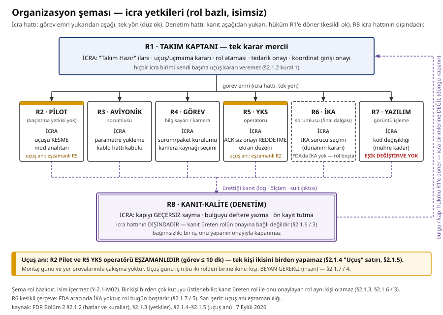

# Bölüm 2. Organizasyonel Yapı ve Proje Takvimi (5 PUAN)

> **Yönerge (birebir):** *"Programın kurumsal işleyişini ve uygulama evrelerini
> netleştirmek adına bu bölümde; rollerin tanımlandığı organizasyonel hiyerarşi ile
> tasarım döngüsünün aşamalarını kapsayan proje takvimi incelenmektedir. Mühendislik
> döngüsünün sistematik bir düzende ilerlemesini sağlayan bu iki temel unsur, aşağıda
> iki müstakil başlık altında ayrıntılı olarak sunulmaktadır."*
> (Kaynak: `results/fdr_sablon/fdr_yonerge_metin.txt`, Bölüm 2 girişi.)

> **Takım:** Navitas Autonomous Systems · **Takım ID:** 997827 · **Başvuru no:** 5329027
> *(Kaynak: `navitas-teknofest/references/ddr_requirements.md` — DDR döneminde yazıldı.
> **DOĞRULANACAK:** KYS kaydıyla teyit edilmeden bu üç alan rapora nihai sayılmaz.)*
>
> **Bu bölümün yazım kuralı.** Aşağıdaki her tarih ve her sayı bir artefakttan gelir;
> satırın sonunda hangi dosyadan ve hangi komutla çıkarıldığı yazılıdır (bölüm sonundaki
> Kanıt dizini). Ölçülmemiş bir şey "ölçülemedi" diye yazılır, tahmin edilmez. Geçmeyen
> bir kapı "geçmedi" diye yazılır (§2.2.5.4). Henüz kapanmamış insan girdileri
> **BEYAN GEREKLİ (insan)** etiketiyle boş bırakılmıştır; doldurulmadan bu bölüm
> tamamlanmış sayılmaz.

> **Numara eşlemesi (eski taslak → bu sürüm).** Bu bölüm, resmî yönergenin iskeletine
> taşınırken yeniden numaralandı. Tablo satırlarının içindeki eski çapraz atıflar
> **kaynağındaki hâliyle bırakılmıştır** (kanıt satırı değiştirilmez, §2.1.6 kural 4);
> karşılıkları şunlardır:
>
> | eski numara | bu sürümdeki karşılığı |
> |---|---|
> | 1 (İki ayrı sistem) | **Bölüm 2 — kapsam notu** |
> | 2.1 / 2.2 / 2.3 | §2.1.3 / §2.1.4 / §2.1.6 |
> | 3.1 / 3.2 / 3.3 | §2.2.2.a / §2.2.3 / §2.2.4 |
> | 4 · 4.1 · 4.2 · 4.3 · 4.4 | §2.2.5 · §2.2.5.1 · §2.2.5.2 · §2.2.5.3 · §2.2.5.4 |
> | 5 (Planlanan takvim) | §2.2.6 |
> | 6 (Takvim riskleri) | §2.2.7 |
> | 7 (Kanıt dizini) | **Kanıt dizini (Bölüm 2)** — bölüm sonu |

---

## Bölüm 2 — kapsam notu: iki ayrı sistem

Şartname bu yarışmada takımdan **iki farklı fiziksel araçla** iş ister ve bunlar aynı araç değildir.
Hem organizasyon (kim neyi icra eder) hem takvim (ne ne zaman yapılır) bu ayrım üzerine kurulur;
rapordaki her takvim satırı hangi araca ait olduğu belirtilerek yazılmıştır.

| | **FDA görev test uçuşu aracı** | **Yarışma (final) aracı** |
|---|---|---|
| Şartname dayanağı | §5.3.2 — *"çoklu rotorlu ve dikey iniş-kalkış yapabilen bir insansız hava aracı (Drone)"* | §6 — *"sabit kanatlı insansız hava aracı (İHA) konfigürasyonunda olması zorunludur"* |
| Konfigürasyon | Quadcopter, 3B baskı gövde | Sabit kanat + mancınık fırlatma + paraşütle iniş + İKA |
| Görev | 20×20 m simüle alanda ≥ 30 m irtifadan açık güzergâh tespiti, YKS'ye canlı aktarım, ≤ 10 dk | Tam görev zinciri (fırlatma → tespit → aktarım → paraşüt → İKA → hedef bölge) |
| Bu raporda durumu | Gövde basıldı ve monte edildi; aviyonik montajı **5 Eylül 2026**'da yapılacak | **Üretilmedi.** Tasarım DDR'de sunuldu; üretim dalgası 21 Eylül sonrası (bkz. Bölüm 5 §5.2.10) |
| Ağırlık limiti | — (§5.3.2 limit koymuyor) | İHA ≤ 25 kg (yükler dâhil), İKA ≤ 10 kg (yük hariç) — §6 |

⚠ **Bu ayrım raporun her yerinde korunur.** FDA uçuşunda paraşüt ve İKA **yoktur**; yer kontrol
istasyonu yazılımı bunun için ayrı bir görev kipiyle (`--fda`) çalıştırılır ve o kipte paraşüt
ile İKA düğmeleri fiilen kapalıdır (sözleşme: `CONTRACTS.md` §6.7, karar kaydı `REVIEW_LOG.md`
D-408, 2026-09-02).

---

## Bölüm 2.1. Organizasyonel Yapı

> **Yönerge (birebir):** *"Takımın güncel organizasyonel yapılanması ve üyelerin/birimlerin
> icra yetkileri bu bölümde şematize edilmelidir. Raporun objektif değerlendirme kriterleri
> uyarınca, üyelerin kişisel verilerinden (isim, görsel vb.) arındırılmış, tamamen rol bazlı
> ve profesyonel bir anlatım tercih edilmelidir."*

### 2.1.1 Kişisel veriden arındırma — `Y-2.1-M02` (karşılanmıştır)

Bu bölümde **ad-soyad, fotoğraf ve kişiye bağlanabilir hiçbir veri yoktur ve olmayacaktır.**
Yapı tamamen **rol kodları (R1…R8)** üzerinden tanımlıdır.

Bu, doldurulmayı bekleyen bir boşluk **değildir**: yönerge isim istemediği gibi açıkça
*"üyelerin kişisel verilerinden (isim, görsel vb.) arındırılmış, tamamen rol bazlı"* bir anlatım
şart koşar. Dolayısıyla **rol bazlı anlatım, gereksinimin karşılanmış hâlidir**; isim eklemek
gereksinimi kapatmaz, **ihlal eder**.

⚠ Raporun önceki sürümünde "rol → isim ataması" bir insan beyanı borcu olarak işaretliydi.
Bu **yanlış okumaydı** ve yönerge okunduktan sonra kaldırılmıştır (dayanak: `REVIEW_LOG.md`
D-417 — *"resmî FDR yönergesi okundu: rapor yanlış iskeletteydi ve isim yasağını bilmiyorduk"*).
Rol → kişi eşlemesi takım içi bir kayıttır ve **rapora girmez**; bu yüzden §2.1.7'deki açık
kalem listesinde de yer almaz.

Kapsam sınırı: takımın **üye sayısı** ve **öğrenim düzeyi oranı** şartname §4 kontenjan
kuralıyla ilgilidir, kişisel veri değildir; o iki sayı §2.1.7'de açık kalem olarak durur.

### 2.1.2 Organizasyon şeması — icra yetkileri (`Y-2.1-M01`)

Şema iki hattı ayırır: **icra hattı** (görev emri yukarıdan aşağı akar) ve **denetim hattı**
(kanıt aşağıdan yukarı akar, hüküm kaptana döner). R8 bilerek icra hattının **dışındadır**.



*Şema rol bazlıdır, isim içermez (Y-2.1-M02). `sekiller/organizasyon.svg`, 7 Eylül 2026; kutular §2.1.3
tablosundan (rol kodu + rol adı + icra yetkisi), hatlar ve kurallar §2.1.2'den, R2/R5 uçuş anı
eşzamanlılığı §2.1.4–§2.1.5'ten (sarı şerit + not kutusu). Düz ok icra hattı, kesikli ok denetim hattı;
R8'in hükmü R1'e döner. Nöbetçi: `tests/test_gece_sekiller.py` (isim taraması, R1–R8 tamlığı,
eşzamanlılık notu). Aşağıdaki metin şeması aynı içeriğin düz-metin karşılığıdır ve korunur.*

```text
                      ┌───────────────────────────────────────────────┐
                      │             R1 · TAKIM KAPTANI                │
                      │  İCRA YETKİSİ: "Takım Hazır" ilanı · uçuş/    │
                      │  uçmama kararı · rol ataması · tedarik onayı  │
                      │  · koordinat girişi onayı                     │
                      └──────────────────────┬────────────────────────┘
                                             │  görev emri  ──►  (icra hattı: tek yön)
       ┌──────────────┬──────────────┬───────┴──────┬──────────────┬──────────────┐
       ▼              ▼              ▼              ▼              ▼              ▼
 ┌────────────┐ ┌────────────┐ ┌────────────┐ ┌────────────┐ ┌────────────┐ ┌────────────┐
 │ R2  PİLOT  │ │ R3 AVİYONİK│ │ R4 GÖREV   │ │ R5   YKS   │ │ R6   İKA   │ │ R7 YAZILIM │
 │            │ │            │ │ BİLGİSAYARI│ │ OPERATÖRÜ  │ │ (final     │ │ /GÖRÜNTÜ   │
 │ İCRA:      │ │ İCRA:      │ │ İCRA:      │ │ İCRA:      │ │  dalgası)  │ │ İCRA:      │
 │ uçuşu      │ │ parametre  │ │ sürüm ve   │ │ ACK'siz    │ │ İCRA:      │ │ kod değ.   │
 │ KESME      │ │ yükleme ·  │ │ paket      │ │ onayı      │ │ İKA sürücü │ │ (mühre     │
 │ mod anaht. │ │ kablo hattı│ │ kurulumu · │ │ REDDETME · │ │ seçimi     │ │  kadar)    │
 │            │ │ kabulü     │ │ kamera     │ │ ekran      │ │            │ │ EŞİK DEĞ.  │
 │            │ │            │ │ kaynağı    │ │ düzeni     │ │            │ │ YETKİSİ YOK│
 └─────┬──────┘ └─────┬──────┘ └─────┬──────┘ └─────┬──────┘ └─────┬──────┘ └─────┬──────┘
       │              │              │              │              │              │
       └──────────────┴──────────────┴───────┬──────┴──────────────┴──────────────┘
                                             │  ürettiği kanıt (log · ölçüm · suit çıktısı)
                      ╔══════════════════════╦════════════════════════╗
                      ║          R8 · KANIT-KALİTE (DENETİM)          ║
                      ║  İCRA YETKİSİ: kapıyı GEÇERSİZ sayma ·        ║
                      ║  bulguyu deftere yazma · ön kayıt tutma       ║
                      ║                                               ║
                      ║  ! İCRA HATTININ DIŞINDADIR: kanıt üreten     ║
                      ║    rolün onayına bağlı DEĞİLDİR (§2.1.6 / 3)  ║
                      ╚══════════════════════╩════════════════════════╝
                                             │
                                             └──►  bulgu / kapı hükmü R1'e döner
                                                   (icra birimlerine DEĞİL) — döngü kapanır
```

**Şemanın okunuşu — üç bağlayıcı kural:**

1. **Tek karar mercii.** Uçuş/uçmama, "Takım Hazır" ilanı ve tedarik onayı yalnız R1'dedir.
   Hiçbir icra birimi kendi başına uçuş kararı veremez. R2'nin yetkisi **uçuşu kesmedir**
   (tek yönlü emniyet yetkisi), başlatma değil.
2. **Yetki devri karar devri değildir.** R7 kod değiştirebilir; **eşik değiştiremez** —
   eşikler ön kayıtta donmuştur (§2.1.6 / 1) ve `CONTRACTS.md` §12 sonraki terfileri bağlar.
3. **Denetim ayrı hattadır.** R8 icra emri almaz; kanıtı çürütür ve hükmü R1'e verir.
   Bu ayrım uygulanmıştır: `REVIEW_LOG.md` D-405 ve D-407 çürütme turları, kanıtı üreten
   rolün onayına bakılmadan kapatılmıştır.

⚠ Şema **rolleri** gösterir, kişileri değil. Bir kişi birden çok kutuyu üstlenebilir; bunun
uçuş anındaki tek ölçülmüş sonucu §2.1.5'te açık kalem olarak durur.

### 2.1.3 Rol tanımları, icra yetkileri ve üretilen kanıt

Şartname §4, takımın **kaptan dâhil en az 6, en fazla 10 kişiden** oluşmasını zorunlu kılar.
Aşağıdaki yapı **rol** üzerinden tanımlıdır; bir kişi birden çok rolü üstlenebilir, ancak
**kanıt üreten rol ile o kanıtı onaylayan rol aynı kişi olamaz** (bağımsızlık kuralı, §2.1.6).

| # | Rol | Sorumluluk | Yetkisi olan kararlar | Ürettiği kanıt |
|---|---|---|---|---|
| R1 | **Takım Kaptanı** | Görev günü tutanağı, saha kararları, kişi ataması, alışveriş/tedarik onayı | "Takım Hazır" ilanı; uçuş/uçmama kararı; koordinat girişi onayı | Saha tutanağı, karar kaydı |
| R2 | **Pilot** | RC kumanda, arm/disarm ön kontrolü, manuel kurtarma (yalnız emniyet) | Uçuşu kesme; mod anahtarı kullanımı | Uçuş logu (`.bin`), hover/loiter kayıtları |
| R3 | **Aviyonik sorumlusu** | Pixhawk 6C + güç dağıtımı + kablolama + kalibrasyon; failsafe/geofence | Parametre yükleme; kablo hattı kabulü | `config/pixhawk/arducopter_fda_20260906.param` (6 Eylül 20:22 dökümü, D-428 §5g; üçüncü döküm bekleniyor) |
| R4 | **Görev bilgisayarı / kamera** | Jetson (Orin Nano Developer Kit 4 GB — D-431) kurulumu, kamera köprüsü, FPS kapısı, model yükleme | Sürüm/paket kurulumu; kamera kaynağı seçimi | `jetson_fps.py` çıktısı, `jetson_baslat.sh --kapi` çıktısı |
| R5 | **YKS operatörü** | Yer kontrol istasyonu, hakem ekranı, aktarım/ACK, kronometreler | Ekran düzeni; ACK'siz onayı reddetme | `hakem_log`, YKS ekran kaydı |
| R6 | **İKA sorumlusu** | İKA hattı (final dalgası); sürücü entegrasyonu, yük ve temas | İKA sürücü seçimi (donanım kararı) | `scripts/ika_surucu_kabul.py` kabul turu çıktısı |
| R7 | **Yazılım / görüntü işleme** | Algı zinciri, rota kararı, sözleşmeler, testler | Kod değişikliği (mühre kadar); eşik **değiştirme yetkisi YOKTUR** | `tests/` suit çıktısı, `REVIEW_LOG.md` D-kayıtları |
| R8 | **Kanıt-kalite (denetim)** | Bağımsız çürütme turu; ön kayıt tutma; kapı denetimi | Bulguyu deftere yazma; kapıyı geçersiz sayma | `REVIEW_LOG.md` çürütücü kayıtları |

Bugün itibarıyla kullanıcı beyanıyla atanmış roller: **R2 Pilot** ve **R5 YKS
operatörü** (`SAHA_HAZIRLIK_PLANI_20260903.md` §3 ve §1.8; beyan 3 Eylül 2026).
R5 rolünün üstlenilmesi ve PC'de uçtan uca koşturulması `REVIEW_LOG.md` D-414'te
ölçümüyle kayıtlıdır (ekran görüntüsü: `results/yks_kurulum/yks_acilis_20260903.png`).

### 2.1.4 Saha günü rol dağılımı (5 Eylül montaj günü ve 21 Eylül prova günü)

| an | R1 Kaptan | R2 Pilot | R3 Aviyonik | R4 Jetson/kamera | R5 YKS |
|---|---|---|---|---|---|
| Kutu/envanter | tutanak, eksik listesi | — | tartı + fotoğraf | — | — |
| Mekanik + kablolama | denetim | yapılandırmada | **yürütür** | kamera/Jetson yerleşimi | — |
| Pixhawk yapılandırma | tutanak | radyo kalibrasyonu | **yürütür** | — | HEARTBEAT teyidi |
| Jetson kurulumu | — | — | UART hattı | **yürütür** | — |
| Yer zinciri | kronometre | — | — | uçlar | **yürütür** |
| Uçuş | "Takım Hazır" | kumanda | pil/CG | canlı izleme | hakem ekranı |

Kaynak: `SAHA_HAZIRLIK_PLANI_20260903.md` §2 (montaj günü tablosu) ve §6 (21 Eylül akışı).

### 2.1.5 🔴 Ölçülmüş rol çakışması — R2 Pilot + R5 YKS operatörü

**Bu iki rol uçuş anında ÇAKIŞIR ve çakışma bilerek kayda geçirilmiştir.**
§2.1.4 tablosunun "Uçuş" satırında R2 kumandayı tutar (gözü araçta), R5 hakem
ekranını sürer (gözü ekranda, hakemle birlikte onay basar). Görev ≤ 10 dk
boyunca ikisi **eşzamanlıdır**; tek kişi ikisini birden yapamaz. Montaj günü
(5 Eylül) ve yer provalarında çakışma yoktur — orada aynı kişi ikisini de
yürütebilir. **BEYAN GEREKLİ (insan): uçuş günü için bu iki rolden birine
ikinci bir kişi atanacaktır.**

Dayanak: `SAHA_HAZIRLIK_PLANI_20260903.md` §3 uyarı kutusu (3 Eylül beyanı) ve
`REVIEW_LOG.md` D-414 ("çakışma kayda geçirildi … uçuş günü için ikinci kişi **açık kalemdir**").

### 2.1.6 Karar ve kanıt yordamı — icra yetkisinin sınırı

Bu projenin organizasyonu, kim ne yapar tablosundan ibaret değildir; **bir işin bittiğine kimin,
neye bakarak karar verdiğini** de tanımlar. Dört kural bağlayıcıdır:

1. **Ön kayıt.** Bir ölçümün eşiği, sonuç görülmeden yazılır ve sonradan gevşetilmez
   (`REVIEW_LOG.md` D-107). Bu kural somut iş görmüştür: 2026-09-01'de umut verici bir ara
   sonuç, önceden yazılmış bir RED kuralıyla karşılaşıp reddedilmiştir (D-377).
2. **ÖLÇÜLEMEDİ ≠ GEÇTİ.** Ölçülemeyen şey geçmiş sayılmaz; paydası olmayan oran rapora girmez.
3. **Bağımsızlık.** Bir iş, onu yapanın onayıyla kapanmaz. Kod yazan rol kendi kodunun kapısını
   onaylayamaz; ayrı bir çürütme turu koşulur (`AGENTS.md` §8; uygulanmış örnekler: D-405, D-407).
4. **Kanıt silinmez.** Yanlış çıkan iddia defterden çıkarılmaz; üstü çizilip düzeltmesine işaret
   verilir (D-373). Bu bölümdeki §4.4 bu kuralın uygulanmasıdır.
   *(Numara eşlemesi: bölüm yönerge iskeletine taşınırken eski **§4.4** başlığı **§2.2.5.4**
   olmuştur; aynı kuralın ikinci uygulaması **§2.2.2.b**'dir. Eski numaralar, çapraz atıfları
   bozmamak için satırlarda olduğu gibi bırakılmıştır.)*

Kanıt defteri: `REVIEW_LOG.md` — bugün itibarıyla **420 kayıt başlığı / 414 benzersiz kayıt no**
(ölçüm: `grep -cE "^### D-[0-9]+" REVIEW_LOG.md` → 420; `... | sort -u | wc -l` → 414; 2026-09-03).

🔴 **Aynı defterin üç okuması birbirini tutmuyor — üçü de silinmedi (kural 4).**

| okuma | başlık | benzersiz | tarih / saat | nerede yazılı |
|---|---|---|---|---|
| A | 414 | 408 | 2026-09-03 (saat kayıtlı değil) | Kanıt dizini satır 11 |
| B | 420 | 414 | 2026-09-03 (saat kayıtlı değil) | hemen yukarıdaki paragraf |
| C | **424** | **418** | **2026-09-04 00:06** | bu satır — yeniden ölçüm |

Ölçüm komutları (C okuması): `grep -cE "^### D-[0-9]+" REVIEW_LOG.md` → 424;
`grep -oE "^### D-[0-9]+" REVIEW_LOG.md | sort -u | wc -l` → 418.
Defter gün içinde büyüdüğü için A ve B aynı günün farklı anları olabilir, ama
**ÖLÇÜLEMEDİ: A ve B okumalarının hangi saatte alındığı kayıtlı değil**, bu yüzden hangisinin
o an doğru olduğu belirlenemiyor. Kapanışı: ölçüm satırlarına saat damgası eklenmesi.

### 2.1.7 Bölüm 2.1'in açık kalemleri

1. **BEYAN GEREKLİ (insan): takım üye sayısı ve şartname §4 oran kontrolü** (kaptan dâhil 6–10 kişi;
   lisansüstü üye oranının şartname sınırını aşmadığı). Bu bir sayı beyanıdır, kişisel veri değildir.
2. **BEYAN GEREKLİ (insan): danışman öğretim üyesi** bilgisi (unvan/kurum düzeyinde, isimsiz).
3. **BEYAN GEREKLİ (insan): takım künyesinin KYS teyidi** (ID 997827 / başvuru 5329027).
4. **BEYAN GEREKLİ (insan): uçuş günü için R2/R5 çakışmasının çözümü** — bu iki rolden birine
   ikinci bir kişi (§2.1.5).
5. **BEYAN GEREKLİ (insan): R6 İKA rolünün final dalgasında kime/hangi birime verileceği** —
   FDA aracında İKA yoktur, rol bugün boştadır.

---

## Bölüm 2.2. Proje Takvimi

> **Yönerge (birebir):** *"Bu bölüm kapsamında daha önce Detay Değerlendirme Raporu'nda
> hazırlanmış olan proje takviminde yer alan termin planına uygunluk teyit edilmeli, iş
> takvimine eklenen yeni iş akışları mevcut ise planlama analitik bir yaklaşımla yeniden
> değerlendirilerek güncellenmelidir."*

Bu başlık üç soruya sırayla cevap verir:
**(1)** DDR termin planı tutuyor mu (§2.2.1) · **(2)** gerçekte ne oldu (§2.2.2–2.2.4) ·
**(3)** takvime hangi yeni iş akışları girdi ve plan buna göre nasıl güncellendi (§2.2.5–2.2.9).

### 2.2.1 DDR termin planına uygunluk teyidi (`Y-2.2-M01`)

DDR döneminin termin planı depoda `navitas-teknofest/references/ddr_requirements.md` içindedir
ve **"Kritik Takvim" başlığı altında üç tarihten ibarettir** (satır 3–6). Aynı dosyanın
"DDR Gap Analizi" bölümü, DDR'ye taşınacak kalemler arasında *"Organizasyon şeması"* (satır 90),
*"Proje takvimi (güncelleme gerekli)"* (satır 91) ve *"Planlanan test takvimi"* (satır 124)
satırlarını taşır. Aşağıdaki tablo bu beş kalemin bugünkü durumudur.

| # | DDR termin planı kalemi (kaynak satır) | DDR'de yazılı | Bugünkü gerçekleşme | Durum |
|---|---|---|---|---|
| 1 | **DDR Son Teslim** (`ddr_requirements.md:4`) | 15 Temmuz 2026 | Depoda ölçülen: DDR belgesinin son iz bırakan sürümü **v4.3**, 2026-07-12 (`f4d1583`); belge 2026-07-12'de depo dışına alındı (`38798f2` — *"DDR dokümanları repoda taşınmıyor"*). 15.07.2026'da iki teknik commit var (`cb10e0e`, `bcfab0f`) | **ÖLÇÜLEMEDİ: teslimin 15.07'de yapıldığı depodan görülemez** (belge repoda tutulmuyor); kapanışı KYS teslim kaydıdır → **BEYAN GEREKLİ (insan): DDR teslim tarihi/saati teyidi** |
| 2 | **DDR Sonuçları** (`ddr_requirements.md:5`) | 29 Temmuz 2026 | Şartname resmî tarihi ile birebir aynı (`results/sartname_bosluk/sartname_metin.txt` s.11). Depoda sonuç/puan artefaktı yok | **BEYAN GEREKLİ (insan): DDR sonuç bildirimi ve alınan puan** |
| 3 | **FDR** (`ddr_requirements.md:6`) | 21 Eylül 2026 | Şartname s.11 ile birebir aynı (**21.09.2026 – 17.00**). Takım planı bu tarihe kilitli (§2.2.8) ve tarih artık **kapı testiyle** korunuyor: `tests/test_fdr_takvim_kapisi.py` **4 test, 4/4 OK** (koşum 2026-09-04) | **UYGUN — termin planı tutuyor** |
| 4 | *"Proje takvimi (güncelleme gerekli)"* (`:91`) | DDR'de güncelleme borcu olarak işaretlenmiş | Güncellendi: §2.2.2 (ölçülmüş gerçekleşme), §2.2.5 (yeni iş akışları), §2.2.8 (3 → 30 Eylül planı) | **KAPANDI** |
| 5 | *"Organizasyon şeması"* (`:90`) | DDR'de ÖDR'den taşınacak kalem | §2.1.2'de **isimsiz, rol bazlı** olarak yeniden üretildi (`Y-2.1-M02`) | **KAPANDI** |
| 6 | *"Planlanan test takvimi"* (`:124`) | DDR'de "yeni gerekli" kalem | §2.2.8 satır satır kapılıdır; test içeriği Bölüm 4'tedir | **KISMEN** — saha testleri 5–19 Eylül'de koşulacak |

⚠ **Kapsam uyarısı — abartılmıyor.** Depodaki DDR referans dosyasının termin planı **üç tarihtir**;
iş paketi kırılımı, Gantt çizelgesi veya kaynak atama tablosu **depoda yoktur**.
**ÖLÇÜLEMEDİ: DDR'nin rapora giren tam termin çizelgesi** — kapanışı, DDR belgesinin (depo dışı
yerel yedek) ilgili sayfasının rapora alınmasıdır; **BEYAN GEREKLİ (insan): DDR proje takvimi
sayfası**. Bu belge gelene kadar yukarıdaki tablo, termin uygunluğunun **depodan görülebilen**
kısmıdır.

### 2.2.2 Gerçekleşen proje takvimi — depo geçmişinden ölçüldü

Aşağıdaki tablo tahmin değildir: `O:\navitas` git deposunun tamamı taranarak
`git log --date=short --pretty=format:"%ad|%h|%s"` ile çıkarılmıştır. Depoda **551 commit** (3 Eylül 2026 gecesi)
vardır; ilk commit **2026-05-06** (`17258f8`, "start project").

#### 2.2.2.a Faaliyet yoğunluğu — gün başına commit (ölçüm, 2026-09-03)

| ay | commit'li gün | toplam commit | en yoğun gün |
|---|---|---|---|
| Mayıs 2026 | 3 | 4 | 07.05 (2) |
| Haziran 2026 | 2 | 4 | 24.06 (3) |
| Temmuz 2026 | 5 | 27 | 11.07 (16) |
| Ağustos 2026 | 27 | 425 | 26.08 (**89**) |
| Eylül 2026 (1–2) | 2 | 93 | 02.09 (**72**) |

Ölçüm komutu: `git log --date=short --pretty=format:"%ad|%s" | awk -F'|' '{print $1}' | sort | uniq -c`.
Yorum: proje ağırlığı Ağustos'ta yoğunlaşmıştır; bu, DDR sonrası (29.07) açılan doğrulama
borçlarının kapatıldığı dönemdir ve §2.2.5'teki revizyonların çoğu bu pencerede alınmıştır.

#### 2.2.2.b 🔴 Yeniden ölçüm (2026-09-04 00:05) — bir satır yeniden üretilemedi

Yukarıdaki tablo **silinmemiştir** (§2.1.6 kural 4). Aynı komut bugün yeniden koşuldu:

| ay | commit'li gün | toplam commit | en yoğun gün | 2026-09-03 okumasıyla farkı |
|---|---|---|---|---|
| Mayıs 2026 | 3 | 4 | 07.05 (2) | aynı |
| Haziran 2026 | 2 | 4 | 24.06 (3) | aynı |
| Temmuz 2026 | 5 | 27 | 11.07 (16) | aynı |
| Ağustos 2026 | **26** | **418** | 26.08 (**89**) | 🔴 **tutmuyor** (27 gün / 425 idi) |
| Eylül 2026 (1–3) | 3 | 107 | 02.09 (**72**) | büyüme (yeni gün eklendi) |
| **Toplam (HEAD)** | 39 | **560** | — | 551 → 560 (büyüme) |

Ek ölçüm: `git log --all --oneline | wc -l` → **607** (tüm dallar dâhil; Ağustos 465).

**İç tutarsızlık, gizlenmeden yazılır.** 2026-09-03 tablosunun ay toplamları
4 + 4 + 27 + 425 + 93 = **553** eder, ama aynı paragrafta toplam **551** yazılıdır; iki sayı
kendi içinde de uyuşmuyor. Bugünkü ölçümde toplam ile ayların toplamı birebir tutuyor
(4 + 4 + 27 + 418 + 107 = 560 = `git log --oneline | wc -l`).
**ÖLÇÜLEMEDİ: 2026-09-03'teki 425 / 551 sayılarının nasıl üretildiği** — ne HEAD (418) ne de
`--all` (465) okumasıyla yeniden üretilebiliyor. Doğru sayılması gereken, yeniden üretilebilen
okumadır (**560 / Ağustos 418**); eski okuma kayıt olarak yerinde bırakılmıştır.

### 2.2.3 Kilometre taşları

| tarih | kilometre taşı | kanıt |
|---|---|---|
| 2026-05-06 | Depo açıldı | `17258f8` "start project" |
| 2026-06-24 | **Model v2** — RescueNet + FloodNet, 100 epoch (Colab) | `594e1b0` |
| 2026-07-11 | Haberleşme çekirdeği: İHA→İKA/YKS açık yol aktarımı (UDP/seri, ACK+seq, heartbeat failsafe) | `d2227ef` |
| 2026-07-11 | Dürüst simülasyon zinciri (tarama → ortomozaik → model → rota → İKA) + hakem logu | `516041b` |
| 2026-07-12 | **Model v3** (yolov8s-seg): mask mAP50 **0,627**; `blocked` 0,322 → 0,403 | `4b386ce`, `results/v3_test_20260712` |
| **2026-07-15** | **DDR son teslim tarihi (şartname)** | şartname s.11 takvim tablosu |
| 2026-07-15 | Model v4 (imgsz 512 → 640; v3 reçetesi birebir) | git log 15.07 |
| **2026-07-29** | **DDR sonuçlarının açıklanması (şartname)** | şartname s.11 |
| 2026-08-05 | Jetson saha paketi ilk hâli; v17 / v20 paket modelleri | `jetson_paket/models/` dosya damgaları |
| 2026-08-13 → 08-19 | v24 → v27 → v30 → v34 model dizisi; kabul kapıları K0–K6 kuruldu | `jetson_paket/models/`, `REVIEW_LOG.md` |
| 2026-08-16 | 🔴 **Kusur ölçüldü:** `seed` eğitimi hiç etkilemiyor — v31, v30'un bit-bit aynısı (D-140); **6,4 saat GPU** karşılıksız harcandı | `REVIEW_LOG.md` D-140, D-252 |
| 2026-08-19 | Saha paketi kayıt defterini taşıyor — kılavuza göre kurulan Jetson model yükleyebiliyor (D-178/D-179) | `results/`, T103 |
| 2026-08-21 | **Model v35** üretime alındı | `jetson_paket/models/navitas_seg_v35_best.pt` |
| **2026-08-26** | **Model v36 üretime alındı — ön kayıtlı iki eşik GEÇİLMEDEN** (§4.4) | D-293, D-294, `results/fdr/GORUNTU_ISLEME_KANIT.md` §3 |
| 2026-08-26 | Üretim karar yolu ilan edildi: `analyze_path` **üretim**, `rota_bul` **tanısal** (D-295, `CONTRACTS.md` §11.2-EK) | D-295 |
| 2026-08-27 | K7 (yayınlanan şerit doğruluğu) kabul zincirine bağlandı; v36 bozulmadan geçti | D-316 |
| 2026-08-28 | **v37 denendi ve GERİ ALINDI**: kabul zinciri geçti, gerçek arena karesi reddetti | D-332 |
| 2026-08-28 | v8 adayı: 124 epoch / **6,19 saat** eğitim → kabul zinciri **RED**; v36 üretimde kaldı | D-331 |
| 2026-09-01 | FDR görüntü işleme kanıt paketi artefakttan üretilir hâle geldi (elle sayı yazımı kaldırıldı) | `scripts/olcum/167_fdr_kanit_paketi.py` |
| 2026-09-01 | Uçtan uca kare gecikmesi ölçüldü: p95 **0,113 s** (D-382/D-383) | `results/fdr/GORUNTU_ISLEME_KANIT.md` §4.1b |
| 2026-09-02 | Faz B araç seti: `iha_komut_alici`, `mavlink_dogrula`, `sik_rf_olc`, `ika_surucu_kabul` | D-403 |
| 2026-09-02 | **MAVLink çoğullayıcı zorunlu kılındı** — seri port tek sahipli, üç tüketici (`CONTRACTS.md` §7.4) | D-403, `FAZ_B_GUN_PLANI.md` §1 |
| 2026-09-02 | Jetson tek komutla kalkar (`jetson_baslat.sh` + 6 systemd birimi); sürüm dondurma mührü | D-404, D-405 |
| 2026-09-02 | Tam test suiti **1827 test** ile kapandı | D-407 §3, `REVIEW_LOG.md`:28298 |
| 2026-09-03 | Cuma öncesi kapı koşumu: genel kapı **15/15 · 15/15**, tam suit **1875 test OK** (skipped 3), kuru koşu **9 GEÇTİ / 1 SAHİPSİZ** (yalnız `motor`) | `results/faz_b_oncesi/cuma_kontrol/cuma_kontrol.txt` |
| 2026-09-03 | Saha belleği üretildi: **405 dosya · 1,27 GB** (`MANIFEST.txt` sha256 + git HEAD) | `scripts/bellek_hazirla.py`, `results/faz_b_oncesi/CUMA_KONTROL_KARTI.md` §A |
| 2026-09-02 | **YKS FDA görev kipi** (`--fda`) — 21 Eylül'de hakem onayını imkânsız kılan kilit kaldırıldı | D-408, `CONTRACTS.md` §6.7 |
| 2026-09-03 | Jetson **Nano 4GB** yığını (14/14 aarch64 çevrimdışı tekerlek), kamera köprüsü, ArduCopter parametre + görev şablonu | D-406, D-407 |
| 2026-09-03 | 🔴 **Takvim kusuru bulundu ve kapıyla kilitlendi:** 21 Eylül FDR **teslim** günüdür, uçuş günü değildir; hata plan/runbook/CONTRACTS/FDR bölümlerine yayılmıştı | D-410, `tests/test_fdr_takvim_kapisi.py` (4 test) |
| 2026-09-03 | **Donanım beyanı değişti:** Nano taşıyıcı kartta microSD yuvası **yok**, M.2 **var** → planın bir adımı geçersiz oldu | D-413, `SAHA_HAZIRLIK_PLANI_20260903.md` §4 |
| 2026-09-03 | **YKS PC kurulumu R5 tarafından üstlenildi ve uçtan uca koşturuldu** (`yks_gui --demo --fda --otokaydet 14 --kapat` → exit 0) | D-414, `results/yks_kurulum/yks_acilis_20260903.png` |

⚠ Tablodaki *(§4.4)* çapraz atfı, bölümün yönerge iskeletine taşınmasından önceki
numaralandırmadandır; bu raporda karşılığı **§2.2.5.4 "Geçmeyen kapı"** başlığıdır. Satır,
kaynağındaki hâliyle korunmuştur.

### 2.2.4 Model sürüm soyağacı (üretim hattı)

| sürüm | paket dosyası damgası | durum | not |
|---|---|---|---|
| v2 | 2026-06-24 (git) | tarihsel | ilk Colab eğitimi |
| v3 / v4 | 2026-07-12 / 07-15 (git) | tarihsel | mask mAP50 0,627 (v3) |
| v17, v20 | 2026-08-05 | tarihsel | saha paketinin ilk modelleri |
| v21 | 2026-08-05 | tarihsel | — |
| v24 | 2026-08-13 | tarihsel | zemin kapısı eşiklerinin kalibre edildiği sürüm (D-283) |
| v27, v30 | 2026-08-14 / 08-15 | tarihsel | v31, v30'un bit-bit kopyası çıktı (D-140) |
| v34 | 2026-08-19 | **yedek aday** | tam sha `config/model_registry.json` `_yedek_surumler` |
| v35 | 2026-08-21 | **yedek aday** | v36'dan farklı hata yapar: arena K3/K4/K6'da daha iyi |
| **v36** | **2026-08-26** | **ÜRETİM** | `navitas-seg-v36-512`, sha256 `1d1caca6…c46911` |
| v37 | 2026-08-28 | **geri alındı** | gerçek arena karesi reddetti (D-332) |
| v8 (gece_v8) | 2026-08-28 | **reddedildi** | kabul zinciri RED (D-331) |

⚠ **DOĞRULANACAK:** v17–v36 satırlarındaki damgalar `jetson_paket/models/` içindeki dosya
değiştirme zamanlarıdır; bunlar **saha paketine kopyalanma** anıdır, eğitimin bittiği an değildir.
Eğitim bitiş zamanları eğitim koşum klasörlerinden ayrıca çıkarılmalıdır.

### 2.2.5 Revizyonlar ve takvime eklenen yeni iş akışları (`Y-2.2-M02`)

Şartname §5.3.1: *"Süreç boyunca meydana gelen bütün revizyonlar FDR kapsamında sunulmalıdır."*
Bu alt başlık o hükmün karşılığıdır **ve aynı zamanda yönergenin 2.2 maddesinin ikinci
yarısıdır**: aşağıdaki revizyonların her biri takvime **yeni bir iş akışı** eklemiştir; §2.2.5.5
bu iş akışlarını planın hangi gününe oturduğuyla birlikte analitik olarak yeniden değerlendirir.
Revizyonlar gizlenmemiş, gerekçeleriyle listelenmiştir.

#### 2.2.5.1 Donanım revizyonları — DDR BOM'u ile bugünkü gerçek künye

DDR aviyonik BOM'u `navitas-teknofest/references/ddr_requirements.md` içindedir (**26 satır**; numaralandırma 1…24, 26, 27 diye gider, **25 atlanmıştır** — DDR metnindeki "27" en büyük numaradır, satır sayısı değil;
beyan edilen toplam **2293 g**). Bugünkü gerçek künye kullanıcı beyanıdır
(`SAHA_HAZIRLIK_PLANI_20260903.md` §0.2, 3 Eylül 2026).

| kalem | DDR BOM (15.07.2026) | **FDR — gerçek (03.09.2026)** | revizyon gerekçesi |
|---|---|---|---|
| Uçuş kontrolcüsü | Pixhawk 6C (BOM) / **Pixhawk 6X** (DDR mimari şeması) | **Pixhawk 6C** + PM02 güç modülü | DDR'nin iki belgesi çelişiyordu (BOM 6C, `avionics_software.md` şeması 6X); gerçek donanım **6C**'dir, çelişki bu raporla kapanır |
| Görev bilgisayarı | Jetson **Orin NX** + carrier + soğutucu (180 g) | ~~**Jetson Nano 4GB** (JetPack 4.6.x, sistem Python 3.6) — 3 Eylül beyanı~~ → **Jetson Orin Nano Developer Kit 4 GB** (JetPack 7.2.1, Ubuntu 24.04, Python 3.12; 3 Eylül beyanı 'Nano 4GB' 6 Eylül'de kartla YANLIŞLANDI — D-431) | Tedarik. 3 Eylül'de sonucu ağır sanıldı (`ultralytics` Py ≥ 3.8 → ayrı Python 3.8 venv + çevrimdışı tekerlek zinciri, Bölüm 5 §5.2.7); 6 Eylül'de kart Python 3.12 ve apt'te TensorRT 10.16 ile geldi, cp38 zinciri kullanılmadı, `~/venv312` + GPU torch 2.11 kuruldu |
| GNSS | Holybro **M10** GPS + pusula (32 g) | **Holybro M9N** | Tedarik |
| Kamera | **Arducam** IMX477 12MP (50 g) | **Raspberry Pi HQ** (IMX477, CSI) + standart lens | Aynı sensör (IMX477), farklı kart. Lens FOV'u **ÖLÇÜLMEDİ** — 5 Eylül'de `kamera_dogrula` ile ölçülecek |
| Güç dağıtımı / sensör | **Mauch PL-100** + Mauch PL 4-6S BEC + ayrı PDB | **Matek XCLASS FCHUB-12S V2** (PDB + akım sensörü) + **PM02** | Tedarik + sadeleştirme; akım ölçümü PM02'ye taşındı (`BATT_MONITOR=4`) |
| RC alıcı | TBS **Crossfire** Nano RX | **FlySky FS-i6** + FS-iA6B (**iBUS**) | Tedarik. Yazılım etkisi: `RC_PROTOCOLS` iBUS'a alındı (parametre dosyası, TEYİT listesinde) |
| Motor | SunnySky X2216 V3 1100KV ×2 (sabit kanat) | ~~**5008 340KV ×4** + 12×10 pervane~~ → **SunnySky X2220 980KV V3 ×4** (BEYAN, etiket fotoğrafı yok) + **10×4,5 (1045)** pervane (7 Eylül beyanı, D-435) (çoklu rotor) | **Araç sınıfı farkı** — FDA aracı çoklu rotordur (§1). 7 Eylül: 5008'ler iade edildi; X2220'ler 2 yıl önce kullanılmış eski motorlar (BEYAN, D-435); itki bütçesi ÖLÇÜLEMEDİ (Bölüm 3 §3.2.1.1.1) |
| ESC | Hobbywing FlyFun 40A V5 ×2 | **80 A DShot destekli ×4** (ilk uçuşlarda PWM 400 Hz) | Araç sınıfı farkı |
| Pil | 4S 14000–15000 mAh Li-ion (1000 g) | **1× 4S 10 Ah 25C**, şarj iMAX B6 (~3 saat dolum) | Tedarik. Operasyonel sonucu: **günde en fazla 2 uçuş** (takvim kısıtı, §5) |
| Paraşüt zinciri (kalem 12–16) | Opale Rescue 2,5 m² + pod + servo + mekanizma + tether | **FDA aracında YOK** | §5.3.2 çoklu rotor uçuşunda paraşüt zorunlu değil; final aracında kalır |
| Servolar (kanat/kuyruk) | EMAX ES08MA II ×4 | **FDA aracında YOK** | Araç sınıfı farkı |
| Pitot + airspeed | Pitot + Holybro MS5525DSO | **FDA aracında YOK** | Çoklu rotorda hava hızı sensörü kullanılmaz |
| Telemetri | Holybro SiK 433 MHz ×2 (uçak + YKS) | **2× SiK 433 MHz** — değişmedi | — |
| Acil güç kesme | Anahtarlı stop + röle | **Anahtar yok — pil fişi çekilir (XT60/XT90)** | 🔴 **DDR gereksinimi** REQ-25…31 — *takımın kendi* gereksinim kimliğidir (`references/ddr_requirements.md:76`); şartname metninde "REQ-" **hiç geçmez** (çift acil güç kesme) FDA aracında **karşılanmıyor**; final aracı için **açık madde** (Bölüm 6'ya taşınır) |
| Gövde | (DDR: sabit kanat yapısal malzeme dağılımı) | **3B baskı quadcopter** (ABS + ABS-CF) | Araç sınıfı farkı; ayrıntı Bölüm 5 |

#### 2.2.5.2 Yazılım ve mimari revizyonları

| konu | DDR'de beyan / plan | **FDR — bugünkü gerçek** | kanıt |
|---|---|---|---|
| Model | YOLOv8-seg **nano**, NCNN, conf > 0,40 (DDR akış şeması) | **YOLOv8m-seg**, `navitas-seg-v36-512`, PyTorch; conf 0,30 | `config/model_registry.json`, `navitas-teknofest/references/avionics_software.md` |
| Hızlandırma | TensorRT `.engine` (Jetson'da derlenir) | ~~**Nano'da ÖLÇÜLEMEDİ** — venv38'de `tensorrt` modülü yok (JetPack 4.6 bağı Py3.6). PT/ONNX ile uçulur~~ **6 Eylül (D-431, Orin Nano, TensorRT 10.16.2):** `.engine` `.pt`'den **derlendi** (57 283 989 B, sha256 `bb9bd868…0300`, deftere yazıldı); FPS engine 1,58/1,33 · pt 1,35/1,06 GEÇTİ; engine↔pt **D-303 oransal 3/126 DÜŞTÜ** → **uçuş `.pt`**, engine üretime alınmadı | `jetson_paket/JETSON_ORIN_NANO_KURULUM.md` §4–§5, §8 |
| Rota karar yolu | tek yol varsayımı | **İki yol ayrıldı:** `analyze_path` üretim, `rota_bul` tanısal | D-295, `CONTRACTS.md` §11.2-EK |
| Pixhawk erişimi | doğrudan seri | 🔴 **Çoğullayıcı zorunlu** — seri port tek sahipli, üç tüketici ayrı UDP ucundan okur | D-403, `CONTRACTS.md` §7.4 |
| Kamera yolu | doğrudan `VideoCapture` | **Kamera köprüsü** (sistem Python + GStreamer `nvarguscamerasrc` → MJPEG/HTTP; 3 Eylül'de 'Python 3.6' sanılıyordu, kartın sistem Python'u 3.12 — 6 Eylül'de köprü sistem Python 3.12 + cv2 4.6 ile **dosya kaynağında açıldı**, CSI kamera bağlı değildi → `nvarguscamerasrc` yolu ÖLÇÜLEMEDİ, D-431) | D-406, `scripts/kamera_koprusu.py`; `results/jetson_20260906/jetson_log_20260906/kamera_koprusu_dosya.log` |
| Hedef Bölge (HB) dedektörü | DDR: üretime bağlanacak | **BAĞLANDI (1 Eylül 2026, D-386)** — kullanıcı renk teyidi + ölçek/şekil çifti kapısıyla; hedef **253/256** doğru pedde, ped örtülüyken **259/260 `HEDEF_YOK`** (fail-closed), karar maliyeti **sıfır**. Ara dönemdeki bağlanmama gerekçesi (gerçek pedde %0 isabet, kırmızı arabada yanlış pozitif) D-295 §2'de durur | D-295 §2 → **D-386** |
| YKS görev kipi | tek kip | **`--fda` kipi eklendi** — paraşüt/İKA kapalı, bütçe tek 10 dk | D-408, `CONTRACTS.md` §6.7 |
| Süre limitleri | belgede | **Sözleşme sabiti**: İHA 900 s, İKA 600 s, FDA operasyon 600 s | `codes/karar_sozlesmesi.py`, D-318 |

#### 2.2.5.3 Şartname resmî takvimi ile takım takvimi

| olay | şartname resmî tarihi | takım planı |
|---|---|---|
| FDR son teslim | 🔴 **14.09.2026 – 17.00** (~~21.09.2026 – 17.00~~) | **TARİH DEĞİŞTİ** — rapor **ve sunum** bu tarihe yetiştirilir. Kaynak: resmî yarışma sayfası, 12 Eylül 2026 okuması: `teknofest.org/tr/yarismalar/ileri-otonom-sistemler-tasarim-ve-operasyon-yarismasi/` → "FDR Son Teslim Tarihi **14.09.2026 - 17.00**"; soru-cevap oturumu D-475 `[10:01]` "14'ünün ertelenme ihtimali maalesef yok" |
| FDA (FDS + Drone ile Görev Test Uçuşu) | **30.09 – 03.10.2026** | **tek atış** — `SAHA_RUNBOOK.md` başlık satırı |
| FDR sonuçları | 04.10.2026 | — |
| SGGS son teslim | 05.02.2027 | Bölüm 7'deki BOM bu sunumun temelidir |
| UHDR son teslim | 16.04.2027 | — |
| Uçuş testleri | 21.05.2027 | — |
| Yarışma | Ağustos–Eylül 2027 | — |

🔴 **Düzeltilen iç tutarsızlık.** `SAHA_HAZIRLIK_PLANI_20260903.md` §0.1, 21 Eylül Adıyaman
uçuşunu *"şartname §5.3.2"* diye etiketler. Bu **yanlıştır ve burada düzeltilir**: şartnamenin
resmî FDA penceresi 30.09–03.10.2026'dır (şartname s.11 takvim tablosu); 21 Eylül'deki Adıyaman
uçuşu takımın **kendi genel provasıdır** ve aynı zamanda FDR teslim günüdür. `SAHA_RUNBOOK.md`
başlık satırı bu doğru okumayı zaten taşır (*"kesin hazır 21 Eylül, tek atış 30 Eylül"*).
Plan belgesindeki etiket kaynağında düzeltilmemiştir (belge kaydı bozulmasın diye); rapor için
geçerli olan bu paragraftır.

**Kusurun ağırlığı ve kapatılışı (D-410).** Bu yalnızca bir etiket hatası değildi: hata
plan, runbook, `CONTRACTS.md` ve FDR bölümlerine **yayılmıştı**; yanlış kalsaydı takım 21 Eylül'e
uçuş hazırlığı yapıp **rapor teslimini kaçırabilirdi** — FDA puanının %85'i rapordur
(`FDA = FDR × 0,85 + test uçuşu × 0,15`). Tekrarı artık bir kapıyla engellenir:

```text
$ python -B -m unittest discover -s tests -p "test_fdr_takvim_kapisi.py" -v
test_T2_hicbir_belge_ucusu_21_eylule_baglamiyor ... ok
test_T3_resmi_takvim_tablosu_belgelerde ... ok
test_T4_ucus_penceresi_kaybolmadi ... ok
test_T1_sartname_iki_tarihi_soyluyor ... ok
----------------------------------------------------------------------
Ran 4 tests in 0.012s
OK
```
(Koşum: 2026-09-04, yorumlayıcı `O:\navitas-local-train\venv\Scripts\python.exe`.)

#### 2.2.5.4 🔴 Geçmeyen kapı — gizlenmez

Üretim modeli **v36**, kendi **ön kayıtlı iki eşiğini geçmeden** terfi etmiştir. Ham kayıt:

```text
ON KAYITLI ESIKLER GECILMEDI: ROTA >= 10 istendi, olculen 8;
MASKE_YOK <= 10 istendi, olculen 16.
GECILEN: FP <= 1 (1) ve YANLIS GUZERGAH = 0 (0).
Terfi bu esikleri GECEREK degil, KULLANICI KARARIYLA yapildi.
ESIKLER DEGISMEDI ve sonraki terfileri baglar.
```

- **Terfi tarihi:** 2026-08-26 · **Karar mercii:** kullanıcı (takım kararı), mimar değil.
- **Gerekçe:** gerçek karede yanlış güzergâh 15/21 → 7/38; engel üstü waypoint 79 → 3.
- **Bedeli açık yazıldı:** K3 0→1, K4 1→4, K6 5→7 (kapı içinde kaldı); kaplama67 0,51→0,42.
- **Eşikler gevşetilmedi** ve sonraki terfileri bağlamaya devam ediyor (`CONTRACTS.md` §12).
- Ayrıca aynı dönemde ölçülen bir karşı kalem: `karar_cevrilmesi` ekseninde v36, v35'ten
  **kötüdür** (14/260 vs 9/260, eşli koşum). Terfi geri alınmamış, ölçüm kayda geçmiştir (D-295 §3).

Bu satır, projenin kanıt yordamının kendi aleyhine de işlediğinin göstergesidir ve raporda
bilerek öne alınmıştır.

#### 2.2.5.5 Yeni iş akışlarının analitik yeniden değerlendirilmesi

Yukarıdaki revizyonların her biri takvime **yeni bir iş kalemi** doğurmuştur. Aşağıdaki tablo,
"hangi revizyon → hangi yeni iş akışı → planın hangi gününe oturdu → kanıtı ne" zincirini kurar.

| # | tetikleyen revizyon | doğan yeni iş akışı | plandaki yeri | kanıt |
|---|---|---|---|---|
| 1 | Jetson Orin NX → ~~**Nano 4GB**~~ **Orin Nano Developer Kit 4 GB** (6 Eylül'de kartla ölçüldü, D-431) | JetPack 4.6.x + ayrı Python 3.8 venv + **çevrimdışı aarch64 tekerlek zinciri** (14/14) hazırlandı → **6 Eylül'de kartla geçersiz**: JetPack 7.2.1 / Python 3.12; kurulum kartta apt + `~/venv312` ile yeniden yapıldı, kapılar geçti | Per 3 Eyl (hazırlık) → Cmt 5 Eyl (kurulum planı) → **Paz 6 Eyl (gerçek kurulum)** | D-406, D-407; `jetson_paket/JETSON_NANO_KURULUM.md` (GEÇERSİZ bandı alacak) → D-431 |
| 2 | Arducam → **RPi HQ (CSI)** | **Kamera köprüsü** (sistem Py3.6 + GStreamer `nvarguscamerasrc` → MJPEG/HTTP) | Per 3 Eyl | D-406, `scripts/kamera_koprusu.py` |
| 3 | Seri porta tek erişim → **üç tüketici** | **MAVLink çoğullayıcı** + doğrulama aracı | Çar 2 – Per 3 Eyl | D-403, `CONTRACTS.md` §7.4, `scripts/mavlink_dogrula.py` |
| 4 | Tek görev kipi → **FDA kipi** | YKS `--fda` kipi; paraşüt/İKA düğmeleri kapalı; tek 10 dk bütçe | Çar 2 Eyl | D-408, `CONTRACTS.md` §6.7, `tests/test_faz_b_yks_fda_kipi.py` |
| 5 | microSD varsayımı → **M.2 / eMMC** (donanım beyanı düzeldi) | "microSD flash" adımı **geçersiz** oldu; yerine Ubuntu'lu host ile yazım | **Cum 4 Eyl satırı yeniden yazıldı** | D-413, `SAHA_HAZIRLIK_PLANI_20260903.md` §4 |
| 6 | 21 Eylül "uçuş günü" sanılıyordu → **FDR teslim günü** | Takvim iddiaları belge belge düzeltildi + **kapı testi** eklendi | 21 Eyl satırı + tüm belgeler | D-410, `tests/test_fdr_takvim_kapisi.py` (4/4, 2026-09-04) |
| 7 | R5 YKS rolü üstlenildi | YKS PC kurulumu + uçtan uca koşum | §1.8 (Cum 4 Eyl) → **3 Eylül'e çekildi** | D-414, `results/yks_kurulum/yks_acilis_20260903.png` |

**Analitik sonuç — 1: plan kaydırılmadı, bir satır yeniden yazıldı.** Yedi yeni iş akışından
altısı 2–3 Eylül penceresine sığdırılmış, ileri tarihli hiçbir satır ertelenmemiştir; yalnız
**5 numaralı kalem** planın bir gününü (Cum 4 Eylül) içerik olarak değiştirmiştir. Kaydırma
gerekmediğinin ölçülmüş göstergesi 3 Eylül kapı koşumudur: genel kapı **15/15 · 15/15**,
tam suit **1875 test OK** (skipped 3), kuru koşu **9 GEÇTİ / 1 SAHİPSİZ**
(`results/faz_b_oncesi/cuma_kontrol/cuma_kontrol.txt`).

**Analitik sonuç — 2: uçuş bütçesi, takvimin bağlayıcı kısıtıdır.** Plan §3'ün gerektirdiği
en az uçuş sayısı, kontrol listesinden sayılabilir: 3.1 ilk hover (1) + 3.2 Loiter/Auto + iniş
kanıtı (1) + 3.3 algı canlı (1) + 3.4 tam prova ×3 (3) + 3.5 sıkı provada tekrar kalkış (≥1)
= **≥ 7 uçuş**. Tek pil ve iMAX B6 (~3 saat dolum) uçuş gününü **≤ 2 uçuşa** kilitlediğine göre
gereken en az uçuş günü **≥ 4**'tür. Plan 6–19 Eylül aralığında **≥ 6 uçuş günü** ayırır
(Paz 6 · 7–11 arasından kaptanın seçeceği ≥ 2 gün · Cmt 12 · Paz 13 · 14–16 sıkı prova).
Pay: **2 gün**. İkinci pil + ≥ 150 W şarj cihazı bu payı büyütür; karar kaptandadır
(`SAHA_HAZIRLIK_PLANI_20260903.md` §4 "Pil kuralı").
⚠ Bu bir hesaptır, tahmin değildir; ama **kaybedilen uçuş günü sayısı öngörülmemiştir** —
hava, arıza ve onarım payı §2.2.7'deki risk tablosunda ayrı durur.

### 2.2.6 Planlanan takvim — 3 → 30 Eylül 2026

Kaynak: `SAHA_HAZIRLIK_PLANI_20260903.md` §4. Her satırın bir **kapısı** vardır; kapı geçilmeden
sonraki güne geçilmiş sayılmaz.

| gün | ne yapılır | rol | kapı |
|---|---|---|---|
| Per 3 Eyl | Jetson Nano yığını, kamera köprüsü, ArduCopter parametre + görev şablonu, çürütücü turu | R7, R8 | suit yeşil; dosyalar depoda ✅ |
| Cum 4 Eyl | microSD'ye JetPack 4.6.x yazımı; tekerlek + paket belleğe; YKS PC; alışveriş; **kargo teslim** | R1, R4, R5 | `results/faz_b_oncesi/` dolu; bellek hazır |
| **Cmt 5 Eyl** | **MONTAJ GÜNÜ** — kutu → mekanik → kablolama → Pixhawk → Nano kurulumu → yer zinciri (pervanesiz) | herkes | `mavlink_dogrula` 3/3; YKS'de HEARTBEAT; FPS ölçüldü |
| Paz 6 Eyl | Pusula kalibrasyonu (dışarıda); **ilk hover**; Loiter/Auto + iniş kanıtı — 2 uçuş | R2, R3, R5 | uçuş logu + `IHA_LANDED` |
| Pzt 7 – Cum 11 | Canlı algı (30 m'de OPEN_ROUTE); ilk tam prova | R2, R4, R5 | 1 tam prova ≤ 10 dk |
| Cmt 12 – Paz 13 | Tam prova ×2 | herkes | toplam 3 temiz prova |
| Pzt 14 – Çar 16 | Sıkı prova: kapalı kutudan başla, kronometre, sıfır müdahale | herkes | 0 müdahale |
| Per 17 Eyl | **Sürüm dondurma (mühür)** — bundan sonra kod değişmez | R7, R1 | künye depoda, `--dogrula` 0 |
| Cum 18 Eyl | "KESİN HAZIR" listesi baştan sona; yedek parça; taşıma kutusu | herkes | tutanak |
| Cmt 19 Eyl | Yedek gün; pil tam şarj | R2, R1 | — |
| Paz 20 Eyl | Adıyaman'a yolculuk; otelde kuru koşu | herkes | — |
| **Pzt 21 Eyl** | **Genel prova uçuşu — Adıyaman** · aynı gün **FDR son teslim (17.00)** | herkes | `results/gorev_20260921/` |
| 22–29 Eyl | Tutanak, düzeltmeler (mühür kapsamı dışında değişiklik yok) | — | — |
| **30.09–03.10** | **FDA — FDS + Drone ile Görev Test Uçuşu (şartname §5.3.2)** | herkes | **tek atış** |

⚠ **"Cum 4 Eyl" satırının güncellenmiş hâli (D-413).** Yukarıdaki satır microSD'ye yazımdan söz
eder; donanım beyanı 3 Eylül'de değişmiştir (taşıyıcı kartta microSD yuvası **yok**, M.2 **var**).
Plan belgesindeki karşılığı üstü çizilerek düzeltilmiştir: *"~~microSD flash~~ → Ubuntu'lu host
ayarla (eMMC boş çıkarsa gerekecek, D-413)"* (`SAHA_HAZIRLIK_PLANI_20260903.md` §4).
Satır kaynağında silinmemiş, düzeltilmiştir (§2.1.6 kural 4).

⚠ **Jetson satırlarının güncellenmiş hâli (D-431).** "Per 3 Eyl — Jetson Nano yığını", "Cum 4 Eyl — microSD'ye JetPack 4.6.x yazımı" ve "Cmt 5 Eyl — Nano kurulumu" satırları 3 Eylül beyanına göre yazılmıştı. 5 Eylül'de Jetson araca takılmadı (D-426 §4); **6 Eylül'de** kart açıldı ve **Jetson Orin Nano Developer Kit 4 GB** (JetPack 7.2.1 kurulu, NVMe kök, Python 3.12) çıktı — imaj yazımı gerekmedi, cp38 tekerlek zinciri kullanılmadı, kurulum kartta yapıldı; genel kapı 15/15 · 15/15 ve FPS kapısı (pt 1,35/1,06 · engine 1,58/1,33 ≥ 0,61) o gün **GEÇTİ** (`results/jetson_20260906/`). Satırlar silinmedi; kapı sütunundaki "FPS ölçüldü" 6 Eylül'e aittir.

**Takvimin ölçülmüş kısıtı:** tek pil ve iMAX B6 (~50 W → ~3 A → ~3 saat dolum) uçuş gününü
**en fazla 2 uçuşa** kilitler. İkinci pil + ≥150 W şarj cihazı prova sayısını ikiye katlar;
karar kaptandadır (`SAHA_HAZIRLIK_PLANI_20260903.md` §4 "Pil kuralı"). Bu kısıtın takvime
etkisinin hesabı §2.2.5.5'tedir.

### 2.2.7 Takvim riskleri ve karşı önlemler (ölçülmüş olanlar)

| risk | neden gerçek | önlem | durumu |
|---|---|---|---|
| **Nano yığını kurulamaz** | ~~v36 YOLOv8m-seg'dir; Nano **CPU**'da 512'de FPS kapısı (**0,61**) düşebilir — ölçülmedi~~ | ~~Çevrimdışı 14/14 aarch64 tekerlek hazır; sıra: CUDA topluluk wheel → ONNX Runtime → CPU torch~~ | ~~açık; 5 Eylül'de ölçülecek. **Eşik gevşetilmez**~~ → **KAPANDI (6 Eylül 2026, D-431; D-462 A9).** Kart beklenenden farklı çıktı (Jetson Orin Nano Developer Kit 4 GB, JetPack 7.2.1, GPU'lu), CPU-yığını riski hiç gerçekleşmedi: `pt` p50/p95 **1,35/1,06 FPS**, `engine` **1,58/1,33 FPS**, eşik **0,61** — **GEÇTİ** (`results/jetson_20260906/jetson_fps_20260906_orin_nano/ozet.json`) |
| **Yanlış güzergâh = 0 puan** | Şartname §5.3.2 mutlak | Histerezis, tek pas tarama, hakem ekranında güven + sebep | kod hazır (D-396) |
| **10 dk aşımı** | Şartname §5.3.2 mutlak | Görev planı kötü-durum bütçesi ~3–3,5 dk (hesaplandı, `config/pixhawk/README.md`) | test ile kilitli |
| **Tek pil** | Ölçülü (10 Ah, iMAX B6) | Günde 2 uçuş planı; 2. pil kararı kaptanda | açık |
| **Gerçek arena görüntüsü yok** | Ölçüm: arena benzeri saha kanıtı **yoktur** (T111/D-198) | Sentetik + gerçek kırsal iki ayrı çerçeve olarak raporlanır; arası tahmin edilmez | **kapanmadı** |
| **Acil güç kesme anahtarı yok** | Kullanıcı beyanı §0.2 | FDA aracında pil fişi; final aracı için tasarım borcu | **açık madde** |

### 2.2.8 Bölüm 2.2'nin açık kalemleri

1. **BEYAN GEREKLİ (insan): DDR teslim tarihi/saati teyidi** — KYS teslim kaydı (§2.2.1 satır 1).
2. **BEYAN GEREKLİ (insan): DDR sonuç bildirimi ve alınan puan** (§2.2.1 satır 2).
3. **BEYAN GEREKLİ (insan): DDR proje takvimi sayfası** — depo dışı yerel yedekten; termin
   çizelgesinin tam hâli olmadan §2.2.1 yalnız üç tarih üzerinden teyit edilebiliyor.
4. **BEYAN GEREKLİ (insan): 5 Eylül kutu açılış teyidi** — §2.2.5.1'deki gerçek künye satırlarının
   her biri fiziksel parça ile karşılaştırılıp imzalanacaktır.
5. **BEYAN GEREKLİ (insan): 21 Eylül Adıyaman uçuş alanı izni** ve alan koordinatları.
6. **ÖLÇÜLEMEDİ: 2026-09-03 tarihli 551 commit / Ağustos 425 okumalarının kaynağı** — bugünkü
   depodan yeniden üretilemiyor (§2.2.2.b); kapanışı, ölçüm satırlarına saat damgası ve komut
   çıktısının dosyaya yazılmasıdır.
7. **ÖLÇÜLEMEDİ: kanıt defteri okumalarının saati** (§2.1.6, A/B okumaları); aynı kapanış.
8. **ÖLÇÜLEMEDİ: Nano'da FPS** (kapı 0,61) — 5 Eylül montaj gününde ölçülecek (§2.2.7).

---

## Kanıt dizini (Bölüm 2)

| # | sayı / iddia | dosya yolu | üreten betik / komut | ölçüm tarihi |
|---|---|---|---|---|
| 1 | 551 commit (3 Eylül gecesi), ilk commit 2026-05-06 `17258f8` | `O:\navitas\.git` | `git log --date=short --pretty=format:"%ad\|%h\|%s"` | 2026-09-03 |
| 2 | Gün başına commit dağılımı (26.08 → 89, 02.09 → 72) | `O:\navitas\.git` | `git log … \| awk -F'\|' '{print $1}' \| sort \| uniq -c` | 2026-09-03 |
| 3 | Model dosyası damgaları v17…v36 | `jetson_paket/models/` | `ls -la jetson_paket/models/` | 2026-09-03 |
| 4 | Üretim modeli künyesi (`navitas-seg-v36-512`, imgsz 512, sha256 `1d1caca6…`) | `config/model_registry.json` → `profiles.competition` | `scripts/olcum/167_fdr_kanit_paketi.py` | 2026-09-01 |
| 5 | v36 ön kayıtlı eşiklerin geçilmediği ham metin (ROTA 8 < 10; MASKE_YOK 16 > 10) | `results/fdr/GORUNTU_ISLEME_KANIT.md` §3 | `scripts/olcum/167_fdr_kanit_paketi.py`; dayanak D-293/D-294 | 2026-08-26 (karar) / 2026-09-01 (paket) |
| 6 | `karar_cevrilmesi` v36 14/260 vs v35 9/260 | `REVIEW_LOG.md` D-295 §3 | eşli koşum, ON_KAYIT §16 | 2026-08-26 |
| 7 | v37 geri alındı; v8 adayı RED (124 epoch / 6,19 saat) | `REVIEW_LOG.md` D-332, D-331 | kabul zinciri `scripts/olcum/65_kabul_denetcisi.py` | 2026-08-28 |
| 8 | v31 = v30 bit-bit aynısı; 6,4 saat GPU karşılıksız | `REVIEW_LOG.md` D-140 (alıntı D-252:19148) | eğitim koşumu kıyası | 2026-08-16 |
| 9 | Uçtan uca kare gecikmesi p95 0,113 s | `results/fdr/GORUNTU_ISLEME_KANIT.md` §4.1b | D-382/D-383 ölçümü, 33 ölçülen gerçek kare (+3 ısınma) | 2026-09-01 |
| 10 | Tam suit 1827 test | `REVIEW_LOG.md`:28298 (D-407 §3) | `python -B -m unittest discover -s tests -q` | 2026-09-02 |
| 10b | Genel kapı 15/15 · 15/15; tam suit 1875 OK (skipped 3); kuru koşu 9 GEÇTİ / 1 SAHİPSİZ | `results/faz_b_oncesi/cuma_kontrol/cuma_kontrol.txt` | `codes/test_rota_sentetik.py`, `unittest discover`, `scripts/saha_kuru_kosu.py` | 2026-09-03 |
| 11 | Kanıt defteri 414 başlık / 408 benzersiz kayıt | `REVIEW_LOG.md` | `grep -cE "^### D-[0-9]+"` ve `\| sort -u \| wc -l` | 2026-09-03 |
| 12 | Şartname resmî takvimi (ÖDR/DDR/FDR/FDA/SGGS/UHDR tarihleri) | `results/sartname_bosluk/sartname_metin.txt` s.11 | PyMuPDF metin çıkarımı (`rapor_uret.py`) | 2026-08-26 |
| 13 | FDR puan tablosu (Tablo 4) ve FDA formülü (FDR×0,85 + uçuş×0,15) | `results/sartname_bosluk/sartname_metin.txt` §5.3.1–5.3.2 | aynı çıkarım | 2026-08-26 |
| 14 | DDR aviyonik BOM'u (**26 satır**, en büyük numara 27, toplam 2293 g) | `navitas-teknofest/references/ddr_requirements.md` | DDR dönemi Excel aktarımı — **DOĞRULANACAK** | 2026-07 (tarih damgası yok) |
| 15 | DDR mimari şemasında "Pixhawk 6X" / "Jetson Orin NX" / "M10" | `navitas-teknofest/references/avionics_software.md` | — | 2026-07 |
| 16 | Gerçek donanım künyesi (Pixhawk 6C, M9N, ~~Nano 4GB~~, FCHUB-12S, 5008 340KV, RPi HQ, 4S 10 Ah) | `SAHA_HAZIRLIK_PLANI_20260903.md` §0.2 | **kullanıcı beyanı**, 3 Eylül 2026 — ~~kutu 5 Eylül'de açılıp teyit edilecek~~ → 5–6 Eylül'de kutu açıldı: Jetson **Orin Nano Developer Kit 4 GB** (beyan yanlışlandı, D-431), ESC Skywalker 60A V2, PM06 (D-426); motor ~~5008 340KV~~ → SunnySky X2220 980KV V3 + 10×4,5 (BEYAN, etiket yok — 7 Eylül, D-435) | 2026-09-03 → 2026-09-07 |
| 17 | Planlanan 3–21 Eylül takvimi | `SAHA_HAZIRLIK_PLANI_20260903.md` §4 | — | 2026-09-03 |
| 18 | FDA görev kipi sözleşmesi (`--fda`) | `CONTRACTS.md` §6.7 · `REVIEW_LOG.md` D-408 | `tests/test_faz_b_yks_fda_kipi.py` (9 test, 4/4 mutant) | 2026-09-02 |
| 19 | MAVLink çoğullayıcı zorunluluğu | `CONTRACTS.md` §7.4 · `FAZ_B_GUN_PLANI.md` §1 | `scripts/mavlink_dogrula.py` | 2026-09-02 |
| 20 | Süre sözleşme sabitleri (900 / 600 / 600 s) | `codes/karar_sozlesmesi.py` · `CONTRACTS.md` §7.1 | `REVIEW_LOG.md` D-318 | 2026-08-27 |
| 21 | DDR termin planı: DDR teslim 15.07.2026 · DDR sonuç 29.07.2026 · FDR 21.09.2026 | `navitas-teknofest/references/ddr_requirements.md:3–6` | doğrudan okuma (`grep -n "Kritik Takvim" -A 6`) | 2026-09-04 |
| 22 | DDR'nin depoya bakan izi: son sürüm v4.3 (`f4d1583`, 12.07) ve belgenin depo dışına alınışı (`38798f2`, 12.07) | `O:\navitas\.git` | `git log --date=short --since=2026-07-10 --until=2026-07-31` | 2026-09-04 |
| 23 | Takvim kapısı **4 test / 4 OK** (21 Eylül = FDR teslim, uçuş değil) | `tests/test_fdr_takvim_kapisi.py` · `REVIEW_LOG.md` D-410 | `python -B -m unittest discover -s tests -p "test_fdr_takvim_kapisi.py" -v` | 2026-09-04 |
| 24 | Depo yeniden ölçümü: **560 commit** (HEAD) · 607 (`--all`) · Ağustos 26 gün / 418 commit | `O:\navitas\.git` | `git log --oneline \| wc -l`; `git log --date=short --pretty=format:"%ad" \| sort \| uniq -c` | 2026-09-04 00:05 |
| 25 | Kanıt defteri yeniden ölçümü: **424 başlık / 418 benzersiz** | `REVIEW_LOG.md` | `grep -cE "^### D-[0-9]+"`; `grep -oE "^### D-[0-9]+" \| sort -u \| wc -l` | 2026-09-04 00:06 |
| 26 | YKS PC kurulumu uçtan uca koştu (exit 0); R5 rolü üstlenildi; R2/R5 çakışması açık kalem | `REVIEW_LOG.md` D-414 · `results/yks_kurulum/yks_acilis_20260903.png` | `yks_gui --demo --fda --otokaydet 14 --kapat` | 2026-09-03 |
| 27 | Donanım beyanı düzeltmesi: Nano taşıyıcıda microSD **yok**, M.2 **var** → plan adımı geçersiz | `REVIEW_LOG.md` D-413 · `SAHA_HAZIRLIK_PLANI_20260903.md` §4 | kullanıcı beyanı + plan düzeltmesi | 2026-09-03 |
| 28 | İsim yasağının bulunuşu ve raporun yönerge iskeletine alınışı | `REVIEW_LOG.md` D-417 · `FDR/YONERGE_HARITASI.md` | resmî yönerge metni `results/fdr_sablon/fdr_yonerge_metin.txt` | 2026-09-03 |
| 29 | Yönergenin Bölüm 2 / 2.1 / 2.2 metni (birebir alıntılar) | `results/fdr_sablon/fdr_yonerge_metin.txt` | pypdf metin çıkarımı | 2026-09-03 |
