# BÖLÜM 3 — GENEL SİSTEM SPESİFİKASYONLARI (40 puan)

> **Şartname dayanağı (§5.3.1):** *"Ayrıca sistemin gerçek görev koşullarında çalışabilir
> olduğunu göstermek amacıyla nihai mekanik, aviyonik ve yazılım mimarisi, alt sistem
> etkileşimleri ile üretim, montaj ve saha kurulum süreçleri ayrıntılı biçimde belirtmelidir."*
> (`results/sartname_bosluk/sartname_metin.txt` satır 693-696)

---

## 3.0 Bu bölümün okunma kuralı

Bu raporda **hiçbir sayı metne elle yazılmamıştır.** Her sayının yanında onu üreten
artefaktın yolu ve betiği durur; bölüm sonundaki **Kanıt dizini** hepsini tek tabloda
listeler. Projede uygulanan dört yazım kuralı bu bölümde de geçerlidir:

| kural | uygulaması |
|---|---|
| **Ölçülmeyen "ölçülemedi"dir** | Ölçülmemiş hiçbir büyüklük "sorun çıkmadı" diye yazılmaz. `ÖLÇÜLEMEDİ ≠ GEÇTİ` bu projede bir slogan değil, kabul denetçisinin kod satırıdır: alt betik çökerse kapı `OLCULEMEDI` döner ve terfiyi **bloklar** (`scripts/olcum/65_kabul_denetcisi.py:456, 608, 636, 664`). |
| **Geçmeyen kapı "geçmedi"dir** | §3.3.4.2.5'te üretim modelinin **ön kayıtlı iki eşiği geçmeden** terfi ettiği açıkça yazılıdır. Gizlenmemiştir; eşikler de gevşetilmemiştir. |
| **Sentetik ölçüm saha başarımı değildir** | §3.3.4.2'deki K0–K7 ölçümlerinin tamamı sentetik arena kümesindedir. Kabul denetçisi bunu her koşumda kendi çıktısına basar. |
| **Emin olunmayan "DOĞRULANACAK"tır** | Kutudan çıkmamış donanımın hiçbir değeri ölçüm gibi sunulmaz; **BEYAN GEREKLİ (insan)** satırı bırakılır (§3.4). |

### 3.0.1 🔴 İKİ AYRI ARAÇ — bu bölümün en kritik kapsam ayrımı

Bu raporda **iki farklı sistem** anlatılır ve karıştırılmaları yorumu bozar:

| | **Yarışma günü aracı** (§2.2) | **Görev test uçuşu aracı** (§5.3.2 · 30 Eylül–3 Ekim; prova 21 Eylül) |
|---|---|---|
| platform | sabit kanat İHA + **mancınık** fırlatma | **çoklu rotor (quadcopter)**, dikey iniş-kalkış |
| iniş | **paraşüt** | motorlu iniş (`NAV_LAND`) |
| ikinci araç | **İKA** (diferansiyel sürüş) zorunlu | **İKA yok** |
| alan | HTAB **50 × 50 m** (şartname s. 239); İHA-UB rota uzunluğu 300 m | **20 × 20 m** simüle test alanı (şartname s. 731 — HTAB ile aynı şey değildir; sentetik arenamız bu 20 × 20 m alanı modeller) |
| irtifa | görev planına göre | **asgari 30 m** |
| süre | İHA 900 s · İKA 600 s | **tüm operasyon 600 s** |
| aktarım hedefi | YKS **ve** İKA | **yalnız YKS** (hakem canlı onaylar) |

Bu ayrım yazılımda da uygulanmıştır: `yks_gui --fda` bayrağı ayrı bir görev kipi kurar
(`CONTRACTS.md` §6.7). Ayrımın nasıl uygulandığı §3.3.4.1.15'tedir.

### 3.0.2 DDR → FDR revizyonu (şartname §5.3.1: *"bütün revizyonlar FDR kapsamında sunulmalıdır"*)

DDR aşamasında beyan edilen aviyonik listesi ile **fiilen tedarik edilen donanım farklıdır**.
Fark gizlenmez; tablo aşağıdadır ve gerekçesi §3.2.1'dedir.

| kalem | DDR beyanı (`navitas-teknofest/references/avionics_software.md`, `ddr_requirements.md`) | **FDR gerçeği** (kullanıcı beyanı 3 Eylül 2026, `SAHA_HAZIRLIK_PLANI_20260903.md` §0.2) |
|---|---|---|
| görev bilgisayarı | Jetson **Orin NX** (16 GB) | ~~**Jetson Nano 4GB** (3 Eylül beyanı)~~ → **Jetson Orin Nano Developer Kit 4 GB** (JetPack 7.2.1, Ubuntu 24.04, Python 3.12; 3 Eylül beyanı 'Nano 4GB' 6 Eylül'de kartla YANLIŞLANDI — D-431) |
| uçuş kontrolcüsü | Pixhawk **6X** | **Pixhawk 6C** + PM02 |
| GNSS | Holybro **M10** | **Holybro M9N** |
| kamera | Arducam IMX477 | **Raspberry Pi HQ (IMX477, CSI)** |
| RC | TBS Crossfire | **FlySky FS-i6 / FS-iA6B (iBUS)** |
| İKA bilgisayarı | Raspberry Pi 5 | **tedarik edilmedi** — İKA hattı finale bırakıldı |
| model | YOLOv8-**seg nano**, NCNN, 640 | **YOLOv8m-seg**, `navitas-seg-v36-512`, PyTorch/ONNX, **512** |

> ⚠ **DOĞRULANACAK:** DDR referans notlarındaki güç/batarya tabloları ("Tüm değerler tahmini")
> FDR donanımına **taşınmamıştır**. FDR'nin güç bütçesi 5 Eylül montajında ölçülecektir (§3.4).

### 3.0.3 Yeniden numaralandırma haritası (3 Eylül taslağı → yönerge iskeleti)

Bu bölüm 3 Eylül 2026 taslağında **kendi** başlık şemasıyla yazılmıştı. FDR yönergesi
(metni `results/fdr_sablon/fdr_yonerge_metin.txt`, iskelet `FDR/YONERGE_HARITASI.md`)
Bölüm 3 için **üç ana** ve on dört alt başlık dayatır: 3.1 Uçuş Bilimleri · 3.2 Yapısal
Tasarım ve Yapısal Analiz · 3.3 Aviyonik & Yazılım. Taşıma yapılmıştır.

**Taşımanın kuralı:** ölçülmüş, artefakta bağlı hiçbir cümle silinmedi; yalnız yeri
değişti. Yönergede karşılığı olmayan ölçülmüş içerik **§3.4 Yönerge dışı ek kanıt**
altında durur. Bölüm sonundaki **Kanıt dizini** tablosu **satır satır** korunmuştur.

| eski taslak | yeni (yönerge) | konu |
|---|---|---|
| 3.1 | §3.3.1.1 | sistem mimarisi — istasyonlar ve mesaj akışı |
| 3.1.1 … 3.1.6 | §3.3.1.1.1 … §3.3.1.1.6 | istasyonlar · mesaj tipleri · ACK · iki kip · alıcı davranışı |
| 3.2 | §3.2.1 | nihai mekanik yapılandırma → İHA yapısal tasarımı |
| 3.2.1 · 3.2.2 · 3.2.3 | §3.2.1.1 · §3.2.1.2 · §3.2.1.3 | görev test aracı · yarışma aracı · ölçülmemiş büyüklükler |
| 3.3 | §3.3.1 | aviyonik mimari |
| 3.3.1 … 3.3.5 | §3.3.1.1.7 … §3.3.1.1.11 | güç/sinyal · çoğullayıcı · SiK hub · akış isteği · FC yapılandırması |
| 3.4 | §3.3.4.1 | yazılım mimarisi → detaylı algoritma akışı |
| 3.4.1 … 3.4.8 | §3.3.4.1.1 … §3.3.4.1.9 | algı zinciri · değişmez kural · çerçeveler · ölçek · geometri · histerezis · yayın · çıplak sayı |
| 3.4.2b | §3.3.4.1.3 | Katman-2 ince bariyer dedektörü |
| 3.4.9 | §3.3.4.2.1 | model künyesi ve kayıt defteri |
| 3.5 | §3.3.4.2.2 | karar zinciri kabul kapıları (giriş) |
| 3.5.1 … 3.5.5 | §3.3.4.2.3 … §3.3.4.2.7 | kapı tablosu · iki ölçüm hattı · geçilmeyen kapı · kapsam sınırı · kapı olmayanlar |
| 3.6 | §3.3.4.1 | emniyet mimarisi → algoritma akışının emniyet kolu |
| 3.6.1 … 3.6.7 | §3.3.4.1.10 … §3.3.4.1.16 | fail-closed · ARM · hakem onayı · İKA kilidi · süreler · FDA kipi · tazelik |
| 3.7 | §3.3.1.1.12 … §3.3.1.1.16 | görev bilgisayarı yığını (~~Jetson Nano 4GB~~ → Orin Nano Developer Kit 4 GB; alt bölümün başında 6 Eylül bandı, D-431) |
| 3.7.1 … 3.7.5 | §3.3.1.1.12 … §3.3.1.1.16 | venv/tekerlek · kamera köprüsü · systemd · FPS kapısı · mühür |
| 3.8 | §3.3.4.3 | haberleşme → haberleşme paket yapısı |
| 3.8.1 … 3.8.4 | §3.3.4.3.1 … §3.3.4.3.4 | çerçeve · ACK tekrar · gecikmeler · ölçülemeyenler |
| 3.9 · 3.9.1 | §3.3.1.3.1 · §3.3.1.3.2 | kuru koşu · kapı özeti (entegrasyon planı) |
| 3.10 | §3.4 | bilinen açıklar → yönerge dışı ek kanıt |
| 3.10.1 … 3.10.3 | §3.4.1 … §3.4.3 | yazılım açıkları · BEYAN GEREKLİ listesi · bölümün iddiası |

Aşağıdaki üç eski başlık **satırı** kanıt atıflarını (`D-403`, `D-404/D-405`,
`D-92/D-93/D-99`) taşıdığı için haritada **birebir** korunmuştur; yeni numaraları
altlarındadır.

```text
### 3.3.2 🔴 MAVLink çoğullayıcı — Jetson'da ZORUNLU (`CONTRACTS.md` §7.4 · D-403)
    yeni → §3.3.1.1.8
### 3.3.3 🔴 SiK hub — NAVITAS-çerçeve seri çoğullayıcı (`CONTRACTS.md` §7.5 · D-404/D-405)
    yeni → §3.3.1.1.9
#### 3.4.2b Katman-2 dedektörü — ince bariyer (T67 · D-92/D-93/D-99)
    yeni → §3.3.4.1.3
```

⚠ Bölüm 6 (`FDR/BOLUM_6_GEREKSINIM_IZLENEBILIRLIGI.md`) "Bölüm 3 §3.5.2" diye atıf
yapar; karşılığı **§3.3.4.2.4**'tür. Bu haritayla düzeltilir; Bölüm 6 bu turda
değiştirilmemiştir.

---

## 3.1 Uçuş Bilimleri - İHA Kavramsal Tasarım Esasları

> **Yönerge notu (birebir):** *"DDR aşamasında sunulan analiz ve hesaplamalara ilişkin
> herhangi bir güncelleme veya revizyon bulunmaması durumunda ise bu bölüm için ilave
> açıklama yapılmasına gerek bulunmamaktadır."*
> (`results/fdr_sablon/fdr_yonerge_metin.txt`, Bölüm 3.1 paragrafı)

**Bu alt bölümün konusu yarışma final aracıdır** — sabit kanat + mancınık + paraşüt.
30 Eylül–3 Ekim'de uçacak **görev test uçuşu aracı çoklu rotordur**; kanadı, kuyruk
takımı ve kontrol yüzeyi **yoktur** (§3.0.1). Bu yüzden 3.1.2–3.1.7 alt başlıkları
çoklu rotor verisiyle **kapatılamaz**; kapatılmaya çalışılırsa iki araç karıştırılmış
olur.

**Bugün depoda uçuş bilimleri hesabına ait artefakt yoktur.** Yapılan arama
(`find . -maxdepth 3 -iname "*.step" -o -iname "*.stp" -o -iname "*.inp" -o -iname "*.odb"
-o -iname "*.rst" -o -iname "*.SLDPRT" -o -iname "*.iges"`) **hiçbir dosya** döndürmedi;
CAD/CFD/FEA çıktısı, kütle-denge tablosu, kararlılık türevi ya da yük zarfı bulunmamaktadır.
Repodaki tek üç boyutlu geometri, görev test uçuşu aracının 3B baskı STL'leridir
(`dronesolid/Drone_Frame_STL.STL`, `Drone_Arm_STL.STL`, `Lower_Drone_Frame_STL.STL`,
`Drone_Legs_STL.STL`, `Drone_Dome_STL.STL`, `GPS_Holder_STL.STL`) — bunlar **quadcopter
parçalarıdır**, sabit kanat aracı değildir.

🔴 **Rol boşluğu (bu raporun kendi bulgusu):** Bölüm 2 §2.1 rol tablosunda R1 Kaptan,
R2 Pilot, R3 Aviyonik, R4 Görev bilgisayarı/kamera, R5 YKS, R6 İKA, R7 Yazılım,
R8 Kanıt-kalite tanımlıdır. **Uçuş bilimleri / yapısal tasarım / CAD rolü tanımlı
değildir.** Bu alt bölüm ölçümle değil **mühendislik işiyle** kapanır; rol ataması
yapılmadan kapanmaz.

⚠ *"DDR'den beri değişiklik yok"* demek **boş bırakmak değildir**: yönerge bunu bir
**beyan** olarak ister ve beyanı ancak DDR'yi hazırlayan taraf verebilir. Aşağıdaki yedi
alt başlığın her birinde bu beyan **eksiktir**.

| kimlik | alt başlık | bugünkü durum | doğrulama yöntemi (yönergenin istediği) |
|---|---|---|---|
| `Y-3.1.1` | Ağırlık & Denge | BEYAN GEREKLİ (final aracı) · ÖLÇÜLEMEDİ (test aracı) | analiz + test (tartı) |
| `Y-3.1.2` | Hava Aracı Boyut Güncellemeleri | BEYAN GEREKLİ | analiz |
| `Y-3.1.3` | Kontrol Yüzeyi Tasarımı Güncellemeleri | BEYAN GEREKLİ | analiz |
| `Y-3.1.4` | Hava Aracı Aerodinamik Karakteristiği | BEYAN GEREKLİ | analiz |
| `Y-3.1.5` | Hava Aracı Kararlılık Karakteristiği | BEYAN GEREKLİ | analiz |
| `Y-3.1.6` | Performans Hesaplamaları | BEYAN GEREKLİ | analiz |
| `Y-3.1.7` | Yük Hesaplamaları | BEYAN GEREKLİ | analiz + test |

### 3.1.1 Ağırlık & Denge

Yönergenin istediği: DDR sonrası kütle dağılımı, ağırlık merkezi konumu, atalet
özellikleri ve hesap sonuçlarındaki değişiklikler, teknik dayanağıyla ve güncellenen
nihai değerlerle.

**BEYAN GEREKLİ (insan):** Yarışma final aracının (sabit kanat) DDR'de sunulan
ağırlık-denge tablosu; FDR'de değişip değişmediği; değiştiyse yeni kütle dağılımı, CG
konumu ve atalet momentleri (Ixx/Iyy/Izz) ile bunların teknik dayanağı. Değişmediyse
"DDR'den beri güncelleme yoktur" beyanı. Üretecek: **rol atanmamış** (yukarıdaki rol
boşluğu).

**ÖLÇÜLEMEDİ:** Görev test uçuşu aracının gerçek kalkış kütlesi ve ağırlık merkezi.
Ölçüm 5 Eylül montajındadır (ölçüt CG ± 1 cm), ayrıntı §3.2.1.3. `ÖLÇÜLEMEDİ ≠ GEÇTİ`.

### 3.1.2 Hava Aracı Boyut Güncellemeleri

Yönergenin istediği: kanat, gövde ve kuyruk takımı geometrilerinde DDR sonrası
güncellemeler, teknik dayanakları ve nihai tasarım değerleri.

**BEYAN GEREKLİ (insan):** Sabit kanat aracın kanat açıklığı, veter, kanat alanı, gövde
uzunluğu ve kuyruk takımı ölçüleri; DDR'ye göre değişiklik listesi ve gerekçesi.
Bu büyüklüklerin hiçbiri bugün repoda yoktur. Üretecek: rol atanmamış.

### 3.1.3 Kontrol Yüzeyi Tasarımı Güncellemeleri

Yönergenin istediği: kontrol yüzeylerinin boyutları, geometrik özellikleri ve tasarım
parametrelerinde DDR sonrası güncellemeler.

**BEYAN GEREKLİ (insan):** Kanatçık / irtifa dümeni / istikamet dümeni yüzey alanları,
veter oranları, maksimum sapma açıları ve servo seçimi; DDR'ye göre değişiklik.
Görev test uçuşu aracında kontrol yüzeyi **yoktur** (çoklu rotor, kontrol motor
devriyledir) — bu başlık yalnız final aracına aittir. Üretecek: rol atanmamış.

### 3.1.4 Hava Aracı Aerodinamik Karakteristiği

Yönergenin istediği: aerodinamik analiz, katsayı ve performans parametrelerinde DDR
sonrası güncellemeler; nihai aerodinamik karakteristik.

**BEYAN GEREKLİ (insan):** C_L–α, C_D–C_L (sürüklenme poları), C_m–α eğrileri ve
kullanılan yöntem (panel yöntemi, CFD, rüzgâr tüneli). Depoda CFD/panel çıktısı
**yoktur** (yukarıdaki dosya araması boş döndü). Üretecek: rol atanmamış.

### 3.1.5 Hava Aracı Kararlılık Karakteristiği

Yönergenin istediği: statik ve dinamik kararlılık karakteristiklerinde DDR sonrası
güncellemeler.

**BEYAN GEREKLİ (insan):** Statik kararlılık (nötr nokta, statik pay), boyuna/yanal
dinamik modlar (kısa periyot, fugoid, Dutch roll, sarmal) ve hesap yöntemi. Depoda
kararlılık türevi **yoktur**. Üretecek: rol atanmamış.

### 3.1.6 Performans Hesaplamaları

Yönergenin istediği: performans analizleri ve hesaplamalarında DDR sonrası güncellemeler;
nihai performans değerleri.

**BEYAN GEREKLİ (insan):** Seyir hızı, çekiş/sürüklenme dengesi, menzil, havada kalış
süresi, tırmanma oranı ve mancınık çıkış hızı gereksinimi. Depoda bu hesapların hiçbiri
yoktur. Üretecek: rol atanmamış.

**⚠ Karıştırma uyarısı:** §3.3.1.1.11'deki **221,5 s** kötü-durum görev süresi bir
**çoklu rotor görev planı hesabıdır** (`WPNAV_SPEED` ve `LAND_SPEED` üzerinden),
sabit kanat performans hesabı **değildir** ve bu başlığa sayılamaz.

### 3.1.7 Yük Hesaplamaları

Yönergenin istediği: yapısal yük hesaplamalarında DDR sonrası güncellemeler; yük
durumları, analiz sonuçları ve nihai yük değerleri.

**BEYAN GEREKLİ (insan):** V-n diyagramı, limit ve nihai yük faktörleri, **mancınık
fırlatma anındaki ivme yükü** (bu yarışmaya özgü ve baskın yük durumudur), paraşüt
açılma şok yükü ve iniş darbesi. Depoda yük zarfı **yoktur**. Üretecek: rol atanmamış.

---

## 3.2 Yapısal Tasarım ve Yapısal Analiz

Yönerge üç platformu **ayrı ayrı** ister: 3.2.1 İHA · 3.2.2 İKA · 3.2.3 Mancınık. Her
birinde gereksinim izlenebilirliği ve **doğrulama yöntemi** (analiz, test, gözle
muayene, benzerlik) tanımlanmalıdır.

> **Yönerge notu (birebir):** *"NOT: İnsansız Kara aracı (DDR 3.2.2) ve Mancınık
> (DDR 3.2.3) alt sistemlerinin hazır alınma koşulları DDR ile aynıdır."*

🔴 **Bu bölümün dürüst özeti:** ölçülmüş yapısal veri **yalnız görev test uçuşu
aracındadır** ve o da **künye seviyesindedir** (§3.2.1.1). Yapısal **analiz** (statik,
burkulma, modal, topoloji optimizasyonu) **hiçbir araç için yapılmamıştır**; depoda
sonlu elemanlar çıktısı yoktur. İKA ve Mancınık için yapısal tasarım da yoktur.

### 3.2.1 İnsansız Hava Aracı (İHA)

Bu başlık altında **iki araç** vardır ve ayrımı §3.0.1'dedir. §3.2.1.1 görev test uçuşu
aracının (çoklu rotor) bugün bilinen künyesidir; §3.2.1.2 yarışma günü aracıdır ve
mekanik verisi yoktur; §3.2.1.3 bugün ölçülmemiş büyüklüklerin listesidir.

#### 3.2.1.1 Görev test uçuşu aracı — 3B baskı quadcopter (§5.3.2; prova 21 Eylül, resmî uçuş 30 Eylül–3 Ekim)

Kaynak: kullanıcı beyanı 3 Eylül 2026, `SAHA_HAZIRLIK_PLANI_20260903.md` §0.2.
**Aviyonik kutusu 3 Eylül itibarıyla açılmamıştır**; künye 5 Eylül montajında kutudan
çıkanla teyit edilecektir.

| kalem | değer | durum |
|---|---|---|
| Gövde | Quadcopter, **3B baskı** (`dronesolid/`: kol, gövde, alt gövde, bacak, dome, GPS tutucu). GPS çubuğu + ayaklar ABS beyaz, kalanı **ABS-CF** siyah | **basıldı ve monte** |
| Motor | ~~**5008 340 KV × 4**~~ → **SunnySky X2220 980KV V3 × 4** (BEYAN — kullanıcı bildirdi, etiket fotoğrafı yok; 7 Eylül beyanı, D-435). 5008'ler iade edildi; X2220'ler 2 yıl önce kullanılmış eski motorlar (BEYAN) | ~~kutuda~~ → araçta takılı; 6 Eylül devrilmeleri (D-429) bu motorlarla (BEYAN, D-435). İtki bütçesi §3.2.1.1.1 — **ÖLÇÜLEMEDİ** |
| Pervane | ~~**12 × 10**~~ → **10 × 4,5 (1045)** (7 Eylül beyanı, D-435) | ~~kutuda~~ → araçta takılı (BEYAN); veri sayfasında 10×4,5 satırı YOK, en yakın resmi ölçüm APC1047 (10×4,7) — §3.2.1.1.1 |
| ESC | **80 A, DShot destekli × 4** — ilk uçuşlarda **PWM 400 Hz** (MAIN 1–4) | kutuda. **7 Eylül notu:** kutudan Hobbywing Skywalker **60A V2** çıktı (D-428 §1, etiket BEYAN); ESC'ler **AUX 1–4**'te (`SERVO9–12` = M4, M2, M1, M3; D-428 §5d, 6 Eylül dökümü); kartta `RC_SPEED` **490** ölçüldü (`config/pixhawk/arducopter_fda_20260906.param` satır 659 — Copter-4.5 varsayılanı, ESC spec 50–432 Hz **dışı**) → şablona `RC_SPEED,400` girdi (D-429 §4; `tests/test_faz_b_pixhawk_sablon.py` P9, 16/16) |
| Güç dağıtımı | **Matek XCLASS FCHUB-12S V2** (PDB + akım sensörü) | kutuda |
| Uçuş kontrolcüsü | **Pixhawk 6C** + **PM02** güç modülü (POWER1, fabrika kalibreli V/I) | kutuda |
| GNSS / pusula | **Holybro M9N**, direk üstü | kutuda |
| RC | **FlySky FS-i6** + FS-iA6B alıcı (**iBUS**) | **bind edilmedi** |
| Telemetri | **2 × SiK 433 MHz** (drone + YKS) | kutuda |
| Görev bilgisayarı | ~~**Jetson Nano 4GB** (JetPack 4.6.x)~~ → **Jetson Orin Nano Developer Kit 4 GB** (JetPack 7.2.1, Ubuntu 24.04, Python 3.12; 3 Eylül beyanı 'Nano 4GB' 6 Eylül'de kartla YANLIŞLANDI — D-431) | **kuruldu 6 Eylül** — genel kapı 15/15 · 15/15, FPS kapısı GEÇTİ; araca takılmadı, Pixhawk/kamera bağlı değil — §3.3.1.1.12 |
| Kamera | **Raspberry Pi HQ (IMX477, CSI)**, standart lens | kutuda |
| Pil / şarj | **1 × 4S 10 Ah 25C** · iMAX B6 (50 W → ~3 A → ~3 saat dolum) | **günde en çok 2 uçuş** |
| Güç kesme | anahtar yok — **pil fişi çekilir** (XT60/XT90) | yordam: pervane en son, pil en son |

~~**Elektriksel kaba hesap (beyan, ölçüm değil):** 4S'te asılı uçuşta yaklaşık 10–12 A/motor, tepe 30+ A/motor. PM02'nin sürekli akım sınırı nedeniyle **sürekli tam gaz yapılmaz**. Bu satır bir **tahmindir**; gerçek akım 5 Eylül'de PM02'nin kendi telemetrisiyle ölçülecektir.~~
**GEÇERSİZ (7 Eylül, D-435):** yukarıdaki tahmin 5008 340KV / 12×10 için yazılmıştı; motor 7 Eylül beyanıyla X2220 980KV V3 + 10×4,5 oldu. Yerine geçen veri sayfası bütçesi §3.2.1.1.1'dedir; gerçek akım hâlâ **ÖLÇÜLEMEDİ**.

**Jetson beslemesi — karar ve gerekçesi:** FCHUB'ın 2 A BEC'i Nano için **yetmez**; ayrı bir
**5 V / 5 A UBEC** FCHUB pil pad'lerinden beslenir, Nano'nun barrel jack'ine (J25) girer ve
**J48 jumper takılır**. Ortak GND zorunludur.

**Pixhawk ↔ Jetson bağlantısı:** `TELEM2` → Nano 40-pin UART (`/dev/ttyTHS1`, pin 8 TX /
pin 10 RX / pin 6 GND, **3,3 V**; 5 V hattı bağlanmaz), MAVLink2 57600.
Yedek: micro-USB → `/dev/ttyACM0`. Tek kablo, USB hub yok.

**Kamera optiği — ölçüm değil, hesap:** RPi HQ'nun standart 6 mm geniş açı lensinde yatay
FOV yaklaşık 55–63°; 30 m irtifada kare genişliği ≈ 31–37 m olur ve **20 × 20 m alan tek
karede sığar**. 16 mm lensle ≈ 12 m olurdu ve sığmazdı. ⚠ Bu bir **hesaptır**; `--fov`
değeri 5 Eylül'de `kamera_dogrula` ile **ölçülecek** ve beyan ölçümle değiştirilecektir.


##### 3.2.1.1.1 İtki bütçesi — 7 Eylül (D-435 · T211)

**Neden var:** 7 Eylül beyanıyla motor künyesi değişti — ~~5008 340KV ×4 / 12×10~~ →
**SunnySky X2220 980KV V3 ×4** (kullanıcı bildirdi; **etiket fotoğrafı yok → BEYAN**) +
**10×4,5 (1045)** pervane + 4S 10 Ah (7 Eylül beyanı, D-435). `REVIEW_LOG.md` D-435'in ilk metni sabahki
belirsiz anımı ("2207 falan") kaydeder; kullanıcı aynı gün modeli **X2220-980KV V3** olarak netleştirdi
(D-435 ek) — geçerli beyan budur; etiket fotoğrafı gelene kadar BEYAN kalır, ÖLÇÜM değildir. 5008'ler iade edildi; X2220'ler **2 yıl önce
kullanılmış eski motorlar** (BEYAN). 6 Eylül devrilmeleri (D-429) bu motorlarla yapıldı (BEYAN).
Depoda o güne kadar **hiç itki bütçesi yoktu** (D-435 ölçüm 2). Aşağıdaki tablo yalnız üretici veri
sayfasına dayanır; **hiçbir satırı ölçüm değildir** ve kütle tartılmadan (T10) kapı kapanamaz.

**Veri sayfası kaynağı:** üretici http://en.rcsunnysky.com/x-fixedwingseries/53.html ("X2220-III / KV980";
aynı satırlar https://sunnyskyusa.com/products/sunnysky-x2220 ve
https://www.buddyrc.com/products/sunnysky-x2220). Künye (veri sayfası): 85 g (kablo dâhil), 3–4S,
**maks. sürekli akım 38 A / 30 s** (süresiz bir sürekli değer yayımlanmamış), maks. sürekli güç 638 W,
önerilen ESC 40 A, iç direnç 51 mΩ, yüksüz 0,7 A/10 V, stator 22 × 20 mm, mil 4,0 mm, 12N14P.
⚠ **10×4,5 (1045) satırı hiçbir resmî/bayi sayfada YOK** — en yakın resmi ölçüm 4S 14,8 V +
**APC1047 (10×4,7)**; aşağıdaki sayılar o satırlardır ve 10×4,5 için **DOĞRULANMADI**. Üreticinin
4S çoklu-rotor önerisi 8–9 inç pervanedir (APC8038/8043/8045/9047); 10 inç yalnız 3S çoklu-rotor ve
4S akrobasi-uçak listesinde geçer (sunnyskyusa.com). Bağımsız (üretici dışı) ölçüm bulunamadı.

| büyüklük | değer | kaynak / etiket |
|---|---|---|
| Kalkış kütlesi (pilli) | **ÖLÇÜLEMEDİ** | T10 — tartı yapılmadı (§3.2.1.3) |
| Motor başına tam gaz itki `T_max` | **2130 g** @ 38,4 A · 568,3 W · 10 476 rpm (yük sıcaklığı "90 ℃ 1 min") | veri sayfası (http://en.rcsunnysky.com/x-fixedwingseries/53.html), 4S 14,8 V + APC1047 (10×4,7); 10×4,5 için DOĞRULANMADI |
| Motor başına tam gaz akımı | **38,4 A** | veri sayfası; sınır 38 A/30 s → tam gazda **SINIRDA/AŞIYOR** (0,4 A marj; sınırın kendisi 30 s'lik değer) |
| Motor sürekli akım sınırı `I_sürekli` | **38 A / 30 s** | veri sayfası (üç kaynakta aynı); süresiz değer yayımlanmamış |
| 4 × `T_max` | **8520 g** | türetilmiş (4 × 2130 g) |
| Hover itki oranı = kütle / (4 × `T_max`) | **ÖLÇÜLEMEDİ** (kütle yok) | ⚠ PWM gaz yüzdesi DEĞİL — itki gazla doğrusal değildir; `MOT_THST_HOVER` (öğrenilmemiş, 0,35 varsayılan — D-434 ölçüm 4) ile karşılaştırma ayrıca yapılır |
| ÖRNEK · 2,0 kg olsaydı | %23,5 · motor başına 500 g → **4,8 A** · 4 motor **19,2 A** | ÖRNEK, ölçüm değil — veri sayfası 500 g satırı |
| ÖRNEK · 2,5 kg olsaydı | %29,3 · motor başına 625 g → **≈6,5 A** · 4 motor **≈26 A** | ÖRNEK — 600 g (6,0 A) ile 700 g (7,9 A) satırları arası doğrusal ara değer |
| ÖRNEK · 3,0 kg olsaydı | %35,2 · motor başına 750 g → **≈8,7 A** · 4 motor **≈35 A** | ÖRNEK — 700 g (7,9 A) ile 800 g (9,4 A) satırları arası doğrusal ara değer |
| ÖRNEK · %50 eşiğine denk kütle | **4260 g** (= 0,5 × 8520 g) | türetilmiş; tartı bunun altında çıkmalı |
| Hover akımı tahmini (motor başına) | **ÖLÇÜLEMEDİ** — ÖRNEK satırlarda 4,8–8,7 A | yalnız motorlar; aviyonik (Jetson/UBEC, SiK, Pixhawk) hariç. Gerçek değer güç modülü telemetrisiyle (PM06 — BEYAN, D-426 §3) ilk hover'da ölçülür |
| ESC (Hobbywing Skywalker 60A V2 — BEYAN, D-428 §1) ↔ motor tam gaz 38,4 A | ESC sınırı motorun üstünde | ESC künyesi BEYAN; veri sayfası önerisi 40 A |
| Pil 4S 10 Ah 25C (BEYAN) → 250 A boşalma ↔ 4 motor tam gaz 4 × 38,4 = 153,6 A | ALTINDA — BEYAN'a bağlı | pil etiketi (C değeri) DOĞRULANMADI |
| **KAPI: hover itki oranı ≤ %50 ∧ `I_hover` ≤ `I_sürekli`** | **ÖLÇÜLEMEDİ** | kütle tartılmadı (T10), akım ölçülmedi. ÖRNEK satırlar 3,0 kg'a kadar eşiklerin altında kalır ama **ÖRNEK ≠ ölçüm**. Bütçe kapanmadan bir sonraki güç verme yok (T211 — TIKAYICI) |

**Logla tutarlılık (ölçüm, D-434/D-435 — tabloyu doğrulamaz, yalnız çelişmediğini söyler):**
P19'da ilk eğilme gaz PWM %45'te başladı (D-434 ölçüm 4); P20'de M1 25 s boyunca 1949'da doygun
kaldı ve duman atan motor M1'di (D-435 ölçüm 3). Tam gaz 38,4 A veri sayfasının 30 s sınırının
üstünde olduğundan 25 s doygunluk dumanı tek başına da açıklar (D-435 ölçüm 3). Eski motorların
hasarlı olup olmadığı `SAHA_OLAY_SONRASI_MUAYENE.md` madde 1–2'deki güçsüz/güçlü muayeneyle ayrılır.

**Kapanış için (İNSAN, madde 9 — T211):** (1) motor etiketi fotoğrafı (X2220 mi, KV980 mi, V3 mü);
(2) pilli tam araç tartısı (T10); (3) ilk hover'da güç modülü telemetrisinden asılı kalma akımı.
Üçü gelmeden bu kapı kapanmaz; bu tabloya ölçüm yazılana kadar her satır ÖLÇÜLEMEDİ ya da ÖRNEK'tir.


#### 3.2.1.2 Yarışma günü aracı (sabit kanat + mancınık + paraşüt + İKA)

**BEYAN GEREKLİ (insan):** Sabit kanat İHA gövdesi, mancınık, paraşüt podu ve İKA şasisinin
nihai mekanik künyesi, kütle dağılımı ve montaj fotoğrafları bu bölüme eklenecektir. Bugün
repoda bu sistemlerin **ölçülmüş** hiçbir mekanik verisi yoktur; DDR'deki BOM tahminidir
(§3.0.2) ve buraya taşınmamıştır.

**Yazılım tarafı hazır ve kilitlidir:** §2.2 yarışma kipi `yks_gui`'nin **varsayılan
kipidir** ve FDA kipi eklenirken **bayt-eş** korunmuştur (regresyon testi:
`tests/test_faz_b_yks_fda_kipi.py` senaryo 2 — yarışma kipinde İKA kanıtsız onay hâlâ
REDDEDİLİR).


#### 3.2.1.3 Bugün ölçülmemiş mekanik büyüklükler

| büyüklük | durum |
|---|---|
| kalkış kütlesi (gerçek tartı) | **ÖLÇÜLEMEDİ** — 5 Eylül §2.1: her parça tartılır ve fotoğraflanır |
| ağırlık merkezi | **ÖLÇÜLEMEDİ** — 5 Eylül §2.2, ölçüt CG ± 1 cm |
| titreşim (`VIBE`) | **ÖLÇÜLEMEDİ** — ölçüt uçuşta `VIBE` < 30 |
| pusula ofseti | **ÖLÇÜLEMEDİ** — ölçüt < 300 |
| itki / asılı kalma akımı | **ÖLÇÜLEMEDİ** — PM02 telemetrisiyle ölçülecek (kutudan PM06 çıktı, D-426 §3); veri sayfası tabanlı bütçe §3.2.1.1.1 (7 Eylül, D-435 — motor X2220 980KV V3, BEYAN) |
| uçuş süresi (4S 10 Ah ile) | **ÖLÇÜLEMEDİ** — hesap yapılmadı, tahmin yazılmaz |


#### 3.2.1.4 Yapısal Tasarım süreçleri kapsamında (`Y-3.2.1-T01` … `Y-3.2.1-T18`)

Yönergenin on sekiz maddesi, bugünkü durumu ve doğrulama yöntemiyle:

| kimlik | yönergenin istediği | bugünkü durum | doğrulama yöntemi | kim üretecek |
|---|---|---|---|---|
| `T01` | Master geometri değişiklikleri (var ise) revizyon öncesiyle karşılaştırmalı + gerekçe | **BEYAN GEREKLİ (insan):** DDR master geometrisi ile FDR arasındaki fark; değişmediyse beyan | gözle muayene + analiz | rol atanmamış |
| `T02` | Yapısal parça değişiklikleri karşılaştırmalı + gerekçe | **BEYAN GEREKLİ (insan):** parça bazlı değişiklik listesi | gözle muayene | rol atanmamış |
| `T03` | Tüm parçalar **detay seviyesinde** tasarlanmış olmalı | **KISMEN.** Görev test uçuşu aracının altı baskı parçası tasarlandı, basıldı ve monte edildi (`dronesolid/Drone_Frame_STL.STL`, `Drone_Arm_STL.STL`, `Lower_Drone_Frame_STL.STL`, `Drone_Legs_STL.STL`, `Drone_Dome_STL.STL`, `GPS_Holder_STL.STL`). Final aracı için **BEYAN GEREKLİ (insan)** | gözle muayene | R1 (test aracı) · rol atanmamış (final) |
| `T04` | Tasarım kriterleri ayrıntılı | **BEYAN GEREKLİ (insan):** yük faktörü, emniyet katsayısı, kütle hedefi, fırlatma arayüzü kriteri | analiz | rol atanmamış |
| `T05` | Sistem yerleşimi **üç boyutlu model üzerinden**; aviyonik, itki, güç, haberleşme, faydalı yük, **paraşüt kurtarma sistemi ve fırlatma ara yüzü** dâhil | **BEYAN GEREKLİ (insan).** Repodaki tek 3B İHA gösterimi `simulation/models/iha/model.sdf`'tir ve **CAD değildir**: `mesh` sayısı **0**, gövde silindir/kutu primitiflerinden kuruludur (dosyanın kendi yorumu: *"Gelişmiş primitif tasarım"*). Paraşüt podu ve fırlatma arayüzü modellenmemiştir | gözle muayene | rol atanmamış |
| `T06` | İHA–İKA–Mancınık **fonksiyonel ve fiziksel ara yüz tablosu** | **KISMEN (10 Eylül, T217).** **Fonksiyonel** sütun **koddan** yazıldı: §3.3.1.3.4 tablosu F1–F11 (mesaj · taşıyıcı · tekrar/ACK · kapı · dosya:satır · kilit testi · ölçüm). ~~**BEYAN GEREKLİ (insan):** fiziksel ara yüzler (mancınık kızak, İKA yük yatağı) yok. **Fonksiyonel** ara yüzlerin haberleşme kolu ölçülmüştür ve §3.3.1.1.2 / §3.3.4.3.1'dedir~~ → **Fiziksel** sütun (mancınık kızağı, İKA yük yatağı, paraşüt bağlantısı) **BEYAN GEREKLİ (insan)** — §3.3.1.3.4 F9–F11 | gözle muayene + test | rol atanmamış (fiziksel) · R7 (fonksiyonel) |
| `T07` | Tüm **bağlantı elemanları ve yapıştırıcılar** tablosu | **BEYAN GEREKLİ (insan):** cıvata/somun/rondela ölçüleri, yapıştırıcı türü ve kür süresi | gözle muayene | rol atanmamış |
| `T08` | **Tedarikçiler ve tahmini teslim süreleri** dâhil satın alınacak parça listesi | **KISMEN.** Tedarik edilen aviyonik künye §3.2.1.1'dedir; **tedarikçi adı ve teslim süresi sütunları boştur** → **BEYAN GEREKLİ (insan)**. Bölüm 7 ile aynı tablodan beslenir | gözle muayene | R1 |
| `T09` | **Parça numaralandırma ve revizyon sistemi** + nihai **BOM** | **BEYAN GEREKLİ (insan):** parça numarası şeması bugün yoktur; STL dosya adları numaralandırma sistemi değildir | gözle muayene | rol atanmamış |
| `T10` | FDR seviyesinde **toplam kütle** + **kütle dağılım tablosu** | **ÖLÇÜLEMEDİ:** tartı 5 Eylül montajındadır (§3.2.1.3). Tahmin yazılmaz | test (tartı) | R1, R3 |
| `T11` | **Malzeme seçimleri** dayanım / ağırlık / üretilebilirlik / operasyonel gerekçeyle | **KISMEN.** Seçim yazılıdır (GPS çubuğu ve ayaklar **ABS beyaz**, kalanı **ABS-CF** siyah — §3.2.1.1); **gerekçesi yazılı değildir** → **BEYAN GEREKLİ (insan)** | analiz | rol atanmamış |
| `T12` | Tüm yapısal parçalar için **üretim yöntemleri** | **KISMEN.** Görev test uçuşu aracı **eklemeli imalattır** (FDM 3B baskı); ayrıntı Bölüm 5'tedir. Final aracı için **BEYAN GEREKLİ (insan)** | gözle muayene | rol atanmamış |
| `T13` | **Toplam imalat süresi** tahmini + **montaj planı** | **BEYAN GEREKLİ (insan):** baskı süreleri kayıt altında değildir | analiz | rol atanmamış |
| `T14` | Parça başına **üretim süresi ve iş gücü**; **fikstür ve aparat tasarımları** | **BEYAN GEREKLİ (insan)** | analiz | rol atanmamış |
| `T15` | Her ana üretim adımı sonrası **ara kontroller ve ölçümler** | **BEYAN GEREKLİ (insan)** | gözle muayene | rol atanmamış |
| `T16` | Olası üretim hataları + **düzeltici işlem prosedürleri** | **BEYAN GEREKLİ (insan).** 🔴 Bununla bağlantılı bilinen risk: kol 1–2 ile kol 3–4 **farklı baskı reçeteleriyle** basıldı ve gerekçesi kayıtta yoktur (`FDR/YONERGE_HARITASI.md` `Y-5-M05`) | gözle muayene | rol atanmamış |
| `T17` | Tüm parçalar için **üretim resimleri ve teknik çizimler** | **BEYAN GEREKLİ (insan):** ölçülendirilmiş teknik resim yoktur; STL bir teknik çizim değildir | gözle muayene | rol atanmamış |
| `T18` | **Taşıma ve depolama** koruma yöntemleri | **BEYAN GEREKLİ (insan):** Adıyaman'a taşıma 20–21 Eylül'dedir (Bölüm 2 takvimi), koruma yöntemi yazılı değildir | gözle muayene | R1 |

#### 3.2.1.5 Yapısal Analiz süreçleri kapsamında (`Y-3.2.1-A01` … `Y-3.2.1-A12`)

🔴 **Bu on iki maddenin tamamı bugün kapalıdır ve nedeni tektir: depoda sonlu elemanlar
(FEA) çıktısı yoktur.** Yapılan dosya araması (`*.inp`, `*.odb`, `*.rst`, `*.step`,
`*.stp`, `*.SLDPRT`, `*.iges`) **hiçbir dosya** döndürmedi. Modal frekans, burkulma
özdeğeri, kütle katılım oranı ve topoloji optimizasyonu **hesaplanmamıştır**; bu
büyüklüklerin hiçbiri tahminle yazılmaz.

| kimlik | yönergenin istediği | bugünkü durum | doğrulama yöntemi | kim üretecek |
|---|---|---|---|---|
| `A01` | Yapısal malzeme **dayanım tablosu** + **fiyat/performans oranı** | **BEYAN GEREKLİ (insan):** ABS ve ABS-CF için akma/kopma dayanımı, elastisite modülü, yoğunluk ve birim fiyat | analiz | rol atanmamış |
| `A02` | Gövde/kanat/kuyruk **topoloji optimizasyonu**; DDR ↔ FDR karşılaştırmalı ağırlık azaltma | **BEYAN GEREKLİ (insan)** | analiz | rol atanmamış |
| `A03` | **Modal frekans ve kütle katılım tablosu** + pozitif/negatif **burkulma özdeğer tablosu** | **BEYAN GEREKLİ (insan)** | analiz | rol atanmamış |
| `A04` | Kanat tasarımında DDR sonrası **iterasyon ve optimizasyon sayısı** | **BEYAN GEREKLİ (insan)** | analiz | rol atanmamış |
| `A05` | Yerleşim/iç yapı değişikliği varsa **doğrulama sonuçları** | **BEYAN GEREKLİ (insan)** | analiz | rol atanmamış |
| `A06` | Nihai burkulma özdeğerleri, mod frekansları, modal kütle katılım oranları + **el hesapları** | **BEYAN GEREKLİ (insan)** | analiz + hesap | rol atanmamış |
| `A07` | Gövde optimizasyonu: iterasyon sayısı, optimizasyon bölgesi, **üç analiz türü** (statik, burkulma, modal) | **BEYAN GEREKLİ (insan)** | analiz | rol atanmamış |
| `A08` | Final gövde analizi — **tüm yüklerin etkisi** | **BEYAN GEREKLİ (insan);** yük durumları §3.1.7'ye bağlıdır ve o da açıktır | analiz | rol atanmamış |
| `A09` | Kuyruk optimizasyonu: iterasyon, bölge, statik/burkulma/modal doğrulama | **BEYAN GEREKLİ (insan)** | analiz | rol atanmamış |
| `A10` | **Uçuş yüklerinin kuyruk yapısı üzerindeki etkileri** | **BEYAN GEREKLİ (insan)** | analiz | rol atanmamış |
| `A11` | Kontrol yüzeyi bağlantı elemanları için **tork ve dayanım hesapları** (üretim öncesi nihai) | **BEYAN GEREKLİ (insan)** | analiz | rol atanmamış |
| `A12` | Kontrol yüzeyleri **menteşe ve tork analizi karşılaştırmalı tablo** | **BEYAN GEREKLİ (insan)** | analiz | rol atanmamış |

> Yönerge, tabloların DDR ile değişmemesi hâlinde **DDR'ye atıf** verilmesine izin
> verir. Bu izni kullanabilmek için de DDR'de o tabloların **var olduğunun** beyan
> edilmesi gerekir; bugün bu beyan yoktur.

### 3.2.2 İnsansız Kara Aracı (İKA)

**Durum:** İKA donanımı **tedarik edilmedi**; hat finale bırakıldı (§3.0.2 tablosu:
İKA bilgisayarı "tedarik edilmedi"). Dolayısıyla İKA'nın **yapısal tasarımı yoktur.**

**Yazılım tarafı ayrıdır ve ölçülmüştür:** rota önbelleği, sürüş izni kilidi ve
waypoint takibi kodda hazırdır (`comms/ika_receiver.py`, `simulation/scripts/ika_nav.py`,
`simulation/scripts/ika_surucu.py`); kilit ve kabul ölçümleri §3.3.4.1.13'tedir.
🔴 Gerçek motor sürücüsü **sahipsizdir** (§3.3.1.3.1 halka 10) — `GercekSurucu` arka
uçsuz **kurulamaz**, boş iskelet "çalışıyor" görünemez.

| kimlik | yönergenin istediği | bugünkü durum | doğrulama yöntemi | kim üretecek |
|---|---|---|---|---|
| `T01`–`T02` | Master geometri ve yapısal parça değişiklikleri | **BEYAN GEREKLİ (insan)** | gözle muayene | R6 + rol atanmamış (CAD) |
| `T03` | Tüm parçalar detay seviyesinde | **BEYAN GEREKLİ (insan)** | gözle muayene | rol atanmamış |
| `T04` | Tasarım kriterleri | **BEYAN GEREKLİ (insan):** İKA gövde genişliği yazılımda **0,70 m** varsayılmıştır (`IKA_GENISLIK_M`, §3.3.4.1.6); **fiziksel araç bu değeri doğrulamalıdır** | analiz | R6 |
| `T05` | Sistem yerleşimi | **BEYAN GEREKLİ (insan)** | gözle muayene | R6 |
| `T06` | İHA–İKA–Mancınık **ara yüz tablosu** | **KISMEN (10 Eylül, T217):** fonksiyonel kol koddan §3.3.1.3.4 tablosunda (İKA satırları F1–F5, F7: `OPEN_ROUTE`/`NO_ROUTE`/`HEARTBEAT`/`IHA_LANDED` alımı, `IKA_GO`, ACK); ~~**BEYAN GEREKLİ (insan)** (fonksiyonel kol için §3.3.1.1.2)~~ → fiziksel kol (yük yatağı, İHA ile temas noktası — F10) **BEYAN GEREKLİ (insan)** | gözle muayene | R6 |
| `T07` | Bağlantı elemanları ve yapıştırıcılar tablosu | **BEYAN GEREKLİ (insan)** | gözle muayene | R6 |
| `T08` | Tedarikçiler + teslim süreleri | **BEYAN GEREKLİ (insan)** | gözle muayene | R1 |
| `T09` | Parça numaralandırma + **BOM** | **BEYAN GEREKLİ (insan)** | gözle muayene | R6 |
| `T10` | Toplam kütle + **kütle dağılım tablosu** | **BEYAN GEREKLİ (insan)** | test (tartı) | R6 |
| `T11` | Malzeme seçimi gerekçesi | **BEYAN GEREKLİ (insan)** | analiz | R6 |
| `A01` | DDR analizleri sonrası **optimizasyon** yapıldıysa | **BEYAN GEREKLİ (insan)** | analiz | rol atanmamış |
| `A02` | **Yük bırakma sistemi** varsa optimizasyon | **BEYAN GEREKLİ (insan):** görev tanımında İKA yükü HB'ye taşır; yük bırakma mekanizması olup olmadığı beyan edilmelidir | analiz | R6 |
| `A03` | Dinamik sistemlerde yapısal bütünlüğü etkileyen değişiklik varsa **analizler yeniden** | **BEYAN GEREKLİ (insan)** | analiz | rol atanmamış |

### 3.2.3 Mancınık

**Durum:** Mancınık **üretilmedi** ve yapısal tasarımı **yoktur**. Repoda mancınığa ait
tek dosya `simulation/models/catapult/model.sdf`'tir; bu bir **görselleştirme
primitifidir**, yapısal model değildir.

| kimlik | yönergenin istediği | bugünkü durum | doğrulama yöntemi | kim üretecek |
|---|---|---|---|---|
| `T01`–`T02` | Master geometri ve yapısal parça değişiklikleri | **BEYAN GEREKLİ (insan)** | gözle muayene | rol atanmamış |
| `T03` | Tüm parçalar detay seviyesinde | **BEYAN GEREKLİ (insan)** | gözle muayene | rol atanmamış |
| `T04` | Tasarım kriterleri | **BEYAN GEREKLİ (insan):** hedef çıkış hızı, kızak uzunluğu, maksimum ivme | analiz | rol atanmamış |
| `T05` | Sistem yerleşimi | **BEYAN GEREKLİ (insan)** | gözle muayene | rol atanmamış |
| `T06` | Mancınık–İHA–İKA **ara yüz tablosu** | **KISMEN (10 Eylül, T217):** fonksiyonel kol §3.3.1.3.4 F9 — mancınığın yazılımla tek teması YKS **FIRLATMA** damgasıdır (`comms/yks_gui.py:3433 firlatma`; elektriksel/yazılımsal hat **yok**). **BEYAN GEREKLİ (insan):** İHA'nın kızağa bağlanma arayüzü ve ayrılma anı; YKS'deki **FIRLATMA** damgası bu ana bağlıdır (§3.3.4.1.15) | gözle muayene | rol atanmamış |
| `T07` | Bağlantı elemanları ve yapıştırıcılar | **BEYAN GEREKLİ (insan)** | gözle muayene | rol atanmamış |
| `T08` | Tedarikçiler + teslim süreleri | **BEYAN GEREKLİ (insan)** | gözle muayene | R1 |
| `T09` | Parça numaralandırma + **BOM** | **BEYAN GEREKLİ (insan)** | gözle muayene | rol atanmamış |
| `T10` | Toplam kütle + **kütle dağılım tablosu** | **BEYAN GEREKLİ (insan)** | test (tartı) | rol atanmamış |
| `T11` | Malzeme seçimi gerekçesi | **BEYAN GEREKLİ (insan)** | analiz | rol atanmamış |
| `A01` | Fırlatıcı sistemde (varsa) **yay sabiti** | **BEYAN GEREKLİ (insan):** yay/lastik seçimi ve k sabiti | test | rol atanmamış |
| `A02` | Mekanizmanın İHA'yı **ne kadar uzağa fırlatabileceği — enerji denklemleriyle** + **şematik gösterim** | **BEYAN GEREKLİ (insan):** depolanan enerji → çıkış hızı → menzil zinciri ve şeması. Girdisi §3.1.1 (kütle) ve §3.1.6'dır (kalkış hızı); ikisi de açıktır | analiz | rol atanmamış |

---

## 3.3 Aviyonik & Yazılım

> **Yönerge:** *"Bu başlık altında yarışma kapsamında geliştirilecek İHA ve İKA
> sistemlerine ait nihai donanım ve sistem mimarisi, elektriksel tasarım ve kablolama,
> görev icra simülasyonu, görev algoritması ve yazılım detaylarına ait tüm detaylara yer
> verilmelidir."*

Raporun ölçülmüş çekirdeği buradadır: aşağıdaki alt başlıkların altındaki her sayı bir
artefakttan gelir ve **Kanıt dizini**'nde yolu vardır. Kapanmamış olanlar
**ÖLÇÜLEMEDİ** ya da **BEYAN GEREKLİ (insan)** etiketiyle durur; ikisi de "geçti"
anlamına gelmez.

### 3.3.1 Nihai Donanım ve Sistem Mimarisi

#### 3.3.1.1 Sistem Mimarisi

> **Yönerge:** *"İHA ve İKA için ayrı ayrı olmak üzere; tüm elektronik bileşenlerin
> birbirine nasıl bağlandığını, sinyal (PWM, UART, I2C vb.) ve güç hatlarını renk
> kodları ile ayırt edecek şekilde gösteren, okunabilir ve detaylı bağlantı şemaları
> verilmelidir."*

**Bugünkü durum iki parçalıdır.** İHA tarafında mimari **ölçülmüş ve kodla kilitlenmiş**
biçimde aşağıdadır: istasyonlar, mesaj sözleşmeleri, güç/sinyal topolojisi, MAVLink
çoğullayıcı, SiK hub, akış isteği, uçuş kontrolcüsü parametreleri ve görev bilgisayarı
yığını. Eksik olan **çizimdir**:

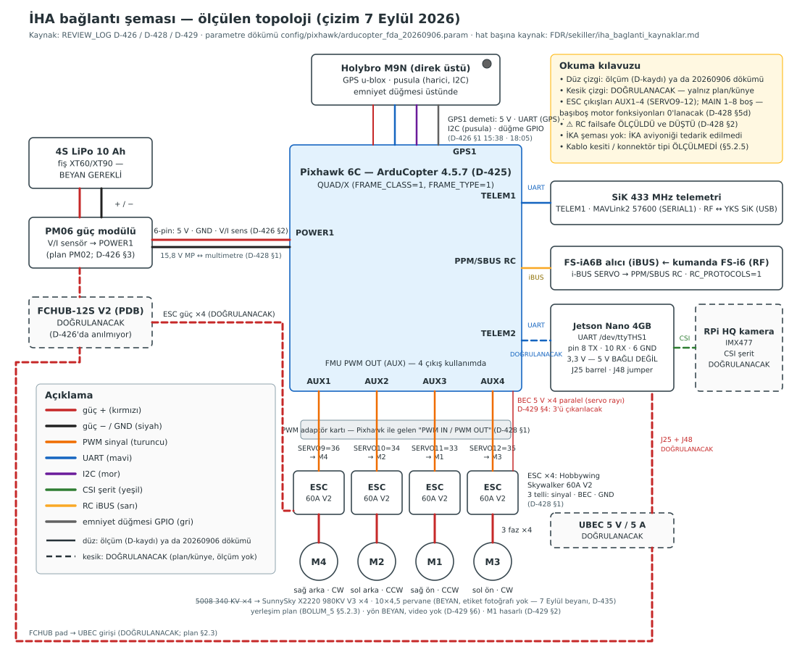

*İHA bağlantı şeması: ölçülen topolojiden çizildi (`REVIEW_LOG.md` D-426/D-428/D-429, parametre dökümü `config/pixhawk/arducopter_fda_20260906.param`, 7 Eylül); güç / PWM / UART / I2C / CSI / RC ayrı renk, legend şemada. **DOĞRULANACAK** hatlar (FCHUB, ESC güç yolu, UBEC → Nano, TELEM2 ↔ Nano UART, CSI) kesik çizgidir — sahada ölçülmedi. Hat başına kaynak: `sekiller/iha_baglanti_kaynaklar.md`; nöbetçi: `tests/test_gece_baglanti_semasi.py`.*

~~**BEYAN GEREKLİ (insan):** İKA için bağlantı şeması. İKA aviyoniği tedarik edilmediği
için (§3.2.2) şema **yoktur**.~~ → **10 Eylül 2026 (T217, ön kayıt H3 · D-439 §3):** İKA şeması
**DDR tasarımından** çizildi. Ölçülmüş İKA hattı **0/16** — aviyonik tedarik edilmedi; şema saha
topolojisi değil **tasarım beyanıdır**, bu yüzden her hat kesik çizgidir.

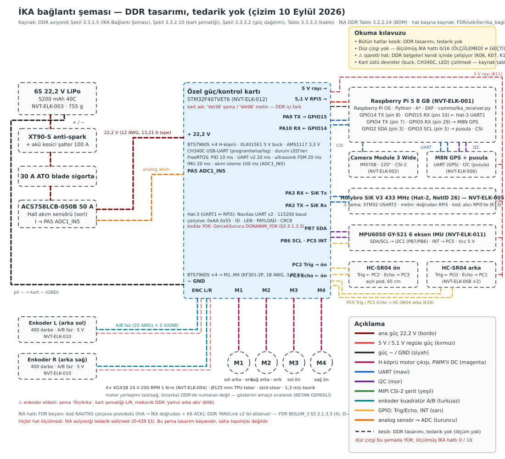

*İKA bağlantı şeması: DDR aviyonik belgesindeki Şekil 3.3.1.5 (İKA Bağlantı Şeması, pin düzeyi), Şekil 3.3.2.10 (STM32F407 özel kart şematiği), Şekil 3.3.3.2 (güç dağıtımı), Tablo 3.3.3.3 (kablo) ve İKA DDR Tablo 3.2.2.14 BOM'undan çizildi (`rapor/*.docx`, python-docx ile 10 Eylül okundu; görseller T217 amelesi tarafından docx'ten çıkarılıp okundu, çürütme turunda bağımsız ajan Şekil 3.3.1.5 / 3.3.2.10 görsellerini teyit etti (10 Eylül); mimar birleştirmede metni onayladı, görselleri kendisi yeniden bakmadı). Ana güç 22,2 V / regüle 5 V / GND / motor H-köprü / UART / I2C / CSI / enkoder / GPIO / analog ayrı renk, legend şemada. **16 hattın 16'sı kesik = "DDR tasarımı, tedarik yok"; ölçülmüş (düz) hat 0.** DDR'nin kendi içindeki çelişkiler gizlenmedi (⚠ K06 enkoder ön-arka/sol-sağ, K07 RPi5 besleme pin/USB-C, K12 kamera IMX477/IMX708, K13 SiK radyosu STM32 USART2 mi RPi5 mi; kart adı Vet36/Vet06). Hat başına kaynak: `sekiller/ika_baglanti_kaynaklar.md`; üreten `scripts/fdr_ika_baglanti_svg.py`; nöbetçi `tests/test_gece_ika_baglanti_semasi.py`.*

**ÖLÇÜLEMEDİ:** İKA şemasındaki 16 hattın hiçbiri (tedarik yok). Tedarikte kapanma: hat hat tezgâh
ölçümü ve `ika_baglanti_kaynaklar.md` satırının `ÖLÇÜLDÜ` + tutanak atfıyla güncellenmesi (İHA
şemasındaki kural; nöbetçi düz çizgiyi ancak o zaman kabul eder). **BEYAN GEREKLİ (insan):** SiK
radyosunun bağlanma noktası (RPi5 mi, STM32 USART2 köprüsü mü — K13; kodun alıcısı RPi5'te
çalışır), acil stop butonunun hattı, motor numaralandırması (M1–M4 sol/sağ · ön/arka).

##### 3.3.1.1.1 İstasyonlar

| istasyon | çalıştığı donanım | sorumluluğu | üretim kodu |
|---|---|---|---|
| **İHA / görev bilgisayarı** | Jetson Orin Nano Developer Kit 4 GB (D-431; Pixhawk 6C'ye bağlı) | kamera → algı → costmap → A* rota → karar eşikleme → telsiz yayını; iniş kanıtı; komut alımı | `codes/rpi_inference.py`, `comms/iha_sender.py`, `comms/iha_inis_yayinci.py`, `comms/iha_komut_alici.py` |
| **YKS / hakem ekranı** | saha dizüstü (Tk arayüzü) | canlı rota + ret sebebi gösterimi, iki aşamalı hakem onayı, kronometreler, komut üretimi | `comms/yks_gui.py`, `comms/kamera_istemci.py` |
| **İKA** | (yarışma günü) diferansiyel sürüş aracı — DDR tasarımı: Raspberry Pi 5 + STM32F407VET6 özel kart, **tedarik yok** (İKA şeması yukarıda, 10 Eylül) | rota önbelleği, sürüş izni kilidi, waypoint takibi | `comms/ika_receiver.py`, `simulation/scripts/ika_nav.py`, `simulation/scripts/ika_surucu.py` |

Üç istasyon **tek bir mesaj sözleşmesiyle** konuşur: satır sonu (`\n`) ile çerçevelenmiş
JSON, taşıyıcıdan bağımsız (UDP simülasyon / SiK 433 MHz saha). Sözleşmenin tamamı
`CONTRACTS.md` §6'dadır; kod `comms/protocol.py`.


##### 3.3.1.1.2 Mesaj tipleri

| tip | üretici | alanlar | anlam |
|---|---|---|---|
| `OPEN_ROUTE` | İHA | `road` (1=sol, 2=orta, 3=sağ), `conf`, `ref_xy`, `waypoints` | doğrulanmış açık güzergâh |
| `NO_ROUTE` | İHA | `sebep`, `detay` | rota üretilemedi — **sessizlikten farklıdır** |
| `HEARTBEAT` | herkes | `node`; İHA ayrıca `karar_yas` | hat canlılığı + **algı yaşı** |
| `ACK` | YKS / İKA | `ref` (seq), `ref_tip` | alındı onayı |
| `CMD` | YKS | `cmd`, `hedef` | operatör komutu (`IKA_GO`, `ARM`, `PARACHUTE`, …) |
| `IHA_LANDED` | İHA | `seq` | Pixhawk kanıtlı iniş bildirimi |

**Yayın kuralı (K1, `CONTRACTS.md` §6.5):** her karede **tam bir** mesaj çıkar —
`OPEN_ROUTE` **veya** `NO_ROUTE`. Sessizlik yoktur. Ret sebepli bir karar hiçbir koşulda
`OPEN_ROUTE` olamaz; güven kapısı **çoğaltılmaz**, tek yerde durur
(`comms/iha_sender.py:145 send_open_route`).


##### 3.3.1.1.3 ACK bağlama sözleşmesi (`ref` / `ref_tip`) — ölçülmüş bir kusurun ürünü

`seq` sayaçları **düğüm başınadır.** YKS'nin `IKA_GO` `seq`'i ile İHA'nın `OPEN_ROUTE`
`seq`'i çakışabilir; tipsiz eşleme, hub fan-out'unda **çapraz kabul** üretiyordu (ölçüldü,
`REVIEW_LOG.md` D-405 Q4 / T206). Sözleşme:

- `ACK.ref_tip` alanı, onaylanan mesajın `type`'ını taşır (`"OPEN_ROUTE"`, `"NO_ROUTE"`,
  `"CMD"`, `"IHA_LANDED"`). Üretici: `protocol.ack(ref, node, ref_tip)`.
- Alıcı, `ref_tip` varsa `ref` **ve** tiple eşler; yoksa yalnız `ref` ile — **geriye
  uyumlu**, eski ACK'lar reddedilmez.
- Kural **her iki uçta** geçerlidir: YKS tarafı `AckliTekrar.ack_geldi`, İHA tarafı
  `IhaSender._tekrarli_gonder`.
- **Bilinmeyen tip sessizce yok sayılır** — geriye uyumluluk bunun üzerine kuruludur
  (`CONTRACTS.md` §6.1).


##### 3.3.1.1.4 Mesaj akışı — yarışma günü kipi (§2.2)

```
        ┌───────────────────── İHA (Jetson Orin Nano 4 GB) ─────────────────────┐
        │  CSI kamera ──► kamera köprüsü ──► rpi_inference (algı+rota+karar)    │
        │        Pixhawk 6C ──► MAVLink çoğullayıcı ──┬─► irtifa (mpp)          │
        │                                             ├─► iniş kanıtı           │
        │                                             └─◄─ komut aktarımı       │
        └───────────┬──────────────────────────────────────────┬────────────────┘
                    │ OPEN_ROUTE / NO_ROUTE  (ACK'li,          │ IHA_LANDED
                    │        8 tekrar × 0,25 s)                │ (ACK'li)
                    │ HEARTBEAT  (ACK'SİZ — sürekli yayın,     │
                    │        1,0 s; tekrar kuyruğuna girmez)   │
                    ▼                                          ▼
   ┌────────────────────────────┐                 ┌──────────────────────────────┐
   │   YKS  (hakem ekranı)      │                 │            İKA               │
   │  · rota + ref_xy çizimi    │  CMD(IKA_GO)    │  · rota önbelleği (latest)   │
   │  · NO_ROUTE sebebi (kırmızı)│ ───────────────►│  · sürüş izni kilidi         │
   │  · ONAY 1/2  (canlı görüldü)│                 │  · waypoint takibi           │
   │  · ONAY 2/2  (İKA'ya aktarıldı) ◄─────────────┤  ACK(ref_tip="OPEN_ROUTE")   │
   │  · kronometreler (900/600 s)│  ACK(ref_tip="CMD")                            │
   └──────────────┬─────────────┘                 └──────────────────────────────┘
                  │ ACK(ref, ref_tip)  ──►  İHA           sür ⟺ (geçerli OPEN_ROUTE)
                  ▼                                            ∧ (İHA inişi tamam)
        hakem sözlü onayı (§2.2.3)                             ∧ (YKS'den IKA_GO)
```

**Kritik nokta — İKA'nın ACK'i YKS'ye de gider.** Denetimde ölçüldü ki 2. hakem onayı
("İKA'ya aktarıldı") hiçbir kanıta dayanmıyordu: İKA'nın ACK'i yalnız gönderene (İHA)
dönüyordu (`results/sartname_bosluk/rapor.md` R6). Sözleşme değişti: İKA ACK'i **hem**
gönderene **hem** bildiği YKS akranına gider; YKS düğmesi **fail-closed**'dur — geçerli
rota `seq`'i için `ACK(ref_tip="OPEN_ROUTE")` ekranda görünmeden 2. onay verilemez
(`CONTRACTS.md` §6.6). UDP kurulumunda `--yks host:port` **fiilen zorunludur**: şartname
sırasında `OPEN_ROUTE`, `IKA_GO`'dan **önce** gelir, yani YKS adresi `IKA_GO`'dan
öğrenilemez.


##### 3.3.1.1.5 Mesaj akışı — FDA görev test uçuşu kipi (§5.3.2 · 30 Eylül–3 Ekim)

```
   İHA (çoklu rotor)                              YKS (hakem ekranı, --fda)
   ─────────────────                              ─────────────────────────
   rpi_inference ──OPEN_ROUTE/NO_ROUTE──────────► rota + şerit no + güven
                 ──HEARTBEAT(karar_yas)─────────► tazelik kutusu (≤ 5 s)
                 ◄────────────ACK(ref_tip)─────── ONAY 2/2
                 ──IHA_LANDED───────────────────► görev süresi biter
   iha_komut_alici ◄──CMD(ARM/DISARM)──────────── ARM kilidi

   İKA halkası YOK  ·  PARAŞÜT düğmesi KAPALI  ·  IKA_GO gönderilmez
   Onay dayanağı: "FDA §5.3.2: İKA yok — onay YKS aktarımına dayanır"
```


##### 3.3.1.1.6 Alıcı davranışı — bağlayıcı kurallar (`CONTRACTS.md` §6.1)

1. `NO_ROUTE`, `latest` içindeki **son geçerli rotayı EZMEZ**; ayrı alana yazılır.
2. `NO_ROUTE` **geçici** bir durumdur. İHA kare kare tarar; bir karede rota bulunamaması
   görevi iptal etmez, alıcı dinlemeye devam eder.
3. Sürüş sırasında `NO_ROUTE` gelirse araç **güvenli duruşa** geçer; yeni geçerli
   `OPEN_ROUTE` gelince devam eder.
4. `HEARTBEAT`teki `karar_yas` alanı **yoksa** yaş BİLİNMİYOR demektir; alıcı **taze
   saymaz**. Gerekçe ölçülmüştür: 45–51 s süren bir algı körlüğünde heartbeat akmaya
   devam ediyordu (`REVIEW_LOG.md` D-374) — **hat canlılığı algı canlılığı değildir.**


##### 3.3.1.1.7 Güç ve sinyal topolojisi

```
  4S 10Ah LiPo
      │ XT60/XT90  (tek güç kesici: fiş)
      ▼
   ┌────────┐   6-pin    ┌──────────────┐
   │  PM06  ├───────────►│  Pixhawk 6C  │  POWER1  (5,1–5,3 V · BATT_MONITOR=4)   ← plan PM02, kutudan PM06 çıktı (5 Eylül, BEYAN)
   └───┬────┘            │              │
       │                 │  TELEM1 ─────┼──► SiK 433 MHz  ──►  YKS (MAVLink)
       ▼                 │  TELEM2 ─────┼──► Jetson UART /dev/ttyTHS1 (MAVLink2 57600)
  ┌─────────────┐        │  AUX 1..4  ──┼──► ESC Skywalker 60A V2 ×4  ──► motor ~~5008 340KV~~ X2220 980KV V3 ×4 · 10×4,5   ← plan 80 A (BEYAN, tam marka/model BEYAN GEREKLİ); motor 7 Eylül beyanı, etiket yok (D-435)
  │ FCHUB-12S V2│        │  RCIN ◄──────┼─── FS-iA6B `i-BUS SERVO` portu (iBUS; CH1–CH6 DEĞİL)
  └──┬───────┬──┘        │  GPS1  ◄─────┼─── Holybro M9N
     │       │           └──────────────┘
     │       └──► 5V/5A UBEC ──► Jetson (Orin Nano Dev Kit; Nano J25/J48 varsayımı geçersiz — besleme yolu DOĞRULANACAK, D-431)
     └──► ESC ×4 güç                         │
                                  CSI ◄──────┴── Raspberry Pi HQ (IMX477)
```


**5 Eylül kutu açılışı — şemadaki kalemlerin plan ↔ kutu karşılaştırması** (`REVIEW_LOG.md` D-426 §1–§3). ÖLÇÜM = Mission Planner `Messages` satırı; BEYAN = takım üyesinin sözlü bildirimi.

| kalem | plan (3 Eylül, `SAHA_HAZIRLIK_PLANI_20260903.md` §0.2) | kutudan çıkan (5 Eylül) | tür |
|---|---|---|---|
| güç modülü | PM02 | **PM06**; 8 pinli kablosu 6 pinli `POWER1`'e uymadı, 6 pinli kablo takıldı, uydurma adaptör yapılmadı. 18:03: `PreArm: Battery 1 low voltage failsafe` listeden kayboldu | BEYAN (etiket **BEYAN GEREKLİ (insan)**) · ÖLÇÜM (PreArm satırı) |
| ESC | 80 A, DShot ×4 | **"60 A V2" ×4** — tam marka/model **BEYAN GEREKLİ (insan)**; ESC kalibrasyonu YAPILMADI | BEYAN |
| RC alıcı | FS-iA6B beklenir, bind edilmedi | **FS-iA6B teyit** (B harfi görüldü); bind edildi; alıcının **`i-BUS SERVO`** portu → Pixhawk `PPM/SBUS RC`. Önce `CH6`'ya takılıydı (tek kanal PWM, Pixhawk görmez). 18:03: `RCInput: decoding IBUS(1)` | BEYAN (bind) · ÖLÇÜM (IBUS satırı) |
| uçuş kontrolcüsü | Pixhawk 6C | Pixhawk 6C — fabrikadan **PX4** ile geldi; ArduCopter **4.5.7** flash edildi (§3.3.1.1.11). 15:08: `ArduCopter V4.5.7 (2a3dc4b7)` · `Frame: QUAD/X` · `PreArm: Check frame class` kayboldu | ÖLÇÜM |
| GNSS | Holybro M9N | 15:38: `u-blox 1 HW: 000A0000 SW: ROM SPG 5.10` | ÖLÇÜM |
| emniyet düğmesi (M9N üstü) | — | 18:05: `PreArm: Hardware safety switch` kayboldu (fiziksel düğme; `BRD_SAFETY_DEFOFF` değiştirilmedi) | ÖLÇÜM |
| motor / ESC hattı | MAIN 1–4, motor testi pervanesiz | 18:06: `starting motor test` → `finished motor test`; sıra ve yönler 4/4 doğru (kablo taşıma + faz değişimi sonrası) — **video BEYAN GEREKLİ (insan)** | ÖLÇÜM (test koştu) · BEYAN (4/4) |
| SiK 433 MHz | TELEM1 → YKS | bağlandı (~18:45); RTT / paket kaybı **ÖLÇÜLEMEDİ** | BEYAN |
| Jetson Nano | TELEM2 + UBEC | **takılmadı** — pusula kalibrasyonu ve MAVLink kapısı bu yüzden yapılmadı | — |

Ağırlık ve boyut sütunları için 5 Eylül tutanağında tartı satırı yoktur; **BEYAN GEREKLİ (insan)** olarak kalır (§3.3.1.2).


##### 3.3.1.1.8 🔴 MAVLink çoğullayıcı — Jetson'da ZORUNLU (`CONTRACTS.md` §7.4 · D-403)

**Bu sözleşme ölçülmüş bir kusurdan doğdu.** Denetimde görüldü ki Pixhawk'ı **iki** üretim
süreci ayrı ayrı açıyordu — `codes/rpi_inference.py:314` (irtifa okuyucu) ve
`comms/iha_inis_yayinci.py:170` (iniş kanıtı) — ve **üçüncüsü** eklenmek üzereydi
(`comms/iha_komut_alici.py`, paraşüt/ARM aktarımı). Seri port (`/dev/ttyACM0`) **tek
sahiplidir**: ikinci süreç ya açılamaz ya birincinin akışını çalar. `inis_kaniti._mav_sahiplen`
süreç **içi** sahipliği koruyordu; süreçler **arası** koruma yoktu. Kılavuzlarda çoğullayıcı
hiç geçmiyordu (grep sayımı: **0**).

**Bağlayıcı kural:** Jetson'da seri portu **yalnız çoğullayıcı** açar (mavlink-router veya
MAVProxy `--out udp:127.0.0.1:1455N`); her tüketici kendi UDP ucundan bağlanır.

| tüketici | uç | yön |
|---|---|---|
| `rpi_inference --mavlink` | `udp:127.0.0.1:14550` | okur (irtifa → `mpp`) |
| `iha_inis_yayinci --mavlink` | `udp:127.0.0.1:14551` | okur (`landed_state`) |
| `iha_komut_alici --mavlink` | `udp:127.0.0.1:14552` | **yazar** (`COMMAND_LONG`) |

Kural bugün **yalnız `iha_komut_alici`'da kodla kilitlidir**: seri cihaz reddedilir,
`--seri-pixhawk-bilerek` ile bilerek aşılabilir. `rpi_inference --mavlink` ve
`iha_inis_yayinci --mavlink` seri cihaz yolunu **hâlâ kabul eder** — üstelik
`iha_inis_yayinci`'nin modül kılavuzu `/dev/ttyACM0`'ı örnek olarak gösterir. Bu iki
süreçte tek-yazar kuralı bugün **yordamla** uygulanır (systemd birim dosyaları +
`jetson_baslat.sh` denetimi), kodla değil. Kod kilidinin bu iki sürece genişletilmesi
**açık kalemdir** (`FDR/ACIK_KALEMLER.md`).

**Kapı:** `scripts/mavlink_dogrula.py` üç uçta **aynı anda** koşar ve şunları arar:
`HEARTBEAT` sysid eşleşmesi, `GLOBAL_POSITION_INT ≥ MAVLINK_KONUM_ASGARI_HZ` (**4,0 Hz**),
`EXTENDED_SYS_STATE ≥ MAVLINK_DURUM_ASGARI_HZ` (**1,0 Hz**).

**Eşikler uydurulmadı, tüketicinin sözleşmesinden türetildi** (`codes/karar_sozlesmesi.py`
sonu, gerekçe yorumda):
- `TELEMETRI_IRTIFA_TAZELIK_S = 0,50 s` → pencereyi sürekli dolu tutmak için Nyquist 2 Hz,
  paket kaybı/jitter için 2× pay → **4 Hz**. Altında irtifa penceresi aralıklarla boşa düşer
  ve rota kesik kesik `OLCEK_YOK` olur.
- `yerde_mi` **3 ardışık** (`ON_GROUND` + düşük irtifa) çifti ister; 1 Hz'de kanıt ≤ 3 s'de
  oluşur → **1 Hz**. Daha yavaşı iniş kanıtını şartname süresi içinde üretemez.

> ⚠ **Gerçek Pixhawk üzerinde bu kapı 5 Eylül'de de KOŞULMADI.** Kart 5 Eylül'de kutudan çıktı
> ve ArduCopter 4.5.7 ile açıldı (§3.3.1.1.11), ama Jetson o gün **takılmadı** (`REVIEW_LOG.md`
> D-426 §4); çoğullayıcı ve üç UDP ucu gerçek kart üzerinde hiç açılmadı. Kapı Jetson takıldığında
> koşulur (`SAHA_RUNBOOK.md` §3 satır 80–85; plan `FAZ_B_GUN_PLANI.md` §1). `ÖLÇÜLEMEDİ ≠ GEÇTİ`.


##### 3.3.1.1.9 🔴 SiK hub — NAVITAS-çerçeve seri çoğullayıcı (`CONTRACTS.md` §7.5 · D-404/D-405)

§7.4'ün **protokol ikizi**: SiK (433 MHz) kipinde Jetson'daki üç NAVITAS süreci
(`rpi_inference --telsiz-seri`, `iha_inis_yayinci --serial`, `iha_komut_alici --serial`)
aynı `/dev/ttyUSB0`'ı ister. Çözüm `comms/seri_hub.py`: portu **yalnız hub** açar,
tüketiciler kendi UDP kiplerinde kalır — **tüketici kodu değişmez.**

| yön / konu | davranış |
|---|---|
| tüketici → seri | çerçeve hub'ın UDP soketine (`--bind`, varsayılan `127.0.0.1:5100`) gider; hub datagramı olduğu gibi seriye yazar ve göndereni "öğrenilen" kümesine ekler |
| seri → tüketiciler | gelen baytlar kalıcı `FrameReader` ile **tam çerçeveye** toparlanır; her çerçeve `encode(decode(...))` ile tek satır yapılıp statik `--tuketici` listesi ∪ öğrenilenlerin **hepsine** yayınlanır |
| uzun ömürlü tüketici | öğrenilen küme sayı tavanlıdır (`OGRENILEN_TAVANI`); uzun ömürlü her tüketici **statik `--tuketici` ile de** verilir — öğrenme yalnız emniyettir |
| tek sahiplik | hub UDP ucunu `SO_REUSEADDR`'sız açar (ikinci hub `exit 3`); seri port `exclusive=True` (Linux flock) — **çift başlatma sessiz olamaz** |
| dayanıklılık | derin iç içe JSON (`RecursionError`), 4096 B üstü datagram, fan-out `OSError` → sayaç + KIRMIZI log, **süreç yaşar**; `SIGTERM` → `durdur()` |
| seri arızası | seri kapatılır, KIRMIZI log, 1 s'de bir yeniden açma; UDP tarafı yaşar; **arızada gelen çerçeveler düşürülür ve sayılır** (kuyruklanmaz — bayat rota yayınlanmasın) |

**Ölçülen zamanlama (Windows geliştirme makinesi, `CONTRACTS.md` §7.5):** UDP→seri
gecikmesi boşta **p50 10,6 ms / p95 31 ms**; 20 Hz seri girişiyle **p50 45 ms**. Bu değerler
`PARASUT_TEKRAR_ARALIGI_S` (0,20 s) sınırının altındadır. ⚠ **Gerçek SiK radyo üzerinde
ÖLÇÜLEMEDİ** — bu sayılar seri köprü ölçümüdür, RF ölçümü değildir.

**Topoloji (SiK kipi, `jetson_baslat.sh KIP=sik` ile bayt-eş aynı, testle kilitli):**
```
seri_hub --port /dev/ttyUSB0 --bind 127.0.0.1:5100 --tuketici 127.0.0.1:5007
rpi_inference    --yks-hedef 127.0.0.1:5100
iha_inis_yayinci --yks       127.0.0.1:5100
iha_komut_alici  --bind      127.0.0.1:5007
```
**Tek hatta bir kez:** SiK hattında hedef YKS'dir; `--ika-hedef` hub'a **verilmez**.
Gerekçe ölçüldü (D-405): İKA ACK'i SiK'ten hiç gelmediği için `IhaSender` **8 tekrar /
2,11 s** boşa tekrar ediyordu.


##### 3.3.1.1.10 Akış isteği — üretim `EXTENDED_SYS_STATE`'i hiç istemiyordu (T207, KRİTİK)

ArduPilot `EXTENDED_SYS_STATE`'i **varsayılan akıtmaz**; istenmesi gerekir. Denetimde
(D-406, P kolu) ölçüldü ki üretim kodu bu isteği **hiç göndermiyordu** — yani iniş kanıtı
sahada hiç oluşmayabilirdi ve İKA kilidi hiç açılmazdı.

**Kapatma (T207, `comms/iha_inis_yayinci.AkisIstekcisi`):** başta ve her
`MAVLINK_AKIS_ISTEK_ARALIGI_S = 10 s`'de `SET_MESSAGE_INTERVAL` gönderilir
(`EXTENDED_SYS_STATE` + `GLOBAL_POSITION_INT`, aralık `1e6 / (hz × MAVLINK_AKIS_ISTEK_HIZ_CARPANI)`,
çarpan **2**). `MAVLINK_AKIS_SESSIZLIK_TAVANI_S = 5 s` boyunca `EXTENDED_SYS_STATE` gelmezse
**bir kez** KIRMIZI uyarı basılır ve istek anında yenilenir; toparlanınca yeşile döner.

**Ölçülmüş tasarım tuzağı:** pymavlink `udp:` **sunucu** kipinde akran görülmeden `write`
hiçbir şey göndermez **ve hatayı yutar**. Bu yüzden istek `mav_hedefi_biliniyor_mu` ile
akran görülene dek **ertelenir**, sonra 10 s beklemeden gönderilir.
Kilit: `tests/test_faz_b_akis_istegi.py` **17 test** (gerçek pymavlink/UDP + sahte Pixhawk);
mutasyon MUT-1 (periyodik yenileme kaldırıldı) → 3 test düştü, MUT-2 (sessizlik alarmı
kaldırıldı) → 3 test düştü; diğer 14 kapı her iki mutasyonda da geçti (hedefe özgülük kanıtı).


##### 3.3.1.1.11 Uçuş kontrolcüsü yapılandırması — parametre ve görev şablonu

`config/pixhawk/arducopter_fda.param` (**48 parametre** — 7 Eylül: 31 + `RC_SPEED` + 16 `SERVOn_FUNCTION`, D-429 §4; her satırın üstünde NEDEN yorumu)
ve `config/pixhawk/fda_gorev.waypoints` (QGC WPL 110) repoda durur ve
`tests/test_faz_b_pixhawk_sablon.py` (**16 test**; 7 Eylül'de P9 `RC_SPEED`, P10 motor çıkışları, P8f/P8g mutasyon kapıları eklendi) ile kilitlidir. Değerlerin kaynağı
**ArduPilot Copter-4.5 kaynak kodudur** (dosya adları `.param` başlığında); sözleşme
sabitleri `codes/karar_sozlesmesi.py`'den gelir.

**Görev sırası ve süre bütçesi** (`WPNAV_SPEED = 300 cm/s`, `LAND_SPEED = 50 cm/s`,
dosyadan okundu):

| # | komut | değer | gerekçe |
|---|---|---|---|
| 0 | `HOME` | yer tutucu (0°, 0°) | koordinatlar Adıyaman'da girilir |
| 1 | `NAV_TAKEOFF` | **32 m** göreli | şartname ≥ 30 m + **2 m baro/EKF payı**; `rpi_inference` 30 m altını `ASGARI_IRTIFA_ALTI` işaretler |
| 2–5 | `NAV_WAYPOINT` × 4 | 20 × 20 m karenin köşeleri, 32 m | tek pas tarama |
| 6 | `NAV_LOITER_TIME` | **60 s** | YKS canlı aktarım + iki aşamalı onay + hakem ACK penceresi |
| 7 | `NAV_LAND` | — | görev süresi inişte biter |

**Hesaplanan kötü-durum görev süresi: 221,5 s** — koşulan fonksiyon
`tests/test_faz_b_pixhawk_sablon.py::sure_butcesi_s`, girdiler `arducopter_fda.param` +
`fda_gorev.waypoints`. Şartname sınırı `SARTNAME_FDA_OPERASYON_SURESI_S = 600 s`; test
ayrıca **bütçenin yarısını** (300 s) aşmamayı arar ki hakem onayı gecikirse pilotun loiter
uzatma payı kalsın.

> ⚠ Bu bir **plan hesabıdır**, uçuş ölçümü değildir. Rüzgâr, köşe yavaşlamaları, GNSS fix
> bekleme ve hakem etkileşimi bu toplama girmemiştir.

**Cumartesi teyide bırakılan değerler (3 Eylül planı; dosyada TEYİT işaretli):** `BRD_SER2_RTSCTS=0`,
`RC_PROTOCOLS=4` (iBUS), `BATT_FS_LOW_ACT` / `BATT_FS_CRT_ACT`; 7 Eylül'de `SERVO9–12_FUNCTION` eklendi (ölçülen AUX 1–4 eşlemesi 36/34/33/35, D-428 §5d) — TEYİT listesi 8 ad. Ayrıca kutudan çıkanla
doğrulanacaklar: `FRAME_CLASS=1` (quad), `FRAME_TYPE` (X), `MOT_PWM_TYPE=0`,
`SYSID_THISMAV=1`, `SERIAL1`/`SERIAL2` (57600 MAVLink2), `SRx_POSITION` 4 Hz,
`SRx_EXTRA3` 1 Hz, `BATT_MONITOR=4`, `FENCE_ENABLE=1` (irtifa 50 m + poligon),
`RTL_ALT 3500`, `LAND_SPEED 50`, `FS_THR_ENABLE 1`, `FS_GCS_ENABLE 1`,
`BATT_FS_LOW/CRT` (4S: 14,4 / 14,0 V), `ARMING_CHECK=1`.

**5 Eylül sonucu** (`REVIEW_LOG.md` D-426 §1, §2, §4). "Teyit" yazmayan satır geçmiş sayılmaz:

| değer | 5 Eylül durumu | kanıt türü |
|---|---|---|
| `FRAME_CLASS=1`, `FRAME_TYPE` X | **teyit** — `Frame: QUAD/X`, `PreArm: Check frame class` kayboldu (15:08) | ÖLÇÜM |
| `RC_PROTOCOLS=4` (iBUS) | **sahada 4 → 1 (All) yapıldı ve geri alınmadı** — teşhis sırasında README'nin yedek yolu; iBUS doğrulandıktan sonra 4'e dönülmedi. Sahada okunan dökümde hangi değerde olduğu görülecek | D-426 §2 |
| iBUS çözümü | **teyit** — `RCInput: decoding IBUS(1)` (18:03) | ÖLÇÜM |
| `BATT_MONITOR=4` / güç modülü | PM06 → `POWER1` çalışıyor: `PreArm: Battery 1 low voltage failsafe` listeden kayboldu (18:03) | ÖLÇÜM |
| emniyet düğmesi | `PreArm: Hardware safety switch` kayboldu (18:05); fiziksel düğme, `BRD_SAFETY_DEFOFF` değiştirilmedi | ÖLÇÜM |
| `BRD_SER2_RTSCTS=0`, `BATT_FS_LOW_ACT` / `BATT_FS_CRT_ACT` | **ÖLÇÜLEMEDİ** — tutanakta teyit satırı yok | — |
| RC failsafe (kumanda kapat → `Radio Failsafe`) | **ÖLÇÜLEMEDİ** — iki kez istendi, sonuç gelmedi; `.param` yorumundaki "iBUS alıcısı çerçeve basmayı keser" **varsayımdır** | D-426 §4 |
| Sahada okunan döküm | 5 Eylül: **dosya YOK** (kontrol edildi, D-426 §4) → **6 Eylül 20:22:** `config/pixhawk/arducopter_fda_20260906.param` repoda (`RC_PROTOCOLS=1`, `FS_THR_ENABLE=3`, `BATT_FS_LOW_ACT=1`; ikinci pusula kalibrasyonu ve `FS_GCS_ENABLE` yok → üçüncü döküm şart) | D-426 §4 → D-428 §5g |
| Accel + level | BEYAN "yapıldı"; kart sabitlenmiş miydi belirsiz — **teyit yok** | BEYAN |
| Pusula kalibrasyonu | YAPILMADI — Jetson takılı değil; Jetson takılınca dışarıda yeniden | D-426 §4 |
| ESC kalibrasyonu | YAPILMADI | D-426 §4 |
| Pil gerilimi MP ↔ multimetre (±0,1 V) | **ÖLÇÜLEMEDİ** | D-426 §4 |
| `SERIAL1`/`SERIAL2`, `SRx_*`, `mavlink_dogrula` 3/3 | YAPILMADI — Jetson takılmadı (§3.3.1.1.8) | D-426 §4 |
| Uçuş modları SwC: Stabilize / Loiter / RTL | BEYAN; kanal uçları 1000–2000 tutanakta yok | BEYAN |


##### 3.3.1.1.12 Görev bilgisayarı yığını — Python 3.8 venv + çevrimdışı tekerlek kurulumu (Jetson Nano 4GB)

> ⚠ **6 Eylül düzeltmesi — bu alt bölümün kısıtı kartla YANLIŞLANDI (D-431).** Kart 6 Eylül'de açıldı: **Jetson Orin Nano Developer Kit 4 GB** (p3767-0004), JetPack **7.2.1** (L4T R39.2.1), Ubuntu 24.04, sistem Python **3.12.3**, kök NVMe (`results/jetson_20260906/ORTAM_KUNYESI.txt`). Aşağıdaki "JetPack 4.6 / Python 3.6 / venv38 / cp38 tekerlek" kararları 3 Eylül beyanına dayanıyordu ve bu kartta **uygulanmadı**; kurulum kartta `nvidia-jetpack` (CUDA 13.2, TensorRT 10.16.2) + `~/venv312` (torch 2.11.0+cu130, ultralytics 8.4.142, pymavlink 2.4.49) ile yapıldı. Kartta koşan kapılar: genel kapı **15/15 · 15/15** (`results/jetson_20260906/jetson_log_20260906/genel_kapi.log`); kayıt defteri v36 `.pt` `eslesti`; `torch.cuda.is_available()` **True**; FPS §3.3.1.1.15; `.engine` denkliği §3.4.1 A3. Metin tarihli kayıt olarak silinmedi.

**Kısıt:** JetPack 4.6.x (Ubuntu 18.04) sistem Python'u **3.6**'dır; repo `ultralytics`
ister (Python ≥ 3.8). NVIDIA'nın JetPack torch wheel'i **Py3.6 içindir** ve 3.8 venv'ine
giremez.

**Karar:** Nano'da `~/venv38` (Python 3.8) + PyPI aarch64 wheel'leri; kurulum **çevrimdışı**
(sahada internet varsayılmaz).

**Gerçek indirme yapıldı** (`scripts/nano_tekerlek_indir.py`, PC'de, 3 Eylül):

```text
OZET: {'WHEEL': 14, 'WHEEL_BAGIMSIZ': 0, 'KAYNAK': 0, 'BASARISIZ': 0} | 51 dosya
```
- **14/14 paket** aarch64/cp38 wheel olarak indi, **kaynak paketi 0** (Nano'da derleme yok)
- torch **2.4.1 (CPU)**, torchvision 0.19.1, ultralytics 8.4.118, onnxruntime 1.19.2,
  MAVProxy 1.8.70
- toplam **51 dosya, 246 MB**; Nano'da tek komut:
  `pip install --no-index --find-links . -r requirements_nano.txt`
- Kilit: `tests/test_faz_b_nano_kurulum.py` (**19 test**)

🔴 **Dürüst risk (belgede yazılı, gizlenmiyor):** üretim modeli v36 **YOLOv8m-seg**'dir
(27,2 M parametre), `n` değil. Nano **CPU**'da 512'de hızı **ölçülmedi** ve FPS kapısının
altında çıkabilir. Çözüm sırası: (1) JetPack 4.6 için Python 3.8 **CUDA torch** topluluk
wheel'i (**insan görevi**), (2) `onnxruntime` ile `.onnx`, (3) CPU torch.
**Eşik gevşetilmez.** Ölçüm 5 Eylül'de **yapılmadı** — Jetson o gün takılmadı (`REVIEW_LOG.md`
D-426 §4); FPS **ÖLÇÜLEMEDİ** olarak kalır, Jetson takıldığında `scripts/jetson_fps.py` ile ölçülür.

~~**TensorRT `.engine`:** venv38'de `tensorrt` modülü **yoktur** (JetPack 4.6 bağı Py3.6).
`.engine` bu kart için **ÖLÇÜLEMEDİ** sayılır; **PT/ONNX ile uçulur.**~~
→ **6 Eylül (D-431):** Orin Nano'da TensorRT 10.16.2 kuruldu; `.engine` `.pt`'den derlendi (530 s; 57 283 989 B; sha `bb9bd868…0300`, deftere `--turev-kaydet` ile yazıldı, `turev_eslesti`). Engine↔pt karar denkliği **ÖLÇÜLDÜ ve DÜŞTÜ** (F1 0 · F2 0,9953 · D-303 oransal 3/126 > 5/260) → engine üretime alınmadı, **uçuş `.pt` GPU ile**. ONNX GPU yolu bu kartta **HATA** (`onnxruntime-gpu` 1.29, `cudaErrorNoKernelImageForDevice`) → "ONNX ile uçulur" seçeneği bu kart için **doğrulanmamıştır**. `results/jetson_20260906/jetson_log_20260906/engine_karar_denkligi.json`, `results/jetson_20260906/jetson_log_20260906/engine_export.log`.


##### 3.3.1.1.13 Kamera köprüsü — iki Python sürümü arasındaki köprü

**Sorun:** CSI IMX477 yalnız GStreamer `nvarguscamerasrc` ile açılır; sistem OpenCV 4.1
(Py3.6) GStreamer'lıdır, ama pip'ten kurulan `opencv-python` (venv38) **GStreamer'sızdır**
ve kamerayı **açamaz**.

**Çözüm (`scripts/kamera_koprusu.py`, Python 3.6 uyumlu):** sistem python3 + sistem cv2 ile
CSI'yi açar ve HTTP üzerinden sunar:

| uç | içerik |
|---|---|
| `/video` | MJPEG akışı |
| `/kare.jpg` | tek kare |
| `/durum` | JSON durum (kaynak, kare sayacı, hata) |

`rpi_inference --kaynak http://127.0.0.1:8080/video` ile tüketilir. Kaynak düşerse
**fail-visible** davranır (sessizce boş kare üretmez) ve yeniden açmayı dener.
Servis birimi `navitas-kamera-koprusu.service`, `KAMERA_PYTHON=/usr/bin/python3`.
**Yedek:** USB webcam (UVC) `--kaynak 0`.
Testler: köprü **7**, `jetson_baslat` **42**, paket bütünlüğü **18 dosya**.
**6 Eylül (D-431):** köprü kartta sistem Python **3.12** + sistem cv2 4.6 (GStreamer=True) ile **dosya kaynağında açıldı** (`kaynak ACILDI`, `fps_tavani=5.0`, :8081 — `results/jetson_20260906/jetson_log_20260906/kamera_koprusu_dosya.log`; `/durum`/`/kare.jpg` HTTP yanıtları ham logda yok, tutanak beyanı). CSI kamera **bağlı değildi** → `nvarguscamerasrc` yolu **ÖLÇÜLEMEDİ**. "Python 3.6 uyumu" gereksinimi kartta geçersiz; kod uyumu testle kilitli kalır.

Ayrıca YKS hakem ekranı için `comms/kamera_istemci.py` bu köprünün `/kare.jpg` + `/durum`
uçlarını **ayrı ağdan** okur — görüntü **SiK hattına yüklenmez** ve bayat kare canlıymış gibi
gösterilmez (`jetson_baslat.sh KAMERA_KOPRU_BIND`; varsayılan loopback, LAN'a açılmak
**açıkça beyan edilir**).


##### 3.3.1.1.14 systemd birimleri — tek komut, gözcülü açılış

`jetson_baslat.sh` altı birimi kurar; hepsi `Restart=always`, `RestartSec=2`:

| birim | görev | bağımlılık |
|---|---|---|
| `navitas-cogullayici` | MAVLink çoğullayıcı (§3.3.1.1.8) | ilk kalkar |
| `navitas-seri-hub` | SiK hub (§3.3.1.1.9) — yalnız `KIP=sik` | — |
| `navitas-kamera-koprusu` | CSI → MJPEG (§3.3.1.1.13) | `rpi_inference`'tan **önce** |
| `navitas-rpi-inference` | üretim algı yolu (`--camera --ekransiz --mavlink udp:127.0.0.1:14550 --mav-sysid`) | çoğullayıcı |
| `navitas-iha-inis-yayinci` | iniş kanıtı + akış isteği (`udp:…:14551`) | çoğullayıcı |
| `navitas-iha-komut-alici` | YKS komutları → Pixhawk (`udp:…:14552`) | çoğullayıcı |

Kullanım kipleri: `--kuru` (hiçbir şey başlatmaz, koşacağı komutları basar ve eksik beyanı
`[YOK]` ile **3 çıkış koduyla** durdurur) · `--kapi` (yalnız çoğullayıcıyı kaldırır ve üç
uçta **aynı anda** `mavlink_dogrula` koşar) · `--durum` (yeniden başlatma sayısı; artıyorsa
**çökme döngüsüdür**) · `--dogrudan` (systemd'siz, gözcüsüz — yalnız ayıklama).

**`--ekransiz` bayrağı ölçülmüş bir çökmeyi kapatır (D-404):** `rpi_inference` koşulsuz
`cv2.imshow` çağırıyordu; DISPLAY'siz Jetson'da ilk karede çöküp `Restart` döngüsüne
giriyordu. Karar yolu **bayt-eş aynıdır** (`tests/test_faz_b_rpi_ekransiz.py`).


##### 3.3.1.1.15 FPS kapısı — **0,61 FPS**, türetilmiş (tahmin değil)

Şartname §6.4: hakem onayı alınmayan tespit **geçersizdir**. Sözleşme
`YKS_TESPIT_TAZELIK_S = 5,0 s` ve karar **kare başınadır** (kareler arası uzlaşma yoktur).
Buradan:

```
GEREKLI_FPS  ≥  1 / (5 · p)          p = bir karenin geçerli rota yayınlama olasılığı
```

| küme | p | gereken FPS | kapsam |
|---|---|---|---|
| sentetik arena (260) | 0,9846 | **0,203** | göreve benzer, **sentetik** |
| gerçek DJİ, **sızıntısız** (243) | 0,3457 | **0,579** | gerçek, arenaya **OOD** |
| gerçek DJİ, yalnız 0038 (230) | 0,3261 | **0,613** | en kötü okuma |

**Kapı en kötüsünden alındı: 0,61 FPS**, p50 **ve** p95 ayrı ayrı.

⚠ **D-376 düzeltmesi kayıtta durur:** ilk ölçümde kullanılan gerçek-kare havuzunun **%62'si
modelin eğitim kümesindeydi**; yukarıdaki satırlar **sızıntı ayıklandıktan sonrasıdır**.
Kirli okuma daha iyimserdi (p = 0,4866). Yanlış sayı silinmedi, **üstü çizilip düzeltmesine
işaret verildi**.

**Saha `p`'si ÖLÇÜLEMEDİ** — gerçek arena görüntüsü yoktur. İki sayı alt/üst çerçevedir;
**arası tahmin edilmemiştir.**

**Çözünürlük artırımı denendi ve REDDEDİLDİ (D-377):** sentetik arenada `p` 0,9846 → 0,7808
gerileme; FPS maliyeti oranı 1,302 (bütçe kısıt değildi). Ön kayıt *"I2 düşerse RED, I1 ne
olursa olsun"* diye **sonuç görülmeden** yazılmıştı ve umut verici bir ara sayı (%21,6) bu
kurala çarptı. Bu, ön kayıt disiplininin somut iş gördüğü bir vakadır.

**Jetson'da ÖLÇÜLDÜ — 6 Eylül 2026 (D-431):** kart Orin Nano Developer Kit 4 GB, `scripts/jetson_fps.py --cihaz 0`, imgsz 512, conf 0,3, `data/raw_frames`, 15 ısınma + **120 örnek**, mpp=None (ölçeksiz Katman-A kipi):

| kol | toplam p50 / p95 (ms) | FPS p50 / p95 | eşik | hüküm |
|---|---:|---:|---:|---|
| `.pt` (PyTorch, GPU) | 739 / 942 | **1,35 / 1,06** | 0,61 | **GEÇTİ** |
| `.engine` (TensorRT FP16) | 635 / 751 | **1,58 / 1,33** | 0,61 | **GEÇTİ** |
| `.onnx` (onnxruntime-gpu 1.29) | — | — | — | **HATA** — `cudaErrorNoKernelImageForDevice` (sm_87 çekirdeği yok) |

10 dk sürekli koşum (**900 örnek**): `.pt` 770 / 922 ms · `.engine` 649 / 765 ms; tegrastats gpu en yüksek **56,3 °C** (258 örnek). Darboğaz model değil: `.engine` ile çıkarım 87 ms, `get_masks` ~311 ms + Katman A ~208 ms CPU'da. Kanıt: `results/jetson_20260906/jetson_fps_20260906_orin_nano/ozet.json`, `results/jetson_20260906/jetson_fps_20260906_orin_nano_10dk/ozet.json`, `results/jetson_20260906/jetson_fps_20260906_orin_nano_10dk/tegrastats.log`. **Sınır:** kamera bağlı değildi, kareler diskten; saha `p`'si yine ÖLÇÜLEMEDİ.


##### 3.3.1.1.16 Sürüm mührü ve paket bütünlüğü

`surum_dondur --dogrula` üç istasyonun (İHA/YKS/İKA) çalıştırdığı dosyaların kanonik
özetlerini mühürler ve doğrular; mühür **git bağına** ve kanonik özete dayanır (v2, **49
test**). ⚠ Mühürün ilk sürümünde **KRİTİK** bir kusur ölçülmüştü: özet **CRLF'ye bağlıydı**
ve Jetson'da (LF) doğrulanamıyordu (D-405). Düzeltildi ve testle kilitlendi.

**Kural:** **17 Eylül sürüm dondurmasından** itibaren üretim kodu **değişmez**; 5–16 Eylül arasındaki değişiklikler kapı + defter kaydı ister (5 Eylül montaj ve ilk gerçek kapı koşumları günüdür, dondurma günü değil); zorunlu değişiklik =
D-kaydı + kapı + **ayrı denetim**.


#### 3.3.1.2 Nihai Aviyonik BOM Listesi

> **Yönerge:** İHA ve İKA için **ayrı ayrı**; kullanılan tüm elektronik bileşenlerin
> adı, marka/modeli, adedi, birim ağırlığı, toplam ağırlığı, boyutları ve **tahmini
> maliyeti**; DDR ↔ FDR **karşılaştırmalı**; kablo ve konnektörler dâhil nihai ağırlık
> ve maliyet.

**Bugün var olan:** kalem adı, marka/model ve adet sütunları §3.2.1.1 künye tablosunda
doludur. **DDR ↔ FDR karşılaştırması** yedi kalem için §3.0.2'de yapılmıştır (görev
bilgisayarı, uçuş kontrolcüsü, GNSS, kamera, RC, İKA bilgisayarı, model).

**Bugün boş olan sütunlar:** birim ağırlık · toplam ağırlık · boyut · tahmini maliyet.

**ÖLÇÜLEMEDİ:** Her aviyonik kalemin gerçek ağırlığı ve kablo/konnektör dâhil toplam
aviyonik ağırlığı. Aviyonik kutusu 3 Eylül itibarıyla açılmamıştır; tartı 5 Eylül
montajındadır (§3.2.1.3, §3.4.2). Tahmin yazılmaz.

**BEYAN GEREKLİ (insan):** Her kalem için **birim fiyat ve toplam fiyat**; Bölüm 7
(Bütçe Gerçekleme Analizi) ile **aynı tablodan** beslenmelidir, iki bölümde farklı sayı
duramaz.

**İKA aviyonik BOM'u yoktur** — donanım tedarik edilmedi (§3.2.2).

#### 3.3.1.3 Entegrasyon Planı

> **Yönerge:** *"İHA ve İKA'nın aviyonik entegrasyonu sırasında izlenecek plan detaylı
> olarak açıklanmalıdır."*

İHA entegrasyon planı depoda **gün gün yazılıdır** (`SAHA_HAZIRLIK_PLANI_20260903.md`,
`FAZ_B_GUN_PLANI.md`) ve Bölüm 2 takviminde özetlenir. Bu bölüme giren **kanıt**,
planın kâğıt üstünde değil **kodda** sınanmış hâlidir: on halkalı kuru koşu.

##### 3.3.1.3.1 Alt sistem etkileşimi — kuru koşu ile ölçülmüş zincir

`scripts/saha_kuru_kosu.py` on halkayı **gerçek kodu çağırarak** sınar ve her halka için
sahibini (dosya:fonksiyon) yazar. **Son koşum: 2026-09-04 09:52:22 — 9 GEÇTİ · 1 SAHİPSİZ ·
0 DÜŞTÜ · 0 ATLANDI** (`results/saha_kuru_kosu_20260904_095222/ozet.json` → `sayim`,
`kopuk_halkalar: ["motor"]`, `cikis_kodu: 1`). Önceki koşum 2026-09-02 23:59:54 aynı sonucu
vermişti (`results/faz_b_oncesi/cuma_kontrol/kuru_kosu/ozet.json`).

| # | halka | durum | kanıt / sahip |
|---|---|---|---|
| 1 | kamera | **GEÇTİ** | kaynak parametrik ve `VideoCapture`'a besleniyor (cihaz yolu `str`, indeks `int`) — `rpi_inference.run_camera` |
| 2 | model yükleme | **GEÇTİ** | ağırlık manifestten türetiliyor, uyuşmazlıkta fail-closed, kayıt defteriyle eşleşiyor — `rpi_inference.load_model` |
| 3 | çıkarım | **GEÇTİ** | tek kare çıkarımı tamamlandı |
| 4 | maske | **GEÇTİ** | `{0,1}` anahtarlı maskeler üretildi |
| 5 | ölçek | **GEÇTİ** | canlı telemetri bu kare için geçerli `mpp` üretti |
| 6 | hedef konumu | **GEÇTİ** | HB saha kaynağından alınabiliyor (T150/D-386: `goruntu=` + şekil kapısı) |
| 7 | rota | **GEÇTİ** | rota üretildi: `yol_no = 2` — `analyze_path` (`run_camera` yolu) |
| 8 | aktarım | **GEÇTİ** | **üretim yolu** `run_camera` kararı loopback İKA'ya `OPEN_ROUTE` olarak yazdı |
| 9 | sürüş izni | **GEÇTİ** | `IHA_LANDED` saha kod yolunda üretiliyor — `comms/iha_inis_yayinci.py:386` (4 Eylül koşumu; 2 Eylül koşumunda `:375`) |
| 10 | **motor** | 🔴 **SAHİPSİZ** | gerçek motor sürücüsü **yok**; `send_vel` yalnız `gz` subprocess'i ve `ika_nav` `simulation/` altında |

Halka 10 bilerek açıktır: İKA donanımı tedarik edilmemiştir ve İKA hattı finale
bırakılmıştır (§3.0.1). Sürücü **arayüzü** hazırdır (`CONTRACTS.md` §7.2) ve `GercekSurucu`
arka uçsuz **kurulamaz** — boş bir iskeletin "çalışıyor" görünmesi engellenmiştir.


##### 3.3.1.3.2 Kapı özeti (3 Eylül 2026 itibarıyla)

| kapı | sonuç |
|---|---|
| Genel kapı `codes/test_rota_sentetik.py` | **15/15** |
| Tam birim test suiti | **1896 OK** (skipped = 3) |
| Kabul zinciri K0–K8 + K5A (v36) | **10/10 GEÇTİ** |
| Saha kuru koşusu | 9 GEÇTİ · 1 SAHİPSİZ |
| Kanıt defteri kayıt sayısı | **414** (`grep -c "^### D-" REVIEW_LOG.md`) |

**5 Eylül 2026 itibarıyla** (3 Eylül tablosu silinmedi; ilerleme tarihli izlenir):

| kapı | sonuç |
|---|---|
| Tam birim test suiti | **2138 test** — OK (~19:1x) · **1 FAIL** ×2 (~14:5x, ~19:5x). Düşen tek test her seferinde `test_p8_sim_katmani.test_comms_loopback_gecer`; sebep **ortam**: canlı `yks_gui` / `ika_nav` üretim portlarını (5005/5006) tutuyor, `comms/test_comms.py:35-36` aynı portlara bind ediyor (`REVIEW_LOG.md` D-427; onarım T209). Kod değişmedi; YKS kapalıyken suit yeşil |
| Saha kuru koşusu | 9 GEÇTİ · 1 SAHİPSİZ (motor) · 0 DÜŞTÜ (4 Eylül, `results/saha_kuru_kosu_20260904_095222/ozet.json`) |
| Gerçek Pixhawk 6C | ArduCopter V4.5.7 açılış · `Frame: QUAD/X` · GPS · iBUS · motor testi — **ÖLÇÜM** (D-426 §1); MAVLink çoğullayıcı kapısı **ÖLÇÜLEMEDİ** (Jetson takılmadı) |
| Firmware çevrimdışı yolu | `tests/test_pixhawk_firmware_yolu.py` **10 test** (D-424 + D-425) |
| Genel kapı `codes/test_rota_sentetik.py` | 5 Eylül için tarihli artefakt yok — bu tabloya yazılmadı (3 Eylül: 15/15) |
| Kanıt defteri kayıt sayısı | **432** (`grep -c "^### D-" REVIEW_LOG.md`, son kayıt D-427) |

**6 Eylül 2026 — Jetson kartında** (D-431; kart Orin Nano Developer Kit 4 GB, Python 3.12):

| kapı | sonuç |
|---|---|
| Genel kapı `codes/test_rota_sentetik.py` (kartta) | **15/15 · şerit 15/15** (`results/jetson_20260906/jetson_log_20260906/genel_kapi.log`) |
| Kayıt defteri | v36 `.pt` `eslesti`, `.engine` `turev_eslesti` |
| T17 FPS (120 örnek) | pt **1,35/1,06** · engine **1,58/1,33** FPS, eşik 0,61 → **GEÇTİ** |
| Engine↔pt denkliği | F1 0 · F2 0,9953 · **D-303 oransal 3/126 DÜŞTÜ** → uçuş `.pt` |
| `jetson_baslat.sh --kuru` | `[YOK]` yalnız `/dev/ttyACM0` → çıkış 3 — Pixhawk bağlı değil, MAVLink kapısı **ÖLÇÜLEMEDİ** |
| Tam süit (kartta) | `Ran 2121` · F5 E30 S8 — 26'sı ortam (`O:\` yolları, PC'deki kümeler), kalanı D-431'de sınıflandırılmış |


##### 3.3.1.3.3 İKA aviyonik entegrasyon planı

~~**BEYAN GEREKLİ (insan):** İKA aviyonik entegrasyon planı (bilgisayar seçimi, sürücü
kartı, güç hattı, montaj sırası ve kabul turu). Donanım tedarik edilmediği için plan
bugün **yazılamaz**; kabul turu betiği hazırdır (`scripts/ika_surucu_kabul.py`, Bölüm 2
§2.1 R6 satırı). Sorumlu rol: **R6 İKA sorumlusu**.~~

**10 Eylül 2026 düzeltmesi (T217; ön kayıt `results/fdr_sprint_20260910/ON_KAYIT.md` H3, D-439 §3).**
Plan iki koldur ve ikisi aynı cümlede anlatılmaz: **yazılım kolu** koddadır ve aşağıda dosya:satır
ile yazılıdır; **donanım kolu** (bilgisayar, sürücü kartı, güç hattı, montaj sırası) DDR tasarımı
olarak §3.3.1.1'deki İKA şemasında durur, **tedarik edilmedi** — o kol için **BEYAN GEREKLİ (insan)**
kalır (R6). İKA fizikte sürülmedi; aşağıdaki her satır **yazılım ölçümüdür**, saha kanıtı değildir.

**(1) Katman zinciri — alıcı → kilit → navigasyon → sürücü arayüzü → arka uç** (satır numaraları 10 Eylül okuması; `ika_nav.py` / `karar_sozlesmesi.py` atıfları T213-B birleşmesi satır kaydırdığı için 10 Eylül akşamı tazelendi — eskisi ~~üstü çizili~~, T214-B)

| # | katman | ne yapar (koddan) | üretim kodu | kilit (test) |
|---|---|---|---|---|
| 1 | **Alıcı** `IkaReceiver` | Taşıyıcıdan bağımsız (UDP `comms/link.py:14` / SiK seri `:73`) satır-JSON çerçeveleri alır: `OPEN_ROUTE` → `latest` (`comms/ika_receiver.py:234`); `NO_ROUTE` ayrı alana, `latest` **ezilmez** (`:247`); İHA `HEARTBEAT` hat canlılığı (`:261`); `IHA_LANDED` → iniş latch'i (`:266`); `CMD IKA_GO` → izin latch'i, mükerrer alım yalnız ACK'lanır (`:275`). `hb_timeout` 3 s sessizlikte `link_lost` (`:27`, `:294 poll`). Rota ACK'ı gönderene **ve** YKS'ye (K8, `:175 _rota_ack`) | `comms/ika_receiver.py` | `tests/test_ika_go_gate.py`, `tests/test_iha_landed_gate.py`, `tests/test_ika_no_route_recovery.py`, `comms/test_comms.py` |
| 2 | **Görev kapısı** (`CONTRACTS.md` §7) | `sür ⟺ OPEN_ROUTE ∧ IHA_LANDED ∧ IKA_GO`; iki latch + ortak son tarih `_surus_izni_gecerli_unlocked` (`ika_receiver.py:127`), bekleyen `wait_surus_izni` (`:114`); sıfır-dışı her motor komutu karar kilidi altında `run_if_route_valid` (`:80`) ile geçer — `NO_ROUTE` geldiyse komut düşer | `comms/ika_receiver.py`; ~~`simulation/scripts/ika_nav.py:203 receiver_rota_gecerli`, `:234 receiver_korumali_hiz_gonder`, `:260 receiver_surus_izni_bekle`~~ `simulation/scripts/ika_nav.py:208 receiver_rota_gecerli`, `:239 receiver_korumali_hiz_gonder`, `:265 receiver_surus_izni_bekle` | `tests/test_p3_ika_surucu.py::T6` (izinsiz sıfır-dışı komut yok), `tests/test_ika_surus_no_route.py`, `tests/test_k5_k6_sure_limitleri.py` |
| 3 | **Navigasyon** `navigate` | Dünya waypoint'lerini (`route_to_world_waypoints`, ~~`ika_nav.py:144`~~ `ika_nav.py:149`) 10 Hz döngüde izler (`CTRL_HZ`, ~~`:39`~~ `:44`); geçiş yarıçapı 0,5 m, son waypoint 0,3 m (~~`:37-38`~~ `:42-43`). Her adımda **sürüş son tarihi (K5)**, **sürücü sağlığı** (~~`:337`~~ `:376`), **hat canlılığı** ve **rota kapısı** denetlenir; biri düşerse `send_vel(0,0)` — güvenli duruş (~~`:304 rota_gecersiz_dur`~~ `:343 rota_gecersiz_dur`). Görev sarmalayıcısı `ika_gorevi` (~~`:437`~~ `:477`) iki ayrı son tarihle (bekleme 900 s / sürüş 600 s, `codes/karar_sozlesmesi.py:1981-1982`) 0–4 çıkış kodu döner | ~~`simulation/scripts/ika_nav.py:280 navigate`, `:416 navigate_route`, `:437 ika_gorevi`, `:524 wait_open_route_from_comms`~~ `simulation/scripts/ika_nav.py:311 navigate`, `:455 navigate_route`, `:477 ika_gorevi`, `:576 wait_open_route_from_comms` | `tests/test_k5_k6_sure_limitleri.py`, `tests/test_dalga2_k1_k5_k8_kusurlari.py`; akış diyagramı (e) `sekiller/akis_e.svg` |
| 4 | **Sürücü arayüzü** `IkaSurucu` (`CONTRACTS.md` §7.2) | `hiz_ver(sağ, sol) → bool` (istisna sızmaz), `konum_al() → (x, y, z, yaw)` ya da 4×None, `durdur()`, `saglikli()` = ardışık hata < `ARDISIK_HATA_TAVANI` 3 (`simulation/scripts/ika_surucu.py:34`, sınıf `:44`); `ika_nav.send_vel/get_pose` buraya delege eder (~~`ika_nav.py:74`, `:82`~~ `ika_nav.py:87 send_vel`, `:79 get_pose`); aktif sürücü `surucu_ayarla` ile takılır (~~`:63`~~ `:68 surucu_ayarla`) | `simulation/scripts/ika_surucu.py` | `tests/test_p3_ika_surucu.py` (T1 bayt-eşitlik, T3 tavan, T5 zaman aşımı, T7 fail-loud) |
| 5 | **Arka uç** | `GercekSurucu` (`ika_surucu.py:186`): arka uçsuz kurulum `DONANIM_YOK` ile **düşer** (`:196`) — sessiz iskelet yasak; `GazeboSurucu` (`:79`; `gz` bu makinede yok); `SahteSurucu` (`:157`; test ve kabul); **`MuJoCoSurucu`** (T213-B, `simulation/mujoco/`, aynı arayüz — bu görevde değil, H1-K5 orada ölçülür) | `simulation/scripts/ika_surucu.py`, `scripts/ika_surucu_kabul.py` | `tests/test_faz_b_ika_surucu_kabul.py` (exit 0/1/2 sözleşmesi) |

**(2) Kabul turu K1–K6 — koşuldu (10 Eylül 2026, `scripts/ika_surucu_kabul.py`)**

Betik `CONTRACTS.md` §7.2 sözleşmesini mekanik olarak sınar; sahada `--surucu gercek --arka-uc modul:Sinif`
ile **aynı adımlar** koşulur. Sahte sürücüyle çıktı birebir
(`results/fdr_sprint_20260910/H3/ika_surucu_kabul_sahte.txt`, JSON eşi `.json`):

```text
IKA SURUCU KABUL TURU — surucu=sahte  tavan=3  rampa=0->0.30 m/s / 5 adim / 0.2 s  (MAX_SPEED=2.0 m/s)
adim  durum    zorunlu  olculen
K1    GECTI    evet     durdur() -> True: durdur()=True
K2    GECTI    evet     konum_al() -> 4'lu demet: (0.0, 0.0, 0.0, 0.0)
K3    GECTI    evet     hiz rampasi 0 -> 0.30 m/s, 5 adim: 5/5 adim; son v=0.30 m/s
K4    GECTI    evet     durdur() -> True ve saglikli() True: durdur()=True saglikli()=True ika_nav.surucu_saglikli()=True
K5    GECTI    evet     fail-closed: 3 ardisik ariza -> saglikli() False: ardisik_hata=3 saglikli()=False; tavan-1'de saglikli()=True
K6    GECTI    evet     basarili hiz_ver sonrasi ardisik_hata == 0: ana surucu ardisik_hata=0; ariza sonrasi hiz_ver=True ardisik_hata=0 saglikli()=True
SON DURDUR (fail-closed): durdur()=True
SONUC: GECTI (exit 0)
```

Aynı betik diğer iki sürücüyle de koşuldu ve **düştüğü yerde düştü diye yazıldı**: `--surucu gazebo`
→ `gz` PATH'te yok: K1/K3/K4/K6 **DÜŞTÜ**, K5 ATLANDI, `SONUC: DUSTU (exit 1)`
(`H3/ika_surucu_kabul_gazebo_gz_yok.txt`); `--surucu gercek` → `DONANIM_YOK`, tur **başlamadı**,
`SONUC: SURUCU_KURULAMADI (exit 2)` (`H3/ika_surucu_kabul_gercek_donanim_yok.txt`). Sahte sürücünün
6/6'sı **sözleşmenin** kanıtıdır, aracın değil: rampa 0 → 0,30 m/s'de (`RAMPA_HEDEF_MS`, 5 adım,
`ika_surucu_kabul.py:83-85`) aracın hareketi gerçek/sim sürücüde **GÖZLE TEYİT** ister — betik bu
satırı basar, yazılım bunu ölçemez. ⚠ Çıktıdaki `MAX_SPEED=2.0 m/s` kabul koşumu anındaki (T213-B öncesi) ~~`ika_nav.py:35`~~ değeridir; DDR
fiziksel hız 1,3 m/s — üç kopyalı sabit `CONTRACTS.md` §4'e tek kaynak olarak ~~taşınıyor~~ **taşındı** (T213-B,
D-438 §2f; bugün `MAX_SPEED` `ika_nav.py:39` = `codes/karar_sozlesmesi.py:1996 IKA_AZAMI_HIZ_MS` 1,3 m/s — 10 Eylül T214-B okuması); kabul rampası (0,30) iki değerin de altındadır, sonuç değişmez.

**(3) Donanım gelince izlenecek sıra — DDR tasarımına göre; tedarik tarihi yok, her adım BEYAN GEREKLİ (insan)**

1. **Tezgâh, kart + RPi5:** DDR Hat-3 — STM32 `UART1` (PA9/PA10) ↔ RPi5 `GPIO14/15`, 115200 baud,
   **Navitas UART v2** çerçevesi `0xAA 0x55 · ID · LEN · PAYLOAD · CRC8` (DDR yazılım Tablo 3.3.5.9 ve
   Tablo 3.3.5.13; §3.3.1.1 İKA şeması K08). Bu çerçevenin RPi5 tarafı kodda **yoktur**: `GercekSurucu`
   arka ucu (`hiz_ver` → motor komutu çerçevesi, `konum_al` → enkoder/EKF konumu) yazılır ve
   `--arka-uc modul:Sinif` ile takılır. DDR'nin "STM32 ↔ RPi5 entegrasyon testi, paket kaybı %0"
   kabulü (DDR yazılım Tablo 3.3.5.19) burada ölçülür.
2. **Kabul turu aynı betikle:** `ika_surucu_kabul.py --surucu gercek --arka-uc …` — K1–K6 + **GÖZLE
   TEYİT** satırı; JSON `results/` altına yazılır.
3. **Alıcı hattı kararı (K13):** kodun alıcısı RPi5'te Python'dur — SiK ile
   `comms/ika_receiver.py --serial /dev/ttyUSB0` ya da WiFi ile `--bind 0.0.0.0:5006 --yks <YKS>:5005`
   (K8 kopyası için `--yks` UDP'de zorunlu, `CONTRACTS.md` §6.6). DDR şeması SiK'i STM32 USART2'ye
   bağlar; bu kodla uyumsuzdur → **karar insanındır** (`sekiller/ika_baglanti_kaynaklar.md` K13).
4. **Uçtan uca kuru koşu:** `scripts/saha_kuru_kosu.py` halka 10 (`motor`) SAHİPSİZ → sahipli
   (§3.3.1.3.1); İHA'dan `OPEN_ROUTE` alımı ve ACK'ın YKS ekranına düşmesi (K8) sahada görülür.
5. **Kilit sahada:** `IHA_LANDED` ve `IKA_GO` gelmeden tekerin dönmediği gözle teyit edilir
   (`tests/test_p3_ika_surucu.py::T6`'nın saha ikizi); hat kesilince 3 s içinde durduğu ölçülür.
6. **Güç/EMI:** DDR'nin planlı testleri (pusula sapması ±5°, İKA DDR Tablo 3.2.2.16; acil kesme ≤ 2 s)
   bu raporda **ÖLÇÜLEMEDİ**.

**(4) İKA hattı FDR beyanı — protokol (kullanıcı kararı D-439 §2: "kod neyse o")**

| | DDR (`rapor/3.3.5_Yazilim_Mimarisi_MERGED_duzeltmeler.docx` Tablo 3.3.5.9) | **FDR — kodun yaptığı** |
|---|---|---|
| protokol | MAVLink v2 (Hat-1 İHA↔YKİ, Hat-2 İKA↔YKİ) | **NAVITAS çerçeve protokolü**: satır sonu ile çerçevelenmiş tek satır JSON (`comms/protocol.py`, §3.3.4.3.1) |
| topoloji | **iki atlamalı**: İHA → YKİ → İKA | İHA → **YKS ve İKA'ya doğrudan** (`comms/iha_sender.py:92 IhaSender(peers)`, `--ika-hedef`); İKA ACK'ı gönderene **ve** YKS'ye (K8, `comms/ika_receiver.py:175`) |
| taşıyıcı | SiK V3 433 MHz, NetID 26 | aynı sözleşme UDP (WiFi / simülasyon) **ve** SiK seri üzerinde; SiK kipinde Jetson'da tek port sahibi `comms/seri_hub.py` (`CONTRACTS.md` §7.5) |
| bütünlük | Hat-3'te CRC8; RF hattında MAVLink CRC | protokolde CRC **yok** — SiK'in kendi hata düzeltmesine güvenilir (§3.3.4.3.1, ölçülmemiş risk) |
| hat kaybı | 5 s (DDR aviyonik Şekil 3.3.1.11 metni) | `IkaReceiver.hb_timeout` **3 s** (`comms/ika_receiver.py:27`); İHA heartbeat 1 Hz (`codes/karar_sozlesmesi.py:145`) |
| ölçüm | — | UDP loopback IKA_GO kadansı RTT p50 0,27 / p95 0,38 ms, kayıp %0, 200/200 ACK, 4,01 pkt/s; TCP-seri köprüsü p50 1,33 / p95 1,83 ms (`results/fdr_sprint_20260910/H2/ozet.json`, T216); **RF hattı ÖLÇÜLEMEDİ** |

Değişikliğin gerekçesi: (i) İKA'da uçuş kontrolcüsü ve MAVLink uç noktası **yok** — alıcı RPi5'te
Python'dur, MAVLink ayrıştırma katmanı eklemek yeni kod ve yeni hata yüzeyi demektir; (ii) şartname
§2.2.3 hakem onayı **aktarım kanıtı** ister — İKA'nın ACK'ı YKS ekranına düşer (K8, §3.3.4.1.12), iki
atlamalı planda YKİ'nin yeniden yayını bu kanıtı üretmez; (iii) üç istasyon tek sözleşmeyle konuşur ve
bu sözleşme `comms/test_comms.py` + `tests/test_faz_b_ack_ref_tip.py` ile kilitlidir; (iv) DDR'deki
Hat-1/Hat-2 NetID ayrımı korunabilir — SiK kipinde İKA'nın hattı (çok-noktalı SiK mi, WiFi mi)
topolojiyle karara bağlanır (`CONTRACTS.md` §7.5 son paragraf; **BEYAN GEREKLİ (insan)**).

##### 3.3.1.3.4 İHA–İKA–Mancınık fonksiyonel arayüz tablosu (yönerge `Y-3.2.1-T06` · 10 Eylül 2026, T217)

Yönerge `Y-3.2.1-T06` "fonksiyonel ve fiziksel ara yüz tablosu" ister; §3.2.1.4, §3.2.2 ve §3.2.3'teki
`T06` satırları **bu tabloya** işaret eder. **Fonksiyonel sütun koddan yazıldı** — her satırda mesaj,
taşıyıcı, tekrar/ACK kuralı, kapı, üretim kodu (dosya:satır, 10 Eylül okuması), kilit testi ve
ölçüm vardır. **Fiziksel sütun** (mancınık kızağı, İKA yük yatağı, paraşüt bağlantısı) bu raporda
**BEYAN GEREKLİ (insan)** olarak durur — üretilmiş mekanik arayüz yoktur (§3.2.1.2, §3.2.3).
Ölçüm sütunundaki sayılar **yazılım düzeneklerindendir** (UDP loopback / TCP-seri köprüsü, T216);
RF hattı ve gerçek Pixhawk için ÖLÇÜLEMEDİ satırları §3.3.4.3.4'tedir.

| # | arayüz (yön) | mesaj / sinyal | taşıyıcı | tekrar / ACK | kapı — ne zaman geçerli | üretim kodu | kilit (test) | ölçüm |
|---|---|---|---|---|---|---|---|---|
| F1 | İHA → YKS **ve** İKA | `OPEN_ROUTE` (`road`, `label`, `conf`, `ref_xy`, `waypoints`) | UDP (WiFi/sim) ya da SiK 433 MHz seri — aynı çerçeve | 8 × 0,25 s, her akrandan `ACK(ref_tip="OPEN_ROUTE")` gelene dek (`comms/iha_sender.py:171 _tekrarli_gonder`, `:219 send_open_route`); üretimde `KararYayinci` latest-wins kuyruğu (`:301`) | güven kapısı tek yerde, eşik altı `NO_ROUTE` olur (`:219-237`); her karede tam bir mesaj (K1, `CONTRACTS.md` §6.5) | üretici `comms/protocol.py:54 open_route`; alıcılar `comms/ika_receiver.py:234`, `comms/yks_gui.py:1521 _mesaj_isle` | `tests/test_rpi_telsiz_yayin.py`, `comms/test_comms.py`, `tests/test_faz_b_ack_ref_tip.py` | UDP loopback 200/200 ACK, RTT p50 0,27 / p95 0,38 ms (`results/fdr_sprint_20260910/H2/ozet.json`) |
| F2 | İHA → YKS ve İKA | `NO_ROUTE` (`sebep`, `detay`) | aynı | 8 × 0,25 s (`iha_sender.py:240`) | `latest` **ezilmez**; sürüşteyse güvenli duruş, yeni `OPEN_ROUTE` ile devam (`CONTRACTS.md` §6.1; ~~`ika_nav.py:304`~~ `ika_nav.py:343 rota_gecersiz_dur`) | `protocol.py:86 rota_yok`; `ika_receiver.py:247` | `tests/test_ika_no_route_recovery.py`, `tests/test_ika_surus_no_route.py` | — (davranış testi) |
| F3 | İHA → herkes | `HEARTBEAT` (`node`, `karar_yas`, telemetri alanları) | aynı | 1 Hz (`IHA_HEARTBEAT_ARALIK_S`, `codes/karar_sozlesmesi.py:145`), ACK'sız | İKA: 3 s sessizlik → `link_lost` → durur, hat dönünce aynı waypoint'ten (`ika_receiver.py:27`, `:294`); YKS: tazelik özeti, `karar_yas` yoksa taze sayılmaz | `iha_sender.py:247 send_heartbeat`; `protocol.py:126` | `tests/test_ika_go_gate.py`, `tests/test_dalga2_k1_k5_k8_kusurlari.py` | — |
| F4 | İHA → YKS ve İKA | `IHA_LANDED` (`seq`) | aynı | 8 × 0,25 s (`iha_sender.py:264 send_iha_landed`); üretici `comms/iha_inis_yayinci.py:361` | **Pixhawk kanıtı** `inis_kaniti.yerde_mi` (`comms/inis_kaniti.py:925`: `ON_GROUND` + `relative_alt` < 1 m, 3 ardışık, aynı sysid); İKA latch (`ika_receiver.py:266`); YKS manuel düğmesi latch'i **açmaz** | `protocol.py:211 iha_landed` | `tests/test_iha_landed_gate.py` (`:313`), `tests/test_iha_inis_yayinci.py`, `tests/test_inis_kaniti.py` | gerçek Pixhawk'ta **ÖLÇÜLEMEDİ** (Jetson–Pixhawk MAVLink kapısı, §3.3.1.3.2) |
| F5 | YKS → İKA | `CMD` (`cmd="IKA_GO"`, `hedef="ika"`) | aynı | aynı `seq` ile 20 × 0,25 s, `ACK(ref_tip="CMD")` gelince durur; üst sınırda KIRMIZI, görev kaybedilmez (`IKA_GO_TEKRAR_*`, ~~`karar_sozlesmesi.py:2081-2082`~~ `karar_sozlesmesi.py:2095-2096 IKA_GO_TEKRAR_ARALIGI_S`; `comms/komut_tekrar.py:18 AckliTekrar`) | YKS: `IHA_LANDED` kanıtı **ve** 2/2 hakem onayı olmadan gönderilmez (`yks_gui.py:3487 ika_baslat`, `:3497-3506`); İKA: latch idempotent, her alım ACK'lanır (`ika_receiver.py:275`) | `protocol.py:197 command`; `yks_gui.py:3509` | `tests/test_ika_go_ackli_tekrar.py`, `tests/test_ika_go_gate.py` | IKA_GO kadansında 4,01 pkt/s · 322,5 B/s (H2) |
| F6 | YKS → İHA | `CMD` (`ARM` / `DISARM` / `RTL` / `LAND` / `PARACHUTE`) | aynı | ARM/DISARM/RTL/LAND 20 × 0,25 s; PARACHUTE 40 × 0,20 s (~~`karar_sozlesmesi.py:2088-2089`, `:2102-2103`~~ `karar_sozlesmesi.py:2102-2103 ARM_TEKRAR_ARALIGI_S`, `:2116-2117 PARASUT_TEKRAR_ARALIGI_S`); ACK **yalnız** Pixhawk `COMMAND_ACK(ACCEPTED)` sonrası, pencere 0,5 s (~~`:2112`~~ `:2126 MAVLINK_KOMUT_ACK_TAVANI_S`) | oturum + `seq` + saat tazeliği; FDA kipinde PARACHUTE gönderilmez (`CONTRACTS.md` §6.7) | `yks_gui.py:3357 acil_komut`, `:3631 parasut`; alıcı `comms/iha_komut_alici.py:303 IhaKomutAlici`, `:510 _aktar` (`DO_PARACHUTE`, `:242`) | `tests/test_faz_b_iha_komut_alici.py`, `tests/test_iha_komut_guvenligi.py`, `tests/test_iha_komut_saat_ve_tekrar.py` | TCP-seri köprüsü RTT p50 1,33 / p95 1,83 ms (H2); Pixhawk'ta **ÖLÇÜLEMEDİ** |
| F7 | İKA → İHA **ve** YKS | `ACK` (`ref`, `ref_tip`) | aynı; seri hatta ortam yayını | rota ACK'ı gönderene + YKS kopyası (`ika_receiver.py:175 _rota_ack`), kontrol ACK'ı (`:160`) | **K8 aktarım kanıtı:** YKS 2/2 onayı İKA'nın `OPEN_ROUTE` ACK'ını görmeden verilemez (`yks_gui.py:1942 ika_aktarim_kaniti_var`, `:2002 _ack_isle`) | `protocol.py:141 ack` | `tests/test_faz_b_ack_ref_tip.py`, `tests/test_dalga2_k1_k5_k8_kusurlari.py` | 200/200 ACK (H2) |
| F8 | YKS → İHA | `ACK` (`OPEN_ROUTE` / `NO_ROUTE` / `IHA_LANDED`, `ref_tip`) | aynı | 2/2 hakem onayında tek ACK; İHA tekrarı durdurur | `yks_gui.py:1842 onayla` — ankor, tazelik, K8 kanıtı fail-closed; kanıt kaydı `comms/hakem_kaydi.py` (`CONTRACTS.md` §6.8) | `yks_gui.py:1842` | `tests/test_faz_b_yks_fda_kipi.py`, `tests/test_yks_hakem_kanit_olaylari.py` | — |
| F9 | Mancınık → İHA / YKS | **fiziksel** ayrılma; yazılımda yalnız YKS `FIRLATMA` zaman damgası (İHA kronometresi) | — | — | ARM kilidi: taze Pixhawk `HEARTBEAT` + `armed` olmadan damga **reddedilir** (`yks_gui.py:3433 firlatma`; FDA kipinde etiket `KALKIŞ`, §3.3.4.1.15) | `yks_gui.py:3433` | `tests/test_faz_b_yks_fda_kipi.py` | mancınıkla elektriksel/yazılımsal hat **yok**; kızak, ayrılma anı, tutma kuvveti **BEYAN GEREKLİ (insan)** |
| F10 | İHA ↔ İKA (fiziksel) | yük yatağı / temas noktası | — | — | — | — | — | **BEYAN GEREKLİ (insan)** — üretilmiş İKA gövdesi yok (§3.2.2) |
| F11 | Paraşüt (fiziksel) | `PARACHUTE` komutunun mekanik ucu (F6 → Pixhawk `DO_PARACHUTE` → tetik) | — | — | — | — | — | pod, tetik, yerleşim **BEYAN GEREKLİ (insan)** (§3.2.1.2) |

### 3.3.2 Elektriksel Tasarım ve Kablolama

#### 3.3.2.1 Nihai Kablaj Hesapları

> **Yönerge:** kablo **kesitleri (AWG)** ve uzunluklarının son hâli; **akım taşıma
> kapasitesi ve gerilim düşümü hesapları**, sistemin çektiği **ölçülen maksimum akıma**
> göre güncellenmiş; kablo düzenlemesi, ekranlama ve konnektör kilitleme yöntemleri
> **görsellerle**.

🔴 **Bu alt başlık bugün tamamen açıktır.** Depoda kablo kesiti, uzunluk, akım taşıma
kapasitesi ya da gerilim düşümü hesabı **yoktur**. Elimizdeki tek elektriksel ifade
§3.2.1.1'deki **kaba hesaptır** ve orada zaten *"Bu satır bir tahmindir"* diye
işaretlidir — bu başlığa **hesap olarak** sayılamaz.

Bilinen ve **doğrulanacak** bağlantılar (künyeden, ölçüm değil): XT60/XT90 pil fişi →
PM02 → Pixhawk 6C POWER1 (6-pin); FCHUB-12S V2 → ESC ×4; FCHUB pil pad'i → 5 V/5 A UBEC
→ Jetson (3 Eylül'de Nano J25/J48 varsayımı; kart Orin Nano Developer Kit çıktı, besleme yolu **DOĞRULANACAK** — D-431); Pixhawk `TELEM2` → Jetson 40-pin UART (Orin Nano'da pin/aygıt adı DOĞRULANACAK; Nano için: pin 8 TX / pin 10
RX / pin 6 GND, **3,3 V**, 5 V hattı bağlanmaz); CSI şerit → Raspberry Pi HQ.

**ÖLÇÜLEMEDİ:** Kablo kesitleri (AWG), uzunlukları, akım taşıma kapasitesi ve gerilim
düşümü hesapları. Girdi olan **ölçülen maksimum akım** yoktur; PM02 telemetrisiyle
5 Eylül montajında ölçülecektir (§3.3.2.2). Ölçüm gelmeden hesap yazılmaz.

**BEYAN GEREKLİ (insan):** Kablo/konnektör tablosu (kesit, uzunluk, konnektör tipi);
kablo düzenlemesi, **ekranlama** ve konnektör kilitleme yönteminin fotoğrafları.
Sorumlu rol: **R3 Aviyonik sorumlusu**.

#### 3.3.2.2 Güç Tüketimi Doğrulaması

> **Yönerge:** *"Sistem tam yükte çalışırken ölçülen akım değerleri ile batarya
> kapasitesinin uyumu kanıtlanmalı, teorik hesaplar ile pratik ölçümler
> karşılaştırılmalıdır."*

**ÖLÇÜLEMEDİ:** Tam yükte ölçülen akım, asılı kalma akımı, tepe akım ve bunların
**4S 10 Ah** batarya kapasitesiyle uyumu. Ölçüm kaynağı hazırdır — PM02 güç modülü
fabrika kalibreli V/I telemetrisi verir ve `BATT_MONITOR=4` şablonda yazılıdır
(§3.3.1.1.11) — ama kart kutudadır. Kapanma: 5 Eylül montajı ve ilk hover.
`ÖLÇÜLEMEDİ ≠ GEÇTİ`.

**7 Eylül (D-435 · T211):** motor künyesi değişti (~~5008 340KV / 12×10~~ → SunnySky X2220 980KV V3 / 10×4,5 — BEYAN, etiket yok). Veri sayfası tabanlı itki ve akım bütçesi §3.2.1.1.1'dedir: tam gaz 38,4 A/motor veri sayfasının 38 A/30 s sınırında; hover akımı ve kütle **ÖLÇÜLEMEDİ**. Kapı (hover ≤ %50 ∧ `I_hover` ≤ `I_sürekli`) tartı ve ilk hover ölçümü gelmeden kapanmaz.

**ÖLÇÜLEMEDİ:** Uçuş süresi. §3.2.1.3'te *"hesap yapılmadı, tahmin yazılmaz"* diye
kayıtlıdır; teorik ↔ pratik karşılaştırma da bu yüzden bugün yapılamaz.

**Bilinen kısıt (beyan):** PM02'nin sürekli akım sınırı nedeniyle **sürekli tam gaz
yapılmaz** (§3.2.1.1); pil tek adettir ve iMAX B6 ile dolum ≈ 3 saat sürdüğü için
**günde en çok 2 uçuş** planlanmıştır.

### 3.3.3 Görev İcra Simülasyonu

> 🧪 **SENTETİK — 10 Eylül 2026 (ölçüm T214-A, metin T214-B; ön kayıt `results/fdr_sprint_20260910/ON_KAYIT.md` H1).**
> Görev icra simülasyonu **MuJoCo 3.13**'te koşuldu (karar D-438: bu makinede Gazebo ve Podman yok — ölçüldü,
> ON_KAYIT §0). Aşağıdaki her sayı bir **simülasyon ölçümüdür, saha kanıtı değildir.** Eşikler ön kayıttan alındı ve
> **gevşetilmedi**; DÜŞEN kapılar olduğu gibi yazılıdır. Sayıların kaynağı `results/fdr_sprint_20260910/H1/README_T214A.md`
> (105 koşum JSON'undan `simulation/mujoco/t214a_rapor.py` ile üretilir) ve `results/fdr_sprint_20260910/video/OKUBENI.md`.

**Kapı özeti (ON_KAYIT H1 · SENTETİK):**

| kapı | ne ölçüldü | ölçüm | eşik (önceden) | hüküm |
|---|---|---|---|---|
| H1-K3 | görüntü işleme ile rota tespiti — ÜRETİM MODELİ, mozaik zinciri (`iha_haritala`, imgsz 512) | doğru etiket **6/15** (tohum 42; yanlış 0) | ≥ 12/15 | **DÜŞTÜ** |
| H1-K3 | aynı — üretim kare-bazlı boru hattı (`rpi_inference.run_camera`, kerteriz beslemesi) | doğru **1/15** | ≥ 12/15 | **DÜŞTÜ** |
| H1-K4 | aktarım — OPEN_ROUTE ACK [ika, yks] ve IKA_GO ACK (YER GERÇEĞİ kolu) | 45/45 · 45/45 | 15/15 | **GEÇTİ** |
| H1-K5 | İKA otonom fizik sürüşü — YER GERÇEĞİ rota | başarı **45/45** · harita 15/15 | ≥ 12/15 harita × 3 tohum | **GEÇTİ** |
| H1-K5 | aynı — ÜRETİM MODELİ rota (mozaik zinciri) | başarı **9/45** · harita 0/15 | ≥ 12/15 harita × 3 tohum | **DÜŞTÜ** |
| H1-K5 | aynı — ÜRETİM BORU HATTI rota (kare-bazlı) | başarı **0/15** · harita 0/5 koşulan (kalan 10 harita K3'te NO_ROUTE → başarısız sayılır) | ≥ 12/15 harita × 3 tohum | **DÜŞTÜ** |
| H1-K6 | sanal görev süresi ve grafikler | 105 koşum tablosu + 4 grafik (§3.3.3.2) | 45 koşum + 4 grafik | **ÜRETİLDİ** |
| H1-K7 | video ≥ 90 s, ≥ 24 FPS, HUD'lu, üç kamera | 177,88 s · 25 FPS · 1280×720 · üç kamera + HUD (§3.3.3.3) | ≥ 90 s · ≥ 24 FPS | **GEÇTİ** — link **BEYAN GEREKLİ (insan)** |

YER GERÇEĞİ oranı sürüş + fizik halkasını ölçer, görüntü işlemeyi ölçmez (rota `arena.route_waypoints`'ten, ON_KAYIT
§5.2); uçtan uca zincir ÜRETİM MODELİ ve ÜRETİM BORU HATTI satırlarıdır — ikisi de eşiğin altında.

🔴 **Bu başlık 3 Eylül'de yeniden açıldı.** Açık kalem listesinde madde 16 *"Gazebo
fiziksel temas koşusu — kapanmayacak sınır"* diye üstü çizilmişti; yönerge `Y-3.3.3` ve
`Y-4-M07` görev icra simülasyonunu **puanlanan bir gereksinim** yaptığı için madde
yeniden açıldı (`FDR/ACIK_KALEMLER.md` madde 16, `REVIEW_LOG.md` D-417). Gerekçe:
*"simülasyon saha kanıtı değildir"* doğrudur, ama **yönerge onu saha kanıtı olarak
istemiyor**; ayrı bir çıktı olarak istiyor.

**Gazebo iskeleti — önceki tasarım, koşulmadı.** Depoda bir Gazebo Classic 11 + Podman ağacı durur
(`simulation/worlds/` 7 dünya; `simulation/models/{iha,ika,catapult}/model.sdf` — mesh sayısı 0; kayıt yolu
`simulation/docker/record.sh`). Bu geliştirme makinesinde `gz` ve `podman` bulunmadığı için (ölçüldü, ON_KAYIT §0)
**hiç koşulmadı**; ağaç silinmedi (`test_p8` kapıları sürer). Bu bölümdeki **hiçbir sayı Gazebo'dan gelmez** —
hepsi MuJoCo koşumlarındandır.

*(3 Eylül metni — 10 Eylül 2026'da MuJoCo ölçümüyle geçersizleşti; üstü çizili, silinmedi.)*

~~**Bugün elde ne var (depodan okundu):**~~

| ~~kalem~~ | ~~dosya~~ | ~~not~~ |
|---|---|---|
| ~~Gazebo Classic 11 dünyaları~~ | ~~`simulation/worlds/` — 7 dünya (`navitas.world`, `navitas_arena.world`, `navitas_arena_zor.world`, `navitas_multi.world`, `navitas_orta.world`, `navitas_zor.world`, `navitas_arena_test.world`)~~ | ~~arena + moloz senaryoları~~ |
| ~~İHA / İKA / mancınık modelleri~~ | ~~`simulation/models/iha/model.sdf`, `models/ika/model.sdf`, `models/catapult/model.sdf`~~ | ~~🔴 **CAD değil** — `mesh` sayısı **0**~~ |
| ~~görev betikleri~~ | ~~`simulation/scripts/iha_flight.py`, `iha_detect_send.py`, `ika_nav.py`, `ika_surucu.py`, `score.py`, `hakem_log.py`~~ | ~~kalkış, tespit, aktarım, sürüş, puanlama~~ |
| ~~kayıt yolu~~ | ~~`simulation/docker/record.sh` → `simulation/recordings/v<id>/navitas.mp4` (1280×720)~~ | ~~Podman konteyneri; `simulation/KULLANIM.md` §1~~ |

~~**Bugün ne YOK:**~~

1. ~~`simulation/recordings/` dizini **yoktur** → üretilmiş hiçbir video yoktur.~~
2. ~~`results/` altında **hiçbir simülasyon ölçüm çıktısı yoktur**.~~
3. ~~Bu geliştirme makinesinde `gz` ve `podman` **PATH'te değildir** → koşum burada
   yapılamaz (`simulation/KULLANIM.md`: *"Bu makinede Gazebo host'a kurulu değil"*).~~
4. ~~Modeller **CAD değildir.** `simulation/models/iha/model.sdf` silindir + kutu
   primitiflerinden kuruludur (dosyanın kendi yorumu: *"Gelişmiş primitif tasarım"*) ve
   `<static>true</static>`'tur — İHA'yı fizik değil, kayıt eklentisi hareket ettirir.
   Yönerge açıkça *"üç boyutlu CAD modellerini içeren"* bir ortam ister.~~

#### 3.3.3.1 Üç Boyutlu Simülasyon Ortamı

> **Yönerge:** *"Takımlar; tasarladıkları İHA ve İKA'nın üç boyutlu CAD modellerini
> içeren bir simülasyon ortamında görevi sanal olarak icra etmelidir. Simülasyon;
> İHA'nın kalkışını, görüntü işleme ile rota tespitini, verinin İKA'ya aktarılmasını ve
> İKA'nın otonom sürüşünü kapsamalıdır."*

**10 Eylül 2026 — ortam ve modeller (MuJoCo 3.13 · SENTETİK):**

| bileşen | simülasyonda ne | etiket | kaynak |
|---|---|---|---|
| Arena | şartname geometrisi: HTAB 50×50 m, İHA-İB 30×30 m mavi, HB 2×2 m kırmızı H, İKA-KB, 3 güzergâh (1 açık; 2 kapalı — bariyer ve tıkama molozu), dağınık moloz, chicane; 15 harita = 5 × {kolay, orta, zor}, aynı tohum → bayt-eş MJCF; açık yol hattı ± 1,45 m engelsiz (D-441) | **SENTETİK** yerleşim; dokular gerçek kare kırpması (yol şeridi zeminden ayrı doku — şartname arenasında zemin ile güzergâh aynı toprak, T213-A §6) | `simulation/mujoco/arena_mjcf.py` (tek kaynak `simulation/scripts/arena.py`) |
| İHA | sabit kanat: gövde + kanat + kuyruk + pervane mesh'i (açıklık 1,8 m), mocap gövde; nadir tarama kamerası (hfov 74,5°, 1280×1280, 1 Hz) | **BASİTLEŞTİRİLMİŞ MODEL** (ekip CAD'i değil — sabit kanat STL'i gelmedi, ON_KAYIT §3 madde 1); uçuş **KİNEMATİK** (aerodinamik yok) | `simulation/mujoco/araclar.py`, `simulation/mujoco/iha_ucus.py` |
| İKA | DDR ölçülü fizik gövdesi: 488×440×310 mm zarf, 9,40 kg, 4 × Ø125 mm teker, skid-steer (4 hız aktüatörü), azami 1,3 m/s; iz genişliği 0,39 m **TAHMİN**, teker ataleti 0,01 kg·m² **TAHMİN**, motor tork sınırı yok | **BASİTLEŞTİRİLMİŞ MODEL** (DDR ölçüleri; CAD değil — İKA STL'i gelmedi, ON_KAYIT §3 madde 2) | `simulation/mujoco/araclar.py`, `simulation/mujoco/ika_surucu_mujoco.py` (`MuJoCoSurucu`, `IkaSurucu` arayüzü — `CONTRACTS.md` §7.2) |
| Mancınık · paraşüt | mancınık İHA-FB'de (x = −26 m) görsel; paraşüt kubbesi iniş bacağında açılır | BASİTLEŞTİRİLMİŞ | `simulation/mujoco/araclar.py` |
| Hakem | sim hakem: OPEN_ROUTE onayı otomatik (2/2 — İKA ACK kopyası görülünce), IHA_LANDED → IKA_GO ACK'lı tekrar; mesajlar `sim: true` | **saha kanıtı değil** (`CONTRACTS.md` §6.7.1 istisnası) | `simulation/mujoco/sim_hakem.py` |
| Saat | MuJoCo `data.time` (2 ms fizik, İKA 10 Hz kontrol) `ika_nav`'a enjekte edilir; `iha_haritala` hesap süresi sim saatine eklenmez | — | `simulation/mujoco/gorev_kosumu.py` |

**Zincir — her koşumda tek süreçte, GPU işleri sıralı** (örnek koşum `model_1_kolay_44`, sim saati):

1. **Kalkış** — mancınıktan fırlatma, kinematik tırmanış; profil süresi (fırlatma → iniş) **36,98 s**.
2. **Tarama** — 30 m'de 4 bacaklı serpantin, 1 Hz nadir kare + `poses.csv` (Gazebo `navitas_scan_cam.cc` sözleşmesi korunur); tarama sonu ve rota yayını **t = 31,98 s**.
3. **Görüntü işleme ile rota tespiti** — ÜRETİM MODELİ v36 (sha `1d1caca6…`, kayıt defteriyle eş; **sim'e özel eğitim YOK**; çıkarım boyu 512 kayıt defterinden). İki yol ayrı etiketle ölçüldü: (a) **mozaik zinciri** `simulation/scripts/iha_haritala.py` (ortomozaik → v36 → costmap A\* → `rota.json`); (b) **üretim kare-bazlı boru hattı** `codes/rpi_inference.py` `run_camera` dosya kaynağıyla (Katman A/B + HB tespiti + `KararYumusatici` + `KararYayinci`) — üretim kodu değiştirilmeden (`simulation/mujoco/sim_karar_toplayici.py`).
4. **Verinin İKA'ya aktarılması** — `comms` `OPEN_ROUTE` (UDP, geçici port, ACK'lı tekrar) → İKA + sim YKS; OPEN_ROUTE ACK [ika, yks] **32,68 s**, IHA_LANDED **37,08 s**, IKA_GO **37,18 s**, IKA_GO ACK **37,28 s**.
5. **İKA otonom sürüşü** — `simulation/scripts/ika_nav.py` `navigate` + `MuJoCoSurucu` (fizik; temas sayılır, koşumu durdurmaz) → HB 2×2 m karesi. Başarı tek fonksiyondur, `gorev_kosumu.basari_hesapla`: çıkış 0 ∧ rota bulundu ∧ HB içinde ∧ temas 0 ∧ sürüş ≤ 600 s (sim).

*(3 Eylül metni — 10 Eylül 2026'da MuJoCo ölçümüyle geçersizleşti; üstü çizili, silinmedi.)*

~~**ÖLÇÜLEMEDİ:** CAD modelli sanal görev icrası. Ortam iskeleti vardır, **CAD ve koşum
yoktur**.~~

~~**Neyin gerektiği (somut, üç kalem):**~~

1. ~~**Makine:** Gazebo Classic 11'in koşabildiği bir Linux makinesi ya da Podman kurulu
   bir host. `simulation/docker/record.sh` kurulumu kendi yapar; ilk imaj derlemesi
   **~3,5 GB disk** ve **~3–4 dakika** ister (`simulation/docker/README.md`,
   `simulation/KULLANIM.md` §0). Bu makinede `podman` ve `gz` yoktur.~~
2. ~~**CAD:** `models/iha` ve `models/ika` SDF'lerine `<mesh><uri>` ile gerçek geometri
   bağlanması. Görev test uçuşu aracı için STL'ler **hazırdır** (`dronesolid/*.STL`,
   altı parça) ve doğrudan bağlanabilir. **Sabit kanat İHA ve İKA için CAD yoktur**
   (§3.2.1.2, §3.2.2) — yönergenin istediği araç bunlardır.~~
3. ~~**Koşum:** kalkış → görüntü işleme ile rota tespiti → veri aktarımı → İKA otonom
   sürüşü sırasını **tek koşumda** kapsayan senaryo. Senaryo tanımı
   `simulation/PROVA_SENARYOSU.md`'dedir.~~

~~⚠ **Kapsam sınırı (bilerek yazılıyor):** simülasyondaki rota kolu `rota_bul`'dur; sahada
yayına giden **üretim** karar yolu `run_camera → analyze_path → KararYayinci`'dir
(§3.3.4.1.1). Simülasyon koşulduğunda bu iki yolun **hangisinin ölçüldüğü** raporda
açıkça yazılmalıdır; aksi hâlde simülasyon başarımı üretim başarımı sanılır.~~ → **10 Eylül 2026:** iki yol ayrı etiketle ölçüldü (zincir madde 3 a/b, §3.3.3.2); YER GERÇEĞİ rotası (`arena.route_waypoints`) yalnız İKA sürüş halkası için, ayrı etiketle kullanıldı (ON_KAYIT §5.2).

#### 3.3.3.2 Simülasyon Verileri

> **Yönerge:** *"Simülasyon sonucunda elde edilen otonom karar verme başarı oranları,
> sanal görev süresi ve sistem tepkileri grafiklerle rapora eklenmelidir."*

**10 Eylül 2026 — ölçüm (SENTETİK · 15 harita × 3 tohum; `results/fdr_sprint_20260910/H1/kosum_tur3/`):**

**(a) Görüntü işleme ile rota tespiti (H1-K3) — ÜRETİM MODELİ v36, sim'e özel eğitim YOK**

| yol | tohum 42 | tohum 43 | tohum 44 | eşik | hüküm |
|---|---|---|---|---|---|
| mozaik zinciri — doğru etiket (yanlış etiket) | 6/15 (0) | 1/15 (0) | 3/15 (0) | ≥ 12/15 | **DÜŞTÜ** |
| mozaik zinciri — güven kapısından geçip yayımlanan doğru OPEN_ROUTE | 5/15 | 1/15 | 3/15 | — | — |
| üretim kare-bazlı, kerteriz beslemesi — doğru (ön kayıtlı hüküm) | 1/15 | — | — | ≥ 12/15 | **DÜŞTÜ** |
| üretim kare-bazlı, ham besleme (TEŞHİS, kapı değil) | 0/15 | — | — | — | — |

Karşılaştırma: aynı mozaik zinciri imgsz 1024 ile (ayrı render, D-441 ek) 7/15; iki ölçüm
aynı kareler üzerinde değildir. Mozaik zincirinde yanlış etiket **0**'dır — düşüşün tamamı "karar yok"tur
(`KAPALI_DAR` / `BELIRSIZ_*`). Üretim kare-bazlı hatta **teşhis** (hüküm dışı, üretim kodu değiştirilmedi): OPEN_ROUTE
yayınlanan karelerin 8/8'i dünyada açık yolu izliyor ama yayınlanan etiket
dünya yoluyla yalnız 3/8 eşleşiyor — `analyze_path` şerit etiketini
**kareye göreli** okur, tarama bacakları HTAB'a ortalı değildir; İKA-KB ile HB **aynı karede 0/225**
tarama karesinde görülür → tek kare rotası KB'ye ankorlanamaz (sim kamerası 30 m'de ~45,6 m iz, KB–HB 44,5–45,8 m).
Kare başına NO_ROUTE sebepleri (kerteriz): `UC_BANT_TEMAS_YOK` 257, `ZEMIN_MASKESI_SUPHELI` 134, `MASKE_YOK` 109, `HEDEF_YOK` 60, `GORUS_HATTI_KOPUK` 17.

**(b) Aktarım (H1-K4) ve İKA otonom sürüşü (H1-K5) — MuJoCo fizik, `ika_nav` + `MuJoCoSurucu`, sim saati**

| rota kaynağı | n | OPEN_ROUTE yayını (tel) · ACK [ika, yks] | NO_ROUTE yayını · ACK | IKA_GO ACK | HB içinde | temas var | **başarı** | harita (3/3 tohum) | eşik | hüküm |
|---|---|---|---|---|---|---|---|---|---|---|
| YER GERÇEĞİ | 45 | 45 · 45 | 0 · 0 | 45 | 45 | 0 | **45/45** | 15/15 | ≥ 12/15 | **GEÇTİ** |
| ÜRETİM MODELİ (mozaik) | 45 | 9 · 9 | 36 · 36 | 9 | 9 | 0 | **9/45** | 0/15 | ≥ 12/15 | **DÜŞTÜ** |
| ÜRETİM BORU HATTI (kare-bazlı) | 15 | 12 · 12 | 3 · 3 | 12 | 0 | 12 | **0/15** | 0/5 koşulan | ≥ 12/15 | **DÜŞTÜ** |

OPEN_ROUTE / NO_ROUTE sayımı **teldeki** karar tipindendir (hakem kaydı, `gorev_kosumu.tel_tipi`): güven kapısı
(conf < 0,20) OPEN_ROUTE'u NO_ROUTE'a çevirir (1 ÜRETİM MODELİ koşumu). H1-K4 kapısı
**OPEN_ROUTE** ACK'ıdır; ÜRETİM MODELİ koşumlarının 45'inin tamamı bir karar mesajı yayınlayıp [ika, yks] ACK'ı
aldı ama bunların yalnız 9'u OPEN_ROUTE'tur. Link kaybı olan koşum: 0.
ÜRETİM BORU HATTI koşumlarında İKA rotayı aldı (12/15) ama rota KB'den kaymış
başladığı için (rota başlangıcının KB'ye uzaklığı medyan 17,84 m, n = 12) 12 koşumda temas
ve süre aşımı oldu. Karşılaştırma: T213-B'nin aynı YER GERÇEĞİ ölçümü **eski yerleşimle** (D-441 öncesi, açık yol
hattına sokulan engeller) 33/45, harita 10/15 idi — yerleşim
düzeltilince 45/45; sürücü ve kontrol kodu değişmedi.

**(c) Sanal görev süresi ve sistem tepkileri (H1-K6) — sim saniyesi; İHA kolu kinematik profil süresidir**

| rota kaynağı | İKA sürüş süresi (başarılı) | toplam görev süresi (başarılı; fırlatmadan HB'ye) | takip hatası maks. m (sürülen, ilk temastan önce) | plan takip maks. m | varış mesafesi m (hepsi) |
|---|---|---|---|---|---|
| YER GERÇEĞİ | n=45 · min 64,1 · medyan 71,3 · ort 77,3 · maks 98,4 | n=45 · min 101,3 · medyan 108,6 · ort 114,5 · maks 135,7 | n=45 · min 0,24 · medyan 0,498 · ort 0,475 · maks 0,563 | n=45 · min 0,161 · medyan 0,5 · ort 0,441 · maks 0,563 | n=45 · min 0,1 · medyan 0,2 · ort 0,2 · maks 0,2 |
| ÜRETİM MODELİ | n=9 · min 63,4 · medyan 67,6 · ort 69,4 · maks 88,5 | n=9 · min 100,7 · medyan 104,9 · ort 106,7 · maks 125,8 | n=9 · min 0,975 · medyan 1,564 · ort 1,517 · maks 2,367 | n=9 · min 0,146 · medyan 0,241 · ort 0,249 · maks 0,38 | n=45 · min 0,2 · medyan 44,7 · ort 36,0 · maks 45,8 |
| ÜRETİM BORU HATTI | — | — | n=12 · min 3,802 · medyan 5,041 · ort 5,325 · maks 9,048 | n=12 · min 0,055 · medyan 0,138 · ort 0,137 · maks 0,218 | n=15 · min 31,4 · medyan 39,8 · ort 39,3 · maks 45,2 |

Takip hatası: İKA konumu ↔ arena açık yol merkez hattı (planlayıcı sapmasını da içerir); plan takip: İKA ↔ komut edilen
rota (sürücü hatası). Koşum koşum tablo: `README_T214A.md` §9 (105 satır).

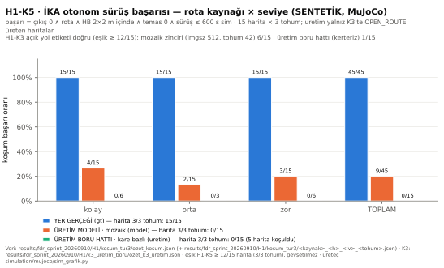

*Şekil 3.3.3.1 — Otonom karar ve sürüş başarı oranı, rota kaynağı × seviye (SENTETİK). Veri
`results/fdr_sprint_20260910/H1/kosum_tur3/ozet_kosum.json`; üreteç `simulation/mujoco/sim_grafik.py`.*

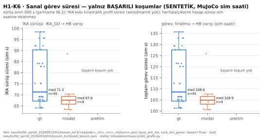

*Şekil 3.3.3.2 — Sanal görev süresi dağılımı: İKA sürüşü ve toplam görev, sim saniyesi (başarılı koşumlar; SENTETİK).*

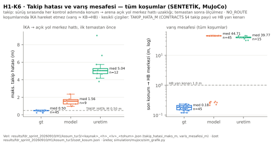

*Şekil 3.3.3.3 — Takip hatası (ilk temastan önce) ve varış mesafesi (SENTETİK).*

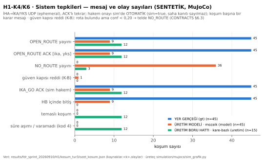

*Şekil 3.3.3.4 — Sistem tepkileri: OPEN_ROUTE / NO_ROUTE / ACK / IKA_GO / temas olay sayıları, teldeki karar tipinden (SENTETİK).*

**Sınırlar (bu ölçümün kapsamı dışı):** İHA uçuşu KİNEMATİK (aerodinamik yok); hakem onayı sim'de OTOMATİK; İKA iz
genişliği ve teker ataleti TAHMİN, motor tork sınırı yok; sim kamerası hfov 74,5° (gerçek ~55°, ÖLÇÜLMEDİ); irtifa
`poses.csv`'den gürültüsüz; kamera köprüsü (MJPEG) atlandı; Jetson ~1,35 FPS kare hızı modellenmedi; OBB araç maskesi
kapalı (sim'de araç yok); ışık/gölge çeşitliliği sentetik.

*(3 Eylül metni — 10 Eylül 2026'da MuJoCo ölçümüyle geçersizleşti; üstü çizili, silinmedi.)*

~~**ÖLÇÜLEMEDİ:** Otonom karar verme başarı oranı, sanal görev süresi ve sistem tepkisi
grafikleri. Üretici betikler depoda vardır (~~ ~~`simulation/scripts/score.py`~~
~~`simulation/score.py` — yol 10 Eylül'de düzeltildi, D-438 §0 ölçümü `simulation/score.py:141`;
`simulation/scripts/hakem_log.py`); koşum yapılmadığı için çıktı yoktur. Kapanma:
§3.3.3.1'deki makine sağlandığında.~~

🔴 **Karıştırma yasağı:** §3.3.4.2'deki K0–K8 ölçümleri (n = 260 sentetik arena kadrajı)
**simülasyon verisi DEĞİLDİR.** Onlar bir kadraj kümesi üzerinde koşulmuş **algı
ölçümleridir**; sanal görev icrası, sanal görev süresi ve İKA sürüşü içermezler. İki
sayı kümesi aynı tabloya konulamaz. Aynı yasak tersine de geçerlidir: §3.3.3.2'deki MuJoCo sayıları K0–K8 algı ölçümlerinin yerine konmaz.

#### 3.3.3.3 Video Kanıtı

> **Yönerge:** *"Simülasyonun gerçekleştirildiğine dair ekran kaydı videosunun bağlantısı
> (Link) raporda paylaşılmalıdır."*

**10 Eylül 2026 — video üretildi (SENTETİK; yerel dosya, git dışı):**

| alan | değer |
|---|---|
| dosya | `results/fdr_sprint_20260910/video/navitas_sim_gorev_20260910.mp4` (yerel; `.gitignore` `*.mp4`) |
| sha256 | `35ffc33e2f99c8335a7c4fe581cea257e294baea57f6f1edcd1fe1089139347d` |
| süre · kare hızı · çözünürlük | 177,88 s (4447 kare) · 25 FPS · 1280×720 · H.264 · 33,56 MB |
| kameralar | İHA nadir (tarama) · üçüncü şahıs (arena genel) · İKA takip — aynı ekranda, faza göre biri büyük |
| HUD | sim saati · faz (FIRLATMA / TARAMA / ROTA / AKTARIM / IKA_GO / SURUS / VARIS) · rota kaynağı etiketi · OPEN_ROUTE ACK [ika, yks] · IHA_LANDED · IKA_GO ACK · İKA→HB mesafesi · temas · oynatma hızı · **SENTETİK** |
| koşumlar | 3 başarılı ÜRETİM MODELİ koşumu: harita 1 kolay (tohum 44), harita 3 orta (tohum 42), harita 5 zor (tohum 42); giriş kartında genel oran (9/45, harita 0/15 — DÜŞTÜ) açıkça yazılı |
| kanıt bütünlüğü | kare kaydedici fizik trajektorisini değiştirmez: YER GERÇEĞİ koşumu `gt_1_kolay_42` kareli ↔ kaydısız 20/20 alan eş; model_1_kolay_44, model_5_zor_42 kosum_tur3 ile 11/11 alan eş; `model_3_orta_42` koşumunda rota GPU render'lı mozaikten farklı çıktı (`rota.json` farklı) → sürüş 65,9 ↔ 65,8 s |
| oynatma | FIRLATMA / TARAMA 2× · AKTARIM 1× · IKA_GO 0,25× · SURUS 3×; ROTA kartı sim saatini dondurur (hesap süresi modellenmez) — her karede HUD'da yazılı |
| üretim | `simulation/mujoco/sim_video.py --kos` ve `--birlestir`; ayrıntı `results/fdr_sprint_20260910/video/OKUBENI.md` |

**Video linki — BEYAN GEREKLİ (insan):** yükleme platformu (YouTube liste dışı / Drive) ve erişilebilir bağlantı
(T222). Link gelene kadar `Y-3.3.3-M03` ve `Y-4-M07` **KISMEN** kalır; yerel dosya yukarıdaki sha256 ile tanınır.

*(3 Eylül metni — 10 Eylül 2026'da MuJoCo ölçümüyle geçersizleşti; üstü çizili, silinmedi.)*

~~**ÖLÇÜLEMEDİ:** Ekran kaydı videosu ve linki. Üretim yolu depoda yazılıdır
(`simulation/docker/record.sh` → `simulation/recordings/v<id>/navitas.mp4`, 1280×720);
`simulation/recordings/` dizini **bugün yoktur**, yani hiç koşulmamıştır.~~

**BEYAN GEREKLİ (insan):** Video üretildikten sonra yükleneceği platform ve **erişilebilir
link**. Link olmadan bu madde `Y-3.3.3-M03` ve `Y-4-M07` **kapanmaz**. *(10 Eylül 2026: video üretildi — §3.3.3.3 tablosu; link bekleniyor, T222.)*

### 3.3.4 Görev Algoritması ve Yazılım Detayları

Bu alt bölüm raporun en kalabalık kanıt yığınıdır. Üç madde yönergededir: **detaylı
algoritma akışı** (§3.3.4.1), **görüntü işleme başarımı** (§3.3.4.2) ve **haberleşme
paket yapısı** (§3.3.4.3).

#### 3.3.4.1 Detaylı Algoritma Akışı

> **Yönerge:** *"İHA ve İKA'nın otonom davranışlarını yöneten ana döngülerin, karar
> mekanizmalarının detaylı akış diyagramları verilmelidir."*

Akışın **içeriği** ölçülmüştür: aşağıdaki on yedi alt başlık, üretim karar zincirini
adım adım, **satır numaralarıyla** ve her kararın arkasındaki ölçülmüş kusurla birlikte
verir. Eksik olan **çizimdir** (§3.3.4.1.17).

##### 3.3.4.1.1 Üretim algı zinciri — adım adım

Görev yolundaki tek karar zinciri `codes/rpi_inference.py:run_camera` (satır 2183)
içindedir. Adımlar, gerçek çağrı sırasıyla:

```
 kamera karesi (BGR)
   │
   ├─[1]─ _preprocess(img)                       rpi_inference.py:1888
   │        → sq (kare tuval, gri 114 dolgu) · small · icerik=(x0,y0,w,h)
   │
   ├─[2]─ model.predict(small, imgsz=INFER_SIZE) rpi_inference.py:2100
   │        INFER_SIZE = model_registry.json → profiles.competition.imgsz = 512
   │        (çıplak sayı YAZILMAZ — CONTRACTS §8, test_t163_cozunurluk_sozlesmesi.py)
   │
   ├─[3]─ get_masks(results, h, w)               rpi_inference.py:740
   │        → {0: zemin, 1: engel}  (sinif_semasi'nden okunan anahtarlar)
   │        + Katman-2 dedektörleri: ince bariyer (_ince_bariyeri_ekle:827)
   │
   ├─[4]─ kare_olcek_kahini(mpp, canli_olcek, icerik, bgr=...)   rpi_inference.py:449
   │        → mpp (metre/piksel). Kaynak hiyerarşisi CONTRACTS §5.1/§5.4.
   │        mpp YOKSA → NO_ROUTE(OLCEK_YOK). Rota ÜRETİLMEZ.
   │
   ├─[5]─ analyze_path(trav_mask, ..., goruntu=sq, sekil_esigi=HB_SEKIL_ESIGI)
   │        rpi_inference.py:1348 → 2116
   │        · en büyük bağlı bileşen (koridor)
   │        · K-A uç-bant teması (alt+üst bant, içerik dikdörtgenine göre)
   │        · C-uzayı: gecilebilir = (dist ≥ r_gerekli_px)
   │        · açıklık ağırlıklı A*: maliyet = 1,0 + λ·u^p   (λ=3,0 · p=2,0)
   │        · HB pedi görünürse A* HEDEFİ pedin kutusudur (T150/D-386)
   │        → open_path (1|2|3) · path_conf · waypoints · karar_reddi
   │
   ├─[6]─ _rota_kararini_esikle(...)             rpi_inference.py:1775 → 2133
   │        güven < ROTA_GUVEN_ESIGI (0,20) → yol None, waypoints boş
   │
   ├─[7]─ KararYumusatici.suz(open_path, karar_reddi)   karar_sozlesmesi.py:2140 → 2172
   │        yayın histerezisi, K = KARAR_HISTEREZIS_KARE = 3
   │        (NO_ROUTE ASLA geciktirilmez — §3.3.4.1.7)
   │
   └─[8]─ _karari_yayinla(...)                   rpi_inference.py:281 → 2139
            → KararYayinci.karar(...) → IhaSender.send_open_route / send_no_route
            → SiK 433 MHz (veya UDP) → YKS + İKA
```

Aynı zincir `run_video` (satır 2214) ve tek kare için `run_image` (satır 1982) kollarında da
**birebir aynı sırayla** çalışır; ayrım yalnız kaynaktadır.

> Yukarıdaki satır numaraları 3 Eylül taslağının anlık görüntüsüdür; silinmedi. 5 Eylül 2026
> (commit `64cd543`) karşılıkları: `run_camera` 2298 · `run_video` 2125 · `run_image` 1960 ·
> `_preprocess` 1892 · `model.predict` 2360 · `get_masks` 744 · `_ince_bariyeri_ekle` 831 ·
> `kare_olcek_kahini` 453 · `analyze_path` 1352 · `_rota_kararini_esikle` 1779 ·
> `KararYumusatici.suz` ~~`codes/karar_sozlesmesi.py:2158`~~ `codes/karar_sozlesmesi.py:2172` (`KARAR_HISTEREZIS_KARE` ~~:2122~~ :2136; 10 Eylül T214-B okuması) ·
> `_karari_yayinla` 285. Diyagram (a) §3.3.4.1.17 bu numaralarla çizildi.

**İki üretim yolu sorunu kapandı.** Denetimde `analyze_path` (Jetson) ile `rota_bul`
(simülasyon/`jetson_fps`) arasında hangi yolun yayına gittiği **belirsizdi**
(`results/sartname_bosluk/rapor.md` R1). Bugün üretim yayın yolu tektir: `run_camera` →
`analyze_path` → `KararYayinci`. Kuru koşu bunu satır satır kanıtlar (§3.3.1.3.1).


##### 3.3.4.1.2 Değişmez kural — *"Serbest alan OTORİTEDİR; nesne katmanı yalnızca ÇIKARIR"*

```
serbest = zemin  AND NOT  engel               ← ÇIKARMA EN SON
serbest(K1 ∧ ¬K2)  ⊆  serbest(K1)             ← DEĞİŞMEZ
```

Çıkarmadan sonra serbest alanı **büyüten** hiçbir işlem eklenmez: `cv2.dilate`,
`MORPH_CLOSE`, `MORPH_DILATE`, `bitwise_or`, `np.maximum` — **hepsi yasaktır.** (Bağlı
bileşen alan filtresi bir **silme** işlemidir; sorun değil.) Uygulama:
`codes/costmap_path_finder.py:212-213`.

**Bu kuralın mühendislik değeri:** Katman-2'ye yeni bir dedektör eklemek **monotonik olarak
güvenlidir** — sistem ancak daha güvenli olabilir. İnce bariyer dedektörü (§3.3.4.1.3) tam bu
sayede, model yeniden eğitilmeden eklenebildi.

**Ölçülmüş uyum:** C-uzayı kısıtı için `{dist ≥ r} ⊆ {dist > 0}`; 7 kompozit karede fazla
piksel **0** (`CONTRACTS.md` §5.3).


##### 3.3.4.1.3 Katman-2 dedektörü — ince bariyer (T67 · D-92/D-93/D-99)

**Neden var, ölçüldü (model kullanılmadan):** şartname figüründe bariyerin **3644**
pikselinin **%0,0**'ını model engel sayıyor, **%30,9**'unu **zemin** sayıyordu; üretilen rota
bariyeri **59 px** kesiyordu. Korumaların **hiçbiri** ateşlemiyordu (zemin kapısı susuyor,
ret yok, güven 0,75). Rotayı yayından alıkoyan tek şey `OLCEK_YOK` idi — bir kapı değil, bir
**eksiklik**.

🔴 **Dürüst sınır (D-99):** ölçüm zemini gerçek arena **değildir**. Şartname Şekil 1 alt
yazısı: *"Görsel tamamen yapay zeka ile oluşturulmuştur. Gerçek alanı doğrudan
yansıtmamaktadır."* Dolayısıyla bariyerin kırmızı-beyaz görünümü **uydurmadır** ve
dedektörün renk anahtarı (`BARIYER_KROMA_ESIGI = 25`, LAB `a*`) yapay bir görüntüden
kalibre edilmiştir. Gerçek arenada engeller kırmızı **olmayabilir** — o durumda dedektör
**hiç ateşlemez**: hiçbir şey ekler, hiçbir şey çıkarır; sistem T67 öncesi davranışa döner
(fail-safe). **Ayakta kalan gerekçe** şartname **metnidir** (§2.1): kapalı güzergâhlar
*"fiziki engellerle kapatılacaktır"* — ince-engel riski **gerçektir**, yalnız görünümü
bilinmiyor.


##### 3.3.4.1.4 Koordinat çerçeveleri — üç çerçeve, karıştırılırsa sessizce yanlış güzergâh

| çerçeve | tanım | kaynağı |
|---|---|---|
| **Kaynak** | ham kameranın kendi piksel uzayı (ör. 1600×900) | `cv2.imread` / kamera |
| **Tuval** | letterbox sonrası **kare** uzay (`max(h,w)²`), kenarlar gri `114` | `_preprocess` |
| **İçerik** | tuvalin içindeki gerçek görüntü dikdörtgeni `(x0, y0, w, h)` | `_preprocess` 3. dönüş değeri |

> **Kural:** her oran, eşik ve bölge hesabı **İÇERİK** dikdörtgenine göre yapılır — tuvale
> göre asla.

Kuralın nedeni **ölçülmüş üç ihlaldir** (düzeltildi, tekrarlanmasın diye sözleşmede durur):

| hata | ölçülen sonuç |
|---|---|
| şerit sınırları tuval genişliğine bölünüyordu | 576×1024 portrede net **SAĞ** koridor için **ORTA** dönüyordu → şartname: **0 puan** |
| `min_area_ratio` tuval alanına göreydi | 16:9'da eşik %1 yerine fiilen **%1,78** |
| tohum bandı tuvalin alt/üst %8'iydi | 16:9'da bantlar tamamen gri dolguda kalıyordu → **18/18 karede rota yok** |

**Yerel ↔ dünya:** `OPEN_ROUTE` waypoint'leri `ref_xy`'ye **göreli metre** cinsindendir;
`ref_xy` daima `[0, 0]`'dır (`YAYIN_REF_XY`) çünkü sahada ortak bir dünya çerçevesi yoktur.
İKA kendi çerçevesine **saf öteleme** ile oturtur; **dönme yoktur**
(~~`simulation/scripts/ika_nav.py:206`~~ `simulation/scripts/ika_nav.py:203`, `route_to_world_waypoints` içinde; 10 Eylül T214-B okuması).

Piksel → yerel metre dönüşümü: `x = (px − px₀)·mpp`, `y = (py₀ − py)·mpp` — piksel `y`
aşağı, yerel `y` **ileri**. İlk nokta `[0,0]`. Kenar `MAX_SEGMENT_M`'i aşarsa **mevcut kenar
bölünür**, yeni geometri eklenmez; sonuç `rota_geometrisini_dogrula`'dan geçer, geçmezse
`NO_ROUTE(ROTA_GEOMETRI)`.


##### 3.3.4.1.5 Ölçek (`mpp`) sözleşmesi — fail-closed'ın kalbi

`mpp` = metre / piksel. **İki bağımsız kaynak** vardır:

| # | kaynak | formül | bugün üretilebilir mi |
|---|---|---|---|
| **(a)** | **irtifa + kamera FOV/odak** | `mpp = 2·h·tan(FOV/2)/W_px` · `mpp = h/f_px` | ✅ **birincil** — MAVLink `GLOBAL_POSITION_INT.relative_alt`, tek okuyucu `comms/inis_kaniti.BagilIrtifaOkuyucu` (`comms/inis_kaniti.py:244-300`) |
| (b) | **HB pedinin bilinen 2,0 m kenarı** | `mpp = HB_KENAR_M / pedin piksel kenarı` | ✅ **ikincil, yalnız DOĞRULAR** |

**(b)'nin ölçülen başarımı** (n = 260 sentetik kadraj): tespit **260/260**, merkez hatası
medyan **0,71 px**, `mpp` medyan sapma **%5,2** (p90 **%8,6**).

**İki kaynak çelişirse ne olur — kodda değil sözleşmede tanımlıdır** (`CONTRACTS.md` §5.4):

| durum | seçilen `mpp` |
|---|---|
| yalnız telemetri | telemetri |
| yalnız HB | HB |
| ikisi var, bağıl fark ≤ `OLCEK_CAPRAZ_BANDI` (**0,25**) | **telemetri** (hiyerarşi değişmez; HB yalnız doğrular) |
| ikisi var, fark bandı aşıyor | **hiçbiri** → `("celiskili", fark)` |

🔴 **Çelişkide ortalama ALINMAZ.** İki bağımsız ölçüm çelişiyorsa *hangisinin doğru
olduğunu bilmiyoruz* demektir; uydurma bir orta değer, ölçülmemiş bir ölçeği ölçülmüş gibi
gösterir. Bant `0,25` seçildi çünkü HB'nin ölçülen sistematik sapmasının (**%5,2**)
yaklaşık **4,8 katıdır**: gerçek bir çelişkiyi yakalayacak kadar dar, dedektörün kendi
sapmasını çelişki saymayacak kadar geniş. Ölçüldü: n=260'ta **260 "doğrulandı" · 0
"çelişkili"**.

**Tazelik — bağlayıcı:** irtifa sabit bir CLI değeri değildir. Örneğin yaşı yalnız host
`time.monotonic()` ile ölçülür (Pixhawk saati host saatine **çevrilmez**).
`TELEMETRI_IRTIFA_TAZELIK_S = 0,50 s`; yaş bu sınıra ulaşır/aşarsa, hiç örnek yoksa veya
kaynak sysid değişirse irtifa **yok** sayılır ve `OLCEK_YOK` üretilir. **Bayat son değer
tekrar kullanılmaz.**

**Makullük bandı:** `SARTNAME_ASGARI_IRTIFA_M = 30,0` (§5.3.2) ve `IRTIFA_MAKUL_UST_M = 200,0`.
Bandın dışındaki telemetri **ölçek üretmez**.

🔴 **Kapatılan sessiz varsayım — ölçülmüş bir tuzak.** Eski `costmap_path_finder.olcek_px(None)`
hâlâ `m = 1.0` alıp `r_gerekli_px = 1,10 piksel` döndürür. Bu *"ölçek yok"* değil *"ölçek
1 metre/piksel"* demektir. Kompozit arenada gerçek değer `1,10 / 0,0868 = 12,7 px` — yani
gövde açıklığı sessizce **~11 kat** küçülüyordu ve hiçbir uyarı basılmıyordu. Sayı geriye
uyum için korundu; **görev yolu artık onu kullanmıyor** ve `tests/test_olcek_ve_c_uzayi.py`
farkı kilitliyor.


##### 3.3.4.1.6 Geometri sabitleri ve C-uzayı

Tek kaynak: `codes/costmap_path_finder.py`.

| sabit | değer | anlam |
|---|---|---|
| `IKA_GENISLIK_M` | 0,70 | İKA gövde genişliği |
| `MASKE_HATA_M` | 0,25 | segmentasyon sınır belirsizliği |
| `TAKIP_HATA_M` | 0,50 | sürüş takip hatası |
| **`R_GEREKLI_M`** | **1,10** | `0,70/2 + 0,25 + 0,50` — **geçilebilirlik yarıçapı** |
| `ALGI_PAYI_M` | 0,25 | engel genişletme payı |
| `AC_M` / `KAPAT_M` | 0,30 / 0,40 | zemin morfolojisi |
| `LAMBDA_ACIKLIK` / `US_ACIKLIK` | 3,0 / 2,0 | A* açıklık cezası `1,0 + λ·u^p` |
| `WP_ARALIK_M` / `MAKS_WP` | 2,0 / 64 | waypoint aralığı ve tavanı |

Geçilebilirlik testi **C-uzayında** yapılır (`gecilebilir = dt_px >= r_gerekli_px`), **ham
maskede asla**. `scipy.ndimage` ve `cv2.ximgproc` bu projede yasak/yok olduğu için koridor
merkezinden geçme davranışı medial-axis yerine **açıklık ağırlıklı A\*** ile elde edilir;
bu **bilinçli bir ikamedir**, eksiklik değil.

**C-uzayının ölçülen etkisi** (arena kompoziti, kusursuz yer gerçeği maskesi, tek değişken
`mpp`; `CONTRACTS.md` §5.3):

| | doğru şerit | yanlış şerit | ret | rota darboğazı | güven |
|---|---:|---:|---:|---|---|
| C-uzayı **yok** | 1/7 | 0 | 6 | **1,0 px** (4 karede) | 0,028–0,117 |
| C-uzayı **var** | **6/7** | **0** | 1 | **13,0–15,0 px** | 0,644–0,744 |

Kalan 1 ret `UC_BANT_TEMAS_YOK`'tur ve C-uzayından **önce de** vardı — K-A'nın kendi
fail-closed reddidir.


##### 3.3.4.1.7 Yayın histerezisi (K = 3) — analiz katmanına dokunmadan

**Sorun ölçüldü:** şerit seçimi sürekli büyüklükler üzerinde ayrık bir karardır; **binde-4**
algı gürültüsü kararları kareler arasında çevirebiliyordu (T68 ölçümü: tohuma göre 4–7/260;
T92 bant oynaklığı 34/260). Yayımlanan şerit zikzak yaparsa İKA'nın hedefi zikzak yapar.

**Çözüm yayın katmanındadır** (~~`codes/karar_sozlesmesi.py:2117`~~ `codes/karar_sozlesmesi.py:2136` `KARAR_HISTEREZIS_KARE = 3`,
sınıf `KararYumusatici`). Analiz katmanına **dokunulmamıştır** (madde 15).

| kural | davranış |
|---|---|
| `NO_ROUTE` / ret | **ANINDA** yayımlanır ve durum sıfırlanır — fail-closed asla geciktirilmez |
| ilk rota, `NO_ROUTE` sonrası ilk rota | ANINDA yayımlanır |
| yayımlanan şeritle aynı şerit | ANINDA yayımlanır (tazelik yenilenir) |
| **farklı** şerit | ancak **K = 3 ardışık** karede aynı yeni şeritle görülürse yayına geçer |
| **H5 tavanı** | bastırma `K − 1` ardışık kareye dayanınca **bir sonraki kare ne olursa olsun** yayımlanır — yayın bundan fazla bayatlayamaz |

H5 tavanı bir tasarım hatasını **birim testi yakaladığı için** vardır: yayımlanan 2 iken
analiz 1/3 arasında salınırsa tavansız sürüm **süresiz** bastırıyordu.

**Ölçüm** (`results/p5_histerezis/olcum_20260903.json`, σ = 2,0/255, kare başına 5 örnek,
n = 260, model v36):

| tohum | ham çevrilme | **yayımlanan çevrilme** | bastırılan | bastırılan `NO_ROUTE` |
|---|---:|---:|---:|---:|
| 7 | 13 | **7** | 6 | **0** |
| 42 | 24 | **11** | 14 | **0** |

Yani çevrilmelerin yaklaşık yarısı yayına hiç çıkmadı ve **hiçbir `NO_ROUTE` geciktirilmedi**.
Gecikme tavanı 3 karedir: uçtan uca p95 0,113 s ile ≈ **0,34 s**, `YKS_TESPIT_TAZELIK_S / 2`
(2,5 s) değerinin çok altında.

> Eşik değişikliği **yeni ön kayıt** ister (`results/p5_histerezis/ON_KAYIT.md`).

🔴 **Ön kayıtlı H1 GEÇİLMEDİ — ve eşik gevşetilmedi.** Ön kayıt "yayımlanan çevrilme
≤ ham çevrilmenin **%40'ı**" diyordu. Ölçülen: **7/13 = %53,8** (tohum 7) ve
**11/24 = %45,8** (tohum 42) — ikisi de eşiğin üstünde; artefaktta
`H1_ozgun: false` olarak durur. Eşik **değiştirilmedi**; bunun yerine mekanizmanın
asıl vaadi, bileşim görülmeden yazılan iki yeni ölçütle sınandı ve **geçti**:
H1a (azınlık şerit→şerit sızıntısı **0/0**) ve H1b (kesin azalma). H1c
(sınıflandırılamayan yayımlanmış çevrilme = 0) **damgalanmadı** ve bu raporun
kendi kuralınca **açık** sayılır. Kayıt: `ON_KAYIT.md` EK-1,
`olcum_20260903.json`. Bu, raporda **geçilmeyen ikinci ön kayıttır** (birincisi
§3.3.4.2.5'teki gerçek-kare eşikleridir).


##### 3.3.4.1.8 Yayın sözleşmesi (K1) — `CONTRACTS.md` §6.5

**Neden var:** denetimde ölçüldü ki `codes/rpi_inference.py` `run_camera`/`run_video`
telsize **hiç** yazmıyordu; `OPEN_ROUTE`/`NO_ROUTE` üreticisi yalnız bir Gazebo betiğiydi.
Sahada **İHA kararı YKS'ye ve İKA'ya ulaşmıyordu**
(`results/sartname_bosluk/rapor.md` R4, KRİTİK).

| kural | değer / davranış |
|---|---|
| kurulum | yalnız `--yks-hedef` / `--ika-hedef` / `--telsiz-seri` verilince; **hedef yoksa gönderici hiç yüklenmez, davranış bayt-eş aynıdır** |
| `open_path is None`, sebep yok | `NO_ROUTE(KARAR_YOK)` |
| ölçek yok / geometri bozuk | `NO_ROUTE(OLCEK_YOK)` / `NO_ROUTE(ROTA_GEOMETRI)` |
| `HEARTBEAT` | ayrı iş parçacığı, `IHA_HEARTBEAT_ARALIK_S = 1,0 s` < `IkaReceiver.hb_timeout = 3,0 s` (2 ardışık kayıp bağlantıyı düşürmez) |
| kuyruk | **latest-wins tek yuva**: kamera döngüsü ACK beklemez; ACK'li gönderim ayrı iş parçacığındadır; `stop()` bekleyen son kararı gönderip durur |
| telsiz hatası | kamera döngüsünü **düşürmez**; `yayinci.hata`'ya yazılır ve çıkışta basılır |

`KARAR_YOK` ve `ROTA_GEOMETRI` sebepleri `ROTA_RET_SEBEPLERI` kümesine **girmez** — o küme
analiz katmanının ret sebepleridir; bunlar **yayın katmanının** fail-closed varsayılanlarıdır.


##### 3.3.4.1.9 Çıplak sayı yasağı (madde 16) — nasıl kilitlendiği

Bu projede ölçülmüş kusurların büyük kısmı algoritma hatası değil, **iki modülün aynı sayıya
farklı anlam vermesiydi.** En pahalı örnek: `iha_haritala.py` çalışma anında
`{0: zemin, 1: moloz, 2: araç}` kuruyor ve `engel_sinif_idler=(1, 2)` veriyordu; eğitim
şemasında `2 = hedef` (H brandası) olduğu için 3 sınıflı bir model bu yola verilseydi
**H brandası ENGEL sayılacaktı** → İKA hedefe hiç ulaşamaz → `P_görev = 0`.

**Çözüm — tek otorite `codes/sinif_semasi.py`, iki ad alanı ayrıldı:**

| ad alanı | sabitler | kim üretir |
|---|---|---|
| **Eğitim sınıfı** | `ZEMIN=0` · `ENGEL=1` · `HEDEF=2` | model çıktısı / YOLO etiketi |
| **Costmap katmanı** | `KATMAN_ZEMIN=0` · `KATMAN_MOLOZ=1` · **`KATMAN_ARAC=10`** | çalışma anı |

Araç katmanı **10**'dan başlar; eğitim sınıf uzayıyla (0..9) **çakışmasın** diye seçildi.
`sinif_semasi` **import anında** `dogrula()` koşar: sabitler çakışırsa **modül yüklenmez**.
Doğrulama `codes/test_sinif_semasi.py` → **8 GEÇTİ / 0 DÜŞTÜ**, içinde bir **pozitif kontrol**
vardır: *"eski şemada hedef ENGEL sayılıyordu"* testi kusuru yeniden üretir.

Aynı disiplin çözünürlük için de geçerlidir: `imgsz` yalnız
`config/model_registry.json → profiles.competition.imgsz` (**512**) üzerinden okunur,
`CONTRACTS.md` §8'de çıplak yazılmaz; kilit `tests/test_t163_cozunurluk_sozlesmesi.py`.


##### 3.3.4.1.10 Fail-closed ilkesi — "ölçemiyorsam üretmem"

Sistemin emniyet duruşu tek cümleyle özetlenir: **kanıt yoksa çıktı yoktur.** Uygulamaları:

| durum | davranış | kod |
|---|---|---|
| ölçek üretilemiyor | **rota ÜRETİLMEZ** → `NO_ROUTE(OLCEK_YOK)` | `karar_sozlesmesi.rota_olcek_reddi` |
| ölçek kaynakları çelişiyor | ortalama alınmaz → ölçek **yok** sayılır | `olcek_capraz_kontrolu` |
| güven < `ROTA_GUVEN_ESIGI` (0,20) | yol `None`, waypoint boş; ayrıca yayın katmanında **ikinci savunma** | `_rota_kararini_esikle` + `iha_sender.send_open_route` güven kapısı (`rota_guven_reddi(conf)`, `comms/iha_sender.py:152-155`) |
| zemin maskesi şüpheli | `ZEMIN_MASKESI_SUPHELI` (kaplama tavanı 0,55 · kenar dayanma tavanı 0,40) | `zemin_maskesi_reddi` |
| model kaydı uyuşmuyor | model **yüklenmez** | `rpi_inference.load_model` |
| kamera ardışık 30 kare düşürdü | **kontrollü bitiş** (`KAMERA_BITIS_DUSEN_KARE`) | `KAMERA_DUSEN_KARE_UST_SINIRI = 30` |
| İKA sürücüsü 3 ardışık arıza | son bir durdurma denenir, `navigate` **False** döner | `ARDISIK_HATA_TAVANI = 3` (10 Hz'de ~0,3 s) |
| ölçüm alt betiği çöktü | kapı `OLCULEMEDI` → terfi **bloklanır** | `65_kabul_denetcisi.py` |

**Ret sebepleri kanonik kodlardır** ve hakem ekranında ayrı ayrı görünür:
`OLCEK_YOK`, `ZEMIN_MASKESI_SUPHELI`, `MASKE_YOK`, `BILESEN_YOK`, `UC_BANT_TEMAS_YOK`,
`ALAN_YETERSIZ`, `GORUS_HATTI_KOPUK`, `KENAR_GUVENSIZ`, `DUSUK_GUVEN`, `KORIDOR_DEGIL`,
`HEDEF_YOK`, `ALAN_IHLALI`, `ASGARI_IRTIFA_ALTI`, `KARAR_YOK`, `ROTA_GEOMETRI`.


##### 3.3.4.1.11 ARM kilidi — "düğme durumu emniyet sinyali DEĞİLDİR"

Ölçülmüş kusur (D-393 §2): `firlatma()` ARM kilidini **düğmenin görsel durumuna** emanet
ediyordu (düğme DISARM'da pasif). Kısayol ya da doğrudan çağrı kilidi aşabilirdi.
**Düzeltme:** `arm_acik` yoksa damga **atılmaz** ve KİLİT loglanır. Bu, projede *T180 sınıfı*
olarak adlandırılan genel kuralın uygulamasıdır: **UI durumu tek başına emniyet sinyali
değildir; eylemin kendisi de reddedilmelidir.**

Aynı kural FDA kipinde kapatılan her düğme için de geçerlidir (§3.3.4.1.15).


##### 3.3.4.1.12 İki aşamalı hakem onayı (§2.2.3)

| adım | ön koşul | ne üretir |
|---|---|---|
| **ONAY 1/2** — "canlı görüldü" | ekranda geçerli `OPEN_ROUTE` (şerit no + güven + waypoint çizimi) | hakem sözlü onayı |
| **ONAY 2/2** — "İKA'ya aktarıldı" | İKA'dan `ACK(ref=seq, ref_tip="OPEN_ROUTE")` **ekranda görünmeli** | İHA'ya ACK gider, zaman damgası yazılır |

Kanıt gelmezse düğme **pasif** kalır ve gerekçe metni görünür. Bu **bilinçli bir seçimdir**:
kanıtsız onay yerine **görünür ret**.

**§2.2.3 sıra denetimi (D-393 §3):** aktarımın İHA **havadayken** tamamlanması gerektiği için
İKA'nın rota ACK'ine `HAVADA ✓` / sarı uyarı damgası basılır; `IHA_LANDED` geldiğinde ACK
hâlâ yoksa ekranda KIRMIZI **"İHLAL RİSKİ: aktarım İHA havadayken tamamlanmadı"** görünür.

**`IKA_GO` ACK'li tekrar (D-02 kapanışı):** Denetimde ölçüldü ki `IKA_GO` **tek atıştı**,
ACK beklenmiyordu ve gönderim sonrası düğme **kalıcı kilitleniyordu** — tek paket kaybı
görevi **geri dönülmez** biçimde bitiriyordu. Bugün: aynı `seq` ile
`IKA_GO_TEKRAR_ARALIGI_S = 0,25 s` aralıkla en çok `IKA_GO_TEKRAR_UST_SINIRI = 20` kez;
İKA'dan `ACK(ref_tip="CMD")` gelince durur. Üst sınır aşılırsa ekranda KIRMIZI
**"İKA ONAY VERMEDİ"**, düğme yeniden aktif, İKA kronometresi **başlamamış sayılır** —
görev kaybedilmez. İKA tarafı **idempotenttir**: mükerrer `IKA_GO` latch'i yeniden kurmaz
ama **her alım ACK'lanır** (YKS'nin tekrarı ancak böyle durur).
Kilit: `tests/test_ika_go_ackli_tekrar.py` — gerçek UDP loopback'te paket düşürme, ACK yok →
üst sınır, mükerrer `IKA_GO`, kanıtsız düğme pasif; **5 mutasyonun tamamı yakalandı**.


##### 3.3.4.1.13 İKA hareket kilidi (§2.2.5)

```
sür  ⟺  (geçerli OPEN_ROUTE)  ∧  (İHA inişi tamamlandı)  ∧  (YKS'den IKA_GO geldi)
```

Şartname: *"İHA yere temas etmeden İKA hareket edemez. İHA iniş yapmadan harekete geçen
takımların görevi başarısız sayılacaktır."*

**İniş sinyalini üreten kimdir — denetimde kapanan boşluk.** Kapı kuruluydu ama üretim
zincirinde iniş sinyalini üreten **yoktu**; varsayılan koşumda kilit hiç açılmıyordu.
Bugün üretici `comms/iha_inis_yayinci.py`'dir ve kanıt **Pixhawk telemetrisidir**:
`EXTENDED_SYS_STATE.landed_state == ON_GROUND` **ardından** `GLOBAL_POSITION_INT.relative_alt < 1 m`,
**aynı sysid**, **3 ardışık çift**, mutlak deadline; sonra `send_iha_landed` ACK'li gider.

🔴 **Manuel "İHA İNDİ" düğmesi latch'i AÇMAZ** — kilit
`tests/test_iha_landed_gate.py:313` ile kilitlidir. Operatörün beyanı kanıt değildir.

**Sürücü katmanı da kilidin altındadır** (`CONTRACTS.md` §7.2): izinler gelmeden sürücüye
sıfır-dışı komut düşmez (`tests/test_p3_ika_surucu.py::T6`). `GercekSurucu` arka uçsuz
**kurulamaz** (`DONANIM_YOK` istisnası) — **sessiz iskelet yasaktır.**

**Varış = brandaya TEMAS (§7.3, SS7 P_görev):** görev *"branda üzerine fiziksel temas"* ile
biter; sınıra girmek 0 puandır. İki yarım da kilitlidir:
1. **İHA yarısı:** rotanın son waypoint'i HB pedinin kutusunda biter — ölçüldü **253/256**
   (ped görünmezken `HEDEF_YOK`).
2. **İKA yarısı:** `navigate` son waypoint'te `FINAL_WP_RADIUS = 0,3 m` kullanır ve
   **`FINAL_WP_RADIUS < HB_KENAR_M/2` (1,0 m)** eşitsizliği bağlayıcıdır → araç merkezi ped
   kenarından ≥ **0,7 m** içeride durur, gövde pedin üstündedir.

> ~~⚠ Gazebo **fiziksel temas** koşusu geliştirme makinesinde **ÖLÇÜLEMEDİ** (gz yok);
> Gazebo'lu makinede koşulacaktır.~~ `ÖLÇÜLEMEDİ ≠ GEÇTİ`.
> → **10 Eylül 2026 (SENTETİK, §3.3.3.2):** İKA yarısı MuJoCo fiziğinde koşuldu — YER GERÇEĞİ rotayla 45/45 koşum HB 2×2 m karesi içinde bitti, temaslı koşum 0, varış mesafesi medyan 0,2 m. Gazebo koşulmadı (önceki tasarım). Simülasyondur, saha kanıtı değildir; gerçek İKA koşusu A1'e bağlıdır.


##### 3.3.4.1.14 Süre limitleri (§6.2 / §6.4)

| sabit | değer | şartname alıntısı |
|---|---|---|
| `SARTNAME_IHA_GOREV_SURESI_S` | 900 | §6.2 *"Bu işlemler için tanınan maksimum süre 15 dakikadır."* |
| `SARTNAME_IKA_GOREV_SURESI_S` | 600 | §6.2 *"İKA'nın HB'ye ulaşması için verilen maksimum süre 10 dakikadır."* |
| `SARTNAME_FDA_OPERASYON_SURESI_S` | 600 | §5.3.2 tüm operasyon |
| `SARTNAME_HAZIRLIK_SURESI_S` | 900 | hazırlık kronometresi |
| `IHA_INIS_HEARTBEAT_ARALIGI_S` | 0,5 | < `IkaReceiver.hb_timeout` (3 s) |

**Bağlayıcı kural:** İKA'da **iki ayrı son tarih** vardır — bekleme ve sürüş. Sürüş saati
izin geldiği **anda** başlar; beklemede geçen süre sürüşten **düşülmez**. Tek ortak deadline
(eski `--timeout 60`) **yasaktır** — sahada iniş dakikalar sonra gelir. Sürüş süresi dolunca
İKA `send_vel(0,0)` ile durur; **serbest alan/rota kararına dokunulmaz** (madde 15).
Kilit: `tests/test_k5_k6_sure_limitleri.py` (sahte saat + gerçek UDP loopback; **4 mutasyonla
düştüğü gösterildi**).


##### 3.3.4.1.15 FDA görev kipi (`--fda`) — görev test uçuşunda onayı İMKÂNSIZ kılan kilidin kaldırılması

**Ölçülen tıkanma (D-407/D-408):** `yks_gui` yarışma günü görevine göre yazıldı. Hakem onayı
2/2 adımı `ika_aktarim_kaniti_var()` istiyordu (K8, §2.2.3). FDA'da **İKA olmadığı için** bu
kanıt **hiç gelmez** → onay tamamlanamaz → İHA'ya ACK gitmez. Şartname §5.3.2 *"gerçek zamanlı
tespitin hakem heyetince doğrulanıp onaylanması"*nı zorunlu kıldığından bu, **uçuşu geçersiz
kılacak bir GUI kilidiydi.**

**Sözleşme (`CONTRACTS.md` §6.7) — `--fda` verildiğinde:**

| konu | yarışma kipi (§2.2) | **FDA kipi (§5.3.2)** |
|---|---|---|
| İHA süre bütçesi | 900 s | **600 s** |
| hakem onayı 2/2 | İKA'nın `OPEN_ROUTE` ACK kanıtı **şart** | **İKA kanıtı ARANMAZ**; 2/2 = "YKS'de canlı görüldü + hakem sözlü onayı" → ACK İHA'ya gider (`ref_tip` ile). Ekranda dayanak: *"FDA §5.3.2: İKA yok — onay YKS aktarımına dayanır"* |
| PARAŞÜT düğmesi | manuel yedek (−50 puan) | **KAPALI** — basılırsa komut **gönderilmez**, KIRMIZI: *"FDA kipinde paraşüt yok (çoklu rotor)"*; etiket `PARAŞÜT (FDA dışı)` |
| FIRLATMA düğmesi | mancınıktan ayrılma damgası | etiket **`KALKIŞ`**; damga = kalkış anı, kronometre burada başlar. **ARM kilidi AYNEN** |
| İKA BAŞLAT | §2.2.5 zinciri | **KAPALI**, `IKA_GO` **gönderilmez** |
| iniş kanıtı (`IHA_LANDED`) | zorunlu | **aynen zorunlu** |
| asgari irtifa notu | bilgi | **aynen** (30 m) |

Kip **açılışta** belirlenir, koşarken **değişmez** ve ekranda sürekli görünür. Sınıf
varsayılanı **yarışma kipidir**; `--fda` verilmedikçe davranış **bayt-eş** değişmez.

**Kanıt:** `tests/test_faz_b_yks_fda_kipi.py` **9 test** (gerçek `protocol.encode/ack`
çerçeveleri, link çağrıları çözülerek denetlenir), içinde **iki pozitif kontrol** vardır
(kanıt varken yarışma kipinde de onay tamamlanır; yarışma kipinde iki tıkla `PARACHUTE`
gerçekten gider) — yani "kilit hep kapalı" diye geçen sahte bir test yoktur.
**Mutasyon: 4/4 yakalandı** (M1 onay kilidi geri → test 1 düştü; M2 paraşüt kilidi kalk →
test 3 düştü; M3 İKA kilidi kalk → test 4 düştü; M4 etiketler uygulanmaz → test 5 düştü);
dosya `cmp` ile **bayt-eş** geri yüklendi.

> ⚠ **DENETİM BORCU (kayıtlı):** §6.7 sözleşmesini de uygulamasını da aynı el yazdı.
> Bağımsız denetim, 21 Eylül Adıyaman provasında **hakem rolü oynanarak**
> kapatılacaktır.


##### 3.3.4.1.16 Tazelik ve körlük — "heartbeat akıyor" ≠ "sistem görüyor"

`HEARTBEAT.karar_yas` alanı, İHA'nın son **ALGI KARARININ** yaşını taşır (saniye, monotonik
saat). Alan **yoksa** yaş BİLİNMİYOR demektir ve alıcı **taze saymaz.**

**Neden:** ölçüldü ki 45–51 saniyelik bir algı körlüğünde heartbeat **akmaya devam ediyordu**
(D-374). Hat canlılığı algı canlılığı değildir.

**Çürütücünün bulduğu üç kaçak da kapatıldı (D-383 §2):**
- **Duvar saati asimetrisi:** İHA tarafı monotonikken YKS alım tarafı `time.time`'daydı;
  saat 30 s geri alınınca **bayat** tespit **TAZE** görünüyordu. Alım damgası ve geçen-süre
  hesabı monotonik yapıldı; repro artık bir testtir.
- **NaN kaçağı:** `nan > eşik` daima `False` olduğu için NaN bir `karar_yas`, BİLİNMİYOR
  korumasını atlatıp tespiti **kalıcı taze** gösteriyordu. İki katmanda süzülüyor; negatif de
  reddediliyor.
- **Ekran kendisiyle çelişiyordu:** bant KIRMIZI *"ALGI ZAMAN AŞIMI"* derken tazelik kutusu
  *"0,5 sn TAZE"* gösteriyordu. Düzeltildi.


##### 3.3.4.1.17 Akış diyagramları — çizim eksiği

**7 Eylül 2026 — beş akış diyagramı koddan türetildi** (Y-3.3.4-M01). Her düğüm ya bir fonksiyon/blok (`dosya:satır`, satır o tanımın/deyimin başı) ya da koşul metni koddan **birebir** alıntılanmış bir karardır; başka düğüm tipi yoktur. Düğüm → satır tabloları `sekiller/akis_<x>_dugumler.md`; doğrulayıcı `scripts/akis_diyagram_dogrula.py` (7 Eylül: 337/337 düğüm tam satırda, 0 hata); nöbetçi `tests/test_gece_akis_diyagramlari.py` (13 test). SVG'ler Chrome headless ile üretildi (`scripts/mermaid_svg.py`; mermaid-cli yok). Vektördür: PDF'te sayfa genişliğine ölçeklenir, okunur ölçek için görüntüleyicide yakınlaştırılır ya da `.svg`/`.mmd` kaynağı ve düğüm tablosu okunur.

(a) İHA ana döngüsü — `codes/rpi_inference.py` (`main` → `run_camera` → `kamera_kareleri`), 51 düğüm:

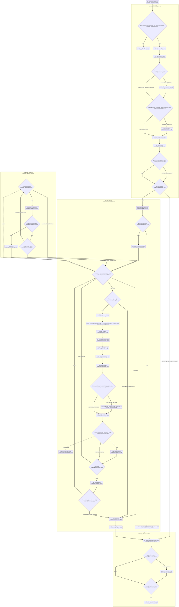

(b) Komut alıcısı — `comms/iha_komut_alici.py` (kaynak pini → bozuk/bilinmeyen CMD → saat ofseti ve zaman kapısı → oturum tekrar anahtarı → MAVLink → COMMAND_ACK → terminal → ACK), 68 düğüm:


(c) İniş kanıtı — `comms/iha_inis_yayinci.py` + `comms/inis_kaniti.py` (akış isteği/bakım, `_yerde_mi_sahipli` ardışık çift döngüsü, IHA_LANDED yayını + heartbeat), 62 düğüm:

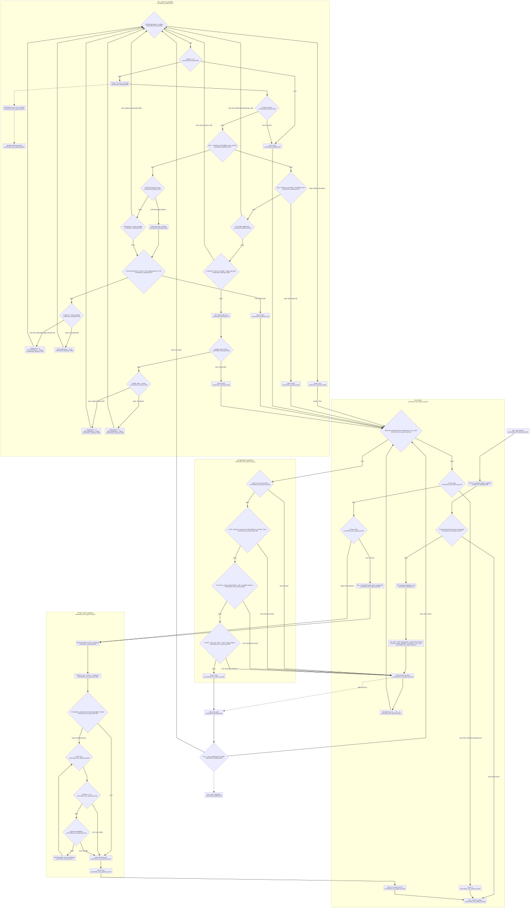

(d) YKS hakem ekranı — `comms/yks_gui.py` (açılış ve `--fda`, dinleme ipliği, tik döngüsü, mesaj işleme, ACK bağlama, iki aşamalı onay, `KANIT_OLAYLARI` kanıt kaydı ve kilidi, fırlatma/İKA kilitleri), 86 düğüm:

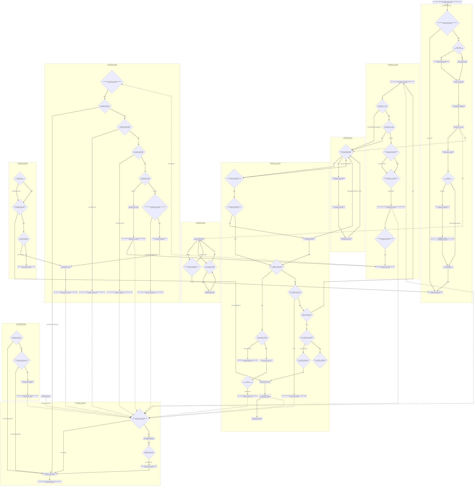

(e) İKA otonom sürüş — `simulation/scripts/ika_nav.py` + `comms/ika_receiver.py` kapıları, 70 düğüm; halka 10 (motor sürücüsü) diyagramda `surucu()` → `_SURUCU = ika_surucu.GazeboSurucu()` (~~`simulation/scripts/ika_nav.py:59`~~ `simulation/scripts/ika_nav.py:64`) düğümü ve "gercek motor surucusu YOK" kenarıyla görünür — gerçek motor sürücüsü **yoktur** (§3.3.1.3.1):

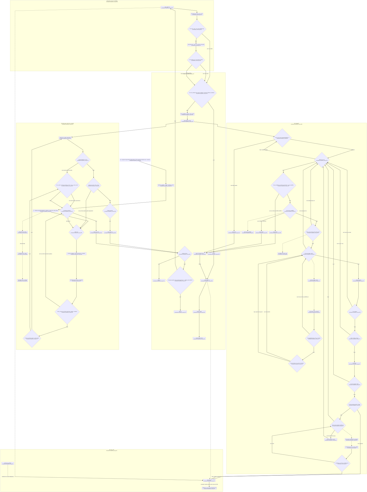

Beşi de koddan türetildi (kaynak commit `f3441b4`, 2026-09-07; teslim commit `366f574`); düğüm tabloları `sekiller/akis_a_dugumler.md` … `sekiller/akis_e_dugumler.md`.

**7 Eylül öncesi durum (o gün ölçülememişti):** Yönergenin istediği **çizilmiş akış diyagramları**. Bugün akış
metin ve ASCII blok olarak vardır (§3.3.4.1.1 sekiz adım, satır numaralarıyla;
§3.3.1.1.4 ve §3.3.1.1.5 iki kipin mesaj akışı). Bunlar akışın **içeriğidir**; eksik
olan **görsel biçimdir**.

**KARŞILANDI (7 Eylül 2026):** (a) `sekiller/akis_a.svg` (51 düğüm), (b) `sekiller/akis_e.svg` (70 düğüm). Halka 10 sahipsizliği (e)'de `_SURUCU = ika_surucu.GazeboSurucu()` düğümüyle (~~`simulation/scripts/ika_nav.py:59`~~ `simulation/scripts/ika_nav.py:64 _SURUCU`) ve "varsayilan: Gazebo (gercek motor surucusu YOK)" kenar etiketiyle görünür; çalışmayan kutu çalışıyor gibi çizilmedi. 7 Eylül öncesinde insandan beklenen beyan şuydu: (a) İHA ana döngüsü ve (b) İKA otonom sürüş döngüsü için
rapora gömülecek akış diyagramı görselleri. İKA döngüsünün diyagramı çizilirken
**halka 10'un sahipsiz** olduğu (gerçek motor sürücüsü yok — §3.3.1.3.1) diyagramda da
görünmelidir; çalışmayan bir kutu çalışıyor gibi çizilemez.

#### 3.3.4.2 Görüntü İşleme Başarımı

> **Yönerge:** *"Rota tespiti için kullanılan yapay zeka veya görüntü işleme modelinin,
> yarışma sahasına benzer koşullarda (farklı ışık açıları, gölgeler vb.) yapılan test
> sonuçları ve doğruluk matrisleri sunulmalıdır."*

Önce modelin künyesi ve kayıt defteri disiplini (§3.3.4.2.1), sonra karar zincirinin
kabul kapıları (§3.3.4.2.2 – §3.3.4.2.7), en sonda yönergenin istediği **"benzer
koşullar"** ölçütünün karşılanmayan kısmı (§3.3.4.2.8).

##### 3.3.4.2.1 Model künyesi ve kayıt defteri fail-closed'u

| alan | değer |
|---|---|
| `model_id` | `navitas-seg-v36-512` |
| mimari | YOLOv8**m**-seg (27,2 M parametre) |
| çıkarım boyutu | **512** |
| arka uç (üretim) | `pytorch` |
| SHA-256 (`.pt`) | `1d1caca6f6da19ea35e69186a048da960ca5188be6ee6d49d6106457cac46911` |
| sınıflar | `{0: traversable, 1: blocked}` |
| ONNX türevi | `f4c9f5fe08883d1aecc9b4ac3ce9f98cea61de2f5298edde5d2c2a7a5056deab` |
| TensorRT `.engine` | `DERLENINCE_YAZILIR` → **yer tutucu = derlenmedi = RED** |

**Türev doğrulaması fail-closed'dur.** Eskiden `model_kayit_dogrula` yalnız **dosya adını**
kıyaslıyordu; her `.engine` "EŞLEŞMİYOR" ile reddediliyor ve Jetson'da TensorRT ancak
`--kayit-dogrulamasiz` ile — yani **fail-closed kapatılarak** — yükleniyordu (D-284, T18
çürütücüsü). Bugün: türevin `sha256`'sı yer tutucu değilse **ve** diskteki dosyanın özetiyle
birebir aynıysa geçer; kayıtsız/yabancı `.engine` **RED**; `kaynak_sha256` üretim `.pt`
özetiyle eşleşmezse türev **YETİM** sayılır ve **RED**.

Saha paketindeki ayna kopya `jetson_paket/config/model_registry.json` ile aynı olmak
zorundadır; nöbetçi `tests/test_t202_jetson_paket_butunlugu.py`.

**Sayısal denklik ölçümleri (kapı değil, ölçüm):**
- **ONNX ↔ PyTorch karar denkliği:** n=260'ta karar **259/260** aynı (1 uyuşmazlık:
  `sa_000215.jpg`, pt=2 · onnx=1); zemin maskesi IoU ortalaması **0,9975**; azami rota
  sapması **172,1 px = 13,443 m**. Ön kayıt kuralı `≤ 5/260` **sağlandı**. ⚠ Koşum CPU
  EP iledir; **TensorRT motorunun kendi denkliği Jetson'da AYRICA ölçülmelidir**.
- **FP16 karar denkliği:** zarar yönü (FP32 doğruyken FP16 yanlış şerit) **0** → GEÇTİ;
  karar uyuşması **0,9968** (eşik 0,98) → GEÇTİ.


##### 3.3.4.2.2 Karar zinciri kabul kapıları — K0…K8 + K5A

Kapıların tamamı tek betikten koşulur: `scripts/olcum/65_kabul_denetcisi.py`. Eşiklerin
tamamı **sonuç görülmeden** yazıldı ve hiçbiri değiştirilmedi; ancak hepsi tek kayıtta
değildir: **K0–K5** `REVIEW_LOG.md` D-107 (14 Ağustos), **K6 ve K7**
`results/gece_20260826/ON_KAYIT.md` (26–27 Ağustos), **K8 ve K5A** D-332 / D-334
(29–30 Ağustos). Bir eşiği doğrularken bu üç kaynağa ayrı ayrı bakılır.


##### 3.3.4.2.3 Kapı tablosu

| kapı | ne ölçer | eşik | ölçülen (bugünkü zincir) | sonuç |
|---|---|---|---|---|
| **K0** | **körlük yok** — model boş maske üretmiyor, figürde zemin görüyor | `figür > 0` · boş maske yok | figür zemin **%2,66** · ham boş **0/67** · copy-paste boş **0/393** | **GEÇTİ** |
| **K1** | rota üretilen kare sayısı | **≥ 230** / 260 | **256/260** | **GEÇTİ** |
| **K2** | rotanın molozdan geçmesi | **≤ %15** | **6/256 = %2,34** | **GEÇTİ** |
| **K3** | **ağır** moloz teması | **≤ %3** | **0/256 = %0,00** | **GEÇTİ** |
| **K4** | arena dışına taşma | **≤ %5** | **2/256 = %0,78** | **GEÇTİ** |
| **K5** | **bariyer kesişimi** (popülasyon) | **= 0 px**, her ölçülebilir karede | **0/178** ölçülebilir kare · toplam **0 px** | **GEÇTİ** |
| **K5A** | bariyer kesişimi — **açılı** bariyer kümesi | K5 ile **birebir aynı** | **0/176** ölçülebilir kare · **0 px** | **GEÇTİ** |
| **K6** | yanlış güzergâh (rota çizgisinin yer gerçeği sınıf 0 üstündeki payı ≥ 0,90 **ve** sınıf 1 üstünde 0 waypoint) | **≤ %5** | **2/256 = %0,78** | **GEÇTİ** |
| **K7** | **YAYINLANAN ŞERİT DOĞRULUĞU** — 260'ın tamamı değil, **şerit etiketi bilinen 88 karelik alt küme** üzerinde | doğruluk **≥ %95** **ve** payda **≥ 80/88** | **84/85 = %98,82** (85 karede rota üretildi, 84'ü doğru şeritte; yanlış: `sa_000090.jpg` 2→3) | **GEÇTİ** |
| **K8** | **TEK FİGÜR KAPISI** (şartname Şekil 1, yapay zekâ üretimi görsel — K0 ile **aynı görüntü**, **n = 1**) — üretim karar yolu bu karede kırılıyor mu | `ZEMIN_MASKESI_SUPHELI` **dönmemeli** | zemin kaplaması **0,0444** · karar yolu reddi `UC_BANT_TEMAS_YOK` | **GEÇTİ** |

Kaynak: `scripts/olcum/results/t63/t150_baglama_v36_kabul_verdikt.json` (**1 Eylül
2026**, üretim kipi — hedef bağlaması T150 ile açık), model
`models/navitas_seg_v36_best.pt`. Toplu verdikt: **10/10 kapı GEÇTİ**. Bu koşum,
raporda "bugünkü zincir" diye anılan **tek** koşumdur; Bölüm 4 §4.8.1 de aynı dosyayı
kullanır (iki bölüm arasında sayı farkı yoktur).

**Kapıların kendi ayırt ediciliği ölçülmüştür.** Örnek: K5A kümesi (`sentetik_arena_kadraj_ACILI_t189`)
yatay kümenin aynı üreteç/tohum/parametreleriyle, yalnız `--bariyer-acisi 90` eklenerek
üretildi. **Mutasyonla ölçülen ayırt edicilik** (`scripts/olcum/results/t63/t189_ayirt_edicilik.json`):
T184 öncesi dedektör bu kümede **185/260 → 48/260** düşüyor (**52,7 puan**), yatay kümede ise
**181/260 → 181/260** hiç düşmüyor. Yani K5A, yatay kümenin göremediği **dönme körlüğünü**
gerçekten ölçüyor.


##### 3.3.4.2.4 İki ölçüm hattı — aynı model, farklı karar katmanı

`config/model_registry.json` içindeki `metrics` bloğu **terfi anının** sayılarını taşır
(26 Ağustos, `gece_v7a_kabul_verdikt.json`). §3.3.4.2.3'teki tablo ise **bugünkü karar zinciriyle**
yeniden koşulmuş sayılardır. İkisi farklıdır ve **fark modelden değil zincirden gelir**:

| kapı | terfi anı (26 Ağu · registry) | özdenetim (28 Ağu) | **üretim kipi (1 Eyl · bugünkü zincir)** |
|---|---|---|---|
| K1 | 255/260 | 256/260 | **256/260** |
| K2 | 15/255 = %5,88 | 6/256 = %2,34 | **6/256 = %2,34** |
| K3 | 1/255 = %0,39 | 0/256 = %0,00 | **0/256 = %0,00** |
| K4 | 4/255 = %1,57 | 3/256 = %1,17 | **2/256 = %0,78** |
| K6 | 7/255 = %2,75 | 3/256 = %1,17 | **2/256 = %0,78** |

28 Ağustos ile 1 Eylül arasındaki fark **T150 hedef bağlamasıdır**: varış noktası
artık HB'den alınır, rota iki karede daha arena dışına taşmaz. Üç sütun da
saklanır; rapor "bugünkü zincir" derken **en yenisini** (1 Eylül) kullanır.

Aradaki iyileşme T184 (dönme körlüğü) ve T198 (şekil kapısı) düzeltmelerinin karar
katmanındaki etkisidir. **Bu sayı model başarımı değil ZİNCİR başarımıdır** ve öyle
okunmalıdır. Terfi anının sayıları **silinmemiştir**; kayıt defterinde durur.


> ⚠ Yukarıdaki paragraf 3 Eylül taslağında **eski 3.5.1** numarasına atıf yapıyordu;
> taşımadan sonraki karşılığı **§3.3.4.2.3 Kapı tablosu**'dur ve atıf yeni numaraya
> çevrilmiştir (harita §3.0.3).

##### 3.3.4.2.5 🔴 GEÇİLMEYEN kapı — üretim modeli ön kayıtlı iki eşiği geçmeden terfi etti

Bu bölüm bilerek öne alınmıştır. Kayıt defterinin **kendi cümlesi**
(`config/model_registry.json → metrics.gercek_kare_kapisi.sonuc`):

```text
🔴 ON KAYITLI ESIKLER GECILMEDI: ROTA >= 10 istendi, olculen 8;
   MASKE_YOK <= 10 istendi, olculen 16.
   GECILEN: FP <= 1 (1) ve YANLIS GUZERGAH = 0 (0).
   Terfi bu esikleri GECEREK degil, KULLANICI KARARIYLA yapildi.
   ESIKLER DEGISMEDI ve sonraki terfileri baglar.
```

**Gerçek kare doğrulama kümesi** (`dataset/dji_kirsal_0038_bolum_v3`, iki bağımsız **kör**
etiket geçişinin uzlaşısı; 0038 kareleri eğitime ve erken durdurmaya **girmedi**):

| küme | n | rota | maske yok | TP | FP | FN | yanlış güzergâh | tavan (rota) |
|---|---:|---:|---:|---:|---:|---:|---:|---:|
| `test29` | 29 | **8** (eşik ≥10 ❌) | **16** (eşik ≤10 ❌) | 7 | **1** (≤1 ✅) | 5 | **0** (=0 ✅) | 12 |
| `val82` | 82 | 30 | 35 | 28 | 2 | 15 | 7 | 43 |

**Terfi gerekçesi (kayıtlı):** gerçek karede yanlış güzergâh **15/21 → 7/38**, engel üstü
waypoint **79 → 3**. **Kabul edilen bedel:** K3 0→1, K4 1→4, K6 5→7 (hepsi kapı içinde),
figür zemin oranı düştü, val82 FP 0→2. Dayanak `REVIEW_LOG.md` D-293, ön kayıt
`results/gece_20260826/ON_KAYIT.md` §15, çürütücü çıktıları
`results/gece_20260826/v7a_curut/`.

**Yedek aday silinmedi ve FARKLI HATA YAPAR:** önceki üretim `navitas-seg-v35-512`
(sha `e00f6b8e…`) arena K3/K4/K6'da daha iyidir (0/1/5) ama gerçek karede daha kötüdür.
İki modelin hata profili farklıdır; seçim bir **ödünleşimdir** ve öyle kayıtlıdır.

> **Bu satırın raporda durmasının nedeni:** eşikler sonradan gevşetilseydi bu terfi
> "kapıdan geçti" diye yazılabilirdi. Eşikler değişmedi; bu yüzden sonraki her terfi de aynı
> çıtayla ölçülecektir.


##### 3.3.4.2.6 Kapıların kapsam sınırı — kabul denetçisinin kendi uyarısı

Denetçi her koşumda şu satırı **kendisi basar**:

```text
⚠ Bu olcumlerin tamami SENTETIKTIR. Hicbiri 'sahada calisir' anlamina gelmez
  (D-88 + D-99, kalici kisit).
```

Kayıt defterinin `_kapsam` alanı aynı şeyi söyler: *"ARENA ÖLÇÜMLERİNİN TAMAMI SENTETİKTİR
(T66 ada kadrajı, n=260); gerçek ARENA karesi YOKTUR — K0..K6 SAHA BAŞARIMI İDDİA ETMEZ."*

🔴 **ARENA BENZERİ SAHA KANITI (kırmızı H + moloz + bariyer) HÂLÂ YOKTUR.** Doğrulama
kümesi aynı gün, aynı kamera, aynı saha türü (kırsal) ve **arena değildir** — "alan dışı"
sorusunu yalnızca **kısmen** kapatır. K8 kapısı da `n = 1`'dir ve dayandığı figür şartnamenin
kendi ifadesiyle *"tamamen yapay zekâ ile oluşturulmuştur"*.

**BEYAN GEREKLİ (insan):** Arena benzeri gerçek saha görüntüsü (kırmızı H brandası + moloz +
fiziki bariyer, ≥ 30 m irtifadan) toplanırsa K0–K8 zinciri bu küme üzerinde yeniden koşulup
sonuç bu bölüme eklenecektir. Bu görüntü bugün **yoktur** ve maket çekimi **yapılmayacaktır**.


##### 3.3.4.2.7 Ölçülmüş ama kapı OLMAYAN büyüklükler (dürüstlük gereği burada)

| büyüklük | ölçülen | not |
|---|---|---|
| **karar çevrilmesi** (kararsızlık) | v36 **14/260** (tohum 7) · **15/260** (tohum 11) | 🔴 **v35'ten KÖTÜ** (9/260 · 11/260). Eşli ölçüldü — aynı koşum oturumu, aynı gürültü gerçekleştirmeleri. Yön iki tohumda da aynı. Bu, §3.3.4.1.7 histerezisinin **var olma nedenidir**. |
| **çatı kaçağı** | **0,0230** (medyan 0,0119) | 55 çatılı gerçek karede tam maske ölçümü. v34 0,9606 → v35 0,0428 → v36 0,0230. Aynı koşumda disk sınaması: çatı→engel 0,9908 · çatı→zemin 0,0000 |
| **gerçek kare zemin kaplaması** | tuval paydası **0,2346** · içerik paydası **0,4171** | Bağımsız (modelsiz) tahmine göre gerçek sürülebilir oran %47–52'dir; v36 o aralığın **altına düştü**. Yani bu terfi *"daha az görüyor"* yönündedir — kabul edilen bedel budur |
| `mask mAP50-95` | 0,155 (val) | **ÖLÇÜM DEĞİL KARAR GİRDİSİ DEĞİL**: val kümesi 0037/0039'dan türetildiği için v35'in temiz-bölüm val'i ile **kıyaslanamaz**. Karara girmedi |


##### 3.3.4.2.8 Yönergenin istediği "benzer koşullar" ve doğruluk matrisi

Yönerge iki şey ister: (a) bugün **karşılanmamıştır**; (b) 7 Eylül 2026'da DOĞRULAMA
kümesinde **ölçülmüştür** (arena değil):

**(a) Yarışma sahasına benzer koşullarda test.** Bugünkü iki ölçüm kümesi:
sentetik arena (n = 260 kadraj) ve gerçek kırsal DJİ kareleri (`test29` n = 29,
`val82` n = 82). Kabul denetçisi her koşumda kendi çıktısına *"Bu ölçümlerin tamamı
SENTETİKTİR"* satırını basar (§3.3.4.2.6). **Farklı ışık açısı ve gölge kesitlerinde
ayrı bir ölçüm yapılmamıştır** — kümeler bu eksende bölünmemiştir.

**ÖLÇÜLEMEDİ:** Farklı ışık açısı ve gölge koşullarında doğruluk. Bunun için arena
benzeri gerçek saha görüntüsü (kırmızı H brandası + moloz + fiziki bariyer, ≥ 30 m)
gerekir ve bugün **yoktur** (§3.3.4.2.6); maket çekimi **yapılmayacaktır**. Kapanma
yolu: 5–19 Eylül saha uçuşlarında farklı saatlerde çekim.

**(b) Doğruluk matrisleri.** K7 (**şerit doğruluğu** 84/85 = %98,82, §3.3.4.2.3) bir
**karışıklık matrisi değildir** — tek eksenlidir ve 88 karelik alt küme üzerindedir.
Sınıf bazlı matris **7 Eylül 2026'da ÖLÇÜLDÜ** — kör **DOĞRULAMA kümesi `test29`**
(CONTRACTS §12; 29 kare, 3840×2160, etiket uzlaşısı v3) üzerinde, üretim modeli v36
(`1d1caca6…6911`, kayıt defterinden), **üretim algı yoluyla** (`_preprocess` → `predict`
CONF 0,30 · imgsz 512 → `get_masks` → içeriğe kırp; `65_kabul_denetcisi.kaplama()` ile
aynı zincir), **CPU** ile. Üretici `scripts/olcum/176_piksel_karisiklik_matrisi.py`; artefakt
`results/gece_20260907/karisiklik/piksel_karisiklik_test29.{json,md,png}` + `kosum.log`;
nöbetçi `tests/test_gece_karisiklik_matrisi.py` (10 test: satır/sütun toplamları = piksel,
IoU 0..1, 29 kare, model sha256 = defter). **Piksel düzeyi**, 240.537.600 px; satır =
tahmin, sütun = yer gerçeği; **etiketsiz piksel ayrı sütundur, engele KATILMAZ** (D-315):

| tahmin \ yer gerçeği | zemin | engel | ETİKETSİZ | satır toplamı |
|---|---:|---:|---:|---:|
| zemin | **12.004.796** | 790.630 | 3.445.818 | 16.241.244 |
| engel | 3.080.875 | **92.405.877** | 11.819.510 | 107.306.262 |
| yok | 8.515.024 | 28.602.498 | 79.872.572 | 116.990.094 |
| sütun toplamı | 23.600.695 | 121.799.005 | 95.137.900 | 240.537.600 |

Sütun payı (yer gerçeği içinde): zemin → zemin **0,509** / engel 0,131 / yok 0,361 ·
engel → engel **0,759** / zemin 0,006 / yok 0,235 · etiketsiz → yok 0,840. **IoU**
(etiketsiz sütun FP sayılmadan): zemin **0,4922** · engel **0,7400**; etiketsiz FP
sayılarak: 0,4313 · 0,6760. Etiketli piksel doğruluğu 0,7181; etiketsiz pay
0,3955 (piksellerin %39,6'sı etiketsizdir — üçüncü sütun bu yüzden vardır). Kare
bazında: 16/29 karede zemin tahmini **hiç yok** (§3.3.4.2.5'teki MASKE_YOK 16/29 ile aynı
sayıdadır; o ölçüm ayrı hattır, `142_gece_olcum`), 11 karede zemin etiketi varken zemin
tahmini yok (IoU 0); engel IoU 12 karede ≥ 0,90, 4 karede 0. T67 ince bariyer katmanının
payı 8.707 px (1 kare) — yalnız-model matrisi JSON'da ayrıca durur, IoU'lar
aynıdır. **Örnek (nesne) düzeyi** aynı CONF/imgsz ile `ultralytics` `model.val` (CPU,
`dataset/test29_v3.yaml`; ultralytics ön işlemesi, üretim yolu değil): satır = tahmin, sütun
= yer gerçeği, son satır/sütun arka plan — zemin **15** / 1 / 1 · engel 1 / **33** / 11 ·
arka plan 35 / 142 / —; sütun toplamları 51 / 176 etiket dosyalarındaki poligon
sayılarıyla birebir. Maske P 0,7196 · R 0,2114 · mAP50 0,1860 · mAP50-95 0,0672.

**SINIR (değişmedi):** bu küme **DOĞRULAMA kümesidir, arena değildir** (kırsal yol; kırmızı H,
moloz yığını, fiziki bariyer içermez) — arena başarımı iddia edilmez. Matrisin okunuşu
§4.8.4'teki D-315 uyarısıyla yapılır: etiketsiz sütun model hatası değildir. Sorumlu rol:
**R7 Yazılım / görüntü işleme**; **eşik değiştirme yetkisi yoktur**, yalnız ölçüm ekler.

**5 Eylül eki — depo taraması ve var olan tek matris.** `results/`, `scripts/olcum/results/`
ve `results/fdr/GORUNTU_ISLEME_KANIT.md` içinde v36 için sınıf bazlı matris / önerme-hatırlama
artefaktı **yoktur**; `sinif_bazli` alanını üreten `scripts/olcum/11_capraz_dogrulama.py`
en son 12 Ağustos'ta v15 için koştu (`results/capraz_dogrulama_v15_ft2sinif_20260812/`),
üretim modeline uygulanmadı. Var olan tek matris eğitim koşumunun Ultralytics 8.4.92 yan
ürünüdür: `codes/runs/segment/gece_v7a_v35taban/confusion_matrix.png` (26 Ağustos 16:36;
`weights/best.pt` SHA-256 `1d1caca6…` = üretim `.pt`, 5 Eylül'de doğrulandı; eğitim sonu
doğrulaması `best.pt` üzerinde koşar, D-115). Örnek (nesne) düzeyi, conf 0,25 · IoU 0,45
(`ultralytics/utils/metrics.py:407,426`); satır = tahmin, sütun = yer gerçeği; "arka plan"
sütunu = yer gerçeği karşılığı olmayan tahmin, "arka plan" satırı = hiçbir tahminle
eşleşmeyen yer gerçeği (`metrics.py:433-478`):

| tahmin \ yer gerçeği | zemin (0) | engel (1) | arka plan |
|---|---:|---:|---:|
| zemin (0) | **68** | 0 | 22 |
| engel (1) | 0 | **108** | 55 |
| arka plan | 70 | 132 | — |

Sütun toplamları (138 / 240) `dataset/dji_v7/labels/val` örnek sayılarıyla birebir aynıdır.
Sütun payı (`confusion_matrix_normalized.png`): zemin 0,49 / 0,51 · engel 0,45 / 0,55 ·
arka plan 0,29 / 0,71. Aynı koşumun `results.csv` epoch 2 satırı (= `best.pt`): maske
**P 0,6236 · R 0,4168 · mAP50 0,3866** — toplam, sınıf bazlı değil.

Bu matris yönergenin istediği matris **DEĞİLDİR** ve satırı tek başına kapatmaz: (i) küme
arena değil, eğitim uçuşları 0037/0039'dan rastgele %15'tir (`dataset/dji_v7/images/val`,
n = 73) ve yalnız erken durdurma içindir (`config/model_registry.json → _egitim`);
(ii) örnek düzeyidir, piksel düzeyi değildir; (iii) sınıf ekseni modelin iki sınıfıdır —
HB pedi ve ince bariyer model sınıfı değildir (§3.3.4.1.1); (iv) çalışma noktası üretimden
farklıdır (üretim CONF 0,30, `65_kabul_denetcisi.py:113`); (v) dizin `.gitignore` (`runs/`)
ile depo dışıdır, makine okunur matris dosyası yoktur. **Kapandı (7 Eylül 2026):** yukarıdaki
(b) ölçümü — kör `test29` üzerinde piksel ve örnek düzeyi, üretim çalışma noktasında, makine
okunur JSON depoda (`results/gece_20260907/karisiklik/`).

#### 3.3.4.3 Haberleşme Paket Yapısı

> **Yönerge:** *"İHA ile İKA arasında, ayrıca Yer İstasyonu ile araçlar arasında
> aktarılan veri paketlerinin nihai yapısı, veri hızı ve gecikme test sonuçları
> belirtilmelidir."*

Üç istekten **paket yapısı** (§3.3.4.3.1, §3.3.4.3.2) ve **gecikme** (§3.3.4.3.3)
ölçülmüştür; ~~**veri hızı** ölçülmemiştir:~~ **veri hızı** 10 Eylül'de **yazılım
düzeneklerinde** ölçülmüştür (§3.3.4.3.3, "10 Eylül" tablosu); **RF hattında hâlâ
ÖLÇÜLEMEDİ**:

**ÖLÇÜLEMEDİ:** SiK 433 MHz hattında fiilî veri hızı (bit/s) ve paket/s. ~~§3.3.4.3.3'teki
sayılar **gecikme** ölçümleridir, veri hızı ölçümü değildir;~~ §3.3.4.3.2'deki tekrar
aralıkları ~~ise~~ **tasarım sabitleridir**, ölçülmüş akış değildir. ~~Kapanma: 5 Eylül,
`scripts/sik_rf_olc.py` gerçek radyo çiftiyle koşulduğunda.~~
**10 Eylül (T216):** `scripts/sik_rf_olc.py`'a bayt/paket sayacı ve `veri_hizi` alanı eklendi;
UDP loopback ve TCP-seri köprüsünde RTT **ve** veri hızı ölçüldü (§3.3.4.3.3 tablo; kaynak
`results/fdr_sprint_20260910/H2/olcum_*.json`). 5 Eylül'de radyolar bağlandı ama betik
koşulmadı (D-426 §1); **kapanma:** ekip SiK çiftini taktığında aynı araç
(`--rol yanki --port COMx` / `--rol olc --port COMy --n 200 --json --cikti …`) — RF satırı o
koşumun JSON'u olmadan kapanmaz.

##### 3.3.4.3.1 Çerçeve protokolü (SiK 433 MHz / UDP)

- **Çerçeveleme:** satır sonu (`\n`) ile ayrılmış **tek satır JSON**, UTF-8
  (~~`comms/protocol.py:216 encode` / `:222 decode`~~ `:229 encode` / `:235 decode` — 10 Eylül
  okuması: T208 mesaj tipi sabit bloğu `MESAJ_*` (`protocol.py:28-39`) +13 satır kaydırdı;
  3 Eylül taslağındaki `:193`/`:199` satır numaraları 5 Eylül'de yeniden okunmuştu).
  `json.dumps(separators=(",", ":"),
  ensure_ascii=False, allow_nan=False)` — NaN çerçeveye giremez. Taşıyıcıdan bağımsızdır.
- **Parçalı veri güvenli okuyucu:** `FrameReader` bayt akışından tam çerçeveleri ayıklar.
- **Tampon tavanı:** `CERCEVE_TAMPON_TAVANI = 64 KiB`. SiK hattında gürültü newline
  üretmeden uzun süre akabilir; tavansız tampon belleği tüketirdi. Tavan aşılınca tampon
  atılır ve hat **bir sonraki newline'da** senkronize olur.
- **Bozuk JSON satırı atılır**, süreç yaşar.
- ⚠ **Protokolde CRC/checksum YOKTUR.** SiK radyosunun kendi hata düzeltmesine güvenilir.
  Bu bilinçli bir sadeleştirmedir ve **ölçülmemiş bir risktir** (§3.4).

**Mesaj tipleri ve alanları** (`CONTRACTS.md` §6 tablosu; üreticiler `comms/protocol.py`,
satır numaraları 5 Eylül okuması). Her çerçevede ortak: `v` (= `PROTOCOL_VERSION` 1,
`protocol.py:23`), `type`, `seq` (düğüm başına sayaç), `t` (gönderenin duvar saati, ms'ye
yuvarlı).

| `type` | üretici | alanlar | üreten fonksiyon |
|---|---|---|---|
| `OPEN_ROUTE` | İHA | `road` (1=sol, 2=orta, 3=sağ), `label`, `conf`, `ref_xy`, `waypoints` | `open_route` (~~`protocol.py:41`~~ `:54` · 10 Eylül) |
| `NO_ROUTE` | İHA | `sebep`, `detay` (isteğe bağlı) | `rota_yok` (~~`:73`~~ `:86`) |
| `HEARTBEAT` | herkes | `node`; İHA ayrıca `karar_yas` ve `HEARTBEAT_TELEMETRI_ALANLARI` (~~`:103`~~ `:116`: `x, y, alt, hiz, yon, bat, bat_yuzde, uydu, karar_yas, lat, lon, gps_fix, armed, mod, pixhawk_canli`) — bilinmeyen alan **yazılmaz**, sözleşme dışı alan `ValueError` | `heartbeat` (~~`:113`~~ `:126`) |
| `ACK` | YKS / İKA / İHA | `ref` (seq), `node`; isteğe bağlı `ref_tip`, `ref_cmd`, `sonuc` | `ack` (~~`:128`~~ `:141`) |
| `CMD` | YKS | `cmd`, `hedef`; isteğe bağlı `oturum` (`[A-Za-z0-9_-]{16,64}`, ~~`:31-34`~~ `:44-47`) | `command` (~~`:184`~~ `:197`) |
| `IHA_LANDED` | İHA | `node="iha"`, `seq` | `iha_landed` (~~`:198`~~ `:211`) |

Tip adları **tek yerden** okunur (T208, 10 Eylül): `protocol.MESAJ_OPEN_ROUTE`, `MESAJ_NO_ROUTE`,
`MESAJ_HEARTBEAT`, `MESAJ_ACK`, `MESAJ_CMD`, `MESAJ_IHA_LANDED` (`MESAJ_TIPLERI`, `protocol.py:32-39`);
üreticiler ve alıcılar (`ika_receiver`, `yks_gui`, `komut_tekrar`, `iha_sender`, `iha_komut_alici`, sim
betikleri) çıplak `"OPEN_ROUTE"` dizgisi yazmaz (madde 16). Tel üzerindeki değer değişmedi; satır atıfları
yukarıda 10 Eylül okumasıyla güncellendi.

**`karar_yas` semantiği (`CONTRACTS.md` §6 tablosu, D-381):** İHA'nın son **algı kararının**
yaşı (s, monotonik saat). Alan **yoksa** yaş bilinmiyor demektir; alıcı **taze saymaz** — hat
canlılığı algı canlılığı değildir (D-374: 45–51 s körlükte heartbeat akmaya devam etti).

**FDA görev kipi (`--fda`) — hatta akan paketler değişir (`CONTRACTS.md` §6.7, D-407):**

| konu | yarışma kipi (§2.2) | FDA kipi (§5.3.2) |
|---|---|---|
| hakem onayı 2/2 | İKA'nın `OPEN_ROUTE` ACK kanıtı **şart** | **İKA kanıtı ARANMAZ**; 2/2 = "YKS'de canlı görüldü + hakem sözlü onayı" → ACK İHA'ya gider (`ref_tip` ile, §6.6). Ekranda gerekçe: `FDA §5.3.2: İKA yok — onay YKS aktarımına dayanır` |
| PARAŞÜT düğmesi | manuel yedek (−50, §2.2.4) | **KAPALI**. Basılırsa komut **gönderilmez**, KIRMIZI: `FDA kipinde paraşüt yok (çoklu rotor)` |
| İKA BAŞLAT / İKA kronometresi | §2.2.5 zinciri | **KAPALI**, etiket `İKA (FDA dışı)`; `IKA_GO` **gönderilmez** |
| iniş kanıtı (`IHA_LANDED`) | zorunlu | **aynen zorunlu** |

Kip açılışta belirlenir, koşarken değişmez, ekranda sürekli görünür. Kilit:
`tests/test_faz_b_yks_fda_kipi.py` (9 test; D-408 §3: 4/4 mutant yakalandı). 5 Eylül saha
YKS'si `--fda` ile açıldı (`REVIEW_LOG.md` D-427 tablosu: `yks_gui.py --fda --ika 10.0.0.2:5006 …`,
PID 15092).

**Yer istasyonunda kalıcı kanıt kaydı (`CONTRACTS.md` §6.8):** hattan geçen onay zinciri
`comms/hakem_kaydi.py` ile diske düşer — UTF-8 JSONL, satır başına `flush`+`fsync`
(`hakem_kaydi.py:94`); yol `--hakem-log` ya da
`results/prova/<YYYYMMDD_HHMMSS>_<pid>/hakem_log.jsonl` (`varsayilan_hakem_log_yolu`, `:21`).
Dosya açılamazsa kurucu yükseltir (fail-closed). Her satırda ortak alanlar
(`hakem_kaydi.py:79-83`): `v`, `ts` (yerel ISO-8601, ms), `monotonic_s`, `oturum`, `olay`.
Olay kümesi tek yerden okunur: `yks_gui.KANIT_OLAYLARI` (`comms/yks_gui.py:127`, **16 olay**;
CONTRACTS tablosu ↔ sabit ↔ AST üç yönlü eşitlik kapısı `tests/test_yks_hakem_kanit_olaylari.py`,
22 test, D-419 §2).

| `olay` | ne zaman yazılır | zorunlu alanlar |
|---|---|---|
| `YKS_ARAYUZ_HAZIR` | kurucunun sonunda, dinleyici thread'inden önce | `demo`, `kamera_yapilandirildi`, `tasiyici`, `komut_oturumu` |
| `ROTA_ALINDI` | kabul edilen `OPEN_ROUTE`un **yeni** `seq`'i işlendiğinde | `seq`, `road`, `label`, `conf`, `waypoint`, `ankor` |
| `ROTA_REDDEDILDI` | güven eşiği altındaki `OPEN_ROUTE` — **ACK üretilmez** | `seq`, `sebep`, `detay` |
| `ROTA_YOK` | yeni `NO_ROUTE`, ACK gönderildikten sonra | `seq`, `sebep`, `detay` |
| `ACK_ALINDI` | yapısal olarak geçerli her `ACK` (`ref` int) | `node`, `ref`, `ref_tip` |
| `IKA_AKTARIM_KANITI` | K8 kanıtı (§6.6) geçerli rota `seq`'i için **ilk** bağlandığında | `seq`, `iha_havada` |
| `HAKEM_ONAYI_1` | 1/2 "tespit doğrulandı" | `seq`, `road`, `conf` |
| `HAKEM_ONAYI_2` | 2/2 onay ve ACK link'e yazıldıktan sonra | `seq`, `ref_tip`, `fda_kipi`, `dayanak`, `iha_indi` |
| `HAKEM_ONAYI_REDDI` | fail-closed ret: `ANKOR_YOK` · `BAYAT_TESPIT` · `IKA_ACK_KANITI_YOK` | `seq`, `sebep` |
| `IHA_INIS_KANITI` | yeni `IHA_LANDED` `seq`'i, ACK gönderildikten sonra | `seq`, `ika_rota_ack_var` |
| `KAMERA_KANIT` | kamera kanıt durumu **değiştiğinde**; değişmezse tekrar aralığında bir | `durum`, `degisim`, `kare_yasi_s`, `kare_sira`, `kaynak`, `hata`, `calisiyor` |
| `TELEMETRI_KANIT` | düğüm tazelik özeti **değiştiğinde**; değişmezse tekrar aralığında bir | `durum`, `degisim`, `bayat`, `yas_s`, `dugumler` |
| `ACIL_SENARYO` | demo arıza tatbikatı tetiklendiğinde | `kod`, `senaryo_no` |
| `KRONOMETRE_BASLADI` | fırlatma/kalkış · `IKA_GO` · alan girişi · müdahale sonrası devam (`kron` ∈ {iha, ika, hazirlik}) | `kron`, `limit_s`, `devam` |
| `KRONOMETRE_BITTI` | İHA indi · HB temas · takım hazır | `kron`, `sure_s`, `limit_s`, `asim` |
| `UI_OLAYI` | `_logla` ile günlüğe yazılan **her** satır | `mesaj`, `seviye` |

Tekrar aralığı `KANIT_TEKRAR_ARALIGI_S = 30.0` (`yks_gui.py:151`); `HEARTBEAT` başına satır
**yazılmaz**. Ölçülen kayıtlar (`results/prova/`, 5 Eylül sayımı; Python `json` +
`collections.Counter`):

| koşum | satır | farklı `olay` | içerik |
|---|---|---|---|
| `20260904_103744_8536` (4 Eylül, `demo=true`, `tasiyici="udp"`) | 16 | 9 | `ROTA_ALINDI` 1 · `ACK_ALINDI` 1 · `IKA_AKTARIM_KANITI` 1 · `KAMERA_KANIT` 1 · `TELEMETRI_KANIT` 2 · `UI_OLAYI` 7 · `OTURUM_BASLADI` / `YKS_ARAYUZ_HAZIR` / `OTURUM_BITTI` 1'er |
| `20260905_142958_15092` (**saha, 5 Eylül**, `--fda`, `demo=false`, `tasiyici="udp"`, `komut_oturumu` mevcut) | 1115 | 5 | 14:29:59 → 19:07:02 (277 dk); `KAMERA_KANIT` 554 · `TELEMETRI_KANIT` 554 (≈ 2 satır/dk = 30 s aralığı) · `UI_OLAYI` 5; rota/onay olayı **yok** (İHA hatta değildi); `OTURUM_BITTI` **yok** (`kapat()` çağrısına ulaşılmadı) |


##### 3.3.4.3.2 ACK'li tekrar parametreleri

| komut | aralık | üst sınır | pencere | sabit (satır numaraları 5 Eylül okuması; `karar_sozlesmesi.py` satırları ~~5 Eylül~~ 10 Eylül T214-B okuması) |
|---|---|---|---|---|
| `OPEN_ROUTE` / `NO_ROUTE` / `IHA_LANDED` | 0,25 s | 8 | 2,0 s | `comms/iha_sender.py:171` `_tekrarli_gonder(repeat=8, interval=0.25)`; çağıranlar `:220`, `:240`, `:264` (3 Eylül taslağı: `:97,145,166,190`) |
| `IKA_GO` | 0,25 s | 20 | 5,0 s | `IKA_GO_TEKRAR_ARALIGI_S` / `_UST_SINIRI` (~~`codes/karar_sozlesmesi.py:2081-2082`~~ `codes/karar_sozlesmesi.py:2095-2096`; tasarım notu: 4 pkt/s, ~~`:2076`~~ `:2090`) |
| `PARACHUTE` | 0,20 s | 40 | 8,0 s | `PARASUT_TEKRAR_ARALIGI_S` / `_UST_SINIRI` (~~`:2102-2103`~~ `codes/karar_sozlesmesi.py:2116-2117`; tasarım notu: 5 pkt/s, ~~`:2098`~~ `:2112`) |
| `ARM` / `DISARM` / `RTL` / `LAND` | 0,25 s | 20 | 5,0 s | `ARM_TEKRAR_ARALIGI_S` / `_UST_SINIRI` (~~`:2088-2089`~~ `codes/karar_sozlesmesi.py:2102-2103`); dört komut aynı merdiveni paylaşır (`comms/iha_komut_alici.py:120-126` `KOMUT_YAS_TAVANI_S`); DISARM teyidi `DISARM_TEYIT_SURESI_S = 4.0` (~~`:2092`~~ `codes/karar_sozlesmesi.py:2106`) |
| Pixhawk `COMMAND_ACK` tavanı | — | — | **0,5 s** | `MAVLINK_KOMUT_ACK_TAVANI_S` (~~`karar_sozlesmesi.py:2112`~~ `karar_sozlesmesi.py:2126`) |

**`COMMAND_ACK` neden zorunlu:** `command_long_send` istisnasız dönmesi **kanıt değildir** —
pymavlink `udp:` sunucusu ölü akrana yazıp hatayı **yutar**; router/Pixhawk ölmüşken de
"aktarıldı" görünürdü (D-403). Bugün İHA komut alıcısı YKS'ye ACK'i **yalnız Pixhawk'ın
`COMMAND_ACK(MAV_RESULT_ACCEPTED)` cevabından sonra** döndürür.

**ACK bağlama (`CONTRACTS.md` §6.6; T206 · D-405 Q4 · D-406):** `seq` sayaçları düğüm
başınadır; YKS'nin `IKA_GO` seq'i ile İHA'nın `OPEN_ROUTE` seq'i çakışabilir. `ACK.ref_tip`
onaylanan mesajın `type`'ıdır (`"OPEN_ROUTE"`, `"NO_ROUTE"`, `"CMD"`, `"IHA_LANDED"`);
alıcı `ref_tip` varsa `ref` **ve** tiple, yoksa yalnız `ref` ile eşler (geriye uyum). Kural
iki alıcıda da kodludur: YKS `AckliTekrar.ack_geldi` (`comms/komut_tekrar.py:88-89`; 10 Eylül T208 import satırı boş satırın yerine girdi, numara değişmedi) ve İHA
`IhaSender._tekrarli_gonder` (`comms/iha_sender.py:193-200`) — hub fan-out'unda her tüketici
herkesin ACK'ini gördüğünden tipsiz eşleme çapraz kabul üretiyordu (ölçüldü, D-405). Kilit:
`tests/test_faz_b_ack_ref_tip.py` (14 test, 2 mutant yakalandı, D-406).

**Kritik komut ACK'i (ARM/DISARM/RTL/LAND/PARACHUTE) güçlü biçimdir:** İHA komut alıcısı
`ACK(ref=seq, node="iha", ref_tip="CMD", ref_cmd=<cmd>, sonuc="ACCEPTED")` üretir
(`comms/iha_komut_alici.py:610-612`; `ACK_SONUC_KABUL = "ACCEPTED"`, `protocol.py:26`). YKS
eyleyici durumunu yalnız `kritik_komut_ack_gecerli_mi` (~~`protocol.py:150`~~ `:163` · 10 Eylül) geçen ACK ile
değiştirir (`comms/yks_gui.py:2019,2034,2051`); `ref_cmd`/`sonuc` taşımayan eski biçim ACK
tekrarı durdurabilir, eyleyici durumuna kanıt olamaz.

**İHA komut hattının 4 Eylül'de değişen davranışı (D-419 §1, D-422) —
`comms/iha_komut_alici.py`, aynası `jetson_paket/kod/iha_komut_alici.py`:**

1. **`COMMAND_ACK` yalnız yetkili bileşen kümesinden kabul edilir** (K-3,
   `_ack_basabilen_bilesenler`, `iha_komut_alici.py:523-542`): `MAVLINK_BELIRTILMEMIS_COMPONENT`
   (= 0, `:111`) · `MAV_COMP_ID_AUTOPILOT1` · `target_component`. Gimbal/kamera/companion ACK'i
   reddedilir. Kök neden ikili aramayla ölçüldü (D-419 §1): eski kod `COMMAND_ACK.srcComponent`i
   (kim cevapladı) `COMMAND_LONG.target_component` ile (kime gönderdim) eşitliyordu;
   `scripts/sahte_pixhawk.py` gerçek ArduPilot gibi component 1 ile ACK basınca `HEDEF_COMPONENT = 3`
   ile açılan test alıcısı ACK'i yok saydı.

   | deney | ne kapatildi | sonuc |
   |---|---|---|
   | A | K-3 ACK bilesen kapisi | `Ran 23 tests ... OK` — **iki dusuk de kalkti** |
   | B | K-2 sonuc onbellegi | hala 2 dusuk |
   | C | K-1 yas kapisi | hala 2 dusuk |

2. **Terminal olan şey teşebbüs değil, MAVLink'e ULAŞMIŞ denemedir** (K-2,
   `iha_komut_alici.py:768-769`): `(oturum, seq, cmd)` anahtarı `_komut_ack_bekle` döndükten
   sonra `bool(kabul)` ile yazılır. `mav is None` / hedef bilinmiyor / aktarım istisnası anahtarı
   zehirlemez (saha açılışında sık durum); ACK penceresinin kapanması (0,5 s) **terminaldir** —
   `COMMAND_LONG` tele çıkmıştır (`tests/test_iha_komut_guvenligi.py:149`, değiştirilmedi).

3. **Saat ofseti iki kademeli kanıt eşiğiyle öğrenilir** (K-1 + D-422 KARAR-1, `_kestir`,
   `iha_komut_alici.py:362-418`): `ham = simdi − damga` iki saatin farkı + gecikme; kayan
   penceredeki (`KOMUT_SAAT_OFSETI_PENCERESI_S = 60.0`, `:155`) en küçük ham fark ofset
   kestirimidir (NTP minimum filtresi), `yas = ham − ofset`. Aday `KOMUT_SAAT_SAPMA_TAVANI_S`
   (30 × 60 s, `:160`) bandının **içindeyse** `KOMUT_SAAT_OFSETI_EN_AZ_ORNEK = 2` (`:149`),
   **dışındaysa** `KOMUT_SAAT_OFSETI_GENIS_EN_AZ_ORNEK = 6` (`:176`) birbirini destekleyen örnek
   gerekir (`KOMUT_SAAT_DESTEK_BANDI_S = max(KOMUT_YAS_TAVANI_S)` = 8 s, `:187`). Adaylar artan
   sırada taranır, küresel `min` alınmaz (K-C, `:382-399`: 10 gün ileri damgalı tek çerçeve küresel
   `min`'i ele geçirip 60,75 s ölü pencere üretiyordu, ölçüm 4 Eylül). Değerlendirilen çerçeve
   kendi örneğini kestirime katmaz; ofset bilinirken reddedilen çerçeve örnek olmaz (`:685-696`).

4. **Saat adımı YEREL ölçülür, trafikten çıkarılmaz** (KARAR-2, `_yerel_saat_adimi`, `:420`):
   `adim = duvar_farki − monotonik_farki`, eşik `KOMUT_SAAT_ADIMI_ESIGI_S = max(KOMUT_YAS_TAVANI_S)`
   = 8 s (`:220`); adım bulununca pencere atılmaz, `adim` kadar düzeltilir. Reddedilen alternatif
   (adımı trafikten çıkarmak) ölçülerek atıldı — D-422 §3: bayat damgalı yeni `seq` 10. ısrarda
   MAVLink'e ulaştı (ofset -7200,000 → -7191,750) — ve modül başlığına yazıldı (`:213-219`).

5. **Tekrar (replay) savunması `(oturum, seq, cmd)` anahtarı (`:715`) + `izinli_kaynak` adres
   pinidir;** saat kapısı tazelik kapısıdır, kimlik doğrulaması değildir (D-422 §4 madde 3: taze
   damgalı uydurma `oturum` tek pakette geçer, eski ve yeni kodda aynı).

D-422 §1 teşhis (gerçek nesneyle yeniden üretildi, tahmin değil):

| senaryo | ARM gecti mi | MAVLink'e giden | ofset |
|---|---|---|---|
| 2 saat sapma, 20 basamak merdiven | **HAYIR** | **0** | `None` (0 ornek) |
| 1970'e acilmis Jetson (~53 yil) | **HAYIR** | **0** | `None` |
| ofset -600 s ogrenildi, sonra +600 s ILERI adim | 60,00 s **OLU** | — | 241 komut reddedildi |

D-422 §4 çürütme — ölçülen şey Pixhawk'a giden `COMMAND_LONG` sayısı:

| senaryo | COMMAND_LONG |
|---|---|
| ayni (oturum,seq,cmd) 40 kez | **1** |
| 10 dk saklanip 500 kez | **1** |
| yeni `seq`, damga eski (200 israr) | **1** |
| yeni `oturum` + yeni `seq`, damga eski (200 israr) | **1** |
| NTP adimi sonrasi eski cerceve | **0** |
| bayat damgali PARACHUTE (200 israr) | **1** |

D-422 §5 onarım sonrası:

| senaryo | once | sonra |
|---|---|---|
| 2 saat sapma | hic gecmiyor | **7. basamakta** geciyor (ofset -7200,0) |
| 1970 Jetson | hic gecmiyor | **7. basamakta** geciyor (ofset -1699999900,0) |
| tavani asan ILERI adim | **60,00 s olu** | **0,25 s** (adimdan sonraki ILK komut geciyor) |

Kabul edilen bedel (D-422 §4, iki bağımsız çürütücü): soğuk alıcıda (ofset öğrenilmemiş,
saldırgan tek konuşan) yakalama yaşı tavanı 1800 s'den sınırsıza çıktı, saldırgana maliyet 3 → 7
paket; meşru YKS bir kez konuşunca 2 saat ve 1 gün bayat çerçeveler 40/40 reddedilir. Kestirim
merdivenin 7/8. basamağında oluşur — cuma kartı notu: "tek basış geçmezse ikinci kez bas".

Kapılar: `tests/test_iha_komut_saat_ve_tekrar.py` **18 → 42** test (assert 71 → 140, silinen 0;
mutasyon: eski mutlak tavan geri konunca 17, `_yerel_saat_adimi` öldürülünce 5 test düştü) ·
`tests/test_faz_b_iha_komut_alici.py` **23** (önce 2 düşük) · `tests/test_iha_komut_guvenligi.py`
10 · dokunulan modülün 12 test dosyası / 212 test OK (D-422 §6).

⚠ **Bu ölçümlerin tamamı `scripts/sahte_pixhawk.py` ile PC'dedir.** 5 Eylül'de Pixhawk 6C
Mission Planner'a bağlıydı, Jetson takılı değildi (D-426 §4); gerçek Pixhawk'ta `COMMAND_ACK`
turu **ÖLÇÜLEMEDİ** (§3.3.4.3.4).


##### 3.3.4.3.3 Ölçülen gecikmeler

**Uçtan uca kare gecikmesi** — **33 ölçülen** gerçek 1280'lik kare (+3 ısınma karesi
ölçüm dışı), üretim zinciri birebir, gerçek `KararYayinci` + **UDP loopback** ACK.
Tablonun tamamı **tek koşumdan** gelir: `results/fda_butce/olcum_20260901.json`
(üreteç `scripts/olcum/169_fda_butce_olcumu.py`).

| adım | p50 (ms) | p95 (ms) |
|---|---:|---:|
| önişleme | 5,0 | 7,1 |
| çıkarım | 12,3 | 14,9 |
| maske | 17,5 | 24,1 |
| karar | 49,7 | 68,6 |
| telsiz + ACK | 2,3 | 2,6 |
| **TOPLAM** | **84,8** | **113,2** |

> ⚠ **Bu tablo bir düzeltmenin ürünüdür.** İlk koşumda (D-382) `telsiz+ACK`
> p50 **307,6 ms** ölçülmüştü ve toplam 395,7/457,8 ms görünüyordu. Bağımsız
> çürütücü bunun bir ölçüm değil, `link.recv`'in **soket zaman aşımı sabiti**
> olduğunu gösterdi (D-383); sabit düzeltilince kalem 2,3 ms'ye indi. Yukarıdaki
> tablo düzeltme **sonrası** koşumdur; çürütülen tablo `REVIEW_LOG.md` D-382'de
> üstü çizili olarak durur ve bu iki koşum **birbirine karıştırılmaz**.

Model yükleme + soğuk başlangıç **2,64 s** — uçuş öncesidir, **bütçe dışı**.

🔴 **Bu tablo bir çürütmenin ürünüdür (D-383 §1).** İlk ölçüm toplam p95 **457,8 ms**
veriyordu ve baskın kalem *"telsiz+ACK 307,6 ms"* idi. Bağımsız çürütücü ölçtü, mimar kodu
okuyarak doğruladı: **bu bir ölçüm değil, `link.recv`'in 0,3 s'lik soket zaman aşımı
sabitinin yansımasıydı** (gerçek loopback RTT **0,06 ms**). Erken çıkış eklendi; sayı
307,6 → **2,3 ms**, toplam p95 457,8 → **113,2 ms**.
**Üretim etkisi de vardı:** karar ipliğinin çevrimi ≥ 0,3 s → yayın hızı ~3,3/s; kamera daha
hızlı üretince latest-wins yuvası kararların bir kısmını **hiç yayınlatmıyordu.**

**Seri (SiK) hattın ikizi de ölçüldü ve düzeltildi (D-403 §3).** `SerialLink.recv` =
`ser.read(256)`: 256 bayt **ya da** 0,3 s zaman aşımı. ~70 baytlık bir ACK için her bekleme
zaman aşımına yuvarlanıyordu. **Gerçek iki uçlu seri köprüde, üretim `IhaSender` ile ölçüm:**
ACK turu **p50 622,6 ms** — paraşüt tekrar aralığının (0,20 s) **üç katı**. Hızlı okumayla
(ilk bayta kadar bekle + `in_waiting` boşalt) **0,8 ms**. Ön kayıtlı eşik p50 < 50 ms,
**sonuç görülmeden** yazılmıştı.

**SiK hub UDP→seri gecikmesi (D-405, `r2_gecikme.py`, 50 örnek; `CONTRACTS.md` §7.5):** boşta
p50 **10,6 ms** / p95 **31 ms**; 20 Hz seri girişiyle p50 **45 ms** (Windows geliştirme
makinesi) — 0,20 s paraşüt aralığının altında. Hub zamanlama sabitleri
`SERI_OKUMA_ZAMAN_ASIMI_S ≤ 0,05`, `UDP_OKUMA_ZAMAN_ASIMI_S ≤ 0,01` testle kilitli
(`tests/test_faz_b_seri_hub.py`, 31 test).

**10 Eylül (T216) — RTT ve VERİ HIZI birlikte, yazılım düzeneklerinde.** Araç `scripts/sik_rf_olc.py`
(gerçek CLI, `--cikti` JSON'unu aracın kendisi yazar, ölç ucu ayrı süreç); n = **200** prob; kadanslar
sözleşmeden (`IKA_GO_TEKRAR_ARALIGI_S` 0,25 s · `PARASUT_TEKRAR_ARALIGI_S` 0,20 s); ACK zaman aşımı 0,5 s.
Üreteç `results/fdr_sprint_20260910/H2/olcum_kos.py`; ham çıktı `olcum_kos_cikti.txt`, özet `ozet.json`
(makine Windows 11, Python 3.13.7, pyserial 3.5; 10 Eylül 01:52). Sayaç: gönderilen/alınan **bayt** ve
**paket** (çözülen çerçeve), süre = ilk prob gönderimi → son ACK/zaman aşımı; kilit
`tests/test_faz_b_sik_rf_olc.py` (13 test; 3 sayaç mutantı yakalandı — kapı çıktısı T216 kaydında).

| düzenek | kadans | ACK / kayıp | RTT p50 / p95 / maks (ms) | TX B/s · bit/s · pkt/s | RX B/s · bit/s · pkt/s | süre (s) | kaynak JSON (`results/fdr_sprint_20260910/H2/`) |
|---|---|---|---|---|---|---|---|
| UDP loopback 127.0.0.1 | IKA_GO 0,25 s | 200/200 · %0 | 0,27 / 0,38 / 0,41 | 322,5 · 2 580 · 4,01 | 314,5 · 2 516 · 4,01 | 49,8 | `olcum_udp_loopback_ikago.json` |
| UDP loopback 127.0.0.1 | PARAŞÜT 0,20 s | 200/200 · %0 | 0,30 / 0,40 / 1,31 | 403,1 · 3 225 · 5,02 | 393,0 · 3 144 · 5,02 | 39,9 | `olcum_udp_loopback_parasut.json` |
| TCP-seri köprüsü (`socket://`, iki gerçek pyserial ucu — D-388 kalıbı) | IKA_GO 0,25 s | 200/200 · %0 | 1,33 / 1,83 / 2,16 | 322,5 · 2 580 · 4,01 | 314,5 · 2 516 · 4,01 | 49,8 | `olcum_tcp_seri_koprusu_ikago.json` |
| TCP-seri köprüsü | PARAŞÜT 0,20 s | 200/200 · %0 | 1,07 / 1,89 / 2,22 | 403,0 · 3 224 · 5,02 | 393,1 · 3 144 · 5,02 | 39,9 | `olcum_tcp_seri_koprusu_parasut.json` |
| **SiK 433 MHz RF (gerçek radyo çifti)** | — | **ÖLÇÜLEMEDİ** | **ÖLÇÜLEMEDİ** | **ÖLÇÜLEMEDİ** | **ÖLÇÜLEMEDİ** | — | yok — ekip radyoları taktığında aynı araç `--port COMx` (§3.3.4.3.4) |

Okuma kuralı: (1) veri hızı sütunları **kadans yüküdür** (≈ 80 B `CMD` + ≈ 78 B `ACK` çerçeve, 4 pkt/s →
≈ 320 B/s), hattın **kapasitesi değildir**; 57 600 baud'un kuramsal ≈ 5 760 B/s'si ölçülmedi, tasarım
hesabıdır. (2) İki uç bayt bayt tutarlıdır: yankının aldığı = ölçün gönderdiği (16 067 B), yankının
gönderdiği = ölçün aldığı (15 666 B) — `ozet.json` → `yanki`. (3) "UYUMLU" verdikti (p95 < 0,20 s)
**yalnız bu düzeneklerin** hükmüdür; RF için hüküm yoktur. (4) UDP'de RTT loopback düzeyindedir
(< 0,5 ms); köprüde ≈ 1–2 ms `socket://` + Windows zamanlayıcı payıdır (D-405 tabanı 0,5–1,1 ms ile uyumlu).

**Bu alt bölümdeki hiçbir sayı RF ölçümü değildir:** kare gecikmesi UDP loopback, seri ACK
ölçümü seri köprü (RF değil, D-403 §3), hub ölçümü UDP→seri, **10 Eylül tablosu UDP loopback ve
TCP-seri köprüsü**. 5 Eylül'de SiK hattı sahada
bağlandı (BEYAN, D-426 §1) ama üzerinden ölçüm alınmadı — §3.3.4.3.4; 10 Eylül itibarıyla da alınmadı.


##### 3.3.4.3.4 🔴 ÖLÇÜLEMEDİ — haberleşmede kapatılmamış sayılar

| büyüklük | durum |
|---|---|
| **Gerçek SiK 433 MHz RF üzerinde RTT / paket kaybı** | **ÖLÇÜLEMEDİ.** Araç `scripts/sik_rf_olc.py` **yazıldı** (`--rol yanki` / `--rol olc --n 50`), hedef **RTT p95 < 0,20 s** (`PARASUT_TEKRAR_ARALIGI_S`) ve < 0,25 s (`IKA_GO_TEKRAR_ARALIGI_S`); çıkış kodları UYUMLU 0 / UYARI 1 / ÖLÇÜLEMEDİ 2; kayıp için eşik yok, yalnız raporlanır. **3 Eylül:** radyolar kutuda. **5 Eylül:** hat sahada bağlandı (BEYAN, D-426 §1 "~18:45 SiK telemetri baglandi"), betik koşulmadı; `results/` altında ölçüm dosyası **yoktur** (5 Eylül sayımı). **10 Eylül (T216):** araç veri hızını da sayar ve UDP taşıyıcı (`--tasiyici udp`) kazandı; yazılım düzenekleri ölçüldü (§3.3.4.3.3 "10 Eylül" tablosu, `results/fdr_sprint_20260910/H2/`), **RF'te hâlâ koşulmadı** — `results/` altında SiK RF ölçüm dosyası **yoktur** (10 Eylül sayımı). Kapanma komutu: `--rol yanki --port COMx` / `--rol olc --port COMy --n 200 --json --cikti results/<tarih>/sik_rtt.json`. |
| **Veri hızı (bit/s, paket/s)** | **RF hattında ÖLÇÜLEMEDİ.** ~~Hiçbir betik ölçmez (`sik_rf_olc.py` RTT ve kayıp verir);~~ **10 Eylül (T216):** `sik_rf_olc.py` artık bayt/s, bit/s ve paket/s sayar (`veri_hizi` alanı; kilit `tests/test_faz_b_sik_rf_olc.py`, 13 test, sayaç mutasyonu yakalandı) ve yazılım düzeneklerinde ölçüldü — §3.3.4.3.3 "10 Eylül" tablosu (UDP loopback / TCP-seri köprüsü: IKA_GO kadansında ≈ 4,0 pkt/s · ≈ 322 B/s TX, PARAŞÜT kadansında ≈ 5,0 pkt/s · ≈ 403 B/s TX; kayıp 0/200). Bunlar **kadans yüküdür, hat kapasitesi değildir** ve **RF değildir**. §3.3.4.3.2'deki 4 pkt/s (`IKA_GO`) ve 5 pkt/s (`PARACHUTE`) tasarım oranları bu ölçümle **loopback'te doğrulandı**; "57600 baud'da ~200 B çerçeve + ACK < 100 ms" (~~`karar_sozlesmesi.py:2075-2076`~~ `karar_sozlesmesi.py:2089-2090`) hâlâ tasarım tahminidir — RF'te ölçülmedi |
| **Menzil** | **ÖLÇÜLEMEDİ.** DDR'deki *">%98, 300 m"* iddiasının repoda kanıtı **yoktur**; 5 Eylül tutanağında (D-426) menzil satırı yok |
| **SiK telsiz firmware / baud** | **ÖLÇÜLEMEDİ.** Parametre dosyası fabrika 57600 baud bekler; telsizin üzerindeki firmware doğrulanmadı (D-424 §5: "kutusu açılmamış donanım" örüntüsünün açık kalemi) |
| **Gerçek Pixhawk'ta `COMMAND_ACK` turu** | **ÖLÇÜLEMEDİ.** D-419/D-422 ölçümleri `scripts/sahte_pixhawk.py` iledir; 5 Eylül'de Pixhawk 6C Mission Planner'a bağlıydı, Jetson takılı değildi (D-426 §4); `iha_komut_alici` gerçek karta karşı koşulmadı |
| **B2-G2 hükmü** (p95 ≤ 1 s heartbeat dönemi) | yalnız **UDP loopback** yapılandırmasının hükmüdür. Üretim seri varsayılanlarıyla (`wait_ack=False`, 4×0,25 s) çevrim 1,0 s ve G2 **geçmezdi**. Bu satır kayıtta böyle durur |
| **Gerçek kamera yakalama gecikmesi** | **ÖLÇÜLEMEDİ** (CSI köprüsü Nano'da koşulmadı) |


---

## 3.4 Yönerge dışı ek kanıt

Aşağıdaki üç alt başlık yönergenin Bölüm 3 iskeletinde **doğrudan karşılığı olmayan**
ama artefakta bağlı içeriktir. Silinmemiş, buraya alınmıştır. Bölüm 6 (gereksinim
izlenebilirliği) ve `FDR/ACIK_KALEMLER.md` bu listeden beslenir; `Y-6-M05`
(*"karşılanamayan veya kısmen karşılanan gereksinimlerin nedenleri"*) doğrudan buradan
karşılanır.

### 3.4.1 Yazılım tarafında kapatılmamış olanlar

| # | açık | neden kapanmadı |
|---|---|---|
| A1 | **Gerçek İKA motor sürücüsü** | Donanım tedarik edilmedi; İKA hattı finale bırakıldı. Arayüz ve sahte sürücü hazır, gerçek arka uç yok |
| A2 | ~~**Gazebo fiziksel temas koşusu**~~ **Fiziksel temas koşusu** (§7.3 İKA yarısı) | ~~Geliştirme makinesinde `gz` yok — **ÖLÇÜLEMEDİ**~~ → **10 Eylül 2026:** MuJoCo'da koşuldu (SENTETİK, §3.3.3.2) — YER GERÇEĞİ 45/45 HB içinde, temaslı koşum 0; Gazebo koşulmadı. Gerçek İKA ile saha koşusu **ÖLÇÜLEMEDİ** (tedarik yok, A1) |
| A3 | **TensorRT `.engine` denkliği** | Nano venv38'de `tensorrt` modülü yok; `.engine` bu kart için **ÖLÇÜLEMEDİ** |
| A4 | **Karar kararsızlığı** (v36 14/260, v35'ten kötü) | Histerezis (K=3) yayın katmanında bastırıyor ama **kök neden modeldedir**; ölçüm kayıtlı, kapı yok. *5 Eylül eki:* yayın katmanı için H1c damgası koşuldu ve kilitlendi (aşağıdaki 4b #24 satırı); kök neden (model) bu satırda açık kalır |
| A5 | **`min()` yolundaki duvar saati zayıflığı** (`rota_zaman` / `son_hb`) | Çürütücü işaret etti, `karar_yas` yolu düzeltildi; bu kol **A2'den eskidir** ve ayrı iş ister |
| A6 | **FDA kipi denetim borcu** | Sözleşmeyi ve uygulamayı aynı el yazdı; bağımsız denetim ilk gerçek provada |


### 3.4.2 BEYAN GEREKLİ (insan) — bu bölüme eklenecek ölçümler

```
BEYAN GEREKLI (insan): Kalkis kutlesi, agirlik merkezi ve her parcanin gercek
  tarti degerleri (5 Eylul montaj, SAHA_HAZIRLIK_PLANI §2.1).

BEYAN GEREKLI (insan): PM02 telemetrisinden okunan asili kalma akimi, tepe akim
  ve olculen ucus suresi (4S 10 Ah pil ile).

BEYAN GEREKLI (insan): Kamera yatay FOV'unun `kamera_dogrula` ile OLCULEN degeri
  (bugun 55-63 derece bir LENS HESABIDIR, olcum degildir) ve 30 m irtifada
  kare genisliginin dogrulanmasi.

BEYAN GEREKLI (insan): Gercek Pixhawk 6C uzerinde `scripts/mavlink_dogrula.py`
  cikitisi -- uc UDP ucunda ayni anda HEARTBEAT sysid, GLOBAL_POSITION_INT >= 4 Hz,
  EXTENDED_SYS_STATE >= 1 Hz.

BEYAN GEREKLI (insan): Gercek SiK 433 MHz cifti uzerinde `scripts/sik_rf_olc.py`
  RTT p95 ve paket kaybi olcumu; ayrica menzil beyaninin kaniti.

OLCULDU 6 Eylul (D-431): kart Jetson Orin Nano Developer Kit 4 GB (Nano 4GB beyani
  yanlislandi); `scripts/jetson_fps.py` 120 ornek: pt p50/p95 1,35/1,06 FPS · engine
  1,58/1,33 FPS · esik 0,61 -> GECTI; ONNX kolu HATA (cudaErrorNoKernelImageForDevice).
  `results/jetson_20260906/jetson_fps_20260906_orin_nano/ozet.json`

OLCULDU 6 Eylul (D-431): `torch.cuda.is_available()` True (Orin, torch 2.11.0+cu130);
  secilen arka uc: ucus `.pt` GPU. Engine derlendi ama D-303 oransal 3/126 DUSTU ->
  uretime alinmadi; ONNX GPU bu kartta dogrulanmamis.

BEYAN GEREKLI (insan): ArduCopter surum numarasi, kalibrasyon ciktilari (accel,
  pusula ofseti < 300), ESC kalibrasyonu ve pervanesiz motor testi videosu;
  sahada okunan dokumun repoya islenmesi -> 6 Eylul 20:22 dokumu repoda:
  `config/pixhawk/arducopter_fda_20260906.param` (D-428 §5g); ucuncu dokum sart.

BEYAN GEREKLI (insan): Adiyaman test alaninin gercek kose koordinatlari
  (`config/pixhawk/fda_gorev.waypoints` bugun Null Island yer tutucusudur).

BEYAN GEREKLI (insan): Arena benzeri gercek saha goruntusu (kirmizi H brandasi +
  moloz + fiziki bariyer, >= 30 m). Bugun YOKTUR; K0-K8 zinciri bu kume uzerinde
  yeniden kosulamadi. Maket cekimi yapilmayacaktir.

BEYAN GEREKLI (insan): Yarisma gunu araci (sabit kanat + mancinik + parasut) ve
  IKA sasisinin nihai mekanik kunyesi, montaj fotograflari, kutle dagilimi.
```


**Bu turda eklenen açık kalemler** (yönerge iskeletine taşıma sırasında ortaya çıktı):

```
BEYAN GEREKLI (insan): Ucus bilimleri (3.1) ve yapisal analiz (3.2) icin
  uretecek ROL ATANMASI. Bolum 2 §2.1 rol tablosunda (R1-R8) yapisal
  tasarim / CAD rolu tanimli DEGILDIR.

BEYAN GEREKLI (insan): Sabit kanat IHA icin agirlik-denge, boyut, kontrol
  yuzeyi, aerodinamik, kararlilik, performans ve yuk hesaplari; ya da
  "DDR'den beri guncelleme yoktur" beyani (yonerge bunu acikca ister).

BEYAN GEREKLI (insan): IKA icin RENK KODLU baglanti semasi — IKA
  aviyonigi tedarik edilmedi. IHA semasi CIZILDI (7 Eylul, olculen
  topoloji): sekiller/iha_baglanti.svg; olculmeyen hatlar DOGRULANACAK.
  -> 10 Eylul (T217): IKA semasi DDR TASARIMINDAN cizildi —
  sekiller/ika_baglanti.svg (16 hat, hepsi kesik "DDR tasarimi, tedarik
  yok"; kaynak sekiller/ika_baglanti_kaynaklar.md; nobetci
  tests/test_gece_ika_baglanti_semasi.py). Ustteki beyan boyle daralir:
  OLCULEMEDI: 16 IKA hattinin hicbiri olculmedi (tedarik yok).
  BEYAN GEREKLI (insan): SiK radyosunun baglanma noktasi (RPi5 mi, STM32
  USART2 mi — K13), acil stop butonunun hatti, motor numaralandirmasi.

BEYAN GEREKLI (insan): Aviyonik BOM'un birim agirlik, boyut ve fiyat
  sutunlari; Bolum 7 ile AYNI tablodan beslenmelidir.

BEYAN GEREKLI (insan): Kablo/konnektor tablosu (AWG kesit, uzunluk) ve
  ekranlama / konnektor kilitleme fotograflari.

OLCULEMEDI: Gorev icra simulasyonu (3.3.3) — Gazebo Classic 11 kosumu,
  CAD modelli sanal gorev, basari orani grafikleri ve video linki.
  Bu makinede `gz` ve `podman` PATH'te YOK; `simulation/recordings/`
  dizini YOK. Kapanma: Podman kurulu bir makine + `dronesolid/*.STL`
  mesh baglanmasi + tek kosum.
  -> 10 Eylul 2026: bu satir GECERSIZ (bir sonraki OLCULDU satiri).

OLCULDU (10 Eylul 2026, SENTETIK): Gorev icra simulasyonu (3.3.3) MuJoCo'da
  kosuldu — 105 kosum, 4 grafik, HUD'lu video (yerel dosya). Gazebo
  kosulmadi (onceki tasarim). Modeller basitlestirilmis (CAD STL yok).
  Acik: video LINKI (asagidaki BEYAN satiri, T222).

OLCULDU (7 Eylul 2026): Sinif bazli karisiklik matrisi — DOGRULAMA
  kumesi test29 (arena DEGIL), v36, CPU, piksel + ornek duzeyi; IoU
  zemin 0,4922 / engel 0,7400 (etiketli payda). Artefakt:
  results/gece_20260907/karisiklik/piksel_karisiklik_test29.json
  (+ .md, .png); uretici scripts/olcum/176_piksel_karisiklik_matrisi.py.

OLCULEMEDI: Farkli isik acisi / golge kesitlerinde goruntu isleme
  dogrulugu. Arena benzeri gercek kare yok; maket cekimi yapilmayacak.

OLCULEMEDI: SiK 433 MHz hattinda fiili veri hizi (bit/s, paket/s).
  Bugunku sayilar gecikme olcumudur. Kapanma: 5 Eylul,
  `scripts/sik_rf_olc.py`.

BEYAN GEREKLI (insan): Simulasyon videosunun yuklenecegi platform ve
  erisilebilir LINK (yonerge Y-3.3.3-M03 ve Y-4-M07 link ister).
```

### 3.4.3 Bu bölümün asıl iddiası

Sayılardan çok, sayıların **nasıl** üretildiği:

1. **Ön kayıt.** Eşik, sonuç görülmeden yazılır ve sonradan gevşetilmez. Bu kural en az iki
   kez somut iş gördü: D-377'de umut verici bir ara sayı önceden yazılmış bir RED kuralına
   çarptı; D-107 eşikleri §3.3.4.2.5'te bir terfiyi *"geçemedi"* diye kayda geçirmeye zorladı.
2. **`ÖLÇÜLEMEDİ ≠ GEÇTİ`.** Ölçülemeyen şey geçmiş sayılmaz; paydası olmayan oran rapora
   girmez. Bu, kabul denetçisinde **kod satırıdır**, temenni değil.
3. **Mutasyon kontrolü.** Her kapı, kaldırıldığında **düşerek** ayırt ediciliğini kanıtlar.
   Mutasyon **koda** uygulanır, yoruma değil; uygulanmayan mutasyon başarı sayılmaz.
4. **Çürütme kaydı.** Yanlış çıkan iddialar **silinmez**, üstü çizilip düzeltmesine işaret
   verilir. §3.3.1.1.15'teki FPS sayısı, §3.3.4.3.3'teki gecikme tablosu ve §3.3.4.2.4'teki iki ölçüm
   hattı bu kuralın doğrudan ürünüdür — **bu bölüm kendi hatalarını da gösterir.**


> ⚠ Yukarıdaki 1. maddedeki atıf 3 Eylül taslağında **eski 3.5.3** numarasınaydı;
> taşımadan sonraki karşılığı **§3.3.4.2.5 GEÇİLMEYEN kapı**'dır ve atıf yeni numaraya
> çevrilmiştir (harita §3.0.3). Satırın kanıt atfı (`D-107`) korunmuştur.

---

## Kanıt dizini

Bölümde geçen her sayının kaynağı. Biçim: **değer** · *dosya yolu* · üreten betik/komut ·
ölçüm tarihi.

### K0–K8 kabul kapıları

| değer | dosya | üreten | tarih |
|---|---|---|---|
| K1 256/260 · K2 6/256 · K3 0/256 · K4 3/256 · K6 3/256 · K5 0/178 · K5A 0/176 · K7 84/85 (%98,82) · K8 GEÇTİ (0,0444) | `scripts/olcum/results/t63/t199_ozdenetim_kabul_verdikt.json` | `scripts/olcum/65_kabul_denetcisi.py` | 2026-08-28 21:25 |
| K0 figür zemin %2,66 · ham boş 0/67 · cp boş 0/393 | aynı dosya (`olcum.K0`) | `65_kabul_denetcisi.py` | 2026-08-28 |
| Terfi anı: K1 255/260 · K2 %5,88 · K3 %0,39 · K4 %1,57 · K5 0/172 · K6 %2,75 | `scripts/olcum/results/t63/gece_v7a_kabul_verdikt.json` · `config/model_registry.json → metrics` | `65_kabul_denetcisi.py` | 2026-08-26 |
| K7 ham ölçüm (88 kare alt küme, 85 rota, 84 doğru, yanlış: `sa_000090.jpg` 2→3) | `scripts/olcum/results/t63/v36_k7_baglama_k7.json` | K7 alt betiği (65 üzerinden) | 2026-08 |
| K5 popülasyon: taranan 260 · bariyerli 173 · ölçekli 173 · rota 172 · kesen 0 · 0 px | `scripts/olcum/results/t63/v36_k7_baglama_k5_populasyon.json` | `scripts/olcum/66_k5_bariyer_populasyon.py` | 2026-08 |
| K5A ayırt edicilik: 185/260 → 48/260 (52,7 puan) vs yatay 181/260 → 181/260 | `scripts/olcum/results/t63/t189_ayirt_edicilik.json` | mutasyon koşumu (T189) | 2026-08 |
| Eşikler (K1≥230 · K2≤%15 · K3≤%3 · K4≤%5 · K6≤%5 · K7≥%95 ve payda≥80) | `scripts/olcum/65_kabul_denetcisi.py:116-140` (`ESIK`) | ön kayıt `REVIEW_LOG.md` D-107 | sonuç görülmeden yazıldı |
| Kabul kümesi parmak izi: n=547 · `sha256:604c037f…` | `t199_ozdenetim_kabul_verdikt.json → kabul_kumesi_parmak_izi` | `65_kabul_denetcisi.py` | 2026-08-28 |
| Künye farkı 5 Eylül: ESC "60 A V2" ×4 (plan 80 A) · güç modülü PM06 (plan PM02) · FS-iA6B teyit (B harfi) | `REVIEW_LOG.md` D-426 §3 (satır 29852–29854) | takım üyesi beyanı, kutu açılınca (ölçüm değil); tam marka/model ve etiket BEYAN GEREKLİ | 2026-09-05 |
| `ArduCopter V4.7.1 (dbe79216)` 14:52 · `ArduCopter V4.5.7 (2a3dc4b7)` + `Frame: QUAD/X` 15:08 · `u-blox 1 HW: 000A0000 SW: ROM SPG 5.10` 15:38 · `RCInput: decoding IBUS(1)` 18:03 · `PreArm: Battery 1 low voltage failsafe` kayboldu 18:03 · `PreArm: Hardware safety switch` kayboldu 18:05 · `starting motor test` → `finished motor test` 18:06 | `REVIEW_LOG.md` D-426 §1 (satır 29819–29826) | Mission Planner `Messages` satırları (oturuma birebir yapıştırıldı) | 2026-09-05 |
| 4.7.1'de `Compare Params` "Missing 9 params" (`SYSID_THISMAV`, `SR1/SR2_POSITION`, `SR1/SR2_EXTRA3`, `RTL_ALT`, `LAND_SPEED`, `WPNAV_SPEED`, `ARMING_CHECK`) → sürüm 4.5.7'ye sabitlendi | `REVIEW_LOG.md` D-425 §1, §3 (satır 29711–29790) | Mission Planner `Compare Params`; karar gerekçesi D-425 §3 | 2026-09-05 |
| Firmware çevrimdışı: `SURUM = "stable-4.5.7"` · `board_id` 56 · `arducopter.apj` 1 585 371 B · `firmware-version.txt` = `4.5.7-FIRMWARE_VERSION_TYPE_OFFICIAL` · 10 test | `scripts/pixhawk_firmware_indir.py:74` · `firmware/` (ikili, depoda değil) · `scripts/bellek_hazirla.py:62-64` · `config/pixhawk/README.md:27-44` | `pixhawk_firmware_indir.py` (5 Eylül 14:58 indirme, `ls -l firmware/`); `tests/test_pixhawk_firmware_yolu.py` (`grep -c "def test_"` = 10) | 2026-09-05 |
| RC alıcı portu `i-BUS SERVO` (önce `CH6`, Pixhawk görmedi) · `RC_PROTOCOLS` sahada 4 → 1, geri alınmadı · PM06 8 pinli kablo → 6 pinli kablo | `REVIEW_LOG.md` D-426 §2 (satır 29833–29844) · `SAHA_HAZIRLIK_PLANI_20260903.md` §2.3:117 | saha tutanağı (mimar oturumu) | 2026-09-05 |
| 5 Eylül açık kalemler: RC failsafe ÖLÇÜLEMEDİ · ESC kalibrasyonu YAPILMADI · parametre dökümü dosya YOK (6 Eylül'de alındı: `arducopter_fda_20260906.param`, D-428 §5g) · pil gerilimi ÖLÇÜLEMEDİ · pusula YAPILMADI (Jetson takılı değil) · accel BEYAN teyitsiz | `REVIEW_LOG.md` D-426 §4 (satır 29863–29868) | — | 2026-09-05 |
| Kuru koşu 9 GEÇTİ · 1 SAHİPSİZ (motor) · 0 DÜŞTÜ · 0 ATLANDI, çıkış kodu 1; `surus_izni` sahibi `comms/iha_inis_yayinci.py:386` | `results/saha_kuru_kosu_20260904_095222/ozet.json` → `sayim`, `kopuk_halkalar`, `satirlar` | `scripts/saha_kuru_kosu.py` | 2026-09-04 09:52:22 |
| Tam suit 2138 test: OK (~19:1x) · 1 FAIL ×2 (~14:5x, ~19:5x) — `test_p8_sim_katmani.test_comms_loopback_gecer`, ortam (5005/5006 canlı YKS/İKA süreçlerinde) | `REVIEW_LOG.md` D-427 (satır 29893–29895) · `comms/test_comms.py:35-36` | `unittest discover -s tests -q`; `netstat` + Win32_Process | 2026-09-05 |
| Kanıt defteri **432** kayıt, son kayıt D-427 | `REVIEW_LOG.md` | `grep -c "^### D-" REVIEW_LOG.md` | 2026-09-05 |
| Adım kırılımı, düzeltme SONRASI koşum (`ozet`): önişleme 5,0/7,1 · çıkarım 12,3/14,9 · maske 17,5/24,1 · karar 49,7/68,6 · telsiz+ACK 2,3/2,6 · toplam 84,8/113,2 (p50/p95 ms); n=33, ısınma 3, ACK oranı 1,0; model yükleme 2,64 s | `results/fda_butce/olcum_20260901.json` (`ozet`, `n`, `isinma`, `ack_orani`, `model_yukleme_s_butce_disi`) | `scripts/olcum/169_fda_butce_olcumu.py` | 2026-09-01 (5 Eylül'de yeniden okundu) |
| Komut hattı K-1/K-2/K-3: ACK bileşen kümesi {0, `MAV_COMP_ID_AUTOPILOT1`, `target_component`}; terminal = MAVLink'e ulaşan deneme; `test_faz_b_iha_komut_alici` 23 OK (önce 2 düşük); ikili arama A/B/C | `comms/iha_komut_alici.py:111,523-542,768-769` · `REVIEW_LOG.md` D-419 §1 | ikili arama (deney A/B/C) + 3 mutant, `cmp` bayt-eş | 2026-09-04 |
| Saat ofseti iki kademeli eşik: 2 örnek (bant içi, 30×60 s) / 6 destekleyen örnek (bant dışı, 8 s destek bandı); yerel adım eşiği 8 s; pencere 60 s | `comms/iha_komut_alici.py:149,155,160,176,187,220` · `REVIEW_LOG.md` D-422 §2 | — | 2026-09-04 |
| Tekrar (replay) çürütmesi: 6 senaryo → `COMMAND_LONG` 1/1/1/1/0/1; 2 saat sapma ve 1970 Jetson 7. basamakta geçer; ileri adım ölü penceresi 60,00 s → 0,25 s; soğuk alıcı maliyeti 3 → 7 paket | `REVIEW_LOG.md` D-422 §1, §4, §5 | amele + 2 bağımsız çürütücü; `git show HEAD:comms/iha_komut_alici.py` ile eski modül yan yana | 2026-09-04 |
| `test_iha_komut_saat_ve_tekrar` 18 → 42 test (assert 71 → 140, silinen 0); mutasyon: mutlak tavan geri → 17 düştü, `_yerel_saat_adimi` öldürüldü → 5 düştü | `tests/test_iha_komut_saat_ve_tekrar.py` · `REVIEW_LOG.md` D-422 §6 | `grep -c "def test_"` = 42 (5 Eylül) | 2026-09-04 |
| ACK `ref_tip` iki alıcıda (YKS `ack_geldi`, İHA `_tekrarli_gonder`); kritik ACK `ref_tip="CMD"` + `ref_cmd` + `sonuc="ACCEPTED"`; 14 test, 2 mutant yakalandı | `comms/protocol.py:26,` ~~`128,150`~~ `141,163` (10 Eylül T208) · `comms/komut_tekrar.py:88-89` · `comms/iha_sender.py:193-200` · `comms/iha_komut_alici.py:610-612` · `tests/test_faz_b_ack_ref_tip.py` · `CONTRACTS.md` §6.6 · `REVIEW_LOG.md` D-406 | — | 2026-09-03 |
| Hakem kanıt kaydı: 16 olay (`KANIT_OLAYLARI`), tekrar aralığı 30 s, ortak alanlar `v`/`ts`/`monotonic_s`/`oturum`/`olay`; 22 test, 6 mutasyon | `comms/yks_gui.py:127,151` · `comms/hakem_kaydi.py:21,79-83,94` · `tests/test_yks_hakem_kanit_olaylari.py` · `CONTRACTS.md` §6.8 · `REVIEW_LOG.md` D-419 §2 | — | 2026-09-04 |
| 5 Eylül saha YKS kaydı: 1115 satır, 5 farklı olay, 14:29:59 → 19:07:02 (277 dk); `KAMERA_KANIT` 554 · `TELEMETRI_KANIT` 554 (≈ 2 satır/dk = 30 s aralığı) · `UI_OLAYI` 5; `tasiyici="udp"`, `demo=false`; `OTURUM_BITTI` yok | `results/prova/20260905_142958_15092/hakem_log.jsonl` | `yks_gui.py --fda` (D-427 tablosu, PID 15092); sayım Python `json` + `collections.Counter` | 2026-09-05 |
| 4 Eylül demo kaydı: 16 satır, 9 farklı olay (`ROTA_ALINDI`, `ACK_ALINDI`, `IKA_AKTARIM_KANITI` dâhil), `OTURUM_BITTI` var | `results/prova/20260904_103744_8536/hakem_log.jsonl` | `yks_gui.py --demo` | 2026-09-04 |
| SiK RF RTT / paket kaybı / veri hızı / menzil: **ÖLÇÜLEMEDİ**; 5 Eylül hat bağlandı (BEYAN), betik koşulmadı | `REVIEW_LOG.md` D-426 §1 · `scripts/sik_rf_olc.py` (koşulmadı) | `results/` altında SiK ölçüm dosyası 0 (`ls results`, 5 Eylül) | 2026-09-05 |
| Kaynak satır numaraları güncellendi: `protocol.py` encode 193 → 216, decode 199 → 222; `iha_sender.py` tekrar merdiveni `:171` (repeat=8, interval=0.25) | `comms/protocol.py` · `comms/iha_sender.py` | `grep -n "^def "` | 2026-09-05 |
| Üretim kipi (bugünkü zincir): K1 256/260 · K2 6/256 · K3 0/256 · K4 2/256 · K6 2/256 · K5 0/178 · K5A 0/176 · K7 84/85 · K8 0,0444 · verdikt `true` | `scripts/olcum/results/t63/t150_baglama_v36_kabul_verdikt.json` (`olcum.*`, `gecti`, `verdikt`) | `scripts/olcum/65_kabul_denetcisi.py` (T150 hedef bağlaması, D-386) | 2026-09-01 23:30 · 5 Eylül'de JSON ile yeniden karşılaştırıldı, fark yok |
| Eğitim-val karışıklık matrisi (örnek düzeyi, conf 0,25 · IoU 0,45, n=73): 68/0/22 · 0/108/55 · 70/132/— ; sütun payı 0,49/0,51 · 0,45/0,55 · 0,29/0,71; sütun toplamı 138/240 = `dataset/dji_v7/labels/val` sayımı | `codes/runs/segment/gece_v7a_v35taban/confusion_matrix.png` · `confusion_matrix_normalized.png` (depo dışı: `.gitignore` `runs/`) | Ultralytics 8.4.92 eğitim sonu doğrulaması, `best.pt` (D-115); `weights/best.pt` SHA-256 `1d1caca6…` = `models/navitas_seg_v36_best.pt` | 2026-08-26 16:36 (5 Eylül'de okundu) |
| Eğitim-val maske P 0,6236 · R 0,4168 · mAP50 0,3866 · mAP50-95 0,1552 (epoch 2 = `best.pt`, toplam) | `codes/runs/segment/gece_v7a_v35taban/results.csv` satır 3 | `scripts/olcum/139_gece_egitim.py` (Ultralytics eğitim, `args.yaml`: imgsz 512, data `dataset/karisim_gece_v7a.yaml`) | 2026-08-26 |
| v36 için sınıf bazlı artefakt YOK; `sinif_bazli` en son v15 (rescuenet val/test) | `results/capraz_dogrulama_v15_ft2sinif_20260812/capraz_dogrulama.json` | `scripts/olcum/11_capraz_dogrulama.py` | 2026-08-12 |
| Sentetik üreteçte ışık açısı/gölge parametresi yok; zemin L bandı 105–190, moloz dL 25–75 | `scripts/olcum/51_sentetik_arena.py:200,218` · `O:\navitas-local-train\calisma\sentetik_arena_kadraj_t66\manifest.json → ornekler[].arena.lab_zemin_hedefi` | üreteç kaynak kodu (okuma) | 2026-09-05 |
| 5 Eylül: uçuş yok, arena benzeri kare 0 (motor testi 4/4) | `REVIEW_LOG.md` D-426 | saha tutanağı | 2026-09-05 |
| Tek-yazar kilidi üç süreçte tek mekanizma: `/dev/tty*` · `COM*` · `serial:` → çıkış 2, tek red metni; yalnız `--seri-pixhawk-bilerek` aşar; `iha_komut_alici --serial` reddedilir | `comms/inis_kaniti.py:101-140` · `codes/rpi_inference.py:2539,2684` · `comms/iha_inis_yayinci.py:432,475` · `comms/iha_komut_alici.py:855,891,899` · `REVIEW_LOG.md` D-419 §3–4 | `tests/test_seri_pixhawk_kilidi.py` **13/13** (bu rapor için koşuldu) | 2026-09-04 (birleştirme) |
| H1c: sınıflandırılamayan yayımlanmış çevrilme **0/0**; tohum 7 → (i) 6 + (ii) 1 = 7 · tohum 42 → (i) 9 + (ii) 2 = 11; ikinci koşum ham 13/24, yayımlanan 7/11 birebir; `H1_ozgun: false` değişmedi | `results/p5_histerezis/ON_KAYIT.md` ("H1c — KOŞULDU") · `results/p5_histerezis/olcum_20260903.json` · `results/p5_histerezis/olcum_h1c_tekrar_20260903.json` | `scripts/olcum/171_histerezis_kararliligi.py` · kapı `tests/test_p5_h1c_damgasi.py` **23/23** (bu rapor için koşuldu) | 2026-09-03 |
| Hakem kanıt olay kümesi **16 olay** · `KANIT_TEKRAR_ARALIGI_S = 30 s` · uçtan uca `--demo --fda` kaydı 18 satır / 9 farklı olay | `CONTRACTS.md` §6.8 · `comms/yks_gui.py:127-144` · `REVIEW_LOG.md` D-412, D-419 §2 | `tests/test_yks_hakem_kanit_olaylari.py` **22/22** · `tests/test_yks_hakem_kanit_yolu.py` **6/6** (bu rapor için koşuldu) | 2026-09-04 |
| Saha ÖLÇÜM satırları: `ArduCopter V4.5.7 (2a3dc4b7)` · `Frame: QUAD/X` · `u-blox 1 HW: 000A0000 SW: ROM SPG 5.10` · `RCInput: decoding IBUS(1)` · `starting motor test` → `finished motor test` | `REVIEW_LOG.md` D-426 §1 (Mission Planner `Messages`, operatör yapıştırdı) | saha ölçümü; ESC kal. / pusula / RC failsafe / param dökümü **AÇIK** (D-426 §4) | 2026-09-05 |
| Firmware 4.5.7 sabit (`SURUM = "stable-4.5.7"`), `.apj` 1.585.371 B, board_id 56, git 2a3dc4b7; 4.7.1'de 31 parametrenin 9'u eksik (`SYSID_THISMAV`, `SR1/SR2_*`, `RTL_ALT`, `LAND_SPEED`, `WPNAV_SPEED`, `ARMING_CHECK`) | `scripts/pixhawk_firmware_indir.py:74` · `REVIEW_LOG.md` D-424 §3, D-425 §1/§4 | `tests/test_pixhawk_firmware_yolu.py` **10/10** (bu rapor için koşuldu; `firmware/` mevcut, atlanan yok) | 2026-09-05 |

### Gerçek kare (DOĞRULAMA kümesi)

| değer | dosya | üreten | tarih |
|---|---|---|---|
| test29: n=29 · rota **8** (eşik ≥10) · maske_yok **16** (eşik ≤10) · TP 7 · FP 1 · FN 5 · yanlış güzergâh 0 · tavan 12 | `results/gece_20260826/gece_v7a_olcum.json` · `config/model_registry.json → metrics.gercek_kare_kapisi` | `scripts/olcum/142_gece_olcum.py` | 2026-08-26 |
| val82: n=82 · rota 30 · maske_yok 35 · TP 28 · FP 2 · FN 15 · yanlış güzergâh 7 · tavan 43 | `results/gece_20260826/gece_v7a_val82_olcum.json` | `142_gece_olcum.py` | 2026-08-26 |
| Terfi kararı metni (eşikler GEÇİLMEDİ) | `config/model_registry.json → metrics.gercek_kare_kapisi.sonuc` · `_surum_karari` | — | 2026-08-26 |
| Ön kayıt | `results/gece_20260826/ON_KAYIT.md` §12/§14/§15 · `REVIEW_LOG.md` D-107, D-293 | — | sonuç görülmeden |
| Çürütücü çıktıları | `results/gece_20260826/v7a_curut/` | — | 2026-08-26 |

### Model künyesi ve denklik

| değer | dosya | üreten | tarih |
|---|---|---|---|
| `navitas-seg-v36-512` · imgsz 512 · pytorch · sha256 `1d1caca6…` | `config/model_registry.json → profiles.competition` | `codes/model_registry.py` | 2026-08-26 |
| ONNX sha `f4c9f5fe…` · `.engine` = `DERLENINCE_YAZILIR` (RED) | aynı dosya → `turevler` | `model_registry.py --turev-kaydet` | — |
| ONNX↔PT karar denkliği 259/260 · IoU 0,9975 · sapma 172,1 px / 13,443 m | `results/t79/onnx_denklik_v36.json` | `scripts/olcum/67_onnx_karar_denkligi.py` | 2026-08 |
| FP16 zarar yönü 0 · karar uyuşması 0,9968 (eşik 0,98) | `results/fdr/GORUNTU_ISLEME_KANIT.md` §4.2 · `REVIEW_LOG.md` D-375 | `scripts/olcum/167_fdr_kanit_paketi.py` | 2026-09 |
| Karar çevrilmesi v36 14/260 (tohum 7) · 15/260 (tohum 11) · v35 9 / 11 | `results/karar_cevrilmesi_v36/` · `config/model_registry.json → metrics.karar_cevrilmesi` | `scripts/olcum/68_karar_kararliligi.py` | 2026-08-26 |
| Çatı kaçağı 0,0230 (medyan 0,0119, n=55) · çatı→engel 0,9908 · çatı→zemin 0,0000 | `config/model_registry.json → metrics.cati_kacagi` | T121 zinciri | 2026-08 |
| Gerçek kare zemin kaplaması: tuval 0,2346 · içerik 0,4171 | `results/gece_20260826/gece_v7a_olcum.json` (k109) | `142_gece_olcum.py` | 2026-08-26 |

### Zamanlama ve gecikme

| değer | dosya | üreten | tarih |
|---|---|---|---|
| Uçtan uca p50 **84,8** / p95 **113,2 ms** (33 ölçülen kare + 3 ısınma, UDP loopback ACK) | `results/fda_butce/olcum_20260901.json` · `REVIEW_LOG.md` D-383 §1 | `scripts/olcum/169_fda_butce_olcumu.py` | 2026-09-01 |
| Adım kırılımı: önişleme 4,9/6,2 · çıkarım 14,8/45,4 · maske 18,4/25,6 · karar 51,2/80,1 (p50/p95 ms) | aynı dosya · `REVIEW_LOG.md` D-382 §2 | `169_fda_butce_olcumu.py` | 2026-09-01 |
| Düzeltilen artefakt: telsiz+ACK 307,6 → **2,3 ms**; toplam 457,8 → 113,2 ms; gerçek loopback RTT 0,06 ms | `REVIEW_LOG.md` D-383 §1 | çürütücü reprosu + mimar doğrulaması | 2026-09-01 |
| Model yükleme 2,64 s (bütçe dışı) | `results/fdr/GORUNTU_ISLEME_KANIT.md` §4.1b | `167_fdr_kanit_paketi.py` | 2026-09 |
| Seri ACK turu p50 **622,6 ms → 0,8 ms** (gerçek iki uçlu seri köprü, üretim `IhaSender`) | `REVIEW_LOG.md` D-403 §3 · ön kayıt `results/p2_seri/ON_KAYIT.md` (eşik p50 < 50 ms) | `tests/test_p2_*` S8 | 2026-09-02 |
| SiK hub UDP→seri: boşta p50 10,6 / p95 31 ms · 20 Hz girişte p50 45 ms (Windows) | `CONTRACTS.md` §7.5 · `REVIEW_LOG.md` D-404/D-405 | `tests/test_faz_b_seri_hub.py` | 2026-09-03 |
| FPS kapısı **0,61** = 1/(5 × 0,3261) | `REVIEW_LOG.md` D-374 / **D-376** (sızıntı düzeltmesi) · `results/fdr/GORUNTU_ISLEME_KANIT.md` §4 | `167_fdr_kanit_paketi.py` | 2026-09 |
| p değerleri: sentetik 0,9846 (→0,203) · sızıntısız gerçek 0,3457 (→0,579) · 0038 tek 0,3261 (→0,613) | aynı | aynı | 2026-09 |
| Çözünürlük RED: 0,9846 → 0,7808 · FPS maliyet oranı 1,302 | `REVIEW_LOG.md` D-377 | ön kayıtlı karar | 2026-09 |

### Karar katmanı sözleşmeleri

| değer | dosya | üreten | tarih |
|---|---|---|---|
| Histerezis K=3; tohum 7: 13→7 (bastırılan 6, NO_ROUTE 0) · tohum 42: 24→11 (bastırılan 14, NO_ROUTE 0) | `results/p5_histerezis/olcum_20260903.json` · ön kayıt `results/p5_histerezis/ON_KAYIT.md` | P5 ölçüm betiği | 2026-09-03 |
| `KARAR_HISTEREZIS_KARE = 3` ve gerekçesi | ~~`codes/karar_sozlesmesi.py:2109-2117`~~ `codes/karar_sozlesmesi.py:2128-2136` | — | — |
| Geometri sabitleri (`R_GEREKLI_M = 1,10` vb.) | `codes/costmap_path_finder.py` · `CONTRACTS.md` §4 | — | — |
| C-uzayı etkisi: doğru şerit 1/7 → 6/7 · darboğaz 1,0 px → 13,0–15,0 px · güven 0,028–0,117 → 0,644–0,744 | `CONTRACTS.md` §5.3 | arena kompoziti ölçümü | — |
| Madde 15 uyumu: 7 kompozit karede fazla piksel 0 | `CONTRACTS.md` §5.3 | — | — |
| HB'den `mpp`: tespit 260/260 · merkez hatası medyan 0,71 px · sapma medyan %5,2 (p90 %8,6) · 260 doğrulandı / 0 çelişkili | `CONTRACTS.md` §5.1/§5.4 · `REVIEW_LOG.md` D-105 | T72 ölçümü | 2026-08 |
| Ölçek çapraz bandı 0,25 (= sapmanın ~4,8 katı) | ~~`codes/karar_sozlesmesi.py:1485`~~ `codes/karar_sozlesmesi.py:1490 OLCEK_CAPRAZ_BANDI` | — | — |
| Ölçeksiz tuzak: `1,10 / 0,0868 = 12,7 px` (~11 kat) | `CONTRACTS.md` §5.2 · `tests/test_olcek_ve_c_uzayi.py` | — | — |
| İnce bariyer: 3644 px · model %0,0 engel · %30,9 zemin · rota 59 px kesiyordu · güven 0,75 | `CONTRACTS.md` §2.1 · `REVIEW_LOG.md` D-92/D-93/D-99 | T67 ölçümü | 2026-08 |
| Çerçeve ihlalleri: 576×1024'te ORTA yerine SAĞ · %1 → %1,78 · 18/18 karede rota yok | `CONTRACTS.md` §3.1 | — | — |
| HB varış: son waypoint ped kutusunda 253/256 · `FINAL_WP_RADIUS = 0,3 m` < `HB_KENAR_M/2 = 1,0 m` → pay ≥ 0,7 m | `CONTRACTS.md` §7.3 · `tests/test_p9e_branda_temas.py` | T150/D-386, P9e/D-391 | 2026-09-02 |
| Sınıf şeması doğrulaması 8 GEÇTİ / 0 DÜŞTÜ (pozitif kontrol dâhil) | `codes/test_sinif_semasi.py` · `CONTRACTS.md` §1.2 | — | — |
| Akış diyagramları (a)–(e): 5 Mermaid çizimi · düğüm = fonksiyon + dosya:satır · yerel lint 5 blok / 0 hata (pozitif kontrol 6 hata) · SVG render ÖLÇÜLEMEDİ (mmdc/pandoc yok) — **7 Eylül'de kapandı, sonraki satır** | §3.3.4.1.17 · `codes/rpi_inference.py:2298-2430` · `comms/iha_komut_alici.py:630-779, 879-926` · `comms/iha_inis_yayinci.py:361-419, 467-561` · `comms/inis_kaniti.py:925-1065` · `comms/yks_gui.py:1436-1503, 1521-1697, 1842-2101` · `simulation/scripts/ika_nav.py:203-413, 437-618` · `comms/ika_receiver.py:69-158, 231-306` | koddan elle türetim, commit `64cd543` (`git status` temiz) | 2026-09-05 |
| Akış diyagramları (a)–(e) SVG: 5/5 üretildi (Chrome headless + mermaid@10, `scripts/mermaid_svg.py`) · 66.907 / 83.785 / 86.200 / 113.055 / 94.090 B · düğüm doğrulama `scripts/akis_diyagram_dogrula.py`: 51 + 68 + 62 + 86 + 70 = 337/337 düğüm TAM satırda, 0 hata (alt-grafik başlıkları dâhil; kenarda tanımsız ID yok) · nöbetçi `tests/test_gece_akis_diyagramlari.py` 13/13 OK (6 pozitif kontrol dâhil) | §3.3.4.1.17 · `FDR/sekiller/akis_{a..e}.mmd` / `.svg` / `_dugumler.md` | koddan türetim, kaynak commit `f3441b4`; teslim commit `366f574` | 2026-09-07 |
| §3.3.4.1.1 satır karşılıkları (5 Eylül): `run_camera` 2298 · `run_video` 2125 · `run_image` 1960 · `_preprocess` 1892 · `get_masks` 744 · `kare_olcek_kahini` 453 · `analyze_path` 1352 · `_rota_kararini_esikle` 1779 · `_karari_yayinla` 285 · `KararYumusatici.suz` 2158 / `KARAR_HISTEREZIS_KARE` 2122 | `codes/rpi_inference.py` · `codes/karar_sozlesmesi.py` | `grep -n "^def \|^class \|^    def "` (commit `64cd543`) | 2026-09-05 |

### Aviyonik ve saha yığını

| değer | dosya | üreten | tarih |
|---|---|---|---|
| MAVLink çoğullayıcı zorunluluğu; üç uç 14550/14551/14552 | `CONTRACTS.md` §7.4 · `REVIEW_LOG.md` D-403 | grep + kod denetimi (çoğullayıcı geçişi: 0) | 2026-09-03 |
| `MAVLINK_KONUM_ASGARI_HZ = 4,0` · `MAVLINK_DURUM_ASGARI_HZ = 1,0` ve türetimleri | `codes/karar_sozlesmesi.py` (dosya sonu) | — | — |
| T207 akış isteği: `MAVLINK_AKIS_ISTEK_ARALIGI_S = 10` · `SESSIZLIK_TAVANI_S = 5` · `HIZ_CARPANI = 2`; 17 test, MUT-1/MUT-2 her biri 3 test düşürdü | `REVIEW_LOG.md` D-406 §3 · `tests/test_faz_b_akis_istegi.py` | ajan + mimar doğrulaması | 2026-09-03 |
| SiK hub topolojisi ve `--ika-hedef` verilmeme gerekçesi (8 tekrar / 2,11 s boşa) | `CONTRACTS.md` §7.5 · `REVIEW_LOG.md` D-405 | çürütücü ölçümü | 2026-09-03 |
| ArduCopter şablonu: 31 parametre, 12 test; kötü-durum süre **221,5 s** ≤ 600 s (`WPNAV_SPEED` 300 cm/s, `LAND_SPEED` 50 cm/s) | `config/pixhawk/arducopter_fda.param` · `config/pixhawk/fda_gorev.waypoints` · `config/pixhawk/README.md` | `tests/test_faz_b_pixhawk_sablon.py::sure_butcesi_s` (bu rapor için koşuldu) | 2026-09-03 |
| Jetson Nano wheel indirmesi: 14/14 WHEEL · 0 KAYNAK · 51 dosya · 246 MB | `wheels/INDIRME_RAPORU.txt` · `jetson_paket/JETSON_NANO_KURULUM.md` §3 | `scripts/nano_tekerlek_indir.py` | 2026-09-03 |
| Nano kurulum kilidi 19 test · kamera köprüsü 7 · `jetson_baslat` 42 · paket 18 dosya | `tests/test_faz_b_nano_kurulum.py`, `test_faz_b_kamera_koprusu.py`, `test_faz_b_jetson_baslat.py` | — | 2026-09-03 |
| systemd birimleri (`Restart=always`, `RestartSec=2`) | `jetson_paket/systemd/*.service` (6 birim) · `jetson_paket/jetson_baslat.sh` | — | 2026-09-03 |
| Donanım künyesi (§3.2.1 tablosunun tamamı) | `SAHA_HAZIRLIK_PLANI_20260903.md` §0.2 | **kullanıcı beyanı** (ölçüm değil) | 2026-09-03 |
| Mühür v2: 49 test; CRLF kusuru (KRİTİK) | `REVIEW_LOG.md` D-405 · `scripts/surum_dondur.py` | çürütücü + kapanış | 2026-09-03 |

### Emniyet ve YKS

| değer | dosya | üreten | tarih |
|---|---|---|---|
| FDA kipi sözleşmesi ve tablosu | `CONTRACTS.md` §6.7 | — | 2026-09-03 |
| FDA kipi: 9 test · **4/4 mutant yakalandı** · dosya `cmp` ile bayt-eş geri yüklendi | `tests/test_faz_b_yks_fda_kipi.py` · `REVIEW_LOG.md` D-408 §3 | — | 2026-09-03 |
| `IKA_GO` ACK'li tekrar: 0,25 s × 20 · 5 mutasyonun tamamı yakalandı | `CONTRACTS.md` §6.6 · `tests/test_ika_go_ackli_tekrar.py` | — | — |
| Paraşüt: 0,20 s × 40 · ceza sabiti `PARASUT_MANUEL_CEZA_PUANI = 50` | ~~`codes/karar_sozlesmesi.py:2097-2099`~~ `codes/karar_sozlesmesi.py:2116-2118 PARASUT_MANUEL_CEZA_PUANI` · `REVIEW_LOG.md` D-393 §1 | — | 2026-09-02 |
| ARM kilidi kusuru ve düzeltmesi | `REVIEW_LOG.md` D-393 §2 · `tests/test_p9abc_yks.py` (10 test) | — | 2026-09-02 |
| Süre limitleri: 900 / 600 / 600 / 900 s · 4 mutasyonla düştüğü gösterildi | ~~`codes/karar_sozlesmesi.py:1974-1991`~~ `codes/karar_sozlesmesi.py:1960-1982` · `tests/test_k5_k6_sure_limitleri.py` | — | — |
| Algı körlüğünde heartbeat akmaya devam ediyordu (45–51 s) | `REVIEW_LOG.md` D-374 | ölçüm | 2026-09 |
| Duvar saati / NaN / ekran çelişkisi kaçakları | `REVIEW_LOG.md` D-383 §2 | 3 bağımsız çürütücü ajan (357k token, 74 araç çağrısı) | 2026-09-01 |
| İniş kanıtı zinciri: `ON_GROUND` + `relative_alt < 1 m`, aynı sysid, 3 ardışık çift; manuel düğme latch'i açmaz | `comms/inis_kaniti.yerde_mi` (`comms/inis_kaniti.py:695-735`) · `tests/test_iha_landed_gate.py:313` | — | — |
| Sürücü arayüzü: `ARDISIK_HATA_TAVANI = 3` (10 Hz'de ~0,3 s), `DONANIM_YOK` | `CONTRACTS.md` §7.2 · `simulation/scripts/ika_surucu.py` · `tests/test_p3_ika_surucu.py` | — | 2026-09-02 |
| Komut yaş tavanları: ARM/DISARM/RTL/LAND 0,25 s × 20 = 5 s · PARACHUTE 0,20 s × 40 = 8 s · saat ofseti penceresi 60 s, en az 2 örnek, bant dışı 6 destekleyen örnek · `COMMAND_ACK` tavanı 0,5 s | `comms/iha_komut_alici.py:120-126, 149, 155, 176` · ~~`codes/karar_sozlesmesi.py:2088-2089, 2102-2103, 2112`~~ `codes/karar_sozlesmesi.py:2102-2103, 2116-2117, 2126` | — | 2026-09-05 |
| İniş kanıtı yayıncısı: `send_iha_landed` 8 × 0,25 s · heartbeat 0,5 s · `yerde_mi` ardisik = 3, tavan_m = 1,0 m · İKA `hb_timeout` 3,0 s | `comms/iha_inis_yayinci.py:361-364, 386` · `comms/iha_sender.py:264` · `comms/inis_kaniti.py:925, 937` · ~~`codes/karar_sozlesmesi.py:2070`~~ `codes/karar_sozlesmesi.py:2084 IHA_INIS_HEARTBEAT_ARALIGI_S` · `comms/ika_receiver.py:27` | — | 2026-09-05 |
| YKS tazelik `YKS_TESPIT_TAZELIK_S = 5,0 s` · İKA `WP_RADIUS` 0,5 m · `FINAL_WP_RADIUS` 0,3 m · `CTRL_HZ` 10 · bekleme / sürüş 900 / 600 s | `codes/karar_sozlesmesi.py:159, 1979-1982` · ~~`simulation/scripts/ika_nav.py:37-39`~~ `simulation/scripts/ika_nav.py:42-44` | — | 2026-09-05 |

### Zincir ve kapı özetleri

| değer | dosya | üreten | tarih |
|---|---|---|---|
| Kuru koşu 9 GEÇTİ · 1 SAHİPSİZ (motor) · 0 DÜŞTÜ | `results/faz_b_oncesi/cuma_kontrol/kuru_kosu/ozet.json` | `scripts/saha_kuru_kosu.py` | 2026-09-02 23:59:54 |
| Genel kapı 15/15 · tam suit **1875 OK** (skipped=3) | `REVIEW_LOG.md` D-408 §3 | `codes/test_rota_sentetik.py` · `python -m unittest discover -s tests` | 2026-09-03 |
| Kanıt defteri 414 kayıt | `REVIEW_LOG.md` | `grep -c "^### D-" REVIEW_LOG.md` | 2026-09-03 |
| Şartname yükümlülük haritası R1–R21 ve boşluk hükümleri | `results/sartname_bosluk/rapor.md` | `results/sartname_bosluk/rapor_uret.py` | 2026-08-27 |
| Şartname tam metni (§5.3.1 Tablo 4, §5.3.2) | `results/sartname_bosluk/sartname_metin.txt` satır 683-748 | PDF çıkarımı | 2026-08-26 |
| Görüntü işleme kanıt paketi (K0–K6, FPS, FP16, yöntem) | `results/fdr/GORUNTU_ISLEME_KANIT.md` | `scripts/olcum/167_fdr_kanit_paketi.py` | 2026-09 |
| Kuru koşu 4 Eylül: 9 GEÇTİ · 0 DÜŞTÜ · 1 SAHİPSİZ (`motor` — gerçek motor sürücüsü yok; diyagram (e) S1) | `results/saha_kuru_kosu_20260904_095222/ozet.json:263-265, 284-286` | `scripts/saha_kuru_kosu.py` (dizin adı kalıbı; ozet.json üretici alanı taşımıyor) | 2026-09-04 09:52:22 |
| İKA bağlantı şeması: 16 hat · ölçülmüş 0 · kesik 16 ("DDR tasarımı, tedarik yok"); DDR içi çelişki 5 (K06/K07/K12/K13 + kart adı) | `FDR/sekiller/ika_baglanti.svg` · `FDR/sekiller/ika_baglanti_kaynaklar.md` | `scripts/fdr_ika_baglanti_svg.py` (kaynak `rapor/*.docx`, python-docx okuması + görsel bakış) · nöbetçi `tests/test_gece_ika_baglanti_semasi.py` | 2026-09-10 |
| İKA sürücü kabul turu K1–K6 **6/6 GEÇTİ** (sahte sürücü, exit 0) · gazebo `gz` yok → K1/K3/K4/K6 DÜŞTÜ (exit 1) · gerçek → DONANIM_YOK (exit 2) | `results/fdr_sprint_20260910/H3/ika_surucu_kabul_sahte.txt` + `.json` · `ika_surucu_kabul_gazebo_gz_yok.txt` · `ika_surucu_kabul_gercek_donanim_yok.txt` | `scripts/ika_surucu_kabul.py --surucu sahte` / `gazebo` / `gercek` | 2026-09-10 |
| İKA hattı yazılım ölçümü: UDP loopback RTT p50 0,27 / p95 0,38 ms · kayıp %0 · 200/200 ACK · 4,01 pkt/s · 322,5 B/s; TCP-seri köprüsü p50 1,33 / p95 1,83 ms; RF ÖLÇÜLEMEDİ | `results/fdr_sprint_20260910/H2/ozet.json` | `scripts/sik_rf_olc.py` (T216) | 2026-09-10 01:52 |
