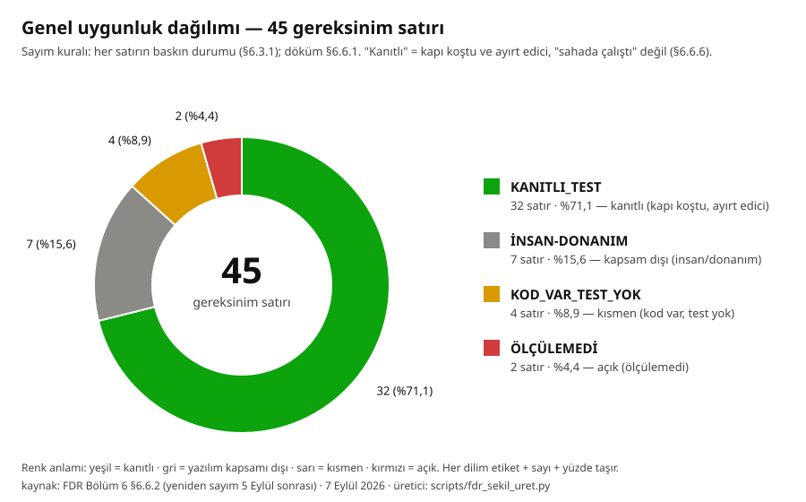
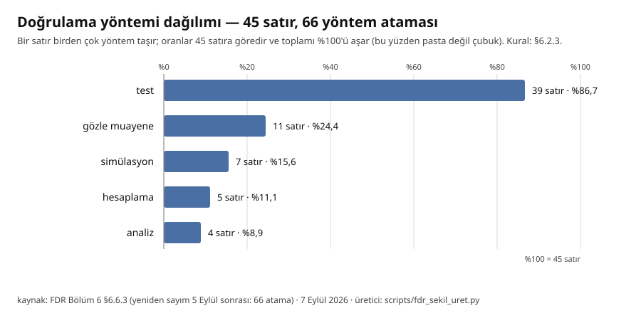

# BÖLÜM 6 — GEREKSİNİM İZLENEBİLİRLİĞİ VE DEĞERLENDİRME (10 puan)

> **NAVITAS** · TEKNOFEST İleri Otonom Sistemler Tasarım ve Operasyon Yarışması
> Şartname §5.3.1, Tablo 4 — Bölüm 6. Kapsam: şartnamenin yazılıma ve sistem
> davranışına düşen **her hükmünün** tek tek izi; hangisinin kanıtı var,
> hangisinin yok, hangisi hâlâ açık ve **ne zamandan beri**.
>
> Bu bölüm bir uyum beyanı değil, bir **kapı dökümüdür**. Her satırın kanıt
> sütununda ya koşulan bir test dosyası ya da `results/` altında duran ham bir
> ölçüm çıktısı vardır. Kanıtı olmayan satır "karşılanıyor" yazılmaz.
>
> **Yönerge karşılığı:** FDR Hazırlama Yönergesi *Bölüm 6. Gereksinim
> İzlenebilirliği ve Değerlendirme (10 PUAN)*. Yönergenin bu başlık altında
> saydığı **altı hüküm** aşağıda altı alt başlıktır ve numaraları yönerge
> haritasındaki kimliklerle (`Y-6-M01` … `Y-6-M06`) eşlenmiştir
> (`FDR/YONERGE_HARITASI.md`, metin `results/fdr_sablon/fdr_yonerge_metin.txt`).

---

## 6.1 Gereksinimlerin hangi ölçüde ve ne şekilde karşılandığı

> `Y-6-M01` — *"Bu başlık altında sistem gereksinimlerinin hangi ölçüde ve ne
> şekilde karşılandığı ayrıntılı olarak açıklanmalıdır."*

### 6.1.1 Durum sözlüğü (dört değer, gevşetilmez)

| durum | anlamı | ne gerekir |
|---|---|---|
| **KANITLI_TEST** | Hükmü karşılayan üretim kodu var **ve** o davranışı sınayan, `tests/` altında koşan bir kapı var. Kapıların çoğu ayrıca **mutasyonla** ayırt ediciliğini göstermiştir (kod bozulunca test düşer). | koşulan test + ham çıktı |
| **KOD_VAR_TEST_YOK** | Davranış üretim kodunda var, ama o davranışı doğrudan zorlayan bir kapı yok; ya da yalnız birim düzeyinde sınanıyor, entegrasyon sınanmıyor. | — |
| **ÖLÇÜLEMEDİ** | Hüküm repo dışındadır (uçuş kontrolcüsü, gerçek telsiz, gerçek arena) ya da ölçüm için gereken donanım/veri henüz yoktur. **ÖLÇÜLEMEDİ, GEÇTİ demek değildir.** | ölçüm tarihi + neyin eksik olduğu |
| **İNSAN-DONANIM** | Hüküm yazılıma düşmez: fiziki montaj, ağırlık, mühür, yük, hakem gözlemi. Sorumlu insandır; yazılım en fazla kayıt tutar. | — |

### 6.1.2 İki araç, tek yazılım — izlenebilirlik hangi araca aittir

Şartname iki ayrı doğrulama ister ve bu bölüm ikisini **karıştırmaz**:

| | §5.3.2 Görev Test Uçuşu | §2.2 Yarışma görevi |
|---|---|---|
| tarih | **30 Eylül – 3 Ekim 2026** (şartname Tablo 1) · prova **21 Eylül** Adıyaman | final haftası |
| araç | **çoklu rotorlu drone** — 3B baskı quadcopter, Pixhawk 6C, Jetson Orin Nano Developer Kit 4 GB (6 Eylül ölçüm, D-431; 3 Eylül beyanı 'Nano 4GB' yanlışlandı), RPi HQ kamera | **sabit kanat** + mancınık + paraşüt + İKA |
| kapsam | kalkış → tespit → YKS'ye aktarım + hakem onayı → iniş, **≤ 10 dk** | tam görev akışı, İKA dâhil |

Algı, karar, haberleşme, yer istasyonu katmanı **iki araçta da aynı kod**tur;
değişen uçuş kontrolcüsü yapılandırması ve gövdedir. Yer istasyonu ayrımı
`--fda` bayrağıyla tanır (`CONTRACTS.md §6.7`). Tablolarda "FDA" işaretli
satırlar görev test uçuşunda (30 Eylül–3 Ekim; provası 21 Eylül) doğrulanacak olanlardır; "final" işaretliler final
dalgasına aittir.

### 6.1.3 İzlenebilirlik matrisi — §2.1 ve §2.2 (görev akışı)

> Son iki sütun bu sürümde eklendi: **doğrulama yöntemi** (`Y-6-M02`) ve
> **yönerge kimliği** (`Y-`), raporun hangi bölümünün o hükmü taşıdığını
> gösterir. Diğer sütunların hücre metinlerine dokunulmadı.

| şartname maddesi | gereksinim | karşılayan bileşen | kanıt (dosya / test) | durum | doğrulama yöntemi | yönerge kimliği (Y-) |
|---|---|---|---|---|---|---|
| **§2.1** (R1) | "üç yoldan yalnızca bir tanesi açık bırakılacak… hangi yolun açık olduğu gizli" — açık şeridi görüntüden bulmak | `codes/rpi_inference.py::analyze_path` (en büyük bağlı bileşen + K-A uç-bant teması + A* tanık yol; yayınlanan `road` = darboğaz şeridi). Üretim yolu ilanı: `CONTRACTS.md §11.2-EK` | `codes/test_rota_sentetik.py` — **iki kol**, bugün koşuldu: KOL 1 (`rota_bul`, tanısal) **15/15**, KOL 2 (**üretim** `analyze_path`) rota üretimi **15/15** · yayınlanan şerit **15/15** (ön kayıt eşiği ≥ 14/15). Kilit: `tests/test_t156_genel_kapi_uretim_kolu.py` (15 test); şerit ekseni: `tests/test_k7_serit_dogrulugu.py` (27 test), `tests/test_t119_yayinlanan_road_kapisi.py` (5 test) | **KANITLI_TEST** | test + simülasyon (sentetik arena) | `Y-3.3.4-M01` · `Y-3.3.4-M02` |
| **§2.1** (R1-ek) | Üç güzergâh **adayının** ayrıştırılması ve K2/K3 ihlal denetimi | `codes/costmap_path_finder.py::koridor_adaylari` + `rota_dogrula` | `tests/test_koridor_etiketi.py`, `tests/test_koridor_genisligi.py` — ⚠ bu iki denetim **yalnız tanısal kolda** (`rota_bul`) koşar, üretim yoluna taşınmadı | **KOD_VAR_TEST_YOK** | test (yalnız tanısal kolda) | `Y-3.3.4-M01` |
| **§2.2.1** | Mühürlü kutu, mancınıkla fırlatma, elden/dikey kalkış yasağı | Mekanik/idari. Yazılım tarafındaki karşılığı **sürüm mührüdür**: `scripts/surum_dondur.py` (künye + doğrulama) | `tests/test_faz_b_surum_dondurma.py` (49 test); ham koşum `results/faz_b_oncesi/surum_dondur_dogrula.txt` | **İNSAN-DONANIM** (yazılım mührü KANITLI_TEST) | gözle muayene (mühür, montaj) + test (sürüm mührü kapısı) | `Y-3.2.1-T05` · `Y-3.2.3-T01…T11` |
| **§2.2.2** (R2) | "Fırlatma sonrası İHA, tam otonom uçuş moduna geçerek… uçuşunu gerçekleştirecektir" | Uçuş kontrolcüsü: ArduCopter/ArduPlane. Repoda **parametre ve görev şablonu** olarak izlenir: `config/pixhawk/arducopter_fda.param` (31 parametre, her satırda gerekçe; Copter-4.5 kaynağından), `config/pixhawk/fda_gorev.waypoints` (QGC WPL 110: TAKEOFF 32 m → tek pas → LOITER 60 s → LAND). **Firmware sürümü sabit:** `scripts/pixhawk_firmware_indir.py:74` `SURUM = "stable-4.5.7"`, `:54` `BOARD_ID = 56` (Pixhawk6C) — kart fabrikadan **PX4** ile gelir (D-424); 4.7.1'de 31 parametrenin **9'u yok** (SI birim reformu, D-425) | `tests/test_faz_b_pixhawk_sablon.py` (12 test — dosya biçimi, kare geometrisi, süre bütçesi kilitli) · `tests/test_pixhawk_firmware_yolu.py` (10; `firmware/` yoksa iki test **atlanır ve söyler**). **5 Eylül ÖLÇÜM** (D-426 §1, MP Messages): 14:52 `ArduCopter V4.7.1 (dbe79216)` + "Missing 9 params" → 15:08 `ArduCopter V4.5.7 (2a3dc4b7)` · `Frame: QUAD/X` · `PreArm: Check frame class` kayboldu; indirilen `firmware/arducopter.apj` 1.585.371 B, git 2a3dc4b7 (D-425 §4) ile aynı. **Gerçek uçuşta AUTO kipi hiç koşmadı** — 5 Eylül'de de uçulmadı (D-426 §5) | **ÖLÇÜLEMEDİ** (AUTO uçuş) · şablon ve firmware sürümü KANITLI_TEST · yükleme 5 Eylül ÖLÇÜM | analiz (parametre ve görev şablonu incelemesi) + test (şablon ve firmware sürüm kapıları) + gözle muayene (5 Eylül MP Messages satırı: firmware ve parametre yüklendi); uçuş testi **yapılmadı** | `Y-3.3.4-M01` · `Y-4-M10` · `Y-4-M12` |
| **§2.2.2** (R3) | "görüntü işleme algoritmaları vasıtasıyla HTAB içindeki açık olan güzergâhı tespit edecektir" | `codes/rpi_inference.py::run_camera` zinciri: `_preprocess` → `model.predict` (v36, imgsz 512) → `get_masks` → `CanliOlcekSaglayici` (mpp) → `analyze_path` → `_rota_kararini_esikle`. Model kaydı fail-closed (`codes/model_registry.py`) | Kabul kapıları K0–K8 + K5A, sentetik arena (n=260), **üretim kipinde** (1 Eylül, `t150_baglama_v36_kabul_verdikt.json`): **10/10 GEÇTİ** — K1 256/260 · K2 6/256 · K3 0/256 · K4 2/256 · K5/K5A 0 px · K6 2/256 · K7 84/85. Terfi anının (26 Ağustos) sayıları Bölüm 3 §3.3.4.2.4'te üç sütunlu tabloda durur; silinmemiştir. Kuru koşu 10 halkanın 9'u GEÇTİ. Testler: `tests/test_rota_guven_esigi.py` (8), `tests/test_zemin_kaplama_kapisi.py`, `tests/test_olcek_uretim_baglantisi.py` | **KANITLI_TEST** ⚠ ölçüm **sentetik** | test (kabul kapıları K0–K8) + simülasyon (sentetik arena, n=260) | `Y-3.3.4-M02` · `Y-4-M08` |
| **§2.2.3** (R4) | "tespit ettiği güzergâh bilgisini kablosuz haberleşme sistemleri üzerinden yer istasyonuna **ve İKA'ya** aktaracaktır" | `comms/iha_sender.py::KararYayinci` — her karede **tam bir** mesaj (`OPEN_ROUTE` **veya** `NO_ROUTE`; sessizlik yok), ACK'li tekrar, latest-wins kuyruk, ayrı HEARTBEAT iş parçacığı. Sözleşme: `CONTRACTS.md §6.5` | `tests/test_rpi_telsiz_yayin.py` (11 test, **gerçek loopback UDP** + gerçek `IkaReceiver` ACK'i). Kuru koşu halka 8: `uretim_yolu_telsiz.open_route_alindi=True, heartbeat=1, ack=['ika']` | **KANITLI_TEST** (UDP) · gerçek SiK için R20 | test (gerçek UDP loopback halkası) | `Y-3.3.4-M03` · `Y-4-M09` |
| **§2.2.3** (R5) | "alan hakemi, canlı olarak güzergâh bilgisinin tespit edildiğini onaylamalıdır" | `comms/yks_gui.py`: rota polyline + ref_xy çizimi, ret sebebi kanonik kodla kırmızı bant, güven-altı OPEN_ROUTE reddi ekranda, hakem künyesinde model SHA, **iki aşamalı** onay. Onayın **diske düşen dayanağı** hakem kanıt kaydı: `comms/hakem_kaydi.py` (JSONL), olay kümesi `yks_gui.KANIT_OLAYLARI` (16 olay, `comms/yks_gui.py:127`), sözleşme `CONTRACTS.md §6.8`; kanıt yazılamıyorsa fırlatma ve onay düğmeleri **kilitli** (fail-closed, fail-visible) | `tests/test_yks_gui_rota_engel.py`, `tests/test_rota_ret_nedenleri.py` (10), `tests/test_hakem_kunye_algi_hizasi.py`, `tests/t64_hakem_ekrani_kapisi.py`. Hakem kanıt kaydı: `tests/test_yks_hakem_kanit_yolu.py` (6; D-412 — `_kanit_yaz` çağrısı commit'lenmiş, tanımı commit'lenmemişti, YKS her gerçek kurulumda düşüyordu; 6/6 mutasyon), `tests/test_yks_hakem_kanit_olaylari.py` (22; D-419 §2 — kanıt kilidi **fail-open'dı**, tek-yazar kilidiyle kapatıldı; 6 mutasyon; CONTRACTS tablosu ↔ sabit ↔ AST üç yönlü küme eşitliği). Gerçek oturum kaydı `results/prova/20260905_142958_15092/hakem_log.jsonl` (5 Eylül, YKS `--fda` PC'de; 1115 satır, 5 olay adı: KAMERA_KANIT 554 · TELEMETRI_KANIT 554 · UI_OLAYI 5 · OTURUM_BASLADI 1 · YKS_ARAYUZ_HAZIR 1 — İHA bağlı değildi, ROTA_*/HAKEM_ONAYI_* olayı **yok**) | **KANITLI_TEST** (sözlü onay insan işidir) | test + gözle muayene (hakem ekranı) | `Y-3.3.4-M01` · `Y-4-M11` |
| **§2.2.3 / §6.2** (R5-ek) | "**gerçek zamanlı** olarak… monitör üzerinden izlenmeli" — bayat tespit canlı gösterilemez | Tazelik damgası `YKS_TESPIT_TAZELIK_S = 5,0 s`; HEARTBEAT'te `karar_yas` alanı (son **algı kararının** yaşı). Alan **yoksa** yaş bilinmiyor demektir ve alıcı taze saymaz | `tests/test_t169_tespit_tazeligi.py` (19 test), `tests/test_a2_karar_yasi.py` (22 test), `tests/test_k1_tazelik_damgasi.py`. Gerekçesi ölçümdür: D-374, gerçek uçuşta **51 saniyelik** karar üretmeyen aralık ölçüldü, heartbeat o sırada akmaya devam ediyordu | **KANITLI_TEST** | test | `Y-3.3.4-M03` · `Y-4-M09` |
| **§2.2.3** (R6) | "alan hakemi… güzergâh bilgisinin **İKA'ya aktarıldığını** onaylayacaktır" | İKA ACK'i yalnız gönderene değil **YKS'ye de** gider (`ika_nav --yks`); "İKA ALDI" gelmeden 2. onay düğmesi açılmaz. Sözleşme `CONTRACTS.md §6.6` (K8) | `tests/test_ika_go_ackli_tekrar.py` (11 test); ham çıktı `results/k4_k8_ika_go_ack/rapor.md`. ⚠ 21 Eylül'de İKA yoktur: `--fda` kipinde bu koşul **aranmaz** ve ekranda dayanağı basılır (`CONTRACTS §6.7`) — `tests/test_faz_b_yks_fda_kipi.py` (9 test, 4/4 mutant yakalandı) | **KANITLI_TEST** | test | `Y-3.3.4-M03` · `Y-4-M09` |
| **§2.2.3** (R7) | "Bu aktarımın İHA **havada iken** tamamlanması gerekmektedir" | YKS onay anında iniş damgasıyla karşılaştırma: "inişten SONRA / zaman bilinmiyor / henüz inmedi" uyarısı | `tests/test_yks_gui_aktarim_zamani.py` (3 test), `tests/test_p9abc_yks.py` (13 test — §2.2.3 sıra denetimi) | **KANITLI_TEST** (uyarı; zorlama doğası gereği yok) | test | `Y-4-M11` |
| **§2.2.3 / §2.2.5** (R8) | Aktarımın tamamlanması — `IKA_GO` kayıpsız iletilmeli | ACK'li, **aynı-seq** tekrar gönderimi; üst sınırda görünür hata; ACK gelmezse düğme **yeniden açılır**; alıcıda idempotent latch. `CONTRACTS.md §6.6` (K4) | `tests/test_ika_go_ackli_tekrar.py` (11), `tests/test_ika_go_gate.py` (9). Ham çıktı `results/k4_k8_ika_go_ack/` — **5 mutasyonun 5'i yakalandı** | **KANITLI_TEST** | test (mutasyonlu) | `Y-3.3.4-M03` · `Y-4-M09` |
| **§2.2.4** (R9) | "Paraşüt açma komutu otonom… manuel tetikleme ile de… manuel ise ceza" | Yazılım yarısı: YKS iki adımlı teyit → ACK'li tekrar → İHA'da `comms/iha_komut_alici.py` komutu Pixhawk'a `COMMAND_LONG` ile aktarır ve **yalnız aktarım başarılıysa** ACK döner. Ceza −50 kaydı YKS'de | `tests/test_faz_b_iha_komut_alici.py` (23 test; 3 Eylül'de 22 — D-419 §1: ACK bileşen kümesi `_ack_basabilen_bilesenler`, sonuç önbelleği ve saat ofseti üç kritik kapatıldı, ayna `jetson_paket/kod/iha_komut_alici.py` güncellendi), `tests/test_iha_komut_saat_ve_tekrar.py` (42; D-419'da 18 → D-422'de 42: saat sapması 30 dk'yi aşınca ARM/DISARM/RTL/LAND/PARACHUTE **kalıcı reddediliyordu** — RTC'siz Jetson'da garantili saha ölümü; onarım sonrası 2 saat sapmada 7. basamakta geçer, ileri adım sonrası ölü pencere 60,00 s → 0,25 s; mutasyon 17 + 5 test düştü), `tests/test_p9abc_yks.py` (13), `tests/test_yks_gui_komut_durustlugu.py` (13; 3 Eylül'de 6, D-419 §3 birleştirmesi `bb832a2`). ⚠ D-422 §4: saat kapısı sahtecilik savunması **değildir**; gerçek çevre `--izinli-kaynak` adres pinidir. **Otonom tetik** (`CHUTE_*` parametreleri, mekanik açma) repo dışıdır ve **hiç ölçülmedi** | **KANITLI_TEST** (manuel zincir) · **ÖLÇÜLEMEDİ** (otonom) | test (manuel zincir); otonom tetik **doğrulanmadı** | `Y-3.2.1-T05` · `Y-4-M12` |
| **§2.2.5** (R10) | "İHA yere temas etmeden İKA hareket edemez… iniş yapmadan harekete geçen takımların görevi başarısız" | Üretici: `comms/iha_inis_yayinci.py` ← `comms/inis_kaniti.py::yerde_mi` (Pixhawk `EXTENDED_SYS_STATE.landed_state == ON_GROUND` **ve** `GLOBAL_POSITION_INT.relative_alt < 1 m`, aynı sysid, ardışık 3 çift, mutlak son tarih). Kapı: `comms/ika_receiver.py::_surus_izni_gecerli_unlocked` | `tests/test_inis_kaniti.py` (26), `tests/test_iha_landed_gate.py` (12), `tests/test_iha_inis_yayinci.py` (12). Manuel "İHA İNDİ" düğmesi latch'i **açmaz** (test ile kilitli). Kuru koşu `surus_izni GECTI` | **KANITLI_TEST** | test | `Y-3.3.4-M01` · `Y-4-M11` |
| **§2.2.5** (R10-ek) | İniş kanıtı sahada **sessizce ölmemeli** | ArduCopter `EXTENDED_SYS_STATE`'i hiçbir `SR*` akışında vermez; yalnız `SET_MESSAGE_INTERVAL` ile akar ve istek Pixhawk reboot'unda (pil değişimi) silinir. `AkisIstekcisi`: başlangıçta ve her 10 s'de istek yeniler, 5 s sessizlikte KIRMIZI uyarı | `tests/test_faz_b_akis_istegi.py` (17 test, 2 mutant yakalandı). Bulgu kaynağı: Copter-4.5 `GCS_Mavlink.cpp` akış dizileri okundu; `grep SET_MESSAGE_INTERVAL comms/` → **0** idi | **KANITLI_TEST** | analiz (ArduCopter kaynak akış dizileri) + test | `Y-3.3.4-M03` · `Y-4-M11` |
| **§2.2.5** (R11) | "İKA'nın intikal süreci YKS'de görevli takım üyesi tarafından **manuel** olarak tetiklenir" | YKS `IKA_GO` komutu → `comms/ika_receiver.py` latch | `tests/test_ika_go_gate.py` (9 test; gerçek UDP çiftinde IKA_GO **öncesi hareket yok**, sonrası var) | **KANITLI_TEST** | test | `Y-3.3.4-M01` |
| **§2.2.5** (R12) | "İKA; **otonom olarak** açık olan güzergâhı takip ederek HB'ye ilerleyecektir… otonom hareket etmeyen İKA'nın görevi başarısız" | Sürücü **arayüzü** var: `simulation/scripts/ika_surucu.py` (`hiz_ver / konum_al / durdur / saglikli`), fail-closed ardışık hata tavanı 3; `CONTRACTS.md §7.2`. **`GercekSurucu` arka uçsuz kurulamaz** (`DONANIM_YOK` istisnası) — sessiz iskelet yasak | `tests/test_p3_ika_surucu.py` (14 test; bayt-eşitlik + fail-closed + §2.2.5 kilidi), kabul harnessı `scripts/ika_surucu_kabul.py`, `tests/test_faz_b_ika_surucu_kabul.py`. **Kuru koşu halka 10 hâlâ `SAHİPSİZ`**: `saha_surucu_importlari: []` | 🔴 **İNSAN-DONANIM** (açık) | analiz (sürücü sözleşmesi) + test (kabul harness'ı); gerçek sürücü **doğrulanmadı** | `Y-3.2.2-T01…T11` · `Y-3.3.3-M01` · `Y-4-M07` |
| **§2.2.6** (R13) | "İKA'nın… **HB sınırları içerisine** girmesi ile görev başarılı" — hedef = 2×2 m kırmızı H | HB dedektörü **üretime bağlandı**: üç üretim çağrısı `analyze_path(goruntu=…)` geçiyor; iç HB çağrısı **ölçek + şekil** çifti kullanıyor (`HB_SEKIL_ESIGI`; mpp yoksa açılmaz). Rotanın son waypoint'i HB pedinin kutusunda biter | `tests/test_t150_baglama.py` (6 nöbetçi), `tests/test_t198_hb_sekil.py` (14), `tests/test_hb_dedektoru.py` (25). Bağlama ölçümü: hedef **253/256** doğru pedde, ped örtülüyken **259/260 HEDEF_YOK** (fail-closed), maliyet **sıfır** (p eşit: 0,9846). Ham çıktı `results/t150/baglama_olcumu_20260901.json` | **KANITLI_TEST** ⚠ sentetik; gerçek pedde ÖLÇÜLEMEDİ | test + simülasyon (sentetik arena) | `Y-3.3.4-M02` · `Y-3.3.3-M01` |
| **§2.2.6** (R13-ek) | Varış = **brandaya temas**, sınıra girmek değil | `simulation/scripts/ika_nav.py` son waypoint'te `FINAL_WP_RADIUS = 0,3 m`; bağlayıcı eşitsizlik `FINAL_WP_RADIUS < HB_KENAR_M/2` (1,0 m) → araç merkezi ped kenarından ≥ 0,7 m içeride durur. `CONTRACTS.md §7.3` | `tests/test_p9e_branda_temas.py` (5 test: geometri + kinematik + mutasyon). ⚠ Gazebo'lu **fiziksel temas** koşusu bu makinede ÖLÇÜLEMEZ (gz yok) | **KANITLI_TEST** (geometri) · **ÖLÇÜLEMEDİ** (fiziksel) | hesaplama (geometrik eşitsizlik) + test; fiziksel temas simülasyonu **ÖLÇÜLEMEDİ: Gazebo bu makinede yok, ortam sağlanınca kapanır** | `Y-3.3.3-M01` · `Y-4-M07` |
| **§2.2.6** (R22) | "İKA'nın belirlenen **yükleri taşıyarak** hedef bölgeye intikal etmesi esastır… yapısal bütünlüğünü koruyor olması ve taşıdığı yükü eksiksiz muhafaza etmesi zorunludur" | Yazılıma düşmez. Yük bağlantısı, kasa ve tartı tutanağı final dalgasının işidir | Kayıt: bu hüküm yükümlülük haritasında **hiç yoktu**, 2026-08-26 taramasında bulundu ve eklendi | **İNSAN-DONANIM** | gözle muayene (final dalgası; yapılmadı) | `Y-3.2.2-T10` · `Y-3.2.2-A02` |

### 6.1.4 İzlenebilirlik matrisi — §5.3.2 (Drone ile Görev Test Uçuşu · 30 Eylül–3 Ekim)

| şartname maddesi | gereksinim | karşılayan bileşen | kanıt (dosya / test) | durum | doğrulama yöntemi | yönerge kimliği (Y-) |
|---|---|---|---|---|---|---|
| **§5.3.2** | "çoklu rotorlu ve dikey iniş-kalkış yapabilen bir insansız hava aracı" | 3B baskı quadcopter (dronesolid gövde), 5008 340KV ×4, 12×10 pervane, 80 A DShot ESC, FCHUB-12S V2, Pixhawk 6C + PM02, Holybro M9N, FS-i6 (iBUS), 2× SiK 433 MHz, ~~**Jetson Nano 4GB**~~ **Jetson Orin Nano Developer Kit 4 GB** (6 Eylül'de kartta ÖLÇÜLDÜ, D-431), RPi HQ (IMX477) | Künye: `SAHA_HAZIRLIK_PLANI_20260903.md §0.2`. **Montaj 5 Eylül** — kutu açıldı, ESC/güç modülü plandan farklı çıktı (D-426 §3); Jetson künyesi 6 Eylül'de kartta ölçüldü (`results/jetson_20260906/ORTAM_KUNYESI.txt`) | **İNSAN-DONANIM** | gözle muayene (montaj ve künye teyidi, 5 Eylül; **yapılmadı**) | `Y-3.3.1-M02` · `Y-3.2.1-T10` |
| **§5.3.2** | "**asgari 30 metre** irtifadan uçarak" tespit | `codes/karar_sozlesmesi.py::SARTNAME_ASGARI_IRTIFA_M = 30,0`; `asgari_irtifa_notu()` her karede irtifayı damgalar, 30 m altı `ASGARI_IRTIFA_ALTI` işaretlenir. Görev planı **32 m** (2 m baro payı) | `tests/test_t171_asgari_irtifa.py` (20 test). ⚠ Kaydın kendi cümlesi: bu şart daha önce sistemde **hiç uygulanmıyordu** ve uyum raporumuz uygulandığını **iddia ediyordu** (D-319) — düzeltildi ve kilitlendi | **KANITLI_TEST** | test | `Y-3.3.4-M01` · `Y-4-M10` |
| **§5.3.2** | "20×20 metre boyutlarındaki simüle edilmiş test alanı" tek karede görülmeli | RPi HQ standart 6 mm lens, yatay FOV ≈ 55–63° → 30 m'de kare genişliği ≈ 31–37 m. `--fov` **beyan değil ölçüm** olacak: `kamera_dogrula` ile 5 Eylül'de ölçülür | Hesap ve gerekçe `SAHA_HAZIRLIK_PLANI_20260903.md §0.2`; çözünürlük sözleşmesi `CONTRACTS.md §8`, kilit `tests/test_t163_cozunurluk_sozlesmesi.py`. **5 Eylül'de ölçülmedi:** D-426 tutanağında kamera satırı yok, Jetson takılı değil (D-426 §4); `results/` altında `kamera_dogrula` çıktısı yok | **ÖLÇÜLEMEDİ** (5 Eylül'de ölçülmedi; yeni tarih BEYAN GEREKLİ) | hesaplama (lens FOV → kare genişliği); ölçüm `codes/kamera_dogrula.py` ile test — 5 Eylül'de **yapılmadı** | `Y-3.3.4-M02` · `Y-4-M03` |
| **§5.3.2** | "uçuş esnasında **gerçek zamanlı** olarak YKİ'ye aktarmak" | `KararYayinci` (R4) + tazelik damgası + `karar_yas` (R5-ek) | **Uçtan uca kare gecikmesi ölçüldü**: 33 ölçülen gerçek karede (+3 ısınma karesi, yüzdeliklere katılmaz), üretim zinciri + gerçek telsiz halkası (UDP loopback ACK) → **p50 **0,085 s** · p95 0,113 s**, tazelik penceresinin (5 s) çok altında. Adım kırılımı ve ham veri `results/fda_butce/olcum_20260901.json`; nöbetçi `tests/test_b2_fda_butcesi.py` (13). ⚠ **Seri (SiK) hat ÖLÇÜLEMEDİ** | **KANITLI_TEST** (UDP) | test (uçtan uca gecikme ölçümü) | `Y-3.3.4-M03` · `Y-4-M09` |
| **§5.3.2** | Gereken **kare hızı** — hakem onayı için tespit taze olmalı | Eşik **türetildi, tahmin edilmedi**: `GEREKLİ_FPS ≥ 1 / (5 · p)`, `p` = bir karenin geçerli rota yayınlama olasılığı | Sentetik arena `p = 0,9846` → 0,203 FPS; gerçek DJİ (sızıntısız, n=243) `p = 0,3457` → 0,579 FPS; en kötü uçuş 0,61 FPS. Ham çıktı `results/b4_fps/p_ve_kosu_20260901.json`; nöbetçi `tests/test_163_b4_olcum_nobetcisi.py` (13). **Saha `p`'si ÖLÇÜLEMEDİ** — gerçek arena karesi yok. **Eşiğin Jetson'da karşılığı 6 Eylül'de ÖLÇÜLDÜ (D-431):** Orin Nano Developer Kit 4 GB, `scripts/jetson_fps.py` 120 örnek → pt p50/p95 **1,35/1,06 FPS** · engine **1,58/1,33 FPS** ≥ 0,61, **GEÇTİ**; `results/jetson_20260906/jetson_fps_20260906_orin_nano/ozet.json` | **KANITLI_TEST** (iki çerçeve + Jetson FPS kapısı) · saha değeri **ÖLÇÜLEMEDİ** | hesaplama (eşik türetimi) + test (`p` ölçümü) + simülasyon (sentetik `p`) | `Y-3.3.4-M02` · `Y-4-M08` |
| **§5.3.2** | "gerçek zamanlı güzergah tespitinin alan hakem heyeti tarafından **doğrulanıp onaylanması**" | YKS hakem ekranı + iki aşamalı onay + `--fda` kipi (İKA kanıtı aranmaz; ACK `ref_tip` ile İHA'ya gider) | `tests/test_faz_b_yks_fda_kipi.py` (9 test; **M1–M4 mutasyonlarının 4'ü de yakalandı**), `tests/test_faz_b_ack_ref_tip.py` (14). ⚠ Bu kip **mimar tarafından yazıldı ve aynı el tarafından denetlendi**; bağımsız denetim borcu 21 Eylül öncesi ilk gerçek provada (hakem rolü oynanarak) kapatılacak | **KANITLI_TEST** (denetim borcu açık) | test (9 test, 4/4 mutant) + gözle muayene (hakem ekranı) | `Y-4-M11` |
| **§5.3.2** | "tüm operasyon sürecinin (kalkış, tespit, veri aktarımı ve iniş) **maksimum 10 dakika**" | `codes/karar_sozlesmesi.py::SARTNAME_FDA_OPERASYON_SURESI_S = 600`; YKS `--fda` kipinde bütçe 900 yerine 600 s | `tests/test_t170_fda_sure_butcesi.py` (16 test), `tests/test_b2_fda_butcesi.py` (13). Görev planı kötü-durum süre bütçesi **221,5 s ≤ 600 s** (`config/pixhawk/README.md`). ⚠ *"600 saniyeye sığar"* hükmü **bilerek verilmedi**: uçuş, kamera yakalama ve seri hat ölçülemedi ve toplama **0 olarak girmedi** | **KANITLI_TEST** (yazılım payı) · uçuş **ÖLÇÜLEMEDİ** | hesaplama (süre bütçesi) + test (sabit kapıları) | `Y-4-M03` |
| **§5.3.2** | "**yanlış güzergah tespiti** yapan takımlar 0 puan" | Fail-closed katmanlar: `rota_guven_reddi`, `rota_olcek_reddi`, `zemin_maskesi_reddi`, `rota_koridor_genisligi_reddi`, K-A uç-bant, `_rota_kararini_esikle`; **son savunma** `iha_sender.send_open_route` (eşik altı → NO_ROUTE); YKS eşik altı OPEN_ROUTE'a ACK vermez | `tests/test_rota_guven_esigi.py` (8), `tests/test_rota_ret_nedenleri.py` (10), `tests/test_koridor_genisligi.py`, `tests/test_zemin_kaplama_kapisi.py`, `tests/test_t141_rota_yoksa_surme.py` | **KANITLI_TEST** | test + simülasyon (kabul kapıları) | `Y-3.3.4-M02` · `Y-4-M08` |
| **§5.3.2** | Yanlış güzergâhın **gürültüden** doğmaması — kare kare çevrilme | Yayın histerezisi (`KararYumusatici`): NO_ROUTE **asla** geciktirilmez; farklı şerit ancak K ardışık karede teyitlenirse yayına geçer; bastırma en fazla K−1 kare sürer | `tests/test_p5_histerezis.py` (12 test). Ölçüm (`results/p5_histerezis/olcum_20260903.json`, iki tohum, n=260×5): ham çevrilme **13 → yayın 7** (tohum 7), **24 → 11** (tohum 42); bastırılanların **hiçbiri** NO_ROUTE değil. ⚠ Ön kayıttaki özgün eşik **H1 DÜŞTÜ** ve öyle kayıtlı; H1a/H1b/H2 geçti | **KANITLI_TEST** (bir alt eşik düştü, gizlenmiyor) | test (ön kayıtlı) + simülasyon (n=260×5, iki tohum) | `Y-3.3.4-M01` · `Y-4-M08` |

### 6.1.5 İzlenebilirlik matrisi — §6.2 (yarışma sırası) ve §6.4 (geçersizlik)

| şartname maddesi | gereksinim | karşılayan bileşen | kanıt (dosya / test) | durum | doğrulama yöntemi | yönerge kimliği (Y-) |
|---|---|---|---|---|---|---|
| **§6.2** | "15 dakikalık Hazırlık Süresi… 'Takım Hazır' ile durdurulur" | `SARTNAME_HAZIRLIK_SURESI_S = 900` (`codes/karar_sozlesmesi.py:1996`; 3 Eylül'de `:1991` idi, dosya büyüdü); YKS hazırlık kronometresi | Sabit tek yerde; ekran metni ondan türer. ⚠ Bu sayı 2026-08-26'da kodda **beş yerde çıplak `"15:00"`** olarak duruyordu ve kayda geçirildi (D-297); sabit sonradan eklendi | **KANITLI_TEST** | test | `Y-4-M03` |
| **§6.2** | "müdahale → **100 ceza puanı** + süre hazırlığa eklenir" | `comms/yks_gui.py::mudahale` — −100 ceza + hazırlık kronometresinin devamı **kodda var** | ⚠ **doğrudan testi YOK** (`grep mudahale tests/` boş); kilitli olan yalnız manuel paraşüt −50 (`test_yks_gui_komut_durustlugu.py`) | **KOD_VAR_TEST_YOK** | gözle muayene (kod okuması); **test yok** | `Y-3.3.4-M01` |
| **§6.2** | "Tekrar fırlatma süreci… süre **durdurulmaz**, 15 dakikaya dâhil" | YKS `firlatma()` kronometreyi **yeniden başlatmıyor** (`if self.t_iha0: return`), düğme kilitleniyor | Davranış kodda doğru; **doğrudan tekrar-fırlatma testi yok** (durum 2026-08-26'dan beri aynı). 4 Eylül'de eklenen `tests/test_yks_monotonik_kronometre.py` (3, commit `1b94dca`) kronometreyi duvar saatinden bağımsız kilitler, `firlatma()`'yı bir kez çağırır — **tekrarı sınamaz** | **KOD_VAR_TEST_YOK** | gözle muayene (kod okuması); **test yok** | `Y-3.3.4-M01` |
| **§6.2 / §6.4** | "İHA görev süresi… azami **15 dakika**" · "İKA'nın HB'ye ulaşması için **10 dakika**" | `SARTNAME_IHA_GOREV_SURESI_S = 900`, `SARTNAME_IKA_GOREV_SURESI_S = 600`; İKA'da **iki ayrı son tarih** (bekleme / sürüş) — tek ortak deadline yasak. `CONTRACTS.md §7.1` | `tests/test_k5_k6_sure_limitleri.py` (9 test; sahte saat + gerçek UDP loopback, **4 mutasyonla düştüğü gösterildi**) | **KANITLI_TEST** | test (mutasyonlu) | `Y-4-M03` |
| **§6.2 / §6.4** | "İHA-UB sınırları içinde icra etmeli; dışına taşan uçuşlar **Alan İhlali**" (300×300 m) | `SARTNAME_IHA_UB_KENAR_M = 300,0`, `iha_ub_ihlali(x, y)`. Üretimde `--ub-referans LAT,LON` ile her HEARTBEAT yerel `x,y` taşır; konum **aynı telemetri okuyucusundan** gelir, ikinci yol açılmaz | `tests/test_t162_alan_ihlali.py` (19 test; üretim döngüsü gerçekten koşuluyor). ⚠ Bu kapı **sahada ölüydü**: GUI denetimi vardı ama üretimde `x,y` üreten yol **yoktu** (D-307). Geofence'in kendisi Pixhawk parametresidir: `FENCE_ENABLE=1`, `FENCE_ALT_MAX 50` (`config/pixhawk/arducopter_fda.param:140,:148`) — **gerçek donanımda doğrulanmadı**: 5 Eylül'de parametre dökümü alınmadı (D-426 §4); 6 Eylül 20:22 dökümü `arducopter_fda_20260906.param` repoda — `FENCE_ENABLE,1` · `FENCE_ALT_MAX,50` kart değeri olarak okunuyor (D-428 §5g); RC failsafe 6 Eylül'de **ÖLÇÜLDÜ ve DÜŞTÜ** (D-428 §2) → §6.5.1 A13 | **KANITLI_TEST** (yazılım) · **ÖLÇÜLEMEDİ** (geofence) | test (üretim döngüsü koşuluyor); Pixhawk geofence'i gözle muayene ile — 5 Eylül'de **yapılmadı** (§6.5.1 A13) | `Y-4-M12` |
| **§6.2** | "fırlatma/başlangıçtan görev bitimine kadar tüm süreçleri (seyrüsefer, tespit, veri aktarımı, sürüş) **tam otonom**" | Tespit otonom (R3) · aktarım otonom (R4) · seyrüsefer uçuş kontrolcüsünde (R2) · **sürüş açık** (R12) | Zincirin dört yarısından üçü kanıtlı, biri donanım bekliyor | **kısmen KANITLI_TEST** · sürüş **İNSAN-DONANIM** | analiz (zincir bütünlüğü) + test | `Y-3.3.4-M01` · `Y-3.3.3-M01` |
| **§6.4** | "Aktarılan verinin doğruluğunun Alan Hakemi tarafından **teyit edilemediği** veya **veri akışının sağlanamadığı** durumlarda uçuş geçersiz" | `IkaReceiver.poll` `hb_timeout` → `link_lost` → güvenli duruş; `send_heartbeat` 1,0 s aralık < 3,0 s zaman aşımı (iki ardışık kayıp bağlantıyı düşürmez); iniş sonrası heartbeat en az İKA görev süresi kadar sürer | `tests/test_iha_landed_gate.py` (12), `tests/test_ika_no_route_recovery.py`, `tests/test_k5_k6_sure_limitleri.py` (9) | **KANITLI_TEST** | test | `Y-3.3.4-M03` · `Y-4-M12` |
| **§6.4** | "Güvenlik Pilotunun… İHA'yı **manuel moda** alması → uçuş başarısız" | YKS `mod != AUTO` uyarısı var (`comms/yks_gui.py:1254`, `:3083`) | ⚠ **Üretim HEARTBEAT'i `mod` alanı ÜRETMİYOR** (`grep mod comms/iha_sender.py` → yalnız `karar_yas`); alanı yazan tek yer YKS'nin kendi demo üreticisidir. Sahada manuel-mod tespiti **hakem/pilot gözlemine** dayanır | **KOD_VAR_TEST_YOK** | gözle muayene (kod okuması); **test yok** | `Y-4-M12` |
| **§6.4** | "**Kırım ve Yapısal Bütünlük**" · "**İniş İhlali** (paraşüt açılmaması, sert iniş)" | Mekanik/emniyet. Yazılım kaydı: iniş kanıtı ve paraşüt komut zinciri (R9/R10) | Paraşüt mekaniği ve kırım denetimi repo dışıdır | **İNSAN-DONANIM** | gözle muayene (final dalgası) | `Y-3.2.1-T05` |
| **§6** | Ağırlık limitleri (İHA 25 kg / İKA 10 kg), 3 uçuş hakkı, güzergâh zorluk katsayısı, mühür | İdari/mekanik. Zorluk katsayısı **açık olan** güzergâha aittir, bizim yayınladığımıza değil → yeni yazılım gereksinimi doğurmaz | Tartı tutanakları 5 Eylül montaj gününde alınacaktı (`SAHA_HAZIRLIK_PLANI §2.1`); **5 Eylül'de alınmadı** (D-426 tutanağında tartı satırı yok) | **İNSAN-DONANIM** | test (tartı; 5 Eylül'de **yapılmadı**, tarih BEYAN GEREKLİ) | `Y-3.2.1-T10` · `Y-3.2.2-T10` |

### 6.1.6 İzlenebilirlik matrisi — §7 (değerlendirme ve puanlama parametreleri)

Şartname §7, `Puan₂ = K_zorluk × [P_görev + (25000−m_İHA)/10 + (900−t_İHA)/5 + (900−t_hazırlık)/30 + (10000−m_İKA)/15 + (m_yük×0,01) + (600−t_İKA)/15 − C_ceza]`
formülüyle puanlar. Yazılıma düşen parametreler ve izleri:

| parametre | şartname anlamı | karşılayan bileşen | kanıt | durum | doğrulama yöntemi | yönerge kimliği (Y-) |
|---|---|---|---|---|---|---|
| `P_görev` | Görevin başarısı — **brandaya fiziksel temas** | `FINAL_WP_RADIUS` + `HB_KENAR_M` eşitsizliği; `CONTRACTS.md §7.3` | `tests/test_p9e_branda_temas.py` (5) | **KANITLI_TEST** (geometri) | hesaplama (geometrik eşitsizlik) + test | `Y-3.3.3-M02` |
| `t_İHA` | 900 s'den tasarruf edilen her 5 s | YKS İHA kronometresi, `SARTNAME_IHA_GOREV_SURESI_S` | `tests/test_k5_k6_sure_limitleri.py` (9) | **KANITLI_TEST** | test | `Y-4-M03` |
| `t_İKA` | 600 s'den tasarruf edilen her 15 s | İKA sürüş son tarihi (bekleme süresinden **ayrı**) | `tests/test_k5_k6_sure_limitleri.py` (9) | **KANITLI_TEST** | test | `Y-4-M03` |
| `t_hazırlık` | 900 s'den tasarruf edilen her 30 s | `SARTNAME_HAZIRLIK_SURESI_S`, YKS hazırlık kronometresi | kod sabiti + YKS; hazırlık provası 5 Eylül'de **yapılmadı** (D-426 tutanağında hazırlık provası satırı yok; tarih BEYAN GEREKLİ) | **KANITLI_TEST** (süre ölçümü) | test | `Y-4-M03` |
| `C_ceza` | Manuel paraşüt −50 · müdahale −100 | YKS ceza kaydı | `tests/test_yks_gui_komut_durustlugu.py` (13; 3 Eylül'de 6 — D-419 §3 birleştirmesi `bb832a2`), `tests/test_p9abc_yks.py` (13) | **KANITLI_TEST** | test | `Y-3.3.4-M01` |
| `m_İHA`, `m_İKA`, `m_yük` | Kütleler | Tartı — yazılıma düşmez | 5 Eylül tartı listesi — **alınmadı** (D-426 tutanağında tartı yok) | **İNSAN-DONANIM** | test (tartı; 5 Eylül'de **yapılmadı**) | `Y-3.2.1-T10` · `Y-3.2.2-T10` |
| `K_zorluk` | Açık güzergâhın zorluk katsayısı | Hakem tayin eder; bizim yayınladığımız şerit **numarasının doğruluğu** ilgilidir | `tests/test_k7_serit_dogrulugu.py` (27) | **KANITLI_TEST** | test | `Y-3.3.4-M02` |

### 6.1.7 Gereksinim kimlikleri — üç liste, tek bağ

Bu bölümde üç ayrı kimlik sistemi yan yana durur ve birbirine karıştırılmaz:

| kimlik | kaynağı | ne adlandırır | örnek |
|---|---|---|---|
| **§…** | yarışma şartnamesi | hükmün şartnamedeki yeri | §2.2.5 |
| **R1–R22** | yükümlülük haritası `results/sartname_bosluk/rapor.md` | şartname hükmünün bu projedeki yükümlülük numarası | R10 (iniş kanıtı) |
| **Y-…** | FDR yönergesi, `FDR/YONERGE_HARITASI.md` | **raporun** hangi bölümünün o gereksinimi taşıdığı | `Y-3.3.4-M03` |

§6.1.3–§6.1.6 matrislerinin son sütunu bu bağı kurar: bir şartname hükmünün
FDR'de hangi bölümde savunulduğu oradan okunur; ters yön yönerge haritasındadır.

⚠ Dördüncü liste **eksiktir**: ÖDR/DDR gereksinim numaraları. DDR metni depoda
`rapor/NAVITAS_DDR_Birlesik.docx` olarak durur ama makine okunur bir gereksinim
kütüğü değildir; bu yüzden DDR kimliği ↔ R ↔ Y eşlemesi bu bölümde **yapılmamıştır**.

- **BEYAN GEREKLİ (insan):** ÖDR ve DDR'de tanımlanmış gereksinim numaraları ve bunların R1–R22 ile eşlemesi. Yönergenin `Y-1-M03` hükmü (*"ÖDR ve DDR'de tanımlanan gereksinimlerin nihai tasarım üzerinde doğrulandığı"*) bu eşlemeyi ister; şu an yalnız şartname maddeleri izlenmektedir.

---

## 6.2 Doğrulama yöntemleri

> `Y-6-M02` — *"Her bir gereksinimin doğrulanmasında kullanılan yöntemler açıkça
> belirtilmeli ve bu doğrulama süreçlerinde analiz, hesaplama, test, simülasyon
> veya gözle muayene gibi hangi tekniklerin kullanıldığı ifade edilmelidir."*

Yöntem, §6.1 matrislerinin **doğrulama yöntemi** sütununda satır satır yazılıdır.
Bu alt başlık o sütunun sözlüğünü, üretim yordamını ve dağılımını verir.

### 6.2.1 Yöntem sözlüğü — yönergenin beş yöntemi bu projede ne demek

| yöntem | bu projede karşılığı | ne zaman yeter | ne zaman yetmez |
|---|---|---|---|
| **test** | `tests/` altında koşan, ham çıktısı `results/` altına düşen ve çoğunda **mutasyonla** ayırt ediciliği gösterilmiş kapı | davranış repoda ve gözlenebilir olduğunda | davranış repo dışındaysa (uçuş kontrolcüsü, telsiz donanımı, gerçek arena) |
| **simülasyon** | sentetik arena (n=260) ve UDP loopback halkası | girdi dağılımının denetlenmesi gerektiğinde | gerçek sahne istatistiği gerektiğinde (§6.5 A4) |
| **hesaplama** | sözleşmeye yazılmış eşitsizlik veya türetim: gereken FPS `1/(5·p)`, süre bütçesi toplamı, `FINAL_WP_RADIUS < HB_KENAR_M/2` | sonuç aritmetik/geometrik olarak bağlayıcı olduğunda | fiziksel doğrulama gerektiğinde |
| **analiz** | kaynak, şartname ve parametre incelemesi (ör. Copter-4.5 `GCS_Mavlink.cpp` akış dizilerinin okunması) | bir davranışın **var olmadığını** göstermek dâhil | ölçümün yerine geçmez |
| **gözle muayene** | kod okuması, ekran gözlemi, montaj ve mühür kontrolü, hakem gözlemi | hüküm insana düştüğünde | yazılım davranışının **tek** dayanağı olduğunda |

⚠ **"gözle muayene" tek başına kaldığı her satır bir borçtur**, bir başarı değil.
§6.1.5'in üç satırı (müdahale −100, tekrar fırlatma, manuel mod) yalnız kod
okumasıyla doğrulanmıştır ve durum hücrelerinde **KOD_VAR_TEST_YOK** yazar.

### 6.2.2 Kanıt zinciri — bir satır nasıl "KANITLI_TEST" olur

1. **Sözleşme** `CONTRACTS.md` içinde yazılır (çıplak sabit yasak; sayı tek yerde durur).
2. **Kapı** `tests/` altına yazılır ve **gerçekten koşulur**; ham çıktı `results/` altına düşer.
3. **Mutasyon** uygulanır: ilgili kod satırı bozulur, kapının **düştüğü** gösterilir. Düşmeyen kapı ayırt edici değildir ve kanıt sayılmaz.
4. **Ön kayıt**: eşik, sonuç görülmeden yazılır (`ON_KAYIT` dosyaları) ve sonradan gevşetilmez.
5. **Çürütme**: yanlış çıkan iddia silinmez; üstü çizilir ve düzeltmesine işaret verilir (`REVIEW_LOG.md`).

3 Eylül sayımında defterde `^### D-` başlıklı **414 kanıt kaydı** (408 ayrık kayıt numarası) vardı. 5 Eylül tutanakları işlendikten sonra (son kayıt **D-427**): **432** başlık, **426** ayrık numara (`grep -c "^### D-" REVIEW_LOG.md` · `grep -o "^### D-[0-9]*" REVIEW_LOG.md | sort -u | wc -l`).

### 6.2.3 Doğrulama yöntemi dağılımı

45 gereksinim satırına toplam **66 yöntem ataması** yapılmıştır (3 Eylül sayımı 65; 5 Eylül
tutanağı §6.1.3 R2 satırına *gözle muayene* — MP Messages satırıyla firmware/parametre
yükleme teyidi — ekledi); bir satır birden
çok yöntem taşıyabildiği için oranlar toplamı %100'ü aşar. Sayılar §6.1.3–§6.1.6
matrislerinin doğrulama yöntemi sütunundan sayılmıştır. **Sayım kuralı:** hücrede
yöntem adı geçen satır o yönteme sayılır; **test yok** yazan üç satır (§6.1.5'in
müdahale, tekrar fırlatma ve manuel mod satırları) test sütununa sayılmaz. Ham
alt-dize sayımı 42 verir; uygulanan test 39'dur. Yeniden sayım betikle yapıldı:
dört matrisin 19 + 9 + 10 + 7 veri satırı, yöntem hücresinde ad arama.

| yöntem | satır | 45 satırın oranı | dağılım (1 blok = 1 satır) |
|---|---:|---:|---|
| **test** | 39 | %86,7 | ███████████████████████████████████████ |
| **gözle muayene** | 11 | %24,4 | ███████████ |
| **simülasyon** | 7 | %15,6 | ███████ |
| **hesaplama** | 5 | %11,1 | █████ |
| **analiz** | 4 | %8,9 | ████ |
| **toplam atama** | **66** | — | 45 satır |

**Okuma.** 39 satırda doğrulama koşulmuş bir kapıya dayanır. Simülasyon 7 satırda
**testin girdisidir**: o yedi satırın kanıtı sentetik sahneye bağlıdır (§6.5 A4).

Yalnız gözle muayeneye dayanan **6 satır** vardır ve ikiye ayrılır:

- **Üçü insana düşen hükümdür** ve yazılım borcu değildir: §2.2.6 (R22) yük taşıma · §5.3.2 çoklu rotorlu araç künyesi · §6.4 kırım ve iniş ihlali.
- **Üçü yazılım borcudur** ve durum hücrelerinde KOD_VAR_TEST_YOK yazar: §6.2 müdahale −100 · §6.2 tekrar fırlatma · §6.4 manuel moda alma.

Bu üç borcun ikisi §6.5.1'de açık kalem olarak sayılıdır (A8 tekrar fırlatma, A7
manuel mod). Üçüncüsü — **müdahale −100 cezasının testsiz olması** — açık kalem
listesinde **yoktur**. Bu, listenin bir eksiğidir ve burada kayda geçirilmiştir.

### 6.2.4 Yordamın işe yaradığı ölçülmüş altı an

Bu bölümün asıl iddiası bir uyum yüzdesi değil, **yordamdır**. Yordamın somut
işe yaradığı ölçülmüş altı an (5 ve 6 bu hafta eklendi):

1. **Ön kayıt (D-107).** Eşik sonuç görülmeden yazılır. Çözünürlük artırma denemesinde (`512 → 640`) umut verici bir ara sayı, önceden yazılmış bir RED kuralıyla karşılaştı ve **reddedildi** (sentetik arenada `p` 0,9846 → 0,7808).
2. **Mutasyon kontrolü.** Kapı, ilgili kod bozulduğunda **düşerek** ayırt ediciliğini kanıtlar. Genel kapının üretim kolunda yayın hattı bozulduğunda kol **15/15 → 6/15** düşer ve kapı düşer; tanısal kol aynı koşumda yeşil kalır — yani T155'in açtığı delik artık kapıdadır.
3. **Bağımsız çürütücü.** Uçtan uca gecikme ölçümünde raporlanan "telsiz + ACK ≈ 308 ms" kaleminin bir **soket zaman aşımı sabiti** olduğu bağımsız bir çürütücü tarafından bulundu; düzeltmeden sonra telsiz payı ~2 ms, toplam p95 **0,458 s → 0,113 s**. Yanlış sayı silinmedi, üstü çizilip düzeltmesine işaret verildi.
4. **Sızıntı denetimi.** Gerçek-kare `p` ölçümünde kullanılan havuzun **%62'sinin modelin eğitim kümesinde** olduğu bulundu; kirli okuma daha iyimserdi. Rapordaki sayı (`p = 0,3457`) **sızıntı ayıklandıktan sonrasıdır**.
5. **Çürüten tur (D-421, 4 Eylül).** "Cumartesiye hazır mıyız" sorusuna onaylayan tur hiçbir şey bulmazdı; çürüten tur **13 tıkayıcı** buldu. En ağırı: `SAHA_RUNBOOK.md §3`'teki `iha_komut_alici` komutu `--izinli-kaynak` eksik olduğu için `EXIT=2` ile ölüydü ve bunu kilitlediğini ilan eden `tests/test_p4_runbook.py` **22/22 yeşildi** — sabit jeton listesiyle alt-dize arıyordu ("Komut OLUYKEN kapi yesil"). Yeni kapı komutu **gerçekten koşar**: `tests/test_runbook_komutlari_kosuyor.py` (3 test; bayrak runbook'tan silinince T1 düştü, dosya `cmp` ile bayt-eş geri yüklendi).
6. **Amele mimarı çürüttü (D-422 §3, 4 Eylül).** Saat adımını **trafikten** ölçen mimar tasarımı önce uygulandı, sonra ölçüldü: ısrarlı bayat bir gönderici 2 saat sapmalı kurulumda "10. israrda kapidan GECTI ve MAVLink'e ULASTI" (ofset −7200,000 → −7191,750). Tasarım atıldı; adım **yerel** olarak (`duvar_farki − monotonik_farki`) ölçülüyor, reddedilen alternatif modül başlığına ve teste yazıldı. Kapı 18 → 42 test; mutasyon 17 + 5 düşük.

### 6.2.5 Ölçülemeyen ile geçen aynı şey değildir

Ve tersinden: **ÖLÇÜLEMEDİ ≠ GEÇTİ.** FDA süre bütçesi ölçümünde *"600 saniyeye
sığar"* hükmü **verilmedi**, çünkü uçuş, İKA intikali, seri telsiz ve gerçek
kamera yakalama ölçülemedi ve toplama sıfır olarak girmedi. Bunu bir nöbetçi
test kilitler: ÖLÇÜLEMEDİ listesi boşsa test düşer.

---

## 6.3 Uygunluk durumu ve gereksinimlerin tasarım kararlarıyla ilişkisi

> `Y-6-M03` — *"Her bir gereksinim için uygunluk durumu açık şekilde belirtilmeli
> ve gereksinimlerin tasarım kararları ile olan ilişkisi açıklanmalıdır."*

### 6.3.1 Uygunluk durumunun okunma kuralı — baskın durum

Her satırın uygunluk durumu §6.1 matrislerinin **durum** sütunundadır ve §6.1.1'deki
dört değerden biridir. **Dokuz satır iki durum etiketi taşır**; sayımda (§6.6)
birincil etiket alınır, ikincil etiket hücrede yazılı kalır ve gizlenmez:

| satır | birincil | ikincil |
|---|---|---|
| §2.2.1 mühür / mancınıkla fırlatma | İNSAN-DONANIM | KANITLI_TEST (yazılım mührü) |
| §2.2.2 (R2) tam otonom uçuş | ÖLÇÜLEMEDİ | KANITLI_TEST (parametre/görev şablonu) |
| §2.2.3 (R4) güzergâh aktarımı | KANITLI_TEST (UDP) | gerçek SiK için açık kalem (R20 / §6.5 A2) |
| §2.2.4 (R9) paraşüt | KANITLI_TEST (manuel zincir) | ÖLÇÜLEMEDİ (otonom tetik) |
| §2.2.6 (R13-ek) brandaya temas | KANITLI_TEST (geometri) | ÖLÇÜLEMEDİ (fiziksel koşu) |
| §5.3.2 gereken kare hızı | KANITLI_TEST (iki çerçeve) | ÖLÇÜLEMEDİ (saha `p`'si) |
| §5.3.2 azami 10 dakika | KANITLI_TEST (yazılım payı) | ÖLÇÜLEMEDİ (uçuş) |
| §6.2/§6.4 alan ihlali | KANITLI_TEST (yazılım) | ÖLÇÜLEMEDİ (Pixhawk geofence) |
| §6.2 tam otonom icra | kısmen KANITLI_TEST | İNSAN-DONANIM (İKA sürüşü) |

### 6.3.2 Gereksinim ↔ tasarım kararı bağı

Yönergenin bu maddesi uygunluk durumunun yanında **ilişkiyi** de ister: hangi
gereksinim hangi tasarım kararını doğurdu. O bağ §6.4'te on dört satırlık bir
tabloda verilmiştir; §6.1 matrislerinin *karşılayan bileşen* sütunu ile §6.4'ün
*alınan tasarım kararı* sütunu aynı bileşenleri iki farklı eksende okur.

### 6.3.3 Geçilmeyen kapılar — raporun bilerek gizlemediği yer

Şartname §5.3.1 "gereksinimlerin **doğrulandığını**" ister. Doğrulama, geçen
kapıları saymak kadar **geçmeyeni yazmakla** olur. Bu projede geçmeyen üç kapı
vardır ve hiçbiri sonradan gevşetilmemiştir.

#### 6.3.3.1 Üretim modeli v36, iki ön kayıtlı eşiği GEÇMEDEN terfi etti

Kayıt defterinin kendi cümlesiyle:

```text
🔴 ON KAYITLI ESIKLER GECILMEDI: ROTA >= 10 istendi, olculen 8;
   MASKE_YOK <= 10 istendi, olculen 16.
   GECILEN: FP <= 1 (1) ve YANLIS GUZERGAH = 0 (0).
   Terfi bu esikleri GECEREK degil, KULLANICI KARARIYLA yapildi.
   ESIKLER DEGISMEDI ve sonraki terfileri baglar.
```

- **Terfi tarihi:** 2026-08-26 · **karar:** kullanıcı (insan) · **dayanak:** D-293/D-294.
- **Gerekçe:** gerçek karede yanlış güzergâh **15/21 → 7/38**, engel üstü waypoint **79 → 3**.
- **Bedeli açıkça yazıldı:** sentetik arenada K3 0→1, K4 1→4, K6 5→7 (hepsi kapı içinde kaldı); doğrulama kümesinde FP 0→2.
- **Kural nasıl korundu:** eşikler **değiştirilmedi, gevşetilmedi**; `CONTRACTS.md §12`'ye bir **istisna satırı** yazıldı ve aynı eşikler sonraki terfileri bağlamaya devam ediyor. Önceki üretim modeli v35 **silinmedi**, yedek olarak defterde tam SHA'sıyla duruyor ve geri dönüş yordamı yazılı.

#### 6.3.3.2 Yayın histerezisinin özgün eşiği (H1) düştü

`results/p5_histerezis/ON_KAYIT.md` içinde uygulamadan **önce** yazılan H1
eşiği ölçümde **sağlanmadı** (`"H1_ozgun": false`). Alt hipotezler H1a, H1b ve
H2 geçti. Ön kayıt kuralı gereği H1 gevşetilmedi; ölçüm dosyasında `false`
olarak duruyor ve raporda da öyle geçiyor.

#### 6.3.3.3 Kuru koşuda bir halka hâlâ sahipsiz

Saha zinciri kuru koşusunun **son** çalışması (2026-09-02 23:59:54):

```text
GECTI 9 · DUSTU 0 · SAHIPSIZ 1 · ATLANDI 0
kopuk_halkalar: ["motor"]
cikis_kodu: 1
```

Çıkış kodu **1**'dir, yani koşucu kendi hükmünü "başarılı" diye vermemiştir.
Sahipsiz halka İKA motor sürücüsüdür (A1).

Yeniden koşum **2026-09-04 09:52:22** (`results/saha_kuru_kosu_20260904_095222/ozet.json`):
`sayim {"GECTI": 9, "DUSTU": 0, "SAHIPSIZ": 1, "ATLANDI": 0}` · `kopuk_halkalar ["motor"]` ·
`cikis_kodu 1` · `saha_surucu_importlari []` — 2 Eylül ile aynı; 5 Eylül'de İKA
sürücüsüne dokunulmadı.

### 6.3.4 Bu raporun kaynak belgesindeki bayat satırlar

Yükümlülük haritası `results/sartname_bosluk/rapor.md` **2026-08-26/27** tarihlidir
ve bugün üç yerde **bayattır**; bu bölüm haritayı değil bugünkü ölçümü esas alır:

| harita satırı | haritada | bugün | kanıt |
|---|---|---|---|
| R13 (HB üretime bağlı değil) | AÇIK, KRİTİK | **KAPANDI** 2026-09-01 | D-386, `tests/test_t150_baglama.py` |
| R17 (alan ihlali ölçülemedi) | ÖLÇÜLEMEDİ | **yazılım tarafı KAPANDI** 2026-08-27 | D-307, `tests/test_t162_alan_ihlali.py` |
| Kuru koşu "rota DÜŞTÜ" | DÜŞTÜ | **GEÇTİ** (2026-09-02 koşusu) | `results/faz_b_oncesi/cuma_kontrol/kuru_kosu/ozet.json` |

### 6.3.5 Kapıların bugünkü toplam durumu

Kapıların bugünkü toplam durumu (bu bölümün yazımı sırasında koşuldu, 3 Eylül 2026):

| kapı | sonuç |
|---|---|
| Genel kapı — `codes/test_rota_sentetik.py` | **GEÇTİ** · KOL 1 (tanısal) 15/15 · KOL 2 (üretim) rota 15/15 · şerit 15/15 · RC=0 |
| Tam test süiti — `python -B -m unittest discover -s tests -q` | **OK** · **1896 test**, 3 atlandı, 390,5 s · 155 test dosyası |
| Kabul kapıları K0–K6 (sentetik arena, n=260) | **7/7 GEÇTİ** (K0…K6 yedi kapıdır; artefaktın `gecti` alanında yedi anahtar vardır) |
| K7 yayınlanan şerit doğruluğu (üretim kipinde kabul koşusu) | **84/85 (%98,8)** — tek yanlış bilinen gerçek-pozitif |
| Saha zinciri kuru koşusu (10 halka) | GEÇTİ 9 · DÜŞTÜ 0 · **SAHİPSİZ 1** (motor) · çıkış kodu 1 |

**5 Eylül tutanakları işlendikten sonra** (kaynak D-419…D-427; bu düzenlemede GPU
koşumu ve tam süit koşulmadı — YKS açıkken süit koşamaz, aşağıda — sayılar
kayıtlardan alındı):

| kapı | sonuç | kaynak |
|---|---|---|
| Genel kapı — `codes/test_rota_sentetik.py` | **GEÇTİ** 15/15 · 15/15 — son kayıtlı koşum 4 Eylül (D-422 §6 regresyonu); 5 Eylül'e ait ayrı artefakt yok | `REVIEW_LOG.md:29567` |
| Tam test süiti | **2138 test**, 5 Eylül'de üç koşum: ~14:5x **1 FAIL** · ~19:1x **OK** · ~19:5x **1 FAIL**. Düşen tek test `test_p8_sim_katmani.test_comms_loopback_gecer`; sebep **ortam**: `comms/test_comms.py:35-36` üretim portlarına (5005/5006) bind ediyor, YKS canlıyken `WinError 10013` (`comms/link.py:34`); kod değişmedi. Açık iş **T209** (`TASK_QUEUE.md`) | D-427, `REVIEW_LOG.md:29893–29895` |
| Kabul kapıları K0–K6 · K7 (sentetik arena, n=260) | 1 Eylül koşumu geçerli: **7/7** · **84/85** — bu hafta GPU koşumu **yok**, sayı değişmedi | D-386, `t150_baglama_v36_kabul_verdikt.json` |
| Saha zinciri kuru koşusu (10 halka) | 4 Eylül 09:52:22: GEÇTİ 9 · DÜŞTÜ 0 · **SAHİPSİZ 1** (motor) · çıkış kodu 1 — 2 Eylül ile aynı | `results/saha_kuru_kosu_20260904_095222/ozet.json` |
| Pixhawk kabulü (saha, 5 Eylül) | ÖLÇÜM (MP Messages): `ArduCopter V4.5.7 (2a3dc4b7)` · `Frame: QUAD/X` · `u-blox 1 HW: 000A0000 SW: ROM SPG 5.10` · `RCInput: decoding IBUS(1)` · pil ve emniyet düğmesi PreArm'ları kayboldu · `starting motor test` → `finished motor test`. **Yapılmadı / ÖLÇÜLEMEDİ:** RC failsafe testi, ESC ve pusula kalibrasyonu, parametre dökümü, pil gerilimi MP↔multimetre (§6.5.1 A13) | D-426 §1, §4 |

**Bu hafta eklenen kapılar** (sayım `grep -c "    def test" tests/<dosya>`, bu düzenleme sırasında):

| kapı | test | kayıt | ne kilitler |
|---|---:|---|---|
| `tests/test_yks_hakem_kanit_yolu.py` | 6 | D-412 | `_kanit_yaz` tanımlı; `comms/*.py` içinde tanımsız `self._X` çağrısı yok (AST) |
| `tests/test_yks_hakem_kanit_olaylari.py` | 22 | D-419 §2 | 16 olaylık küme: `CONTRACTS.md §6.8` ↔ `KANIT_OLAYLARI` ↔ AST eşitliği; kanıt kilidi fail-closed |
| `tests/test_iha_komut_saat_ve_tekrar.py` | 42 | D-419 §1 (18) → D-422 §6 (42) | ACK bileşen kümesi, sonuç önbelleği, saat ofseti + yerel adım |
| `tests/test_runbook_komutlari_kosuyor.py` | 3 | D-421 §2 | runbook'taki her depo komutu **gerçekten koşar**; alt-dize aramaz |
| `tests/test_wheels_sayisi_belgelerle_tutarli.py` | 4 | D-423 | belgeye yazılan tekerlek sayısı dosya sisteminden doğrulanır |
| `tests/test_pixhawk_firmware_yolu.py` | 10 | D-424 (6) + D-425 (4) | firmware 4.5.7 sabit, board_id 56, firmware → param sırası; `firmware/` yoksa **atlanır ve söyler** |
| `tests/test_yarisma_adi_kapisi.py` | 3 | D-417 | yarışma adı |
| `tests/test_fdr_sarkan_atif_kapisi.py` | 7 | D-420 | FDR içi sarkan atıf |
| `tests/test_yks_harita_yerlesimi.py` | 3 | D-kaydı yok | YKS harita yerleşimi |
| `tests/test_yks_monotonik_kronometre.py` | 3 | commit `1b94dca` (4 Eylül; D-kaydı yok) | YKS kronometreleri duvar saatinden bağımsız |

Test dosyası sayısı 155 → **182** (`ls tests/*.py | wc -l`; 180'i `test_*.py`).

**Kapı yazan elin kendi kusurları — bu hafta iki kez.** Geçilmeyen kapı kadar
yanlış yazılmış kapı da yazılır; ikisi de düzeltme turunun ürünüdür ve kayıt
defterinin kendi cümleleriyle:

- **D-423 (4 Eylül)** — `ls ~/wheels | wc -l` **51** basar, kapı **48** bekliyordu (48 yalnız `.whl`, 3 metin dosyası sayılmamıştı):

  > Kusuru mimar kendi "duzeltmesi" ile uretti. … Iki sayi da gercek, ama ayni seyi olcmuyorlar … DOGRU bir kopyada duserdi.

  Kural (`REVIEW_LOG.md:29617`): "bir belgeye sayi yazan her duzeltme, o sayiyi ureten komutun gercekten o sayiyi bastigini gostermek zorundadir." Kapı: `tests/test_wheels_sayisi_belgelerle_tutarli.py` (4).
- **D-425 (5 Eylül)** — firmware boşluğunu kapatan D-424 "stable" (= 4.7.1) indirdi; 4.7'de 31 parametrenin **9'u yok** (`RTL_ALT`, `WPNAV_SPEED`, `LAND_SPEED` birim, `ARMING_CHECK` anlam tersi):

  > D-424'un kendisi bu kusuru URETTI … Yani D-424, kendi onarimini olcmeden kapatti.

  Sahada 14:52'de `Missing 9 params` ile ölçüldü, 15:08'de 4.5.7 ile kapandı (D-426 §1). Kural (D-425 §6): beyan edilen bağımlılık **zorlanır**. Kapı: `tests/test_pixhawk_firmware_yolu.py` +4 (`SurumKilidiTests`).

---

## 6.4 Gereksinimlerin tasarım kararlarına etkisi; mimari ve performansa katkısı

> `Y-6-M04` — *"belirlenen gereksinimlerin tasarım sürecinde alınan kararları
> nasıl etkilediği ve sistem mimarisi ile performans üzerinde ne tür katkılar
> sağladığı detaylı biçimde ifade edilmelidir."*

### 6.4.1 Şartname hükmü → tasarım kararı → etki

Aşağıdaki her satır, mimarinin bir şartname hükmü **yüzünden** aldığı şekildir.
Kanıt sütunundaki her dosya §6.1 matrislerinde de geçer: bu tablo yeni bir iddia
getirmez, mevcut kanıtı neden–karar–etki ekseninde okur.

| # | gereksinim | alınan tasarım kararı | mimari / performans etkisi | kanıt |
|---|---|---|---|---|
| 1 | §2.2.5 (R10) İHA yere temas etmeden İKA hareket edemez | Sürüş izni **fail-closed latch**; iniş kanıtı iki bağımsız MAVLink alanının birlikte doğrulanması (`landed_state == ON_GROUND` **ve** `relative_alt < 1 m`, aynı sysid, ardışık 3 çift) | Tek alanın yanlış okunması görevi düşürmüyor; manuel "İHA İNDİ" düğmesi latch'i **açamıyor** | `tests/test_inis_kaniti.py` (26), `tests/test_iha_landed_gate.py` (12) |
| 2 | §2.2.5 (R10-ek) iniş kanıtı sahada sessizce ölmemeli | `AkisIstekcisi`: `SET_MESSAGE_INTERVAL` isteği başlangıçta ve her 10 s'de yenilenir, 5 s sessizlikte KIRMIZI uyarı | Pil değişiminde Pixhawk reboot'u akışı silse bile zincir kendini onarıyor; sessiz başarısızlık **görünür** oldu | `tests/test_faz_b_akis_istegi.py` (17 test, 2 mutant) |
| 3 | §5.3.2 yanlış güzergâh tespiti 0 puan | Çok katmanlı **fail-closed** ret zinciri; son savunma `iha_sender.send_open_route` (eşik altı → NO_ROUTE) | Sistem "emin değilsem sus" tarafına yaslandı: sentetik arenada yanlış güzergâh (K3) 0/256; bedeli `MASKE_YOK` oranıdır | `tests/test_rota_guven_esigi.py` (8), `tests/test_rota_ret_nedenleri.py` (10) |
| 4 | §2.2.3 / §6.2 gerçek zamanlılık | HEARTBEAT'e `karar_yas` alanı; **alan yoksa** alıcı taze saymaz | Bayat tespit canlı gösterilemiyor; gerçek uçuştaki 51 s'lik kör aralık ölçülebilir ve raporlanabilir hâle geldi | `tests/test_t169_tespit_tazeligi.py` (19), `results/b4_fps/p_ve_kosu_20260901.json` |
| 5 | §5.3.2 operasyon azami 10 dakika | YKS `--fda` kipinde süre bütçesi 900 → **600 s**; görev planı tek pas + 60 s loiter | Kötü-durum süre bütçesi **221,5 s**; kalan pay ölçülemeyen kalemler için bırakıldı, sıfır sayılmadı | `tests/test_t170_fda_sure_butcesi.py` (16), `config/pixhawk/README.md` |
| 6 | §5.3.2 asgari 30 m irtifa | `SARTNAME_ASGARI_IRTIFA_M = 30,0` sözleşmeye alındı; görev planı **32 m** (2 m baro payı) | Şart daha önce **hiç uygulanmıyordu** (D-319); şimdi her kare irtifa damgası taşıyor, 30 m altı işaretleniyor | `tests/test_t171_asgari_irtifa.py` (20) |
| 7 | §2.2.3 (R4) güzergâh aktarımı | Her karede **tam bir** mesaj (`OPEN_ROUTE` veya `NO_ROUTE`), sessizlik yok; latest-wins kuyruk; ayrı HEARTBEAT iş parçacığı | Alıcı "sessizlik = rota yok" çıkarımı yapmıyor; kuyruk şişmiyor, en yeni karar kazanıyor | `tests/test_rpi_telsiz_yayin.py` (11) |
| 8 | §2.2.6 (R13) hedef 2×2 m kırmızı H | HB dedektörü **ölçek + şekil** çiftiyle çalışır; mpp yoksa açılmaz | Ped örtülüyken 259/260 `HEDEF_YOK` (fail-closed) ve maliyet sıfır: `p` KİP A/B eşit (0,9846) | `results/t150/baglama_olcumu_20260901.json` |
| 9 | §2.2.6 (R13-ek) varış = brandaya temas | Bağlayıcı eşitsizlik sözleşmeye yazıldı: `FINAL_WP_RADIUS < HB_KENAR_M/2` | Araç merkezi ped kenarından ≥ 0,7 m içeride durur; "sınıra değdi" yorumu mimaride mümkün değil | `tests/test_p9e_branda_temas.py` (5) |
| 10 | §6.2 / §6.4 süre limitleri | İKA'da **iki ayrı son tarih** (bekleme / sürüş); tek ortak deadline yasaklandı | Bekleme süresi sürüş bütçesini yemiyor; §7'deki `t_İKA` parametresi doğru ölçülebiliyor | `tests/test_k5_k6_sure_limitleri.py` (9 test, 4 mutasyon) |
| 11 | §6.4 veri akışı sağlanamazsa uçuş geçersiz | Heartbeat aralığı 1,0 s < zaman aşımı 3,0 s; iniş sonrası heartbeat en az İKA görev süresi kadar sürer | İki ardışık paket kaybı bağlantıyı düşürmüyor, gerçek kopma düşürüyor; güvenli duruş yanlış tetiklenmiyor | `tests/test_iha_landed_gate.py` (12), `tests/test_ika_no_route_recovery.py` |
| 12 | §6.2 / §6.4 alan ihlali (300×300 m) | Konum **aynı telemetri okuyucusundan** alınır; ikinci yol açılmadı | GUI'nin gördüğü `x,y` ile üretimin gördüğü aynı; D-307'deki "sahada ölü kapı" örüntüsü tekrarlanmıyor | `tests/test_t162_alan_ihlali.py` (19) |
| 13 | §2.2.5 (R12) İKA otonom sürüş | `GercekSurucu` arka uçsuz **kurulamaz** (`DONANIM_YOK`); sessiz iskelet yasaklandı | Eksik donanım kuru koşuda `SAHİPSİZ` görünüyor, yeşil görünmüyor; koşucunun çıkış kodu 1 | `tests/test_p3_ika_surucu.py` (14), `results/faz_b_oncesi/cuma_kontrol/kuru_kosu/ozet.json` |
| 14 | §5.3.2 hakem onayı (İKA yokken) | `--fda` bayrağı: İKA kanıtı aranmaz, dayanağı ekranda basılır; ayrım kodda **tek yerde** (`CONTRACTS.md §6.7`) | 21 Eylül provasında İKA olmadan hakem onayı akışı tıkanmıyor; iki araç tek kod tabanında kalıyor | `tests/test_faz_b_yks_fda_kipi.py` (9 test, 4/4 mutant) |

### 6.4.2 Gereksinimin performansa maliyeti — ölçülmüş üç örnek

Gereksinim her zaman performansı **artırmaz**; bu projede üç kez performansı
bilerek geri verdi ve üçünün de bedeli ölçülüp yazıldı:

1. **Çözünürlük artırma reddedildi.** "Yanlış güzergâh yok" hükmü `512 → 640` denemesini reddetti: sentetik `p` 0,9846 → 0,7808, FPS maliyeti 1,302 (`results/fdr/GORUNTU_ISLEME_KANIT.md` §4.1, D-377). Karar performans lehine değil, hüküm lehine verildi.
2. **v36 terfisi bedelle alındı.** Gerçek karede yanlış güzergâh 15/21 → 7/38 ve engel üstü waypoint 79 → 3 kazanıldı; karşılığında sentetik arenada K3 0→1, K4 1→4, K6 5→7 ve doğrulama kümesinde FP 0→2 ödendi (§6.3.3.1).
3. **Histerezis gecikme karşılığında kararlılık aldı.** Yayın çevrilmesi 13→7 ve 24→11'e indi; bedeli en fazla K−1 karelik bastırmadır ve NO_ROUTE **hiç** geciktirilmez (`results/p5_histerezis/olcum_20260903.json`).

### 6.4.3 Katkının sayısal karşılığı

| ölçüt | değer | kaynak |
|---|---|---|
| uçtan uca kare gecikmesi p50 / p95 | 0,085 s / 0,113 s | `results/fda_butce/olcum_20260901.json` |
| gereken kare hızı (en kötü uçuş) | 0,61 FPS | `results/b4_fps/p_ve_kosu_20260901.json` |
| görev süresi kötü-durum bütçesi | 221,5 s ≤ 600 s | `config/pixhawk/README.md` |
| yayınlanan şerit doğruluğu (üretim kipi) | 84/85 (%98,8) | kabul koşusu, D-386 |
| yanlış güzergâh (sentetik arena, K3) | 0/256 | `t150_baglama_v36_kabul_verdikt.json` |
| HB hedefi doğru pedde | 253/256 | `results/t150/baglama_olcumu_20260901.json` |

⚠ Bu satırların **hiçbiri gerçek arenada ölçülmemiştir** (§6.5 A4); ölçüm çerçevesi
sentetik arena ve UDP loopback'tir. Sayılar bu çerçevenin dışına taşınamaz.

---

## 6.5 Karşılanamayan ve kısmen karşılanan gereksinimler

> `Y-6-M05` — *"Karşılanamayan veya yalnızca kısmi olarak karşılanan gereksinimler
> bulunması durumunda, bu durumun nedenleri açıkça belirtilmeli ve söz konusu
> eksikliklerin giderilmesine yönelik alınan önlemler veya planlanan iyileştirme
> çalışmaları raporda açıklanmalıdır."*

### 6.5.1 Açık gereksinimler — kapanmamış olanların tam listesi

Aşağıdaki satırlar bugün itibarıyla **kapanmamıştır**. Her birinin ne zamandan
beri açık olduğu ve neyin eksik olduğu yazılıdır. Bu tablo raporun en önemli
tablosudur: kapanmış işleri saymak kolaydır, açık kalanı yazmak zordur.

| # | şartname maddesi | açık olan | ne zamandan beri | neden kapanmadı | kapanma koşulu | yönerge kimliği (Y-) |
|---|---|---|---|---|---|---|
| **A1** | §2.2.5 (R12) | **Gerçek İKA motor sürücüsü yok.** Arayüz, kabul harnessı ve fail-closed davranış hazır; `GercekSurucu` arka uçsuz kurulmuyor (`DONANIM_YOK`). Kuru koşu halka 10 `SAHİPSİZ`, saha sürücü importları `[]` | **2026-07** (D-22'nin dört kopukluğundan biri); arayüz 2026-09-02'de eklendi | **Donanım kararıdır**: hangi sürücüye (seri / PWM / GPIO / MAVLink) bağlanacağı seçilmedi. Yazılım kendi kendine kapatamaz | Arka uç bağlanıp `scripts/ika_surucu_kabul.py` K1–K6 GEÇTİ; İKA hattı **final dalgası** | `Y-3.3.3-M01` · `Y-4-M07` |
| **A2** | §2.2.3 (R20) | **Gerçek SiK 433 MHz hattı hiç ölçülmedi.** Bugüne kadarki tüm aktarım kanıtı UDP loopback'tir. DDR'de geçen ">%98 paket teslimi, 300 m" iddiasının **kanıtı yoktur** | **2026-08-26**'dan beri açık olarak kayıtlı | 5 Eylül: iki SiK **bağlandı** (BEYAN "tamam oldu", D-426 §1), RTT/kayıp **ölçülmedi**; `results/` altında `sik_rf_olc` çıktısı yok | `scripts/sik_rf_olc.py --rol olc --n 50` ile RTT p50/p95 + kayıp ölçümü; hedef p95 < 0,20 s. 3 Eylül'de **5 Eylül** yazılıydı, o gün yapılmadı; yeni tarih BEYAN GEREKLİ | `Y-3.3.4-M03` · `Y-4-M05` · `Y-4-M09` |
| **A3** | §2.2.2 / §6.2 (R2) | **Gerçek otonom uçuş hiç koşmadı.** ArduCopter parametre ve görev şablonu repoda ve testle kilitli; ama hiçbir motor dönmedi, hiçbir AUTO görevi uçmadı | Proje başından beri | Aviyonik kutuda; montaj **5 Eylül** | İlk hover → Loiter/Auto → 30 m tam prova (`SAHA_HAZIRLIK_PLANI §3.1–3.4`) | `Y-4-M10` · `Y-4-M12` |
| **A4** | §5.3.2 / §2.2.2 | **Gerçek arena karesi yok.** K0–K6 kabul kapılarının tamamı sentetiktir (T66 ada kadrajı, n=260). Gerçek doğrulama kümesi (DJİ 0038) kırsal bir yol çekimidir: kırmızı H, moloz yığını, bariyer **içermez** | **2026-08-26** (D-290) | Maket çekimi yapılmayacak (kullanıcı kararı); gerçek arena yalnız yarışma günü görülecek | Saha `p`'si 21 Eylül'de ilk kez ölçülür. Bu boşluk rapor tarihinde **kapatılamaz** | `Y-3.3.4-M02` · `Y-4-M08` |
| **A5** | §5.3.2 (gerçek zamanlılık) | **Gerçek uçuşta 45–51 saniyelik, sahne bağıntılı kör aralıklar** ölçüldü: model bitişik bloklar boyunca hiç karar üretmiyor (0038'de 51 kare, 46'sı `MASKE_YOK`). Tazelik penceresi 5 s → aralık pencereyi **10 kat** aşıyor | **2026-09-01** (D-374) | Bu bir **hız** sorunu değildir (gereken FPS 0,61, band 0,9–2,6): daha hızlı örneklemek aynı köre daha çok bakmaktır. Kalan iş **model tarafındadır** | Arena benzeri veriyle eğitim/ince ayar; ya da uçuş planında aynı bölgeden ikinci geçiş. **Açık** | `Y-3.3.4-M02` · `Y-4-M08` |
| **A6** | §2.1 (R1-ek) | **Üç-güzergâh adayı kapısı ve K2/K3 ihlal denetimi üretim yolunda yok.** `koridor_adaylari` + `rota_dogrula` yalnız tanısal kolda (`rota_bul`) koşar | **2026-08-26** (`CONTRACTS §11.2-EK`, ikinci boşluk) | T156 üretim yolunun **kararını** kapıya soktu, **ihlal denetimini taşımadı** | Denetimin `analyze_path` koluna taşınması + mutasyonla ayırt ediciliğin gösterilmesi | `Y-3.3.4-M01` |
| **A7** | §6.4 (R21) | **Uçuş kipi (`mod`) üretim telemetrisinde yok.** YKS "manuel moda alındı" uyarısını gösterebiliyor ama alanı üreten üretim kodu yok | **2026-08-26**'dan beri kayıtlı | Alan MAVLink `HEARTBEAT.custom_mode`'dan türetilebilir; iş küçük ama sözleşme (`CONTRACTS §6`) değişikliği ister | `iha_sender.send_heartbeat` alanı taşısın + kapı | `Y-3.3.4-M03` · `Y-4-M12` |
| **A8** | §6.2 (tekrar fırlatma) | Davranış doğru (kronometre yeniden başlamıyor) ama **doğrudan testi yok** | 2026-08-26 | Küçük kapsam; sırası gelmedi | Tek testlik iş | `Y-4-M01` |
| **A9** | §2.2.6 / §7 | **Gazebo fiziksel temas koşusu ÖLÇÜLEMEDİ** (bu geliştirme makinesinde `gz` yok) | 2026-09-02 (D-391) | Ortam eksik | Gazebo'lu makinede prova koşusu | `Y-3.3.3-M01` · `Y-3.3.3-M02` · `Y-3.3.3-M03` · `Y-4-M07` |
| ~~**A10**~~ | §5.3.2 (Jetson) | ~~**Nano'da FPS ve CUDA durumu ölçülmedi.** v36 YOLOv8m-seg'dir; Nano **CPU** torch ile 512'de kapının (0,61 FPS) altına düşebilir~~ → **KAPANDI 6 Eylül (D-431):** kart **Orin Nano Developer Kit 4 GB** (Nano değil); `torch.cuda.is_available()` **True**; `scripts/jetson_fps.py` p50/p95: pt **1,35/1,06** · engine **1,58/1,33** FPS ≥ 0,61 → **GEÇTİ**, eşik gevşetilmedi. Sınır: mpp=None, kareler diskten, kamera bağlı değil; ONNX kolu HATA | **2026-09-03** (D-406) → kapanış **2026-09-06** | 5 Eylül'de Jetson takılmadı (D-426 §4); 6 Eylül'de kartta ölçüldü — `results/jetson_20260906/jetson_fps_20260906_orin_nano/ozet.json` | — (koşul karşılandı) | `Y-4-M04` |
| **A11** | §5.3.2 (denetim) | **`--fda` kipinin bağımsız denetimi yok**: sözleşmeyi (`CONTRACTS §6.7`) de uygulamayı da aynı el yazdı | 2026-09-03 (D-408, borç açıkça kaydedildi) | Denetleyen ajan kotada | Hakem rolü oynanarak gerçek provada doğrulama (21 Eylül öncesi) | `Y-4-M11` |
| **A12** | §2.2.4 (R9) | **Otonom paraşüt tetiği ölçülmedi**; mekanik açma sistemi ve `CHUTE_*` parametreleri final dalgasının işidir | Proje başından | Sabit kanat platformu henüz yok | Final dalgası (`SAHA_HAZIRLIK_PLANI §7`) | `Y-3.2.1-T05` · `Y-4-M12` |

**Açık satır sayımı:** ~~12~~ **11** (A10 6 Eylül'de kapandı, D-431). Bunların **4'ü donanım/veri beklemektedir** (A1, A2, A3, A4),
**2'si ölçüm bekleyen risk** (A5, A9), **3'ü yazılım borcudur** (A6, A7, A8),
**2'si denetim/final borcudur** (A11, A12).

### 6.5.2 Kapanma penceresi ve tarihi verilmemiş kalemler

3 Eylül sürümünde §6.5.1'in *kapanma koşulu* sütununda **yedi kalemin tarihi
yazılıydı**: A2 ve A10 (5 Eylül) · A3 (montaj sonrası ilk hover → Loiter/Auto →
tam prova) · A11 (21 Eylül öncesi) · A4 (ilk ölçüm 21 Eylül; **rapor tarihinde
kapatılamaz**) · A1 ve A12 (final dalgası).

**5 Eylül geçti; A2 ve A10 kapanmadı** (D-426): SiK bağlandı ama RTT/kayıp
ölçülmedi, Jetson takılmadı. **A10 6 Eylül'de kapandı** (D-431): Jetson araca değil tezgâha
alındı, kart Orin Nano Developer Kit 4 GB çıktı, FPS kapısı GEÇTİ. A3'ün montaj adımı yapıldı (firmware, parametre,
GPS, RC, güç, motor testi — ÖLÇÜM); ilk hover plana göre Pazar 6 Eylül'e bırakıldı
(D-426 §5), AUTO uçuş yok. **A13** 5 Eylül'de açıldı. Tarihi hâlâ yazılı olanlar:
A3 (ilk hover → tam prova) · A11 (21 Eylül öncesi) · A4 (21 Eylül) · A1 ve A12
(final dalgası).

**~~Sekiz~~ Yedi kalemin kapanma tarihi bugün verilmemiştir: A2, A5, A6, A7, A8, A9, A13** (A10 6 Eylül'de kapandı, D-431).
Bunların kapanma *koşulu* yazılıdır ama takvime bağlanmamıştır ve bu raporda
tarih uydurulmamıştır.

- **BEYAN GEREKLİ (insan):** A2 (SiK RTT), A5 (kör aralıklar), A6 (üretim yolunda ihlal denetimi), A7 (`mod` alanı), A8 (tekrar fırlatma testi), A9 (Gazebo temas koşusu) ve A13 (Pixhawk failsafe/geofence/parametre dökümü) için kapanma tarihi (A10 Nano FPS 6 Eylül'de kapandı, D-431) — hangisi 21 Eylül provasından önce, hangisi sonra kapanacak.

İki kalem hakkında bu bölümün açık hükmü vardır ve gizlenmez:

- **ÖLÇÜLEMEDİ:** A4 — gerçek arena karesi yoktur ve maket çekimi yapılmayacaktır; saha `p`'si ilk kez 21 Eylül provasında ölçülür. Bu boşluk **rapor tarihinde kapanmaz**.
- **ÖLÇÜLEMEDİ:** A2 — gerçek SiK 433 MHz hattının gecikme ve paket kaybı ölçümü; `scripts/sik_rf_olc.py` ile kapanır. 3 Eylül'de "5 Eylül'de kapanır" yazılıydı; 5 Eylül'de SiK bağlandı (BEYAN, D-426 §1) ama betik koşulmadı, `results/` altında çıktı yok. O güne kadar her aktarım kanıtı UDP loopback'tir.

---

## 6.6 Genel uygunluk durumu — özet tablo ve pasta grafiği

> `Y-6-M06` — *"Son olarak tüm gereksinimlerin genel uygunluk durumu özet bir tablo
> veya pasta grafiği ile görsel olarak sunulmalıdır."*

> **Grafik notu (7 Eylül 2026).** §6.6.2 halka grafiği ve §6.6.3 çubuk grafiği artık
> markdown'a gömülü SVG'dir (`sekiller/uygunluk_pasta.svg`, `sekiller/uygunluk_yontem.svg`);
> ikisi de `scripts/fdr_sekil_uret.py` ile **bu bölümdeki tablolardan okunarak** üretilir,
> sayılar `tests/test_gece_sekiller.py` ile tabloya karşı her koşuda sınanır. Metin tabanlı
> barlar, grafiği açamayan okur için korunmuştur. §6.6.4 yalnız tablodur (aşağıda not).
> PDF dizgisi (`scripts/fdr_pdf_uret.py`) aynı SVG dosyalarını basar.

### 6.6.1 Durum sayımı — matris matris döküm

Bu bölümde izlenen **45 gereksinim satırı** (§2.1–§2.2: 19 · §5.3.2: 9 · §6.2/§6.4: 10 · §7: 7):

| matris | satır | KANITLI_TEST | KOD_VAR_TEST_YOK | ÖLÇÜLEMEDİ | İNSAN-DONANIM |
|---|---:|---:|---:|---:|---:|
| §6.1.3 — §2.1 / §2.2 | 19 | 14 | 1 | 1 | 3 |
| §6.1.4 — §5.3.2 | 9 | 7 | 0 | 1 | 1 |
| §6.1.5 — §6.2 / §6.4 | 10 | 5 | 3 | 0 | 2 |
| §6.1.6 — §7 | 7 | 6 | 0 | 0 | 1 |
| **toplam** | **45** | **32** | **4** | **2** | **7** |

Sayım kuralı §6.3.1'dedir (baskın/birincil etiket). Döküm burada verilmiştir ki
sayı kontrol edilebilsin: her satırın durumu kendi hücresinden okunur.

**Yeniden sayım (5 Eylül tutanakları işlendikten sonra):** 45 satır · KANITLI_TEST 32 ·
KOD_VAR_TEST_YOK 4 · ÖLÇÜLEMEDİ 2 · İNSAN-DONANIM 7 — **değişmedi**. Yöntem: dört
matrisin her veri satırında *durum* hücresindeki ilk kalın etiket alındı ("kısmen
KANITLI_TEST" → KANITLI_TEST), satırlar betikle sayıldı (19 + 9 + 10 + 7 = 45). Bu
hafta işlenen kayıtlar (D-412, D-419, D-421, D-422, D-424, D-425, D-426) hücrelerin
**kanıt** ve **yöntem** sütunlarını değiştirdi, hiçbirinin birincil durumunu
değiştirmedi: R2 hâlâ ÖLÇÜLEMEDİ (AUTO uçuş yok), müdahale ve tekrar fırlatma hâlâ
KOD_VAR_TEST_YOK (yeni testler cezayı ve tekrarı sınamıyor), `mod` alanı hâlâ
üretilmiyor (`comms/iha_sender.py` yalnız `karar_yas`), künye satırı hâlâ
İNSAN-DONANIM (kutu açıldı, üç fark BEYAN).

### 6.6.2 Genel uygunluk dağılımı (pasta grafiği verisi)

| durum | satır | oran | dağılım (50 blok = %100) |
|---|---:|---:|---|
| **KANITLI_TEST** | 32 | %71,1 | ████████████████████████████████████ |
| **İNSAN-DONANIM** | 7 | %15,6 | ████████ |
| **KOD_VAR_TEST_YOK** | 4 | %8,9 | ████ |
| **ÖLÇÜLEMEDİ** | 2 | %4,4 | ██ |
| **toplam** | **45** | **%100,0** | 50 blok |

Yeniden sayım 5 Eylül sonrası: **aynı** (32 / 7 / 4 / 2; yöntem §6.6.1). Pasta grafiği
verisi bu dört satırdır; dizgide yüzdeler ve etiketler aynen taşınır.



*Halka grafiği §6.6.2 tablosundan üretildi (`scripts/fdr_sekil_uret.py`, 7 Eylül 2026). Renk: yeşil
kanıtlı · gri yazılım kapsamı dışı (insan/donanım) · sarı kısmen (kod var, test yok) · kırmızı açık
(ölçülemedi). Dilim sayıları, oranları ve yay açıları `tests/test_gece_sekiller.py` ile tabloya karşı
sınanır; tablo değişirse grafik yeniden üretilmeden kapı düşer.*

### 6.6.3 Doğrulama yöntemi dağılımı (ikinci grafik verisi)

Sayılar §6.2.3'ten; bir satır birden çok yöntem taşıdığı için toplam 45'i aşar.
Sayım kuralı ve **test yok** istisnası §6.2.3'te yazılıdır. Yeniden sayım 5 Eylül
sonrası: toplam atama 65 → **66** (gözle muayene 10 → 11); diğer dört yöntem aynı.

| yöntem | satır | 45 satırın oranı | dağılım (1 blok = 1 satır) |
|---|---:|---:|---|
| test | 39 | %86,7 | ███████████████████████████████████████ |
| gözle muayene | 11 | %24,4 | ███████████ |
| simülasyon | 7 | %15,6 | ███████ |
| hesaplama | 5 | %11,1 | █████ |
| analiz | 4 | %8,9 | ████ |



*Çubuk grafiği §6.6.3 tablosundan üretildi (`scripts/fdr_sekil_uret.py`, 7 Eylül 2026). Bir satır
birden çok yöntem taşıdığı için halka değil çubuk: oranlar 45 satıra göredir ve toplamı %100'ü aşar;
halka bu tabloyu yanlış anlatırdı.*

### 6.6.4 Açık kalem dağılımı (üçüncü grafik verisi)

Sayılar §6.5.1'in on iki satırından (3 Eylül'de on iki: 4 / 3 / 3 / 2; 5 Eylül'de **A13** açıldı → on üç: 4 / 4 / 3 / 2 = %30,8 / %30,8 / %23,1 / %15,4, D-426 §4; 6 Eylül'de **A10** kapandı → on iki, D-431); gruplama §6.5.1 sonundaki
sayımdadır. Oranlar bir ondalığa yuvarlanmıştır.

| küme | kalem | oran | dağılım (1 blok = 1 kalem) |
|---|---:|---:|---|
| donanım / veri bekliyor (A1, A2, A3, A4) | 4 | %33,3 | ████ |
| ölçüm bekleyen risk (A5, A9, A13) | 3 | %25,0 | ███ |
| yazılım borcu (A6, A7, A8) | 3 | %25,0 | ███ |
| denetim / final borcu (A11, A12) | 2 | %16,7 | ██ |
| **toplam** | **12** | **%100,0** | |

- ~~**BEYAN GEREKLİ (insan):** Bu üç tablonun PDF dizgisinde pasta/halka grafiğine çevrilmesi — yönergenin `Y-6-M06` hükmü **görsel** sunum ister; markdown kaynağında yalnız veri ve metin bar vardır.~~
  **7 Eylül 2026 — üçte ikisi kapandı, beyan gerekmiyor:** §6.6.2 halka grafiği (`sekiller/uygunluk_pasta.svg`) ve §6.6.3 çubuk grafiği (`sekiller/uygunluk_yontem.svg`) markdown'a gömüldü; `scripts/fdr_sekil_uret.py` tabloları okur, `tests/test_gece_sekiller.py` sayıları tabloya karşı sınar (11 test; 5/5 mutasyon yakalandı). **§6.6.4 için grafik üretilmedi:** on üç kalemlik dört küme metin barla okunur; ayrı bir halka bilgi eklemez. Görsel istenirse aynı betiğe üçüncü tablo eklenir.

### 6.6.5 Bu bölümün yönerge maddelerine karşılığı

| yönerge kimliği | ne isteniyor | bu bölümde nerede | durum |
|---|---|---|---|
| `Y-6-M01` | gereksinimlerin hangi ölçüde ve ne şekilde karşılandığı | §6.1 — dört matris, 45 satır | VAR |
| `Y-6-M02` | doğrulama yöntemi (analiz · hesaplama · test · simülasyon · gözle muayene) | §6.1 matrislerinin *doğrulama yöntemi* sütunu + §6.2 | VAR |
| `Y-6-M03` | her gereksinim için uygunluk durumu + tasarım kararlarıyla ilişkisi | §6.1 *durum* sütunu + §6.3 | VAR |
| `Y-6-M04` | gereksinimlerin tasarım kararlarına etkisi, mimari ve performansa katkısı | §6.4 — 14 satırlık karar tablosu + 3 maliyet örneği | VAR |
| `Y-6-M05` | karşılanamayan/kısmi gereksinimler, nedenleri, giderme planı | §6.5 — A1–A13 | VAR |
| `Y-6-M06` | genel uygunluk durumunun **görsel** sunumu | §6.6.2 halka grafiği (`sekiller/uygunluk_pasta.svg`) + §6.6.3 çubuk grafiği (`sekiller/uygunluk_yontem.svg`) + §6.6.4 veri tablosu; metin barlar korundu | VAR (7 Eylül 2026; grafikler tablodan üretilir, nöbetçi `tests/test_gece_sekiller.py`) |

### 6.6.6 Bu tablo okunurken bilinmesi gereken üç şey

⚠ **Bu tablo okunurken üç şey bilinmelidir:**

1. **Sayımda satırın *baskın* durumu alınmıştır.** Birçok satır iki yön taşır — §2.2.4'ün manuel paraşüt zinciri KANITLI_TEST, otonom tetiği ÖLÇÜLEMEDİ; §6.2 alan ihlalinin yazılım yarısı KANITLI_TEST, Pixhawk geofence'i ÖLÇÜLEMEDİ. İkinci yön her satırın kendi hücresinde yazılıdır ve bu sayım onu gizlemez.
2. **%71 "kanıtlı" demek "sahada çalıştı" demek değildir.** Bu oran, kapıların **koştuğu ve ayırt edici olduğu** oranıdır. Ölçümlerin ezici çoğunluğu **sentetik arena** ve **UDP loopback** üzerindedir; gerçek arena karesi (A4), gerçek telsiz (A2) ve gerçek uçuş (A3) yoktur.
3. **İNSAN-DONANIM satırları eksik iş değil, doğru sınıflandırmadır** — mühür, tartı, yük ve kırım hükümleri yazılıma düşmez. Ama içlerinden **biri** (R12, İKA sürücüsü) yazılımın da bekleyen işidir ve §6.5.1 A1'de açık olarak sayılmıştır.

### 6.6.7 Sayım düzeltmesi — önceki sürümle fark

Bu bölümün önceki sürümü özet sayımda **KOD_VAR_TEST_YOK 3 (%6,7)** ve
**İNSAN-DONANIM 8 (%17,8)** veriyordu. Satır satır yeniden sayımda (§6.6.1 dökümü)
bu iki hücre **4** ve **7** çıktı; toplam (45), KANITLI_TEST (32) ve
ÖLÇÜLEMEDİ (2) değişmedi. Hiçbir **durum hücresi** değiştirilmemiştir:
sayım hücrelere uyduruldu, hücreler sayıma değil.

Farkın hangi satırdan doğduğu, önceki sürümde satır dökümü yayımlanmadığı için
**kesinleştirilemez**. Bu sürümde döküm §6.6.1'de matris matris verilmiştir ve
sayılan satırlar burada tek tek yazılıdır:

- **KOD_VAR_TEST_YOK (4):** §2.1 (R1-ek) üç güzergâh adayı denetimi · §6.2 müdahale −100 · §6.2 tekrar fırlatma · §6.4 manuel moda alma (`mod` alanı).
- **İNSAN-DONANIM (7):** §2.2.1 mühür ve mancınıkla fırlatma · §2.2.5 (R12) İKA sürücüsü · §2.2.6 (R22) yük taşıma · §5.3.2 çoklu rotorlu araç · §6.4 kırım ve iniş ihlali · §6 ağırlık limitleri ve mühür · §7 kütleler.
- **ÖLÇÜLEMEDİ (2):** §2.2.2 (R2) tam otonom uçuş · §5.3.2 20×20 m alanın tek karede görülmesi.

⚠ ÖLÇÜLEMEDİ sütunundaki **2** sayısı, ölçülemeyen şeylerin sayısı DEĞİLDİR:
yalnız *birincil* etiketi ÖLÇÜLEMEDİ olan satırları sayar. §6.3.1'e göre altı
satır daha ikincil etiket olarak ÖLÇÜLEMEDİ taşır (R9 otonom tetik, R13-ek
fiziksel temas, saha `p`'si, uçuş süresi, Pixhawk geofence'i, gerçek SiK hattı).
Ölçülemeyen kalemlerin tam listesi §6.5.1'dedir (12 satır; A13 5 Eylül'de eklendi, A10 6 Eylül'de kapandı — D-431).

---

## Kanıt dizini

> **Yönerge dışı ek kanıt.** Yönerge Bölüm 6 böyle bir dizin istemez; bu depo
> her sayının kaynağını göstermeyi kendi kuralı saydığı için tutulur ve PDF
> dizgisinde bölüm sonu eki olarak kalır.

Bu bölümde geçen **her sayının** kaynağı: dosya yolu · üreten betik/komut · ölçüm tarihi.

| sayı / iddia | dosya yolu | üreten betik / komut | ölçüm tarihi |
|---|---|---|---|
| Genel kapı: KOL 1 **15/15**, KOL 2 rota **15/15** · şerit **15/15**, RC=0 | konsol çıktısı (bu bölümün yazımı sırasında koşuldu) | `O:\navitas-local-train\venv\Scripts\python.exe -B codes/test_rota_sentetik.py` | **2026-09-03** |
| Tam süit **1896 test OK (skipped=3)**, 390,534 s | `results/faz_b_oncesi/cuma_kontrol/tam_suit.txt` | `O:\navitas-local-train\venv\Scripts\python.exe -B -m unittest discover -s tests -q` | **2026-09-03** |
| **155** test dosyası (`tests/*.py`), bunların **153**'ü `test_*.py` | `tests/` | `ls tests/*.py \| wc -l` | 2026-09-03 |
| Defterde **414** `### D-` başlığı, **408** ayrık kayıt numarası | `REVIEW_LOG.md` | `grep -o "^### D-[0-9]*" REVIEW_LOG.md \| sort -u \| wc -l` | 2026-09-03 |
| Her test dosyasının test sayısı (11 / 12 / 19 / 22 / 27 …) | `tests/test_*.py` | `grep -c "    def test" tests/<dosya>.py` | 2026-09-03 |
| Kabul kapıları K0–K6: K1 255/260 · K2 5,88 · K3 0,39 · K4 1,57 · K5 0 · K6 2,75 (n=260) | `scripts/olcum/results/t63/gece_v7a_kabul_verdikt.json` → `results/fdr/GORUNTU_ISLEME_KANIT.md` §2 | `scripts/olcum/65_kabul_denetcisi.py`; belge üreteci `scripts/olcum/167_fdr_kanit_paketi.py` | 2026-08-26 (belge 2026-09-01) |
| Üretim modeli künyesi: `navitas-seg-v36-512`, imgsz **512**, SHA `1d1caca6…6911` | `config/model_registry.json` · `profiles.competition` | `codes/model_registry.py` (fail-closed doğrulama) | terfi 2026-08-26 |
| v36 terfisi: ön kayıtlı **ROTA ≥ 10 → ölçülen 8**; **MASKE_YOK ≤ 10 → ölçülen 16**; geçilen FP ≤ 1 (1), yanlış güzergâh = 0 (0) | `config/model_registry.json` · `_surum_karari` | `scripts/olcum/65_kabul_denetcisi.py`; karar dayanağı D-293/D-294 | 2026-08-26 |
| v36 terfi bedeli: K3 0→1, K4 1→4, K6 5→7, val82 FP 0→2; kazanç: yanlış güzergâh 15/21→7/38, engel üstü wp 79→3 | `config/model_registry.json` · `_surum_karari` | aynı | 2026-08-26 |
| K7 yayınlanan şerit doğruluğu **84/85 (%98,8)** üretim kipinde | `REVIEW_LOG.md` D-386; kabul koşusu 65 | `scripts/olcum/65_kabul_denetcisi.py` (üretim kipi, 3. koşum) | 2026-09-01 |
| HB bağlama: hedef **253/256** doğru pedde · ped örtülüyken **259/260 HEDEF_YOK** · `p` KİP A/B eşit **0,9846** | `results/t150/baglama_olcumu_20260901.json` · ön kayıt `results/t150/ON_KAYIT_BAGLAMA.md` | T150 bağlama ölçümü (D-386) | 2026-09-01 |
| Uçtan uca kare gecikmesi **p95 0,113 s** (33 ölçülen gerçek kare (+3 ısınma), üretim zinciri + gerçek `KararYayinci` + UDP loopback ACK); ilk okuma p95 0,458 s idi ve 308 ms'i **soket sabiti** çıktı | `results/fda_butce/olcum_20260901.json` · ön kayıt `results/fda_butce/ON_KAYIT.md` | `scripts/olcum/169_fda_butce_olcumu.py`; düzeltme D-383 | 2026-09-01 |
| Gereken FPS türetimi: `1/(5·p)`; sentetik `p = 0,9846` → 0,203 · gerçek sızıntısız `p = 0,3457` → 0,579 · en kötü uçuş 0,61 | `results/b4_fps/p_ve_kosu_20260901.json` · ön kayıt `results/b4_fps/ON_KAYIT.md` (+EK-1, EK-2) | `scripts/olcum/163_b4_p_ve_kosu.py`; sızıntı düzeltmesi D-376 | 2026-09-01 |
| **51 saniyelik** kör aralık (0038, t=18–85 s, ~32,5 m sabit, 46 karesi `MASKE_YOK`); ikinci blok 45 kare | `results/b4_fps/p_ve_kosu_20260901.json` | `scripts/olcum/163_b4_p_ve_kosu.py` (D-374 §2) | 2026-09-01 |
| Çözünürlük denemesi reddi: sentetik `p` **0,9846 → 0,7808**, FPS maliyeti 1,302 | `results/fdr/GORUNTU_ISLEME_KANIT.md` §4.1 | `scripts/olcum/167_fdr_kanit_paketi.py` (D-377) | 2026-09-01 |
| FP16 karar denkliği: zarar yönü **0**, karar uyuşması **0,9968** (eşik 0,98) | `results/fdr/GORUNTU_ISLEME_KANIT.md` §4.2 | `scripts/olcum/167_fdr_kanit_paketi.py` (D-375) | 2026-09-01 |
| Histerezis ölçümü: ham çevrilme **13→7** (tohum 7) ve **24→11** (tohum 42); bastırılan NO_ROUTE **0**; `H1_ozgun = false` | `results/p5_histerezis/olcum_20260903.json` · ön kayıt `results/p5_histerezis/ON_KAYIT.md` | P5 histerezis ölçümü (D-396) | **2026-09-03** |
| Kuru koşu: **GEÇTİ 9 · DÜŞTÜ 0 · SAHİPSİZ 1 (motor)** · `cikis_kodu: 1` · `saha_surucu_importlari: []` | `results/faz_b_oncesi/cuma_kontrol/kuru_kosu/ozet.json` | `scripts/saha_kuru_kosu.py` | **2026-09-02 23:59:54** |
| Genel kapı mutasyonu: üretim kolu **15/15 → 6/15**, tanısal kol yeşil kalır | `results/t156/rapor.md` | `tests/test_t156_genel_kapi_uretim_kolu.py` (mutasyon muhafızı) | 2026-08-26 |
| IKA_GO ACK kapısı: **5 mutasyonun 5'i yakalandı** | `results/k4_k8_ika_go_ack/rapor.md` | `tests/test_ika_go_ackli_tekrar.py` | 2026-08-26 |
| K1 telsiz halkası: `open_route_alindi=True`, `heartbeat=1`, `ack=['ika']` | `results/K1_telsiz_halkasi/rapor.md`; kuru koşu `ozet.json` `aktarim.detay.uretim_yolu_telsiz` | `tests/test_rpi_telsiz_yayin.py` + `scripts/saha_kuru_kosu.py` | 2026-08-26 / 2026-09-02 |
| `--fda` kipi: **9 test**, **4/4 mutant** (M1–M4) yakalandı; regresyon süiti 1882 test OK (D-408 sonrası; bugünkü süit 1896) | `REVIEW_LOG.md` D-408 §3 | `tests/test_faz_b_yks_fda_kipi.py` | 2026-09-03 |
| Süre sabitleri: İHA **900 s**, İKA **600 s**, hazırlık **900 s**, FDA operasyonu **600 s**, İHA-UB kenarı **300 m**, asgari irtifa **30 m** | `codes/karar_sozlesmesi.py:339, :1974–1998, :1989, :1991` | `grep -n "SARTNAME_" codes/karar_sozlesmesi.py` | 2026-09-03 |
| Görev planı kötü-durum süre bütçesi **221,5 s ≤ 600 s**; görev irtifası **32 m**; loiter **60 s** | `config/pixhawk/README.md` · `config/pixhawk/fda_gorev.waypoints` | `tests/test_faz_b_pixhawk_sablon.py` (12 test) | 2026-09-03 |
| ArduCopter parametre şablonu **31 parametre**, 4'ü **TEYİT** işaretli | `config/pixhawk/arducopter_fda.param` | Copter-4.5 kaynak dosyalarından doğrulandı (D-406) | 2026-09-03 |
| Jetson Nano yığını: **14/14 paket** aarch64/cp38 wheel, 51 dosya, 246 MB | `wheels/INDIRME_RAPORU.txt` | `scripts/nano_tekerlek_indir.py`; `tests/test_faz_b_nano_kurulum.py` (20 test) | 2026-09-03 |
| Donanım künyesi (quadcopter, Pixhawk 6C, Jetson Nano 4GB, RPi HQ, 4S 10 Ah) | `SAHA_HAZIRLIK_PLANI_20260903.md` §0.2 | kullanıcı beyanı, 3 Eylül; **5 Eylül'de kutu açılarak teyit edilecek** | 2026-09-03 (beyan) |
| Jetson kartı **Orin Nano Developer Kit 4 GB** (JetPack 7.2.1, Python 3.12.3) — 'Nano 4GB' beyanı yanlışlandı; `torch.cuda.is_available()` True; `jetson_fps.py` pt **1,35/1,06** · engine **1,58/1,33** FPS (eşik 0,61, GEÇTİ); engine↔pt D-303 oransal **3/126 DÜŞTÜ** → uçuş `.pt`; kartta genel kapı 15/15 · 15/15 | `results/jetson_20260906/ORTAM_KUNYESI.txt` · `results/jetson_20260906/jetson_fps_20260906_orin_nano/ozet.json` · `results/jetson_20260906/jetson_log_20260906/engine_karar_denkligi.json`, `genel_kapi.log` | kartta koşum (D-431) | **2026-09-06** |
| Sözleşme numaraları (§6.5 K1, §6.6 K4/K8, §6.7 FDA kipi, §7.1 süre, §7.2 sürücü, §7.3 temas, §7.4 çoğullayıcı, §7.5 SiK hub, §8 çözünürlük, §11.2 halka tablosu, §12 gerçek-kare kapısı) | `CONTRACTS.md` | — | güncel |
| Şartname alıntıları ve madde numaraları (§2.1, §2.2.1–2.2.6, §5.3.1 Tablo 4, §5.3.2, §6, §6.1–6.4, §7) | `results/sartname_bosluk/sartname_metin.txt` (1314 satır; PDF 30 sayfa, PyMuPDF ile çıkarıldı) | `fitz` (PyMuPDF) metin çıkarımı | 2026-08-26 |
| Yükümlülük haritası R1–R22 (**bu bölümün başlangıç noktası; üç satırı bayat, §6.3.4'te düzeltildi**) | `results/sartname_bosluk/rapor.md` | şartname boşluk denetimi | 2026-08-26 / 27 |
| Tam süit **2138 test** — 5 Eylül üç koşum: ~14:5x **1 FAIL** · ~19:1x **OK** · ~19:5x **1 FAIL**; düşen tek test `test_p8_sim_katmani.test_comms_loopback_gecer`, sebep ortam (`comms/test_comms.py:35-36` 5005/5006'ya bind, `WinError 10013`); süre ve `skipped` sayısı için `results/` altında çıktı dosyası **yok** | `REVIEW_LOG.md` D-427 satır 29893–29895 | `O:\navitas-local-train\venv\Scripts\python.exe -B -m unittest discover -s tests -q` (YKS kapalıyken) | **2026-09-05** |
| Genel kapı **15/15 · 15/15** (D-422 §6 regresyonu, 4 Eylül); 5 Eylül'e ait ayrı artefakt yok | `REVIEW_LOG.md:29567` · önceki: `results/faz_b_oncesi/cuma_kontrol/genel_kapi.txt` (3 Eylül, HEAD baeca14) | `O:\navitas-local-train\venv\Scripts\python.exe -B codes/test_rota_sentetik.py` | 2026-09-04 |
| **182** test dosyası (`tests/*.py`), bunların **180**'i `test_*.py` (3 Eylül: 155 / 153) | `tests/` | `ls tests/*.py \| wc -l` · `ls tests/test_*.py \| wc -l` | D-427 sonrası |
| Defterde **432** `### D-` başlığı, **426** ayrık kayıt numarası (3 Eylül: 414 / 408); son kayıt D-427 | `REVIEW_LOG.md` | `grep -c "^### D-" REVIEW_LOG.md` · `grep -o "^### D-[0-9]*" REVIEW_LOG.md \| sort -u \| wc -l` | D-427 sonrası |
| Bu hafta eklenen kapıların test sayıları: `test_yks_hakem_kanit_yolu` **6** · `test_yks_hakem_kanit_olaylari` **22** · `test_iha_komut_saat_ve_tekrar` **42** · `test_runbook_komutlari_kosuyor` **3** · `test_wheels_sayisi_belgelerle_tutarli` **4** · `test_pixhawk_firmware_yolu` **10** · `test_yarisma_adi_kapisi` **3** · `test_fdr_sarkan_atif_kapisi` **7** · `test_yks_harita_yerlesimi` **3** · `test_yks_monotonik_kronometre` **3**; değişenler: `test_faz_b_iha_komut_alici` 22 → **23**, `test_yks_gui_komut_durustlugu` 6 → **13** | `tests/test_*.py` · D-412, D-419, D-421, D-422, D-423, D-424, D-425, D-417, D-420; commit `1b94dca` | `grep -c "    def test" tests/<dosya>.py` · `git show b4df3f1:tests/test_yks_gui_komut_durustlugu.py \| grep -c "    def test"` | D-427 sonrası |
| Firmware sabitlemesi: `SURUM = "stable-4.5.7"`, `BOARD_ID = 56`; indirilen `arducopter.apj` **1.585.371 B**, git **2a3dc4b7**; `firmware-version.txt` = `4.5.7-FIRMWARE_VERSION_TYPE_OFFICIAL`; 4.7.1'de 31 parametrenin **9'u yok** | `scripts/pixhawk_firmware_indir.py:54, :74` · `firmware/` (saha belleği; ikili dosya repoya girmez) · `REVIEW_LOG.md` D-425 §1, §4 (satır 29787) | `scripts/pixhawk_firmware_indir.py`; kapı `tests/test_pixhawk_firmware_yolu.py` (10) | **2026-09-05** |
| 5 Eylül Pixhawk kabulü — ÖLÇÜM (Mission Planner Messages): `ArduCopter V4.7.1 (dbe79216)` + "Missing 9 params" (14:52) · `ArduCopter V4.5.7 (2a3dc4b7)` · `Frame: QUAD/X` (15:08) · `u-blox 1 HW: 000A0000 SW: ROM SPG 5.10` (15:38) · `RCInput: decoding IBUS(1)` (18:03) · pil ve emniyet PreArm'ları kayboldu (18:03/18:05) · `starting motor test` → `finished motor test` (18:06). BEYAN: motor sıra/yön 4/4, SiK bağlandı, uçuş modları SwC | `REVIEW_LOG.md` D-426 §1 satır 29819–29829 | takım üyesinin yapıştırdığı MP satırları (sözlü bildirim BEYAN olarak ayrıldı) | **2026-09-05** |
| Künye farkı (BEYAN): ESC **"60 A V2" ×4** (plan 80 A) · güç modülü **PM06** (plan PM02) · FS-iA6B **teyit**; tam marka/model BEYAN GEREKLİ | `REVIEW_LOG.md` D-426 §3 satır 29852–29854 · plan `SAHA_HAZIRLIK_PLANI_20260903.md:39, :41` | kutu açılışı, gözle | 2026-09-05 (beyan) |
| 5 Eylül'de **yapılmayan / ölçülemeyen**: RC failsafe testi (sonuç gelmedi) · ESC kalibrasyonu · pusula kalibrasyonu (Jetson takılı değil) · parametre dökümü (**dosya YOK**; 6 Eylül'de alındı: `arducopter_fda_20260906.param`, D-428 §5g) · pil gerilimi MP↔multimetre · tartı · kamera FOV · SiK RTT · Nano FPS (6 Eylül'de Orin Nano'da ÖLÇÜLDÜ, D-431) | `REVIEW_LOG.md` D-426 §4 satır 29863–29869; `ls config/pixhawk/` | — | 2026-09-05 |
| Kuru koşu **2026-09-04 09:52:22**: GEÇTİ 9 · DÜŞTÜ 0 · SAHİPSİZ 1 (motor) · `cikis_kodu: 1` · `saha_surucu_importlari: []` — 2 Eylül ile aynı | `results/saha_kuru_kosu_20260904_095222/ozet.json` | `scripts/saha_kuru_kosu.py` | **2026-09-04** |
| Hakem kanıt kaydı olay kümesi: **16 olay** (`KANIT_OLAYLARI`), kenar + `KANIT_TEKRAR_ARALIGI_S = 30.0`; gerçek oturum `hakem_log.jsonl` (5 Eylül, YKS `--fda`, 14:29 → 19:07): **1115 satır, 5 olay adı** — KAMERA_KANIT 554 · TELEMETRI_KANIT 554 · UI_OLAYI 5 · OTURUM_BASLADI 1 · YKS_ARAYUZ_HAZIR 1 (İHA bağlı değil: ROTA_*/HAKEM_ONAYI_* yok) | `comms/yks_gui.py:127–151` · `CONTRACTS.md §6.8` (satır 444) · `results/prova/20260905_142958_15092/hakem_log.jsonl` | `comms/hakem_kaydi.py`; kapılar `tests/test_yks_hakem_kanit_olaylari.py` (22), `tests/test_yks_hakem_kanit_yolu.py` (6) | 2026-09-05 |
| Süre ve mesafe sabitlerinin güncel satırları: `SARTNAME_ASGARI_IRTIFA_M :339` · `SARTNAME_IHA_GOREV_SURESI_S :1979` · `SARTNAME_IKA_GOREV_SURESI_S :1980` · `SARTNAME_FDA_OPERASYON_SURESI_S :1994` · `SARTNAME_HAZIRLIK_SURESI_S :1996` · `SARTNAME_IHA_UB_KENAR_M :2003` (3 Eylül satırları: :339, :1974–1998, :1989, :1991) | `codes/karar_sozlesmesi.py` | `grep -n "SARTNAME_" codes/karar_sozlesmesi.py` | D-427 sonrası |

### BEYAN GEREKLİ (insan)

Aşağıdaki satırlar **ölçülmemiştir** ve bu raporda sayı olarak geçmemektedir.
Rapor teslim edilmeden önce insan tarafından ölçülüp doldurulmalıdır:

- **BEYAN GEREKLİ (insan):** Gerçek SiK 433 MHz çiftinde OPEN_ROUTE/IKA_GO/IHA_LANDED tur süresi (RTT p50/p95) ve paket kayıp oranı — `scripts/sik_rf_olc.py`. 5 Eylül'de SiK bağlandı (BEYAN, D-426 §1) ama ölçülmedi. DDR'deki ">%98 teslim, 300 m" iddiasının bugün **kanıtı yoktur**.
- ~~**BEYAN GEREKLİ (insan):** Jetson Nano 4GB üzerinde `torch.cuda.is_available()` sonucu ve `scripts/jetson_fps.py` p50/p95 kare hızı (PT ve ONNX kolları) — Jetson 5 Eylül'de takılmadı (D-426 §4); tarih BEYAN GEREKLİ.~~ → **ÖLÇÜLDÜ 6 Eylül (D-431):** kart Jetson Orin Nano Developer Kit 4 GB; `torch.cuda.is_available()` **True**; PT **1,35/1,06** · engine **1,58/1,33** FPS (≥ 0,61); ONNX kolu **HATA** (`cudaErrorNoKernelImageForDevice`) — `results/jetson_20260906/jetson_fps_20260906_orin_nano/ozet.json`.
- **BEYAN GEREKLİ (insan):** RPi HQ kamera gerçek yatay FOV değeri (`kamera_dogrula` ölçümü); rapordaki 55–63° **lens beyanından türetilmiş tahmindir**, ölçüm değildir.
- **BEYAN GEREKLİ (insan):** Montaj sonrası gerçek kütleler (İHA, İKA, yük) — §7 `m_İHA`/`m_İKA`/`m_yük` parametreleri.
- **BEYAN GEREKLİ (insan):** İKA gerçek motor sürücüsü seçimi (seri / PWM / GPIO / MAVLink) ve `scripts/ika_surucu_kabul.py` K1–K6 sonuçları.
- **BEYAN GEREKLİ (insan):** Pixhawk üzerinde geofence (`FENCE_*`) ve failsafe parametrelerinin **gerçek donanımda** doğrulanmış hâli; 5 Eylül'de döküm alınmadı (D-426 §4); 6 Eylül 20:22 dökümü `config/pixhawk/arducopter_fda_20260906.param` repoda (D-428 §5g) — `FENCE_*`/`FS_*` kart değerleri oradan okunur, RC failsafe 6 Eylül'de ÖLÇÜLDÜ ve **DÜŞTÜ** (D-428 §2), ESC ve pusula kalibrasyonu 6 Eylül'de yapıldı (D-428 §1, §3 — beyan); üçüncü döküm bekleniyor (§6.5.1 A13).
- **BEYAN GEREKLİ (insan):** ESC ve güç modülünün tam marka/modeli — sahada "60 A V2" ×4 (plan 80 A) ve PM06 (plan PM02) görüldü (D-426 §3, BEYAN); FDR Bölüm 3/5/7 künyesi buna göre düzeltilecek.
- **BEYAN GEREKLİ (insan):** Motor sırası/yön testinin videosu — 4/4 doğru **BEYAN**'dır (D-426 §1); RC failsafe testinde `Radio Failsafe` satırı ve CH3 değeri.
- **BEYAN GEREKLİ (insan):** İlk hover, Loiter/Auto ve tam prova uçuş logları (`VIBE`, EKF, pusula ofseti, IHA_LANDED damgası) — 6 Eylül ve sonrası.
- **DOĞRULANACAK:** `--fda` kipinin bağımsız denetimi (A11); aynı el hem sözleşmeyi hem uygulamayı yazdı.
