# 12–15 Eylül 2026 uçuş logları — pil/pervane konfigürasyon karşılaştırması (A–D) + tam gaz logu (E) ve 21 Eylül önerisi

Üretim: 2026-09-15 · Girdi: `A_3S_1045/ozet.json`, `B_4S_1045/ozet.json`, `C_3S_9x5x3/ozet.json`, `D_4S_9x5x3/ozet.json`, `E_1240_tam_gaz/ozet.json`, `F_1311_aski_4S_13Ah/ozet.json`, `parametre_zaman_cizgisi.md`, `tum_loglar.json` (araç: `scripts/ucus_bin_analiz.py`).
Platform: çok rotorlu test platformu, Pixhawk 6C, ArduCopter V4.5.7 (2a3dc4b7), X2220 980KV (beyan).

**Kurallar.** Her sayı logdan; **pil, pervane ve kütle logda YOK** (kullanıcı beyanı; hücre sayısı ilk BAT.Volt'tan doğrulandı). Askı örneklemi = irtifa > 1 m, |dikey hız| < 0,5 m/s, ThO 0,25–0,75, ≥ 10 örnek. Motorlu süre < 5 s olan pencereler **kısa sıçrama** sayılır ve askı istatistiklerine **katılmaz**. VIBE = FC'nin hesapladığı ivme std (m/s²; ArduPilot eşikleri 30 iyi / 60 kötü). IMU 25 Hz kayıt (Nyquist 12,5 Hz) → pervane frekansı çözülemez. Motor kanalları **C9–C12** (SERVO9..12_FUNCTION = 36,34,33,35 → C9=M4, C10=M2, C11=M1, C12=M3); `tum_loglar.json`'daki C1–C4 "motor dengesi" bloğu geçersizdir (REVIEW_LOG 2026-09-15 kayıtları). **Motor çift farkları** tüm konfiglerde aynı **toplam ölçekte**: (M1+M2)−(M3+M4) yaw, (M1+M3)−(M2+M4) pitch, (M1+M4)−(M2+M3) roll µs (motor başına ortalama fark = yarısı). **Sarkma** = pencere ilk BAT örneği (arm anı) → motorlu V_min (A/B/C/D/E aynı tanım; F log başı → min, pencere başından 0,03 V farklı).
"HESAP" etiketi = ölçüm değil, kaynaklı hesap.

**Revizyon 2026-09-15 (bağımsız çürütücü sonrası):** (1) A ve C'nin çift farkları /2 ölçeğindeydi, D/E/F toplam → `analiz_A.py`/`analiz_C.py` toplam ölçeğe alınıp yeniden koşuldu (A p05–p95, C uçuş değerleri 2×; başka hiçbir sayı değişmedi, `ozet.json` derin diff ile doğrulandı). (2) C sarkması dinlenme→min yerine A/B/D/E ile aynı pencere-başı→min tanımıyla eklendi (`sarkma_V_pencere_basi`). (3) `MOT_BAT_VOLT_*` dayanağındaki dThO/dV ekstrapolasyonu zayıf dayanak olarak işaretlendi; D `ozet.json`'a ThO–V / ThO–I korelasyonu ve aralıklar eklendi. (4) F yaw salınımı 0,4 → **0,2–0,4 Hz** (yaw açı hatası FFT'si ile). (5) E motorlu AccZ "2,0 Hz tepesi" bant kenarı olarak düzeltildi. (6) B roll hız RMS iki maske değeriyle verildi. Kanıtlar: `REVIEW_LOG.md` 2026-09-15 kaydı.

**F satırı (13-11-32, 4S 13 Ah + 9x5x3, kodla GUIDED 63 s askı)** görev kapsamı dışıdır ama aynı sabah, aynı pervane ve **en uzun temiz 4S askısı** olduğu için referans olarak eklendi.

---

## 1. Konfigürasyon × metrik tablosu

Konfig: **A** 3S + 10x4,5 (12–13 Eyl) · **B** 4S + 10x4,5 (13 Eyl 09-26-58, "aşırı titredi") · **C** 3S + 9x5x3 (14 Eyl 19-43 / 21-10) · **D** 4S + 9x5x3 (15 Eyl 11-14 / 11-18) · **E** 4S + 9x5x3 tam gaz (15 Eyl 12-40-55) · **F** 4S 13 Ah + 9x5x3 (15 Eyl 13-11-32, referans).

| Metrik | A 3S+1045 | B 4S+1045 | C 3S+9x5x3 | D 4S+9x5x3 | E 4S+9x5x3 tam gaz | F 4S 13Ah+9x5x3 (ref.) |
|---|---|---|---|---|---|---|
| Log / uçuş / kısa sıçrama / yalnız-arm | 20 log (biri `1980-01-12 15-45-52`: beyan yok, boot 76, arm penceresi yok → A varsayıldı; istatistiğe etkisi 0) / 18 / 12 / 15 | 3 log / **0** / 6 / 1 (+1 yer kaydı, +1 pervanesiz motor testi) | 2 log / 3 / 0 / 1 | 2 log / 3 / 1 / 1 | 1 log / 1 (9,4 s motorlu) / 0 / 0 | 1 log / 1 / 0 / 0 |
| Askıda toplam s (en uzun dilim) | 312,2 (33,4) | **0** (havada > 0,2 m toplam 7,1 s) | 63,4 (19,6 / 22,2 / 21,6) | 73,7 (28,8) | **0** (2 örnek) | 62,9 (61,3) |
| Askı gazı ThO p50 (ort) | 0,461 (0,466); gruplar 12 Eyl 0,426 · 13 erken 0,454 · 13 geç 0,520 | — (hava vekili 0,239, n=27, askı DEĞİL) | 0,431 / 0,467 / 0,517 (ağ. 0,472) | 0,325 (0,327); p95 0,360 | — (motorlu p50 0,334, maks 1,000) | 0,360 (0,359); p95 0,380 |
| MOT_THST_HOVER (log sonu) / geçerlilik | 0,35 → 0,533 (13 Eyl'de 49 s öğrenme); uçuş sonu 0,448–0,533 vs askı 0,43–0,52 → kısmen geçerli | 0,4726 = **3S değeri**, 4S vekili 0,24'ün ~1,9 katı → **GEÇERSİZ**, öğrenme 0 | 0,533 → 0,516 → 0,498 → 0,506; öğrenme yalnız 2,3 / 4,9 / 1,0 s aktif; fark −0,084 / −0,034 / +0,011 | 0,506 = **3S+9x5x3 değeri**, askı 0,325'in +%55 üstü → **GEÇERSİZ**; öğrenme 0,0 / 0,0 / 0,3 s | 0,3895 (klasörde olmayan boot 140–142'de öğrenilmiş) | 0,3895; askı +%8,5 üstü → kabul edilebilir; GUIDED'da öğrenme çalışmaz (uygun 0,0 s) |
| Askı akımı ort (p95) A | 31,6 (38,9); 12 Eyl 25,5 · 13 erken 31,0 · 13 geç 37,0 | — (havada 36,0 / p95 43,0; sıçrama) | 33,7 / 35,7 / 40,1 (ağ. 36,6) | 35,5 (40,3); maks 45,7 | motorlu ort 41,8; p95 86,4; **maks 115,0** | 37,3 (39,9); maks 42,5 |
| Askı gerilimi V (V/hücre) | 10,09 (3,36) | — (başlangıç 15,93–15,96 = 3,98/hücre) | 11,24 / 10,99 / 10,79 (ağ. 3,67) | 14,72 (3,68) | V_min 12,36 (3,09) @115 A | 14,04 (3,51; pil 3,89/hücre ile başladı, dolu değildi) |
| Askı gücü W | 319 (p95 392) | — (havada 538; sıçrama) | 378 / 392 / 432 (ağ. 401) | 523 (p95 590) | tepe 1421 | 524 (p95 557) |
| Sarkma V/hücre (pencere başı = arm → motorlu min; F log başı → min) | uçuş ort 0,68 (p95 1,28); askı 0,49; kısa sıçramada V_min **1,97 V/hücre** | 0,32–0,33 @ 40–43 A; V_min 3,67 | **0,39 / 0,46 / 0,54** (dinlenme → min ile 0,44 / 0,47 / 0,54); V_min 3,68 / 3,59 / 3,50 | 0,39 / 0,37 / 0,40; V_min 3,56 @ 44 A | 0,795 @ 115 A (arm 15,54 → min; log başı 15,60'tan 0,81); V_min 3,09 | 0,435; V_min 3,457 @ 37,8 A |
| İç direnç paket (Ω) | uydurma 0,033 p50 (0,020–0,075); BAT.Res 0,044 | 0,026–0,028; BAT.Res 0,028–0,031 | 0,037 / 0,026 / 0,029; BAT.Res 0,034 / 0,034 / 0,027 | BAT.Res 0,030–0,033; HESAP 9–10 mΩ/hücre | BAT.Res 0,026 | 0,0304 (r² 0,995; 7,6 mΩ/hücre); BAT.Res 0,032 |
| VIBE askıda IMU0 ort X / Y / Z (m/s²) | 8,3 / 7,4 / 17,2 (uçuş bazında Z 12,0–31,4) | — (sıçrama havuzu motorlu 12,0 / 9,2 / **27,1**; havada 14,3 / 10,3 / 33,7) | 14,1 / 8,3 / 21,0 · 15,0 / 9,4 / 21,1 · **4,1 / 3,7 / 10,1** | 4,5 / 4,3 / 11,6 (uçuş bazında Z 13,6 → 12,5 → 8,7) | — (motorlu 4,6 / 5,1 / 9,8; tam gaz bandı Z 8,5) | 3,9 / 3,4 / 9,3 |
| VIBE askıda p95 X / Y / Z | 12,9 / 10,6 / **34,2** (maks 59,5) | sıçrama p95 18,9 / 12,5 / **46,4** (maks 59,8) | 15,9 / 9,6 / 24,7 · 18,7 / 12,2 / 27,7 · 5,3 / 5,3 / 15,0 | 5,9 / 5,8 / 16,3 (maks 22,2) | motorlu p95 8,1 / 9,4 / 20,2 (maks 22,8) | 5,0 / 5,6 / 12,2 (maks 14,6) |
| Clip artışı (uçuş / kısa sıçrama) | 135 / 15 (4 uçuşta; 16-50 #2: 72) | +10 (IMU0 2, IMU1 8) | 0 / — | 0 / **19** (yer çarpması t=128,63, VibeZ 55,8) | 0 | 0 |
| FFT AccZ tepeleri, askı (IMU 25 Hz) | uçuşa göre 0,5–12,3 Hz, genlik ≤ 0,34; 13 Eyl geç uçuşlarda 9,8–12,3 Hz (0,10–0,22) | — (GyrX **3,6–4,1 Hz, 1,5–2,0 rad/s** = kontrol salınımı; AccZ 6,6–8,5 Hz 0,5–1,0) | mp68: 11,4 (0,18), 9,7 (0,16), 10,4 (0,15) · 11,5 (0,19), 11,7, 12,4, 8,8 · mp69: 0,55 (0,11), 6,85 (0,10), 9,0, 11,5 (0,09) | 0,4 / 8,5 / 6,6 · 0,4 / 0,7 / 11,2 · 0,5 / 10,7 / 1,0 Hz; rms 0,47 / 0,49 / 0,32 (rölanti tabanı 0,17) | motorlu AccZ'de 2–12,5 Hz'de ayrı tepe yok (2,04 Hz 0,31 = 0,4–1,5 Hz tırmanma profilinin kuyruğu: 0,41 Hz 2,26 → 1,02 Hz 0,71 → 1,53 Hz 0,34 → 2,04 Hz 0,31); orta gaz GyrX 6,1 Hz (7,4 °/s) = D askısındaki 5,9 Hz (5,6) | 0,44 Hz (0,055); 2–12,5 Hz: 2,19 (0,044), 10,34 (0,038); rms 0,28 |
| Motor dengesi askı ort M1/M2/M3/M4 µs (yayılım) | 1652/1666/1614/1644 (ort 74, p95 134); M3 en düşük 12/17 uçuşta | havada 1489/1486/1465/1462 (27) ama std ~180 (salınım) | 1703/1628/1582/1624 (**121**) · 1714/1664/1650/1598 (**116**) · 1711/1712/1681/1692 (31) | 1574/1554/1523/1552 (52) · 1568/1558/1526/1557 (42) · 1597/1593/1497/1548 (99); M1 hep en yüksek, M3 hep en düşük | motorlu 1560/1560/1564/1603 (42); **M4 en yüksek**, tam gazda 1949 üst sınırda %44–56 (tek doyan motor) | 1598/1575/1569/1588 (29 = %2,9) |
| Çift farkları yaw CCW−CW / pitch ön−arka / roll sağ−sol µs (**toplam ölçek** (M1+M2)−(M3+M4) vb.; motor başına = yarısı) | +60 (p50 +48, p95 +227; 09-59 #3 +63, #4 **+204**, #6 **+319**) / −44 / +16 | — | +124 / +33 / +117 · +129 / +102 / −2 · +50 / −12 / +11 | +53 / −9 / +50 · +43 / −21 / +40 · **+145** / −47 / +54 | −47 / −38 / +38 (LAND sakin: −24 / −60 / +22) | +16 / +4 / +42 |
| Tutum RMS hata roll / pitch (askı) ° | 1,53 / 1,37 (uçuş başına RMS'lerin ort., n=17; p95 2,9 / 2,6) | havada 3,3–6,3 / 3,5–3,9 | 1,02 / 0,97 · 1,60 / 1,59 · 2,01 / 1,99 (yaw 5,4 / 9,4 / 15,5, pilot yaw komutlu) | 0,82 / 1,51 · 1,67 / 1,53 · 0,78 / 1,10 (yaw hatası 17,5° uçuş 4, çubuk ortada) | motorlu 1,64 / 2,22 (manevralı) | 1,04 / 0,84 (yaw 5,44; **0,2–0,4 Hz yaw salınımı**, maks 16°) |
| Hız halkası RMS hata roll / pitch °/s | 9,3 / 8,5 | **82–113** (roll), ROut maks 1,0 = doyum | — (yaw YOut p95 0,19–0,32) | 6,7 / 9,8 · 13,0 / 11,5 · 9,2 / 8,5 | 12,7 / 16,5; doyum 0 | 6,9 / 5,4 |
| EKF (XKF4 maks) / lane switch | SV 1,17, SM 1,04; lane switch 2 uçuş; innov düşen 12 örnek | SV 0,39 SM 0,19; 0 | SV ≤ 0,20 SM ≤ 0,18; 0; HDop maks 1,74 | SV 0,24 SP 0,12 SM 0,47; 0; arm'da HDop 2,18 (11-14-33) | SV ≤ 0,15 SM ≤ 0,34; 0 | SV 0,11 SM 0,15; 0; 21–25 uydu |
| Failsafe / ERR uçuş içinde | **4× pil FS → LAND** (arm'dan 22–30 s sonra, 9,73–9,85 V), 1× GCS FS → LAND (`09-42-26` #2), 1× thrust loss (`16-50-10` #2), 2× lane switch; uçuş pencereleri DIŞINDA 7× EKF varyans FS (`19-41-52` ×3, `08-34-30` ×4) ve 9 GPS glitch | yok; 1× kip reddi "throttle too high" | yok (radyo FS ve EKF varyans yalnız disarm sonrası yerde) | yok (GCS FS yerde t=63,7, 0,33 s) | yok | yok |
| Uçuş süresi HESAP (%80 kapasite / askı akımı) | 12,2 dk (8000 mAh beyan) — pratikte FS 22–29 s'de | hesaplanamaz | 10,5 dk (8000 mAh beyan) | hesaplanamaz (4S kapasitesi bilinmiyor; 592 mAh/dk) | — | 16,7 dk (13 000 mAh beyan; 622 mAh/dk) |

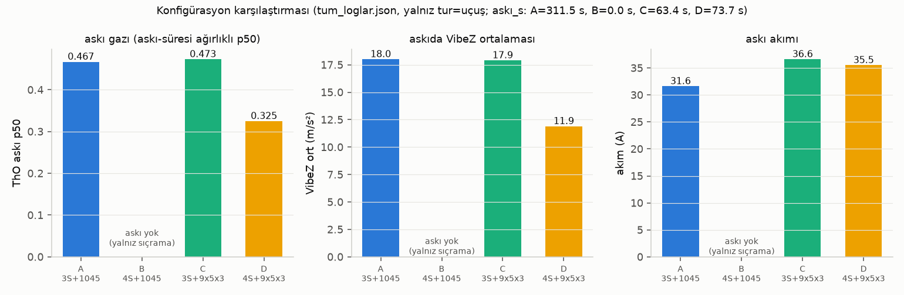
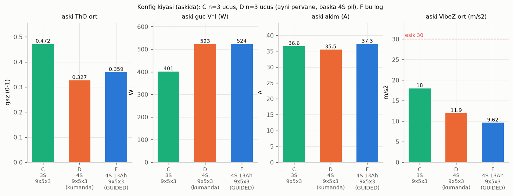
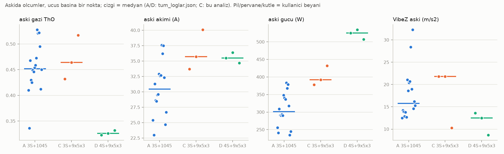
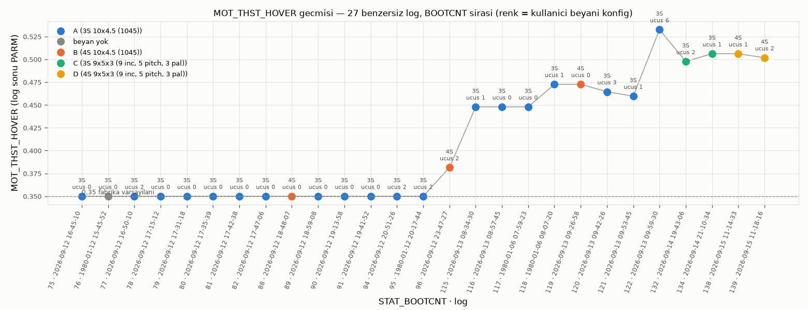

---

## 2. Konfigürasyon yorumları

### A — 3S + 10x4,5 (12–13 Eylül, 20 log)
- **Askı gazı üç grupta farklı:** 12 Eyl 0,426 (25,5 A) → 13 Eyl erken 0,454 (31,0 A) → 13 Eyl geç (`09-59-30` #4–6) 0,520 (37,0 A). `09-59-30` #3 → #4 arasında 5 dk'da askı akımı 32,7 → 37,6 A, CCW−CW +63 → +204 µs (toplam ölçek), VibeZ 19,7 → 27,3, yaw hız RMS 13,9 → 59 °/s **birlikte** sıçradı → fiziksel değişiklik (yük/pervane/montaj) LOGDAN BELİRLENEMEZ, kullanıcıya sorulacak.
- **Pil failsafe 4 kez** (`08-34-30` #2, `1980-01-06 08-07-20` #2, `09-42-26` #3, `09-53-45` #1): arm'dan 22–30 s sonra, 128–203 mAh kullanılmışken V 9,73–9,85 V (BATT_LOW_VOLT 10 V, 10 s zamanlayıcı). Sebep kapasite değil **sarkma**: askıda 0,49 V/hücre, paket R 0,033–0,044 Ω. 12 Eyl kısa sıçramalarda V_min 5,9 V (**1,97 V/hücre**, I maks 116,9 A).
- **Titreşim en yüksek grup:** askı VibeZ havuz 17,2 (p95 34,2, maks 59,5); clip 135 (`16-50-10` #2: 72). 13 Eyl geç uçuşlarda AccZ tepeleri 9,8–12,3 Hz (0,10–0,22 m/s²).
- **EKF/olay yükü ağır:** uçuşta 2 lane switch (`16-50-10` #2, `09-59-30` #5) ve 1 "Potential Thrust Loss (3)" (`16-50-10` t=383,2); uçuş pencereleri dışında 7 EKF varyans failsafe (`19-41-52` ×3, `08-34-30` ×4) ve 9 GPS glitch ERR. Pusula 13 Eyl 09:52'de kalibre edildi (COMPASS_OFS değişti); sonrasında (`09-59-30` #5) 1 lane switch daha.
- MOT_THST_HOVER 0,35 → 0,533: öğrenme yalnız 13 Eyl'de 49 s aktif oldu (12 Eyl 0 s); son değer 0,533 `09-59-30` #4–6'nın yüksek gaz durumundan.

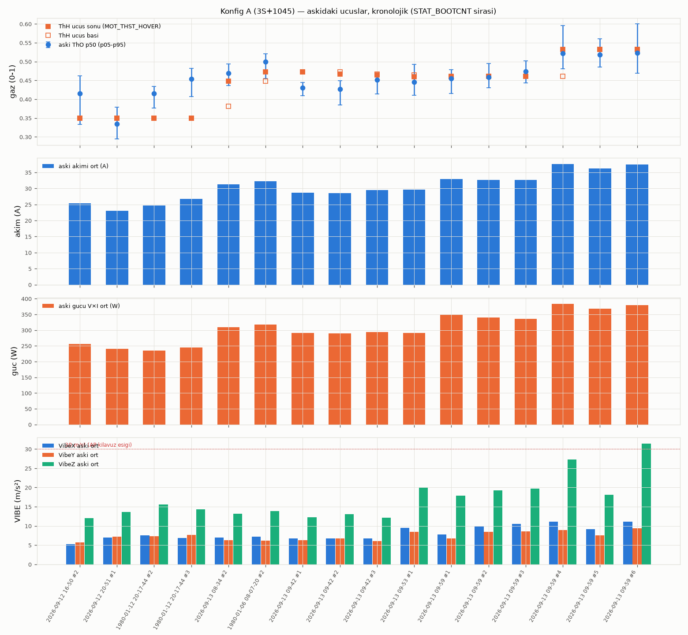
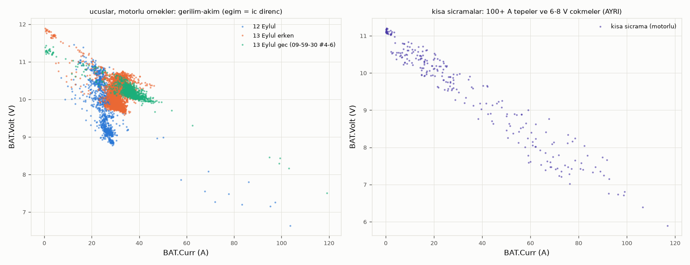

### B — 4S + 10x4,5 (13 Eylül 09-26-58; "aşırı titredi")
- **Gerçek uçuş yok:** 6 kısa sıçrama (0,9–4,2 s, toplam 15,8 s, alt maks 1,30 m) + 1 yalnız-arm; askı ölçütü hiçbir pencerede sağlanmadı → askı gazı/akımı/süresi **ölçülemez**. `18-48-07` yalnız pil takılı yer kaydı (MP motor testi ×29), `23-47-27` pervanesiz motor testi (I ≤ 9,2 A, 3× radyo FS).
- **"Aşırı titreme" = ~4 Hz roll/pitch kontrol salınımı:** LOIT sıçramaları #1/#3/#5 havada roll hız RMS hatası 82,0 / 108,8 / 113,4 °/s (pencere "havada" maskesi; yer/hava ayrımı alt > 0,2 m ile 84,2 / 104,7 / 115,2 — ≤ %4 fark), |R| maks 148 / 310 / 256 °/s, ROut maks 0,46 / **1,01** / 0,71 (doyum); GyrX FFT tepesi 3,84 / 3,60 / 4,09 Hz, 1,54 / 2,02 / 1,66 rad/s (genlik kısa pencere seçimine ±%10 duyarlı; frekans ve 3S'e oran sağlam). Aynı gün, aynı pervane, aynı PID ile 3S kalkış (`1980-01-06 08-07-20`, boot 118): 7,9 °/s, ROut 0,066, tepe 0,074 rad/s @1,2 Hz → 4S'te **20–27×**.
- **Sebep zinciri (ölçüm + çıkarım):** MOT_THST_HOVER 0,4726 (3S'ten taşındı) 4S hava vekili 0,24'ün ~1,9 katı; ATC_RAT_RLL/PIT_P 0,135 (varsayılan) 4S itki kazancıyla (~V², ×1,78) doyuma girdi. Kalkışta 0,73 m/s ile 1,30 m sıçrama (LOIT #1).
- VIBE sıçrama havuzu (motorlu) IMU0 Z ort 27,1 p95 46,4 maks 59,8; havada 33,7 vs yerde 21,6; clip +10. Salınım **havada da sürdü** → yer teması tek açıklama değil.
- BATT_VOLT_MULT log içinde 18,7267 → 17,9415 (t=387–390 s); #4→#5 arasındaki 0,70 V "düşüşü" bu kalibrasyondur.

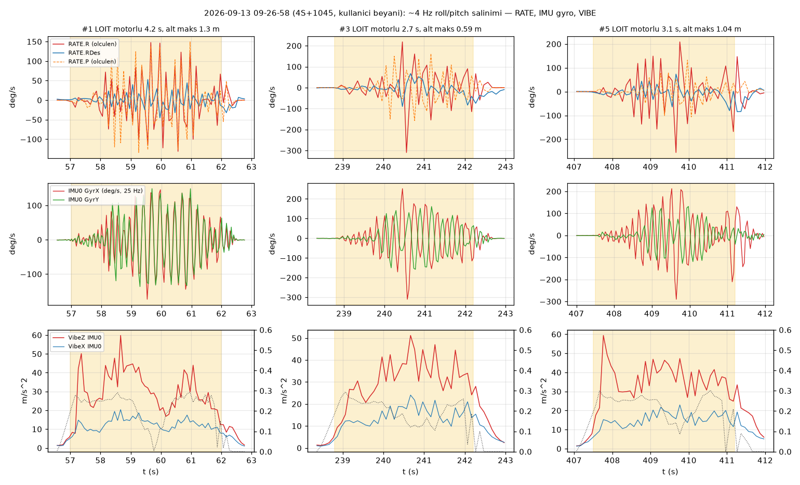
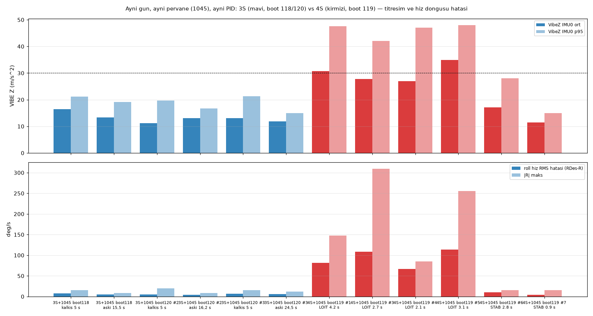

### C — 3S + 9x5x3 (14 Eylül 19-43-06 ×2, 21-10-34 ×1)
- **Askı gazı 0,43 → 0,47 → 0,52, akım 33,7 → 35,7 → 40,1 A**, güç 378 → 392 → 432 W: aynı pervanede A ile aynı gaz (0,47), ama akım A'dan +5 A (36,6 vs 31,6) ve güç +%26 (401 vs 319 W). Kütle logda yok → neden ayrıştırılamaz.
- **Sarkma 0,39 / 0,46 / 0,54 V/hücre** (pencere başı → min, A/D ile aynı tanım; dinlenme → min ile 0,44 / 0,47 / 0,54); `21-10-34` #2'de V_min 10,51 V (3,50 V/hücre @46,6 A), BATT_LOW 10 V'a marj 0,51 V → 3S ile pil failsafe riski sürüyor.
- **VIBE iki log arasında çok farklı:** `19-43-06` (mp68) askı X 14–15, Z 21 (p95 25–28) → `21-10-34` (mp69) X 4,1, Z 10,1 (p95 15,0). Arada 1,5 saat; motor yayılımı da 121/116 → 31 µs'ye düştü (M1 %93 → %30 en yüksek). Ne değişti LOGDAN BELİRLENEMEZ (kullanıcıya sorulacak).
- MOT_THST_HOVER 0,533 → 0,506: öğrenme ancak ≥ ~10 s kesintisiz ölü-bant koşusundan sonra başlıyor (ilk aktif gecikme 9,6 / 9,9 / 9,7 s ölçüldü); toplam aktif 2,3 / 4,9 / 1,0 s → tam yakınsama için ~21 s daha askı gerekiyordu.
- Uçuş içinde ERR yok. Yaw: pilot yaw komutları ile yaw hatası ±33/42° (`21-10-34` #2), YOut p95 0,32.

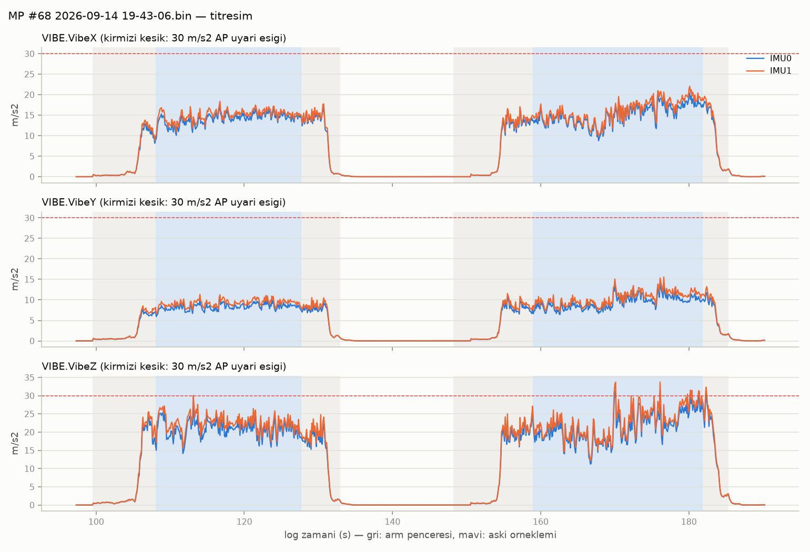
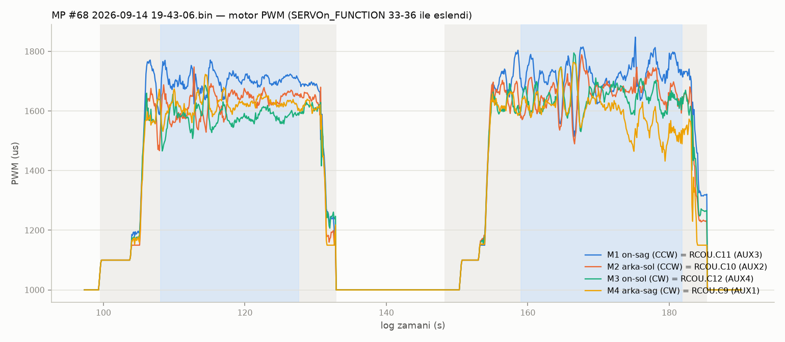

### D — 4S + 9x5x3 (15 Eylül 11-14-33, 11-18-16)
- **`11-14-33` uçuş İÇERİR** (ilk tarama "uçuş yok" demişti: ARM/EV10 kaydı yok, ama MODE STAB t=86,7 + EV57 + RCOU 1000→1100→1550 + FLTTIME +44 s) → 43,5 s motorlu, 34,6 s askı; D'nin en uzun askısı.
- **Askı gazı 0,325** (n=737): aynı pervanede 3S'e (C 0,473) göre **%31 düşük**; akım 35,5 A ≈ C (36,6), güç 523 W (+%30, gerilim 14,72 V).
- **MOT_THST_HOVER 0,506 GEÇERSİZ** (+%55): 3 uçuşta da öğrenme engellendi — `is_zero(PSCD.DVD)` sağlanmadı; `11-14-33`'te gaz çubuğu ort 1613 µs (ölü bölge üstü 1597), ölü bölge içi %0 → sürekli +0,10 m/s tırmanma isteği. STAB'da çubuk ortası 0,506 gaz = askının 1,56 katı → sert tırmanma riski.
- **VIBE askıda en düşük grup:** Z 11,6 (p95 16,3, maks 22,2), X/Y 4,5/4,3; clip 0. Clip 19 ve VibeZ 55,8 **yalnız** `11-18-16` pencere 3 kısa sıçramasında (t=128,63 yer çarpması: gaz 0,39 → 0,07, CRt −123 cm/s) → askı istatistiğine katılmadı.
- **Motor dengesi:** M1 (ön-sağ) hep en yüksek, M3 (ön-sol) hep en düşük; CCW−CW +53 / +43 / **+145** µs (toplam ölçek; aynı ölçekte A `09-59-30` #4/#6 +204/+319 ve C mp68 +124/+129 daha büyük, C mp69 +50); uçuş 4'te yaw çubuğu ortada iken yaw hatası 17,5°, YDes p90 42 °/s; sağ−sol +50/+40/+54, ön−arka −9/−21/−47.
- Parametre uyumsuzlukları: BATT_LOW/CRT_VOLT 10/9 V (= 2,50/2,25 V/hücre @4S → failsafe fiilen kapalı), BATT_CAPACITY 8000 (3S pil), MOT_BAT_VOLT_MAX/MIN 0 (telafi kapalı; askı içi dThO/dV −0,12…−0,27 1/V ölçüldü ama yükle karışık, bkz. §5.2).

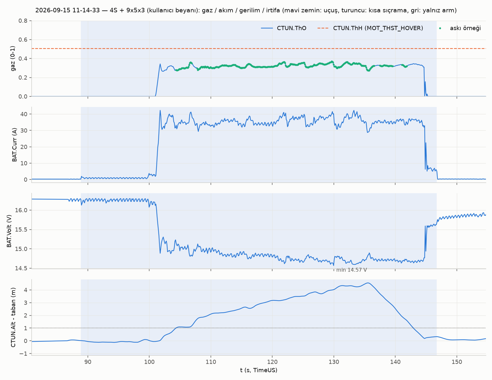
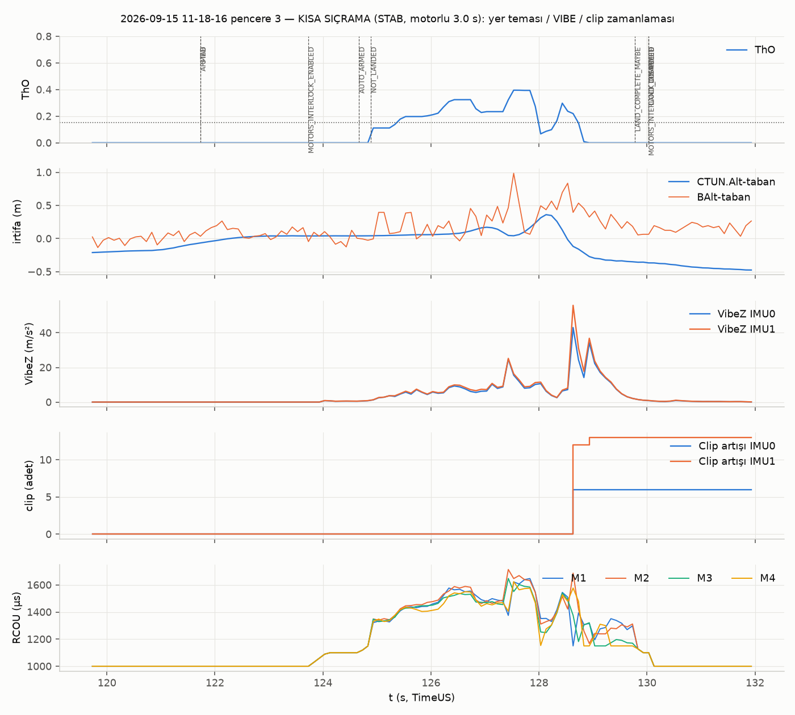
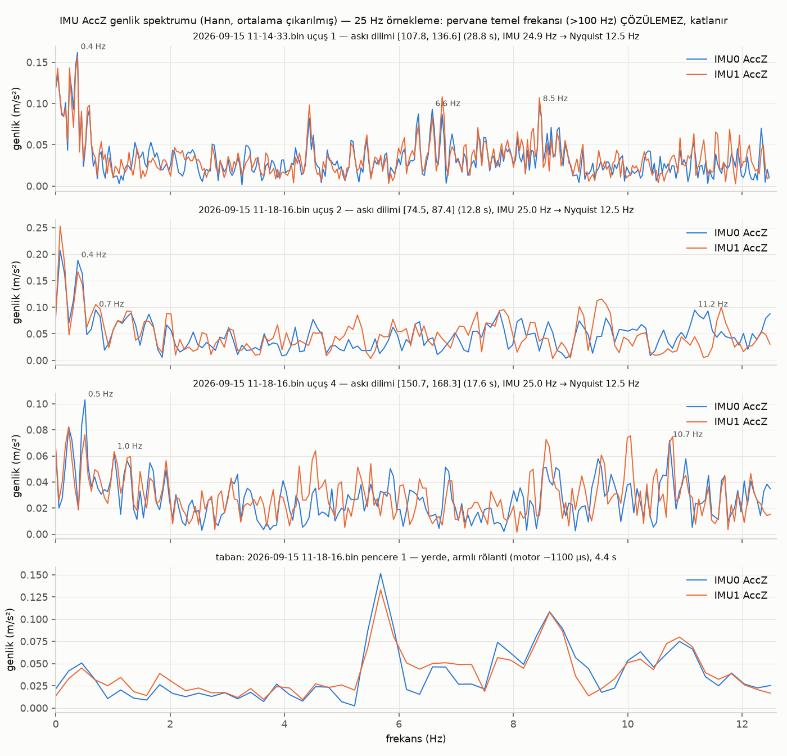

### F — 4S 13 Ah + 9x5x3, kodla GUIDED (15 Eylül 13-11-32; referans)
- 62,9 s askı (~3 m), ThO 0,360, 37,3 A, 524 W, VibeZ 9,3 (p95 12,2), clip 0, tutum RMS 1,04/0,84°, uçuş içinde ERR yok. Pil 3,89 V/hücre ile başladı (dolu değil), min 3,457 V/hücre.
- 0,2–0,4 Hz kapalı çevrim **yaw salınımı** (RMS 5,44°, maks 16°, DesYaw sabit): GyrZ FFT'de 0,38 Hz baskın (0,11 rad/s), ama yaw **açı hatası** FFT'sinde 0,15–0,18 Hz (3,2–3,4°) 0,36–0,40 Hz'den (2,4–2,7°) büyük; açı hatası gücünün %53'ü 0,1–0,25 Hz, %35'i 0,25–0,5 Hz bandında; sıfır geçiş sıklığı ~0,26 Hz.
- Ham V < 14,0 V toplam 37,3 s, en uzun 11,9 s > BATT_LOW_TIMER 10 s → "LOW 14,0 V ham" eşiği bu (dolu olmayan) pille LAND tetiklerdi; VoltR (sarkma telafili) min 15,01 V.

---

## 3. B ve D titreşiminin A ve C ile ADİL kıyası

| Kıyas ekseni | B (4S+1045) | D (4S+9x5x3) | A / C tabanı | Sonuç |
|---|---|---|---|---|
| Örneklem türü | yalnız **kısa sıçrama** (≤ 4,2 s, alt ≤ 1,30 m, yer teması karışık) | 73,7 s **askı** (+ 1 sıçrama ayrı) | A 312 s askı; C 63 s askı | B ile askı kıyası **yapılamaz**; D ile yapılır |
| Aynı türle kıyas | A'nın 12 Eyl kısa sıçramaları: VibeZ ort 11,0, p95 23,8, maks 43,9, clip 15, V_min 1,97 V/hücre | D sıçrama p3: VibeZ maks 55,8, clip 19 (yer çarpması) | — | Sıçramalar her konfigde 40–60 m/s² tepe veriyor; **sıçrama konfige mal edilmez** |
| Gaz farkı | ThO vekili 0,24 (askı gazının ~yarısı), ama I 36 A (tırmanış + salınım) | ThO 0,325 (C 0,473'ün %69'u); I 35,5 A ≈ C | A 0,467 / 31,6 A; C 0,473 / 36,6 A | B'de "gazla" değil kontrol salınımıyla akım; D'de düşük PWM oranı (~0,55) ile VIBE düştü, neden-sonuç için hızlı IMU gerekir |
| Öğrenilmemiş ThH | 0,4726 (3S) → ~1,9× → ALTHOLD/LOIT ileri besleme yanlış, kalkışta 0,73 m/s sıçrama | 0,506 (3S) → +%55; LOIT'te kalkış/askı yine sağlandı (ThO 0,30–0,36), STAB'da sert tırmanma | A/C: ThH kendi askısına yakın (fark ≤ 0,08) | B'nin salınımına ThH yanlışlığı **katkıda**; D'de aynı yanlışlık salınım üretmedi (aynı 4S, farklı pervane) |
| Kontrol salınımı | roll hız RMS 82–113 °/s, ROut doyum 1,0, GyrX 3,6–4,1 Hz 1,5–2,0 rad/s | roll hız RMS 6,7–13,0 °/s, doyum 0 | 3S+1045 kalkış 7,9 °/s | B "titreşimi" **PID/itki-kazancı salınımıdır**, pervane titreşimi değil (25 Hz IMU ile pervane katkısı dışlanamaz) |
| VIBE Z IMU0 (ort / p95) | 27,1 / 46,4 (sıçrama havuzu) | **11,6 / 16,3** | A 17,2 / 34,2; C 21,0–21,1 / 24,7–27,7 (mp68), 10,1 / 15,0 (mp69) | D, A'dan ve C-mp68'den **düşük**, C-mp69 ile aynı; B kıyaslanamaz |
| Clip | +10 | uçuş 0 | A 135 (uçuş), C 0 | D temiz |

**Adil hüküm:** (1) B'nin "aşırı titremesi" 4S+1045 kombinasyonunda **kontrol salınımı** (yanlış ThH + 4S itki kazancıyla varsayılan RAT_P'nin doyması); askı hiç kurulamadığı için pervane titreşimi ölçülmedi. (2) D'nin askı titreşimi dört konfigürasyon içinde **en düşük**; D'nin yüksek tepe/clip değerleri tek bir yer çarpmasına aittir. (3) A ve C-mp68'in yüksek VIBE'i 3S'e mi, pervaneye mi, yoksa o günkü fiziksel duruma mı (A `09-59-30` #3→#4 sıçraması; C mp68→mp69 düşüşü) bağlı, **logdan ayrıştırılamaz**.

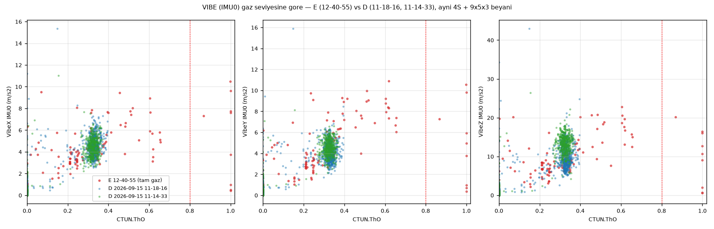

---

## 4. E logu (15 Eylül 12-40-55, tam gaz) — "titreşim yok ama kol sallantısı"

**Uçuş:** 4S (15,60 V, 3,90 V/hücre) + 9x5x3 (beyan); STAB, tek pencere 13,7 s, motorlu 9,4 s; t=130,2 gaz 1002 → 2000 µs; ThO > 0,8 **0,9 s** (130,34–131,14), gerçek tam güç 0,4–0,5 s; irtifa 0 → 8,00 m (t=135,3), CRt tepe 5,19 m/s; LAND (RC) t=137,4; askı örneği 2 → askı istatistiği yok. Akım tepe **115,0 A**, V_min 12,36 V (3,09 V/hücre), sarkma 3,18 V, güç 1421 W. ERR yok, EKF < 0,35, MOTB FailFlags 2 (dengeli), ThLimit 1,0.

| Kullanıcı gözlemi | Kanıt | Hüküm |
|---|---|---|
| "Tam gazda titreşim olmadı" | VIBE Z gaz bandına göre: 0,15–0,25 → 6,6; 0,25–0,50 → 10,1 (D askısı 10,0); 0,50–0,75 → 16,5 (manevra anı); **0,90–1,00 → 8,5** (X/Y 5,1/4,6); clip 0; 2–12,5 Hz gyro bant RMS E 0,132/0,069 vs D askı 0,133/0,087 rad/s; kayan 1 s GyrX 4–12,5 Hz tam gaz vuruşunda 4,1–4,8 °/s (yüksek anlar 133,4–134,2 yaw/roll çubuğu, 137,2–138,2 LAND frenleme, 139,8–140,0 yer teması) | **DOĞRULANDI** — VIBE gazla artmıyor, pervane/balans genişbant titreşimi için kanıt yok |
| "Gayet hızlıydı" | 0,9 s tam gazda +1,32 m, tepe tırmanma 5,19 m/s, 5 s'de 8 m | DOĞRULANDI |
| "Kollarda sallantı var" | Kol eğilme/gevşeklik modları tipik 15–40 Hz → IMU 25 Hz (Nyquist 12,5), ATT/RATE 10 Hz ile **GÖRÜLEMEZ**; PIDR/PIDP yok (LOG_BITMASK bit12 kapalı) | Log **ne doğrular ne çürütür** |
| Dolaylı statik kanıt (mekanik/CG lehine) | M4 (arka-sağ) motorlu +31 µs, LAND sakin +27 (en yüksek), tam gazda **tek doyan motor** (1949 µs, örneklerin %44–56'sı; diğerleri 7–55 µs altta); sağ−sol +38 (LAND +22), ön−arka −38 (LAND −60) → D ile **aynı yön** (+41/+53/+50; −21/−47/−8). Tam gaz vuruşunda çubuk ortada (C1 1499) iken roll 1,6 → **5,0° sağa**, ROut −0,09. Yaw dengesi D'de +CCW (+39…+145) iken E sakin dilimde −24 µs → 11:18–12:40 arasında yaw torku değişmiş görünüyor (zayıf: 1,4 s iniş dilimi) | Sağ-arka yönünde tutarlı **statik itki/ağırlık dengesizliği VAR**; "gevşek/eğik kol" ile de "ağırlık merkezi kayması" ile de uyumlu, log ayıramaz |
| Ayar (PID) hipotezi | Kendiliğinden salınım yok (roll/pitch hata FFT 0,4–1,4 Hz = pilot bandı; sıfır geçiş 0,66/0,61 Hz); RATE doyma 0; karıştırıcı tutarlılığı korr 0,98; motor komutu bağımsız sapmıyor | **Ayar sorunu için kanıt YOK** |

**Hüküm:** BELİRSİZ, ağırlık **mekanik/CG** tarafında: (1) pervane/balans titreşimi yok, (2) PID salınımı yok, (3) sağ-arka (M4) statik dengesizlik D ve E'de tutarlı, (4) yaw dengesi D → E değişmiş olabilir. Kesin ölçüm için INS_LOG_BAT_MASK=1 (+ PID logu) ile 20 s askı logu gerekir.

**Uçuştan önce yer kontrol listesi (uçuş DEĞİL):**
1. **Kol cıvataları / tork:** dört kolu elle burarak ve kaldırarak gevşeklik; önce **M4 (arka-sağ)**, sonra M1 (ön-sağ; 6 Eylül "M1 hasarlı" notu). Gövde-kol ve kol-motor bağlantılarında tork işareti.
2. **Motor montajı ve eksen dikliği:** her motorun mili gövde düzlemine dik mi (M4 başta); montaj vidaları; yatak boşluğu/ses (elle çevir).
3. **Pervane:** dördü de aynı 9x5x3 mü (beyan; logda yok), somun torku, çatlak; balans (VIBE düşük olduğu için titreşim kanıtı yok, ama sağ-arka itki farkı pervane eşitsizliğinden de gelebilir).
4. **Ağırlık merkezi:** pil/yük yerleşimi; sağ-arka ağırlık → M4 yükü. Askıda sağ−sol +42 µs (F), +38 (E), ön−arka −60 (E LAND).
5. **FC sönümleyici/montaj:** vidalar, sönümleyici ped, kablo gerginliği (VIBE düşük → sönümleyici bozukluğu kanıtı yok; rutin kontrol).
6. **ESC/motor kabloları ve konnektörler** (M4 hattı öncelikli).
7. **GPS/pusula direği ve kablo** (13 Eyl'de pusula kalibrasyonu yapıldı; EKF olayı 4S loglarında yok).

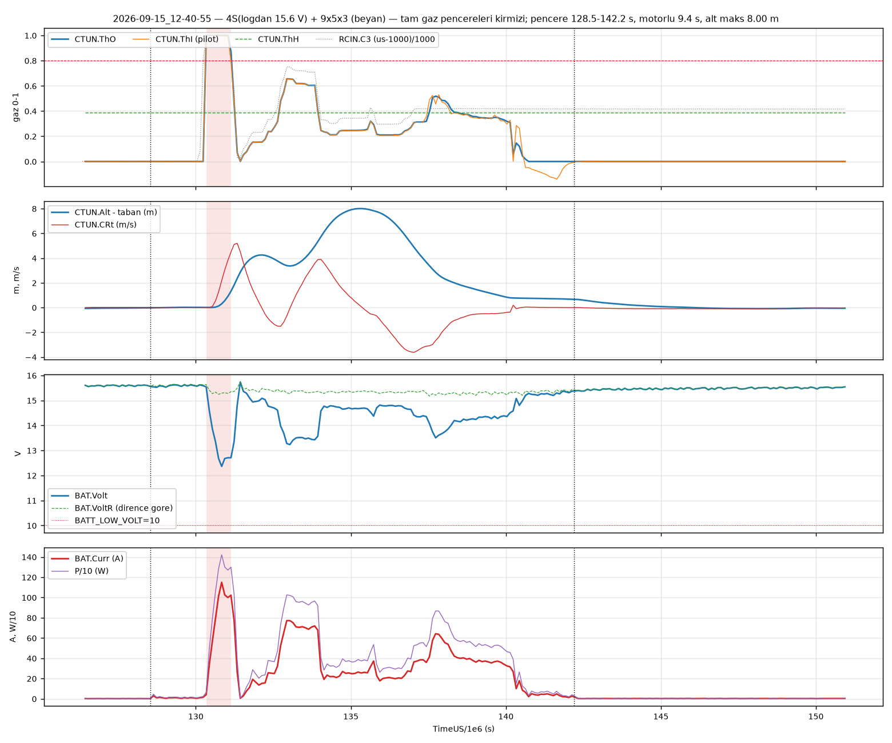
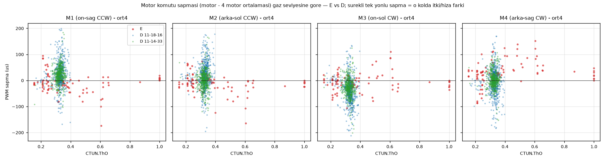
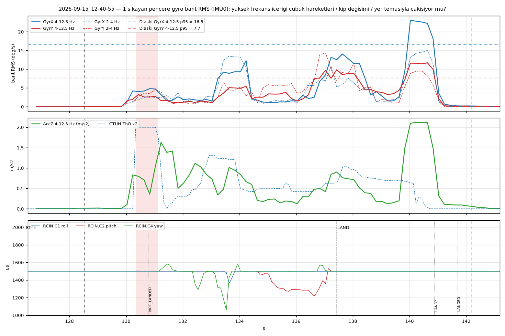

---

## 5. 21 EYLÜL ÖNERİSİ

### 5.1 Pil + pervane: **4S 13 000 mAh + 9x5x3** (F konfigürasyonu)

| Gerekçe | Sayı |
|---|---|
| İtki payı | Askı gazı 4S+9x5x3 **0,325 (D) / 0,360 (F)** vs 3S 0,467 (A) / 0,473 (C); E'de 0,9 s tam gazla 5,19 m/s tırmanma, 5 s'de 8 m |
| Titreşim | Askı VibeZ IMU0 ort **11,6 (D) / 9,3 (F)** vs 17,2 (A) / 21,0–21,1 (C mp68) — ama C mp69'da 10,1 (= D düzeyi): titreşim 4S lehine **tek başına ayırt edici değil**; p95 16,3 / 12,2 vs 34,2 (A havuz); clip 0 (D, F) vs 135 (A) |
| Tutum | F roll/pitch RMS 1,04/0,84°, hız halkası 6,9/5,4 °/s vs A 1,53/1,37°, 9,3/8,5 °/s; doyum yok |
| Pil dayanımı | 3S 8 Ah (A): **4 pil failsafe 22–30 s'de** (sarkma 0,49 V/hücre askıda, kısa sıçramada 1,97 V/hücre; R 0,033–0,044 Ω). 3S ile C'de V_min 3,50 V/hücre, LOW'a marj 0,51 V. 4S 13 Ah (F): R 0,0304 Ω, askı 37,3 A → HESAP **16,7 dk** (%80 kural, dolu pil); D paketi 592 mAh/dk (kapasite bilinmiyor) |
| 4S + 1045 NEDEN DEĞİL | B: ~4 Hz kontrol salınımı, roll hız RMS 82–113 °/s, ROut doyum; askı hiç kurulamadı |
| 3S + 9x5x3 NEDEN DEĞİL | C: 3S ile 36,6 A / 401 W, sarkma 0,39–0,54 V/hücre, V_min 3,50 V/hücre → BATT_LOW 10 V'a marj 0,51 V (pil FS riski; A'da 3S ile 4 kez tetiklendi). Titreşim ayırt edici DEĞİL: mp68 VibeZ 21 / yayılım 116–121 µs ama mp69 10,1 / 31 µs (= D). Asıl ayrım akım, sarkma ve FS marjıdır (§3) |
| Bedel | Güç 523–524 W (3S+1045 319 W'ın +%64'ü) — aynı akımda (35–37 A) daha yüksek gerilim; kütle farkı logda yok (F ThO 0,360 vs D 0,325 = +%9,8, güç +%0,2: pil kütlesi mi paket farkı mı ayrıştırılamaz) |

### 5.2 Parametre önerileri (mevcut değerler logdan; F logu 13-11-32 PARM)

| Parametre | Mevcut | Öneri | Dayanak |
|---|---|---|---|
| `BATT_CAPACITY` | 8000 (3S pilin değeri) | **13000** (F pili beyanı) | RemPct/mAh eşikleri yanlış; beyan tam boşaltma ile doğrulanmadı |
| `BATT_LOW_VOLT` / `BATT_CRT_VOLT` | 10,0 / 9,0 (= 2,50 / 2,25 V/hücre @4S → **failsafe fiilen kapalı**) | **14,0 / 13,2** (3,5 / 3,3 V/hücre) | F: V_min ham 13,83 V; E: 12,36 V @115 A |
| `BATT_FS_VOLTSRC` | 0 (ham) | **1** (sarkma telafili) **veya** LOW'u ham 13,6 V yap | F'de ham V < 14,0 toplam 37,3 s, en uzun 11,9 s > `BATT_LOW_TIMER` 10 s → dolu olmayan pille LAND tetiklerdi; VoltR min 15,01 V (0 s altında). Dolu pil (4,20 V/hücre) ile marj ~1,2 V daha geniş |
| `BATT_ARM_VOLT` | 9,0 (2,25 V/hücre; yarım pille kalkışı engellemez) | **14,4** (3,6 V/hücre; 14,8 daha tutucu) | F 15,57 V ile arm ederdi |
| `BATT_LOW_MAH` / `BATT_CRT_MAH` | 0 / 0 | 3250 / 1950 (HESAP: %25 / %15 × 13 000) — **isteğe bağlı** | `BATT_AMP_PERVLT` 36,36 hiç kalibre edilmedi → mAh mutlak değeri belirsiz; önce şarj-geri-doldurma ile doğrula |
| `MOT_THST_HOVER` | 0,3895 | **Koru**; kabul testinde ≥ 30 s çubuk-ortada askı ile yeniden öğrenmeye izin ver (`MOT_HOVER_LEARN`=2 kalsın). Hedef 0,33–0,38 | F askı 0,360 (+%8,5); D 0,325. Öğrenme ~10 s kesintisiz ölü-bant koşusundan sonra başlar (C: 9,6–9,9 s), her çubuk dokunuşu sayacı sıfırlar; **GUIDED'da öğrenmez** (F uygun 0,0 s) |
| `MOT_BAT_VOLT_MAX` / `MOT_BAT_VOLT_MIN` | 0 / 0 (telafi kapalı) | **16,8 / 13,2** (yalnız 4S uçulacaksa; 3S'e dönülürse 12,6 / 9,9) | Dayanak sarkmanın kendisi: D uçuş içi 1,49–1,61 V (0,37–0,40 V/hücre), E tam gazda 3,18 V → telafi kapalıyken ThH ileri beslemesi gerilimle kayar. **ZAYIF DAYANAK:** D askıda dThO/dV −0,12…−0,27 1/V ölçüldü ama askı içi V aralığı yalnız 0,36–0,56 V, ThO aralığı 0,08–0,13 ve ThO–I korelasyonu (0,73–0,89) ≥ ThO–V (−0,68…−0,79) → eğim yükle karışık; "1,5 V'ta ~0,2 gaz" HESAP, ölçüm değil (D `ozet.json` `dThO_dV_gecerlilik`) |
| `INS_HNTCH_ENABLE` / `INS_HNTCH_*` | 0 | **0 — DEĞİŞTİRME** | Kural: yalnız FFT tepesi varsa. 25 Hz IMU ile pervane temel frekansı (HESAP 114–134 Hz) **çözülemez**; 2–12,5 Hz'deki tepeler küçük (F AccZ 2,19 Hz 0,044 m/s²; D 8,5–11,2 Hz; C mp68 9,7–12,4 Hz 0,15–0,19) ve gövde mi katlanmış pervane mi ayırt edilemez. Kör çentik yok |
| `INS_LOG_BAT_MASK` / `INS_LOG_BAT_OPT` | 0 / 0 | **1 / 0** (ön-filtre ham IMU) — kabul testi uçuşunda | Pervane spektrumu ve "kol sallantısı" (15–40 Hz) ancak böyle görülür; sonra HNTCH kararı (isteğe bağlı `FFT_ENABLE`=1) |
| `LOG_BITMASK` | 176126 (bit12 PID kapalı) | **180222** (+4096, PID) | PIDR/PIDP/PIDY yok → I-terim birikimi (statik tork dengesizliğinin en net göstergesi) görülemiyor |
| `INS_GYRO_FILTER` / `INS_ACCEL_FILTER` | 20 / 20 | **Değiştirme** | Gecikme/salınım kanıtı yok (F hız halkası RMS 6,9/5,4 °/s, doyum 0) |
| `ATC_RAT_RLL/PIT_P,I,D`; `ATC_ANG_*_P` | 0,135 / 0,135 / 0,0036; 4,5 | **21 Eylül öncesi değiştirme** | 4S+9x5x3'te tutum RMS ≤ 1,7°, doyum 0. (4S+1045'te doyuma girdi → o kombinasyon zaten önerilmiyor) |
| `ATC_RAT_YAW_P/I/D` | 0,18 / 0,018 / 0 | **Değiştirme; önce PID logu ile ölç** | F: 0,2–0,4 Hz yaw salınımı (RMS 5,4°, maks 16°); D uçuş 4: yaw hatası 17,5°, CCW−CW +145 µs (toplam ölçek). Kaynak (ayar / 3 pal yaw otoritesi / rüzgar) ayrıştırılamadı; uçuş günü yaw AUTOTUNE yapılmaz |
| `FS_GCS_ENABLE` / `FS_GCS_TIMEOUT` | 5 (Land) / 5 s | Değiştirme; ama telemetri bağı kesilirse **GUIDED'da 5 s sonra LAND** olacağını bil | GCS FS 15 kez tetiklendi (hepsi yerde); F'de arm öncesi "PreArm: GCS failsafe on" |
| `BATT_VOLT_MULT` | 18,388 (17,02–19,53 arası 9 kez değiştirildi) | Multimetre ile bir kez doğrula, sonra sabit tut | Loglar arası mutlak V/P kıyası ±%7 belirsiz |

### 5.3 Kabul testi (21 Eylül sabahı, görevden önce)

**Ön koşul:** §4 yer kontrol listesi tamam; pil dolu (≥ 16,6 V = 4,15 V/hücre); MP motor testi ile sıra/yön (C9=M4, C10=M2, C11=M1, C12=M3); §5.2 parametreleri yazıldı; telemetri bağı kurulu, HDop < 1,0, ≥ 12 uydu.

| Adım | Ne yapılır | Ölçüm (log) | Kabul eşiği (F/D'den türetildi; ArduPilot 30/60) |
|---|---|---|---|
| T1 kumanda askısı | LOITER, ~3 m, **çubuklara dokunmadan ≥ 30 s**, LAND | CTUN.ThO p50; PARM MOT_THST_HOVER değişimi | ThO p50 0,32–0,40; uçuş sonu MOT_THST_HOVER 0,33–0,38 ve \|ThH − ThO p50\| ≤ 0,03 |
| T2 kod askısı | GUIDED kalkış → 3 m → **60 s** askı → LAND (F protokolü) | askı örneklemi ≥ 500 (≥ 50 s) | — |
| Titreşim (T1+T2) | VIBE IMU0 ve IMU1, askı | p95 X,Y ≤ 8; **Z ≤ 16**; maks < 30; clip artışı **0** | F 5,0/5,6/12,2; D 5,9/5,8/16,3 |
| Tutum | ATT Des−gerçek RMS; RATE | roll/pitch ≤ 1,5°; yaw ≤ 6°; hız halkası roll/pitch RMS ≤ 10 °/s; \|ROut\|,\|POut\| p90 ≤ 0,10; doyum (\|out\| ≥ 0,5) 0 | F 1,04/0,84/5,44°, 6,9/5,4 °/s, p90 0,088 |
| Motor dengesi | RCOU C9–C12 askı ort | yayılım ≤ 40 µs; hiçbir motor ≥ 1900 µs; CCW−CW ≤ 60 µs (**toplam ölçek** (M1+M2)−(M3+M4)) | F 29 µs, +16; D +43…+145; C mp69 +50; A 09-59 #4/#6 +204/+319 |
| Pil | BAT askı | I 34–40 A; ham V_min ≥ 14,0 V (dolu pille); sarkma ≤ 0,45 V/hücre; BAT.Res ≤ 0,035 Ω | F 37,3 A, R 0,030 |
| EKF/GPS | XKF4, GPS | SV/SP/SH/SM maks < 0,5; innov > 1 = 0; lane switch 0 | F 0,11/0,02/0,05/0,15 |
| Olaylar | ERR/MODE/MSG | uçuş içinde ERR 0, failsafe 0, "thrust loss"/"crash" 0 | — |
| Hızlı IMU (T2) | ISBH/ISBD (INS_LOG_BAT_MASK=1) | pervane temel/pal-geçiş tepesi görünür mü; 15–40 Hz'de gövde/kol tepesi var mı | Tepe varsa HNTCH kararı; 15–40 Hz belirgin tepe = kol/montaj şüphesi → uçma |

Bir satır kalırsa göreve çıkılmaz; log `scripts/ucus_bin_analiz.py` ile koşulur (RCOU için C9–C12).

---

## 6. Riskler

| Risk | Kanıt | Karşı önlem |
|---|---|---|
| **Gerilim çökmesi tam gazda** | E: 115 A → 3,09 V/hücre (3,90 ile başlayan pil), sarkma 3,18 V, 1421 W. 13 Ah paket R 0,0304 Ω → 115 A'da ~3,5 V sarkma (HESAP): dolu 16,8'den ~13,3 V (CRT 13,2'nin hemen üstü) | Tam gaz darbeleri < 10 s (`BATT_LOW_TIMER`); `BATT_FS_VOLTSRC`=1; görevde tam gaz gerekmiyor |
| **3S'e dönüş** | 3S'te 4 pil FS (22–30 s), kısa sıçramada 1,97 V/hücre | Paket tipiyle birlikte BATT_* ve MOT_BAT_VOLT_* eşikleri değiştirilmeli; iki set parametre dosyası |
| **EKF** | 12–13 Eyl (3S günleri): 7 EKF varyans FS (uçuş dışı) + 1 (14 Eyl `21-10-34`, yerde), uçuşta 2 lane switch, 9 GPS glitch (A); 4S loglarında (D/E/F) 0. D `11-14-33` arm'da HDop 2,18 | HDop < 1,0 olmadan arm etme; EK3_MAG_CAL=3 yaw reset (kalkış +14 s) normaldir; `FS_EKF_ACTION`=1 LAND |
| **Titreşim eşikleri 30/60** | D/F askıda tüm örnekler < 30; sert iniş/yer çarpması 43–56 (klip) | Sert inişten sonra pervane/kol yeniden kontrol; MOT_SPIN_MAX 0,95 |
| **M4 doyumu** | E: tam gazda yalnız M4 1949 µs (%44–56), diğerleri 7–55 µs altta → tam gazda tutum otoritesi azalır (roll +5° çubuk ortada) | Tam gazdan kaçın; §4 mekanik/CG kontrolü; CG sağ-arkadan ortaya |
| **Arming** | `BATT_ARM_VOLT` 9 V yarım pili durdurmaz; "Arm: Throttle too high" (`11-18-16` t=105); "Mode change to STABILIZE failed: throttle too high" (`09-26-58`); "PreArm: GCS failsafe on" (F t=221); "PreArm: High GPS HDOP" (D) | `BATT_ARM_VOLT` 14,4; STAB'da gaz sıfırken arm; telemetri ve GPS arm öncesi hazır |
| **Yanlış MOT_THST_HOVER** | D: 0,506 vs 0,325 → STAB çubuk ortası 1,56× askı; B: ALTHOLD/LOIT ileri besleme yanlış → kalkışta sıçrama | §5.2; T1 ile doğrula |
| **Yaw** | F 0,2–0,4 Hz salınım (maks 16°); D +145 µs statik yaw farkı (toplam ölçek; A'da +319'a kadar görüldü); 3 pal 9" yaw otoritesi düşük | Keskin yaw komutlarından kaçın; PID logu ile ölç |
| **Telemetri / RC kaybı** | GCS FS 15 tetik (yerde), radyo FS "Disarming" 5 kez (kumanda kapatıldı) | GUIDED'da GCS kaybı → 5 s sonra LAND; RC kaybı → `FS_THR_ENABLE`=3 LAND; kumandayı uçuşta kapatma |
| **Mekanik** | "Kol sallantısı" ölçülemedi; M4 sapması; 6 Eylül M1 hasarı; C mp68 → mp69 ve A `09-59-30` #3 → #4 açıklanamayan durum değişimleri | §4 listesi; hızlı IMU logu |

---

## 7. Veri boşluğu

| Eksik | Etkisi | Nasıl kapanır |
|---|---|---|
| **4S kapasitesi (D paketi)** | `BATT_CAPACITY` 8000 = 3S değeri; D uçuş süresi hesaplanamadı (592 mAh/dk ölçüldü) | Etiket/beyan; koşullu HESAP: 4000 → 5,4 dk, 6000 → 8,1 dk, 8000 → 10,8 dk |
| **13 Ah beyanı (F)** | 658 mAh gözlemden ekstrapolasyon 3,2 Ah (alt sınır) … ~11 Ah (kötü koşullu) | Tam boşaltma testi (şarj cihazı geri-doldurma mAh) |
| **Kütle** (hiçbir konfig) | 3S/4S ve pil farkının ThO/güce etkisi ayrıştırılamıyor (F vs D: ThO +%9,8, güç +%0,2) | Tartı: her konfig için kalkış kütlesi |
| **Pervane teyidi** | Logda yok; 4 pervane aynı mı, 1045 2 pal / 9x5x3 3 pal beyan | Uçuş kartına yazılacak; fotoğraf |
| **Motor KV / ESC-RPM telemetrisi** | Pervane frekansı ölçülemez (HESAP 114–134 Hz) | ESC telemetri yoksa hızlı IMU (INS_LOG_BAT_MASK=1) |
| **Hızlı IMU + PID logu** | FFT 12,5 Hz'e kadar; I-terim görünmüyor | `INS_LOG_BAT_MASK`=1, `LOG_BITMASK` 180222 |
| **Boot 140–142 logları** | ~85 s uçuş klasörde yok; MOT_THST_HOVER 0,3895 orada öğrenildi | SD karttan alınmalı |
| **Akım kalibrasyonu** | `BATT_AMP_PERVLT` 36,36 hiç değişmedi → I/mAh mutlak değeri ±? | Bir kez şarj-geri-doldurma ile kalibre |
| **Pil sıcaklığı, rüzgar** | BAT.Temp 0; ortam yok | Uçuş kartı |
| Açıklanamayan durum değişimleri | A `09-59-30` #3→#4 (I +5 A, CCW−CW +63→+204, VibeZ 19,7→27,3); C mp68→mp69 (VibeX 15→4, yayılım 121→31) | Kullanıcıya sorulacak (o aralıkta ne değişti) |

**"14 Eylül parametre sıfırlaması" hipotezi — DESTEKLENMEDİ** (`parametre_zaman_cizgisi.md` §2, §7): default-dışı parametre sayısı 27 logda 106–117 aralığında sabit; STAT_BOOTCNT kesintisiz (122 → 132: 9 logsuz açılış, görünmeyen RUNTIME 25 686 s, FLTTIME 0 s); RC1_MIN 1000, INS_ACCOFFS_X 0,0182, AHRS_TRIM_X −0,0042, COMPASS_OFS_X 6,03 sabit; 13 → 14 Eyl boşluğunda tek kullanıcı değişikliği `BATT_CAPACITY` 6000 → 8000; MOT_THST_HOVER 0,5326 sıfırlanmadan taşındı. Fabrika sıfırlaması bu sayıyı ~0'a, RC*_MIN'i 1100'e, BOOTCNT'yi 0'a çekerdi. Not: `16-45-10` ve `1980-01-12 15-45-52` (boot 75–76, 12 Eyl'in ilk iki logu) BATT_LOW_VOLT 14,4 = 3S pilde tek seferlik kullanıcı değeri (`16-50-10` başında 10'a çekildi; `parametre_zaman_cizgisi.md` §2) — hipotezi etkilemez.
Öğrenme zinciri (14 değişim, hepsi log içi DISARM kaydı): 0,35 → 0,3813 (12 Eyl 23-47 pervanesiz test, geçersiz) → 0,4479 → 0,4726 → 0,4645 → 0,4596 → 0,5326 (13 Eyl) → 0,4977 → 0,5062 (14 Eyl) → 0,5017 (15 Eyl 11-18) → 0,3895 (boot 140–142, logsuz).

---

*Grafikler ilgili alt klasörlerde; tüm sayılar `*/ozet.json` ve `parametre_zaman_cizgisi.md` içindedir. Tekrar üretim: her klasördeki `analiz_*.py` (yorumlayıcı `O:\navitas-local-train\venv\Scripts\python.exe`).*
