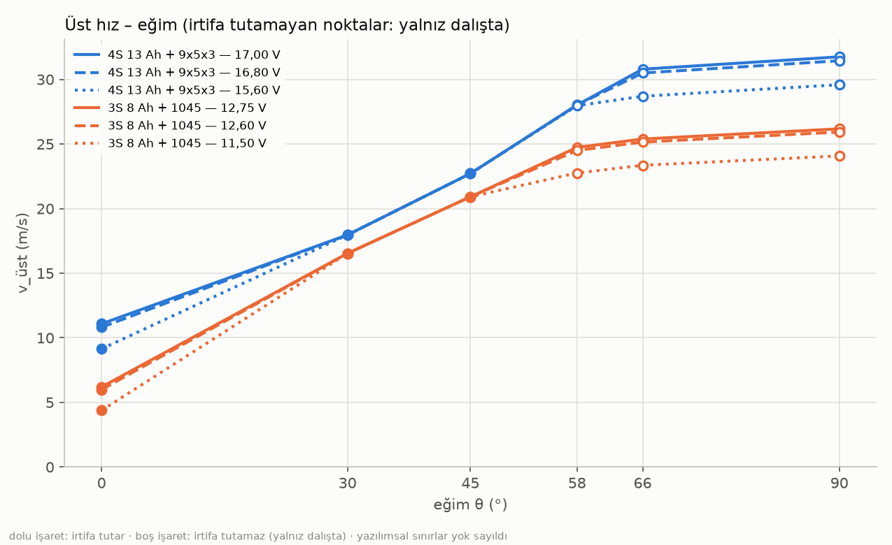
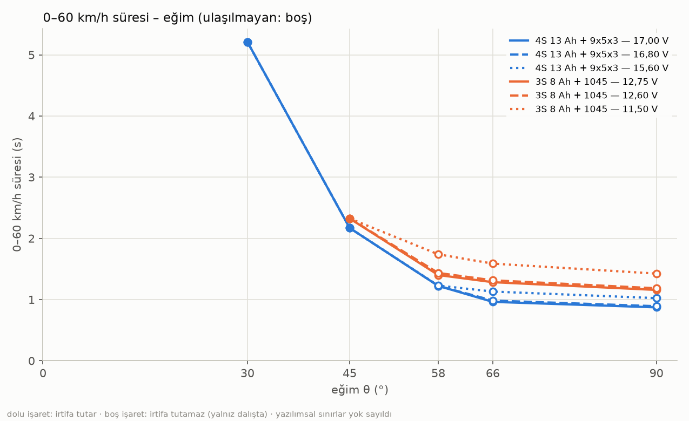
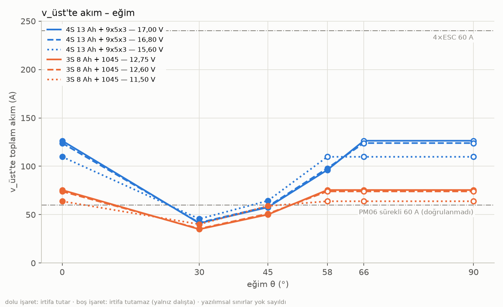

# Performans zarfı — 4S 13 Ah + 9x5x3 ve 3S 8 Ah + 1045 (yazılımsal sınırlar yok sayıldı)

Üretim: 2026-09-16T23:55:28 · betik: `results/ucus_analiz_20260915/performans_zarfi/performans_modeli.py` · numpy 2.3.5 · tüm sayılar betik çıktısıdır (`tablolar.json`).

**Bu bir HESAPTIR, ölçüm değil.** Ölçülen yalnız kalibrasyon noktalarıdır (askı ve 4S tam gaz). Kütle, CdA, ρ ve KV ölçülmedi — parametre olarak alındı ve aşağıda yazılıdır. ANGLE_MAX 30°, LOIT_SPEED 12,5 m/s, WPNAV_SPEED 3 m/s **yok sayıldı** (kullanıcı: "yazılımsal sınırlar kalksaydı").

## 1. Model (denklemler ve kaynakları)

1. **Motor-pervane.** `u_eff = SPIN_MIN + (SPIN_MAX − SPIN_MIN)·a(ThO)`, `a(x) = ((e−1) + √((1−e)² + 4·e·x)) / (2e)`, e = MOT_THST_EXPO = 0,65 (ArduPilot `AP_Motors::thrust_to_actuator`, lift_max = 1). **MOT_THST_EXPO ne yapar:** itkinin PWM ile yaklaşık karesel arttığını telafi etmek için kontrolcünün itki isteğine (ThO) ters/kök bir eğri uygular; böylece ThO'nun yarısı yaklaşık yarı itki verir. Expo'nun PWM yolunda olduğu ölçümle doğrulandı: F logu askıda ölçülen ortalama PWM 1583 µs; expo'lu model 1568 µs, expo'suz 1438 µs (expo'suz haritayla iki 4S ankrajı bağdaşmaz: tam gaz T/W öngörüsü 3,67 olurdu, ölçülen 1,91).
   `RPM_KV = KV·V_yük·u_eff` (yüksüz KV modeli, KV = 980 rpm/V üretici beyanı), `T = k_T·RPM²`, `P_el = k_P·RPM³`, `I = P_el/V_yük` (verim sabit). k_T = W/RPM_askı², k_P = P_askı/RPM_askı³ (askı noktası: T = W).
   **Tam gaz RPM sarkması:** `RPM_TG = s_TG·KV·V_yük·SPIN_MAX`. s_TG 4S tam gaz noktasından (T/W = 1,91 @ 12,36 V) kalibre edilir: yük altında RPM, yüksüz KV ekstrapolasyonunun altında kalır (motor I·R sarkması). 3S+1045 için tam gaz ölçümü YOK → aynı s_TG **aktarıldı** (aynı motor/ESC; belirsizlik notu §2 ve §6).
   Sonuç: `T_max(V_yük) = k_T·(s_TG·KV·V_yük·0,95)²`, `P(T) = k_P·(T/k_T)^1,5` (P ∝ T^1,5, momentum teorisi).
2. **Pil.** `V_yük = V_açık − I·R_paket` (4S 30,4 mΩ, 3S 41,0 mΩ; ölçüm). Tam gazda I = P(V_yük)/V_yük = c·V_yük² olduğundan V_yük ve I **kapalı döngü** çözülür (sönümlü sabit-nokta iterasyonu; ikinci derece kapalı formla doğrulandı). Sabit itkide V² − V_açık·V + R·P = 0, yüksek gerilim kökü; diskriminant < 0 ise paket gücü veremez.
3. **Eğim.** θ = 0: dikey tırmanış, `T(v) = T_max·(1 − v/v_pitch)`, `v_pitch = pitch·RPM_TG/60` (9x5x3: 5″ = 0,127 m; 1045: 4,5″ = 0,1143 m); `m·dv/dt = T(v) − W − ½ρ·CdA(0)·v²`, RK4 (dt = 0,002 s). θ = 30–66°: irtifa sabit düz uçuş, gereken `T = W/cosθ`, yatay kuvvet `W·tanθ`, sürükleme `½ρ·v²·CdA(θ)`, `a0 = g·tanθ`, `v_üst = √(2·W·tanθ / (ρ·CdA(θ)))`, `v(t) = v_üst·tanh(a0·t/v_üst)`, `t(v) = (v_üst/a0)·atanh(v/v_üst)` (RK4 ile çapraz kontrol, azami sapma 0,000 %). T_max < W/cosθ ise **irtifa tutamaz**: tam gazla yatay kuvvet `T_max·sinθ`, düşey ivme `(T_max·cosθ − W)/m` < 0, v_üst "yalnız dalışta"; sürdürülebilir azami eğim `θ_max = acos(W/T_max)`. θ = 90: itki tamamen yatay, yatay ivme T_max/m, düşüş ivmesi g.
   `CdA(θ) = 0,08·(1 + 0,5·sinθ)` m², ρ = 1,15 kg/m³, g = 9,80665 m/s². "Üst hıza süre" = %95·v_üst; 0–60 km/h = 16,67 m/s, 0–100 = 27,78 m/s; ulaşılmıyorsa ✗ (asimptot).
4. **Akım.** v_üst'te (irtifa tutan satırlarda) T = W/cosθ → P(T) → I, V_yük ile birlikte çözülür; tam gaz akımı (ivmelenme başı) 2'deki kapalı döngüden. Kıyas: ESC 60 A/motor sürekli (ad plakası; 80 A tepe veri sayfası doğrulanmadı); PM06 60 A sürekli / 120 A tepe (**veri sayfası doğrulanmadı**, bellekten). Ölçülen 115 A tepe PM06'dan geçti (E logu).
5. **Rüzgar.** O eğimde konum tutabileceği azami rüzgar = v_üst (hava hızı). Ayrıca T_max ile θ_max ve ona karşılık rüzgar (gaz %100, kontrol payı sıfır).
6. **Enerji.** v_üst'te 1 dk: `I_üst·1000/60` mAh; %80 pil ile kalan süre `0,80·C / I_üst · 60` dk (C = beyan kapasite).

İhmal edilenler: ileri uçuşta rotor gücünün değişimi (translational lift / profil gücü), dalışta düşey sürükleme, ESC/motor verim değişimi, pil sıcaklığı ve SoC'ye bağlı R.

## 2. Kalibrasyon (ölçülen ankraj noktaları → model katsayıları)

### 4S 13 Ah + 9x5x3

| büyüklük | değer | kaynak |
|---|---|---|
| kütle | 3,277 kg → W = 32,14 N | TARTI — kullanıcı beyanı 16 Eyl; pil/pervane takılı VARSAYILDI |
| askı ankrajı | ThO 0,360, V_yük 14,00 V, I 37,3 A, P 522 W (64 s) | F_1311_aski_4S_13Ah/ozet.json: ThO_aski_ort 0,3591 / p50 0,3604; I p50; 62,9 s GUIDED askı (13-11-32 logu) |
| u_eff(askı), PWM | 0,568 → 1568 µs (expo'lu); ölçülen ort. PWM 1583 µs | model / F ozet.json `rcou.ort_pwm_orani` |
| RPM_askı (KV modeli) | 7789 rpm | KV·V·u_eff |
| k_T | 5.2964e-07 N/rpm² (motor başına askı itkisi 8,03 N) | W/RPM_askı² |
| k_P | 1.1049e-09 W/rpm³ (motor başına askı gücü 130,5 W) | P_askı/RPM_askı³ |
| tam gaz ankrajı | T/W 1,91 (a 8,93 m/s², alt sınır: hava direnci ihmal), V_yük 12,36 V, I 115 A, RCOU maks 1949 | E_1240_ivme/ozet.json: TW_alt_sinir 1,91 (a 8,934 m/s²); E_1240_tam_gaz/ozet.json: I_maks 115 A, V_min 12,36 V, RCOU M4 maks 1949 |
| T/W_TG yüksüz KV modeli (s_TG = 1) | 2,18 | k_T·(KV·12,36·0,95)²/W — ölçülenden 14,3 % yüksek → sarkma gerekli |
| **s_TG** (RPM sarkma çarpanı) | **0,9355** (c_T = s² = 0,875; RPM_TG model 10765 rpm) | √(T/W_ölçülen / T/W_KV) — ÖLÇÜM (bu konfigin tam gaz noktası) |
| çapraz kontrol: tam gaz güç | model 1378 W / 111,5 A; ölçülen 1421 W / 115 A (sapma -3,0 %) | P ∝ T^1,5 tutarlılığı |
| motor başına tam gaz itkisi | 15,35 N (1,56 kgf) @ 28,8 A/motor | T_max/4 |
| çapraz kontrol: D logu askısı | model T/W 1,01, I 35,8 A; ölçülen I 35,5 A | D_4S_9x5x3 (F ozet.json kıyas bloğu 'D': aski_ThO_ort 0,327, aski_V 14,719, aski_I_A 35,514) |
| R_paket | 30,4 mΩ | F ozet.json ic_direnc.a_kalkis_gecisi (r² 0,995) |
| pil senaryoları V_açık | 17,00 V (fazla dolu 4,25 V/hücre); 16,80 V (dolu 4,20 V/hücre); 15,60 V (F logu başı) | kullanıcı |

### 3S 8 Ah + 1045

| büyüklük | değer | kaynak |
|---|---|---|
| kütle | 2,777 kg → W = 27,23 N | VARSAYIM — 4S tartısı − ~0,5 kg paket farkı; ölçülmedi |
| askı ankrajı | ThO 0,467, V_yük 10,08 V, I 31,6 A, P 319 W (311 s) | A_3S_1045/ozet.json: havuz_ThO ort 0,466 (ThO_motorlu_ort 0,467), havuz_V ort 10,09, havuz_I_A ort 31,6, askida_toplam_s 312,2 (n=3122 örnek, 18 uçuş) |
| u_eff(askı), PWM | 0,646 → 1646 µs (expo'lu); ölçülen ort. PWM havuz değeri yok | model / F ozet.json `rcou.ort_pwm_orani` |
| RPM_askı (KV modeli) | 6382 rpm | KV·V·u_eff |
| k_T | 6.6854e-07 N/rpm² (motor başına askı itkisi 6,81 N) | W/RPM_askı² |
| k_P | 1.2252e-09 W/rpm³ (motor başına askı gücü 79,6 W) | P_askı/RPM_askı³ |
| tam gaz ankrajı | **ÖLÇÜM YOK** | — |
| **s_TG** | **0,9355** (c_T = 0,875) | 4S ölçümünden AKTARILDI (aynı motor/ESC varsayımı) |
| belirsizlik | s_TG = 1 alınsaydı T_max/W (dolu pil) 1,70 yerine 1,79 olurdu; 3S'te tam gaz akımı 4S'ten düşük → sarkma daha az → gerçek değer bu iki sayı arasında |
| R_paket | 41,0 mΩ | A ozet.json R_uydurma_ohm_paket.ort (n=18) |
| pil senaryoları V_açık | 12,75 V (fazla dolu 4,25 V/hücre); 12,60 V (dolu 4,20 V/hücre); 11,50 V (A uçuş başı ort) | kullanıcı |

## 3. Tablo — 4S 13 Ah + 9x5x3

Satırlar: eğim θ × pil senaryosu. "tam gaz A @ V_yük": ivmelenme başı, kapalı döngü çözümü. "v_üst'te A": irtifa tutan satırlarda T = W/cosθ sabit hız akımı; tutamayan satırlarda tam gaz akımı. 0° satırı dikey tırmanıştır (hızlar düşey).

| θ | pil V_açık | gereken T/W | T_max/W | irtifa | a0 m/s² | v_üst m/s (km/h) | %95 v_üst süre | 0–60 km/h | 0–100 km/h | tam gaz A @ V_yük | v_üst'te A | azami rüzgar m/s | 1 dk mAh | %80 pil dk | sınırlayıcı |
|---|---|---|---|---|---|---|---|---|---|---|---|---|---|---|---|
| 0° | 17,00 V fazla dolu 4,25 V/hücre | 1,00 | 2,16 | ✓ | 11,42 | 11,1 (40) | 2,6 s | ✗ (asimptot 40 km/h) | ✗ (asimptot 40 km/h) | 126 @ 13,16 V | 126 | — | 2106 | 4,9 | pitch hızı; akım: tam gaz > PM06 tepe 120 A; v_üst'te > PM06 sürekli 60 A |
| 0° | 16,80 V dolu 4,20 V/hücre | 1,00 | 2,12 | ✓ | 11,01 | 10,8 (39) | 2,7 s | ✗ (asimptot 39 km/h) | ✗ (asimptot 39 km/h) | 124 @ 13,03 V | 124 | — | 2066 | 5,0 | pitch hızı; akım: tam gaz > PM06 tepe 120 A; v_üst'te > PM06 sürekli 60 A |
| 0° | 15,60 V F logu başı | 1,00 | 1,88 | ✓ | 8,63 | 9,1 (33) | 2,9 s | ✗ (asimptot 33 km/h) | ✗ (asimptot 33 km/h) | 110 @ 12,26 V | 110 | — | 1830 | 5,7 | pitch hızı; akım: v_üst'te > PM06 sürekli 60 A |
| 30° | 17,00 V fazla dolu 4,25 V/hücre | 1,15 | 2,16 | ✓ | 5,66 | 18,0 (65) | 5,8 s | 5,2 s | ✗ (asimptot 65 km/h) | 126 @ 13,16 V | 41 | 18,0 | 686 | 15,2 | sürükleme; akım: tam gaz > PM06 tepe 120 A |
| 30° | 16,80 V dolu 4,20 V/hücre | 1,15 | 2,12 | ✓ | 5,66 | 18,0 (65) | 5,8 s | 5,2 s | ✗ (asimptot 65 km/h) | 124 @ 13,03 V | 42 | 18,0 | 695 | 15,0 | sürükleme; akım: tam gaz > PM06 tepe 120 A |
| 30° | 15,60 V F logu başı | 1,15 | 1,88 | ✓ | 5,66 | 18,0 (65) | 5,8 s | 5,2 s | ✗ (asimptot 65 km/h) | 110 @ 12,26 V | 46 | 18,0 | 760 | 13,7 | sürükleme |
| 45° | 17,00 V fazla dolu 4,25 V/hücre | 1,41 | 2,16 | ✓ | 9,81 | 22,7 (82) | 4,2 s | 2,2 s | ✗ (asimptot 82 km/h) | 126 @ 13,16 V | 58 | 22,7 | 960 | 10,8 | sürükleme; akım: tam gaz > PM06 tepe 120 A |
| 45° | 16,80 V dolu 4,20 V/hücre | 1,41 | 2,12 | ✓ | 9,81 | 22,7 (82) | 4,2 s | 2,2 s | ✗ (asimptot 82 km/h) | 124 @ 13,03 V | 58 | 22,7 | 974 | 10,7 | sürükleme; akım: tam gaz > PM06 tepe 120 A |
| 45° | 15,60 V F logu başı | 1,41 | 1,88 | ✓ | 9,81 | 22,7 (82) | 4,2 s | 2,2 s | ✗ (asimptot 82 km/h) | 110 @ 12,26 V | 64 | 22,7 | 1073 | 9,7 | sürükleme; akım: v_üst'te > PM06 sürekli 60 A |
| 58° | 17,00 V fazla dolu 4,25 V/hücre | 1,89 | 2,16 | ✓ | 15,69 | 28,0 (101) | 3,3 s | 1,2 s | 4,9 s | 126 @ 13,16 V | 96 | 28,0 | 1603 | 6,5 | sürükleme; akım: tam gaz > PM06 tepe 120 A; v_üst'te > PM06 sürekli 60 A |
| 58° | 16,80 V dolu 4,20 V/hücre | 1,89 | 2,12 | ✓ | 15,69 | 28,0 (101) | 3,3 s | 1,2 s | 4,9 s | 124 @ 13,03 V | 98 | 28,0 | 1632 | 6,4 | sürükleme; akım: tam gaz > PM06 tepe 120 A; v_üst'te > PM06 sürekli 60 A |
| 58° | 15,60 V F logu başı | 1,89 | 1,88 | ✗ düşüş a_z -0,04 | 15,64 | 28,0 (101) yalnız dalışta | 3,3 s | 1,2 s | 5,1 s | 110 @ 12,26 V | 110 | — | 1830 | 5,7 | itki; akım: v_üst'te > PM06 sürekli 60 A |
| 66° | 17,00 V fazla dolu 4,25 V/hücre | 2,46 | 2,16 | ✗ düşüş a_z -1,17 | 19,39 | 30,8 (111) yalnız dalışta | 2,9 s | 1,0 s | 2,4 s | 126 @ 13,16 V | 126 | — | 2106 | 4,9 | itki; akım: tam gaz > PM06 tepe 120 A; v_üst'te > PM06 sürekli 60 A |
| 66° | 16,80 V dolu 4,20 V/hücre | 2,46 | 2,12 | ✗ düşüş a_z -1,34 | 19,02 | 30,5 (110) yalnız dalışta | 2,9 s | 1,0 s | 2,5 s | 124 @ 13,03 V | 124 | — | 2066 | 5,0 | itki; akım: tam gaz > PM06 tepe 120 A; v_üst'te > PM06 sürekli 60 A |
| 66° | 15,60 V F logu başı | 2,46 | 1,88 | ✗ düşüş a_z -2,31 | 16,84 | 28,7 (103) yalnız dalışta | 3,1 s | 1,1 s | 3,5 s | 110 @ 12,26 V | 110 | — | 1830 | 5,7 | itki; akım: v_üst'te > PM06 sürekli 60 A |
| 90° | 17,00 V fazla dolu 4,25 V/hücre | ∞ | 2,16 | ✗ düşüş a_z -9,81 | 21,23 | 31,8 (114) yalnız dalışta | 2,7 s | 0,9 s | 2,0 s | 126 @ 13,16 V | 126 | — | 2106 | 4,9 | itki; akım: tam gaz > PM06 tepe 120 A; v_üst'te > PM06 sürekli 60 A |
| 90° | 16,80 V dolu 4,20 V/hücre | ∞ | 2,12 | ✗ düşüş a_z -9,81 | 20,82 | 31,4 (113) yalnız dalışta | 2,8 s | 0,9 s | 2,1 s | 124 @ 13,03 V | 124 | — | 2066 | 5,0 | itki; akım: tam gaz > PM06 tepe 120 A; v_üst'te > PM06 sürekli 60 A |
| 90° | 15,60 V F logu başı | ∞ | 1,88 | ✗ düşüş a_z -9,81 | 18,44 | 29,6 (107) yalnız dalışta | 2,9 s | 1,0 s | 2,8 s | 110 @ 12,26 V | 110 | — | 1830 | 5,7 | itki; akım: v_üst'te > PM06 sürekli 60 A |

**Parametreler (4S 13 Ah + 9x5x3):** kütle 3,277 kg (TARTI), W = 32,14 N, CdA(θ) = 0,08·(1 + 0,5·sinθ) m², ρ = 1,15 kg/m³, R_paket = 30,4 mΩ, pervane 9x5x3 (3 pal) (pitch 0,1270 m), KV 980 rpm/V, SPIN_MIN/MAX 0,15/0,95, EXPO 0,65, kapasite 13 Ah (%80 kullanılabilir), kalibrasyon: askı (ThO 0,360, 14,00 V, 37,3 A) → k_T 5.296e-07 N/rpm², k_P 1.105e-09 W/rpm³; s_TG 0,9355 (ÖLÇÜM (bu konfigin tam gaz noktası)).

**Senaryo başına θ_max (T_max ile sürdürülebilir azami eğim) ve o eğimde rüzgar:**

| V_açık | tam gaz V_yük / I | T_max/W | θ_max | rüzgar @ θ_max (m/s, km/h) | v_pitch (0°) |
|---|---|---|---|---|---|
| 17,00 V (fazla dolu 4,25 V/hücre) | 13,16 V / 126 A (31,6 A/motor) | 2,16 | 62,5° | 30,5 (110) | 24,3 m/s |
| 16,80 V (dolu 4,20 V/hücre) | 13,03 V / 124 A (31,0 A/motor) | 2,12 | 61,9° | 30,1 (108) | 24,0 m/s |
| 15,60 V (F logu başı) | 12,26 V / 110 A (27,4 A/motor) | 1,88 | 57,9° | 28,0 (101) | 22,6 m/s |

**Sınırlayıcı etken sütunu:** *sürükleme* = v_üst'ü CdA belirler (itki yeter); *itki* = T_max < W/cosθ, irtifa tutulamaz; *pitch hızı* = dikey tırmanışta pervane pitch hızı sürüklemeden önce sınırlar; *pil (güç aktarımı)* = V_açık² < 4·R·P; *akım* ekleri = ESC/PM06 sınırının aşıldığı yer (PM06 sınırları veri sayfasından doğrulanmadı).

## 4. Tablo — 3S 8 Ah + 1045

Satırlar: eğim θ × pil senaryosu. "tam gaz A @ V_yük": ivmelenme başı, kapalı döngü çözümü. "v_üst'te A": irtifa tutan satırlarda T = W/cosθ sabit hız akımı; tutamayan satırlarda tam gaz akımı. 0° satırı dikey tırmanıştır (hızlar düşey).

| θ | pil V_açık | gereken T/W | T_max/W | irtifa | a0 m/s² | v_üst m/s (km/h) | %95 v_üst süre | 0–60 km/h | 0–100 km/h | tam gaz A @ V_yük | v_üst'te A | azami rüzgar m/s | 1 dk mAh | %80 pil dk | sınırlayıcı |
|---|---|---|---|---|---|---|---|---|---|---|---|---|---|---|---|
| 0° | 12,75 V fazla dolu 4,25 V/hücre | 1,00 | 1,74 | ✓ | 7,22 | 6,2 (22) | 2,4 s | ✗ (asimptot 22 km/h) | ✗ (asimptot 22 km/h) | 75 @ 9,66 V | 75 | — | 1258 | 5,1 | pitch hızı; akım: v_üst'te > PM06 sürekli 60 A |
| 0° | 12,60 V dolu 4,20 V/hücre | 1,00 | 1,70 | ✓ | 6,90 | 6,0 (22) | 2,5 s | ✗ (asimptot 22 km/h) | ✗ (asimptot 22 km/h) | 74 @ 9,56 V | 74 | — | 1234 | 5,2 | pitch hızı; akım: v_üst'te > PM06 sürekli 60 A |
| 0° | 11,50 V A uçuş başı ort | 1,00 | 1,47 | ✓ | 4,60 | 4,4 (16) | 2,7 s | ✗ (asimptot 16 km/h) | ✗ (asimptot 16 km/h) | 64 @ 8,88 V | 64 | — | 1064 | 6,0 | pitch hızı; akım: v_üst'te > PM06 sürekli 60 A |
| 30° | 12,75 V fazla dolu 4,25 V/hücre | 1,15 | 1,74 | ✓ | 5,66 | 16,5 (60) | 5,3 s | ✗ (asimptot 60 km/h) | ✗ (asimptot 60 km/h) | 75 @ 9,66 V | 35 | 16,5 | 582 | 11,0 | sürükleme |
| 30° | 12,60 V dolu 4,20 V/hücre | 1,15 | 1,70 | ✓ | 5,66 | 16,5 (60) | 5,3 s | ✗ (asimptot 60 km/h) | ✗ (asimptot 60 km/h) | 74 @ 9,56 V | 35 | 16,5 | 591 | 10,8 | sürükleme |
| 30° | 11,50 V A uçuş başı ort | 1,15 | 1,47 | ✓ | 5,66 | 16,5 (60) | 5,3 s | ✗ (asimptot 60 km/h) | ✗ (asimptot 60 km/h) | 64 @ 8,88 V | 40 | 16,5 | 668 | 9,6 | sürükleme |
| 45° | 12,75 V fazla dolu 4,25 V/hücre | 1,41 | 1,74 | ✓ | 9,81 | 20,9 (75) | 3,9 s | 2,3 s | ✗ (asimptot 75 km/h) | 75 @ 9,66 V | 50 | 20,9 | 835 | 7,7 | sürükleme |
| 45° | 12,60 V dolu 4,20 V/hücre | 1,41 | 1,70 | ✓ | 9,81 | 20,9 (75) | 3,9 s | 2,3 s | ✗ (asimptot 75 km/h) | 74 @ 9,56 V | 51 | 20,9 | 849 | 7,5 | sürükleme |
| 45° | 11,50 V A uçuş başı ort | 1,41 | 1,47 | ✓ | 9,81 | 20,9 (75) | 3,9 s | 2,3 s | ✗ (asimptot 75 km/h) | 64 @ 8,88 V | 59 | 20,9 | 983 | 6,5 | sürükleme |
| 58° | 12,75 V fazla dolu 4,25 V/hücre | 1,89 | 1,74 | ✗ düşüş a_z -0,78 | 14,44 | 24,7 (89) yalnız dalışta | 3,1 s | 1,4 s | ✗ (asimptot 89 km/h) | 75 @ 9,66 V | 75 | — | 1258 | 5,1 | itki; akım: v_üst'te > PM06 sürekli 60 A |
| 58° | 12,60 V dolu 4,20 V/hücre | 1,89 | 1,70 | ✗ düşüş a_z -0,95 | 14,17 | 24,5 (88) yalnız dalışta | 3,2 s | 1,4 s | ✗ (asimptot 88 km/h) | 74 @ 9,56 V | 74 | — | 1234 | 5,2 | itki; akım: v_üst'te > PM06 sürekli 60 A |
| 58° | 11,50 V A uçuş başı ort | 1,89 | 1,47 | ✗ düşüş a_z -2,17 | 12,22 | 22,8 (82) yalnız dalışta | 3,4 s | 1,7 s | ✗ (asimptot 82 km/h) | 64 @ 8,88 V | 64 | — | 1064 | 6,0 | itki; akım: v_üst'te > PM06 sürekli 60 A |
| 66° | 12,75 V fazla dolu 4,25 V/hücre | 2,46 | 1,74 | ✗ düşüş a_z -2,88 | 15,55 | 25,4 (91) yalnız dalışta | 3,0 s | 1,3 s | ✗ (asimptot 91 km/h) | 75 @ 9,66 V | 75 | — | 1258 | 5,1 | itki; akım: v_üst'te > PM06 sürekli 60 A |
| 66° | 12,60 V dolu 4,20 V/hücre | 2,46 | 1,70 | ✗ düşüş a_z -3,01 | 15,26 | 25,1 (91) yalnız dalışta | 3,0 s | 1,3 s | ✗ (asimptot 91 km/h) | 74 @ 9,56 V | 74 | — | 1234 | 5,2 | itki; akım: v_üst'te > PM06 sürekli 60 A |
| 66° | 11,50 V A uçuş başı ort | 2,46 | 1,47 | ✗ düşüş a_z -3,95 | 13,16 | 23,4 (84) yalnız dalışta | 3,3 s | 1,6 s | ✗ (asimptot 84 km/h) | 64 @ 8,88 V | 64 | — | 1064 | 6,0 | itki; akım: v_üst'te > PM06 sürekli 60 A |
| 90° | 12,75 V fazla dolu 4,25 V/hücre | ∞ | 1,74 | ✗ düşüş a_z -9,81 | 17,03 | 26,2 (94) yalnız dalışta | 2,8 s | 1,2 s | ✗ (asimptot 94 km/h) | 75 @ 9,66 V | 75 | — | 1258 | 5,1 | itki; akım: v_üst'te > PM06 sürekli 60 A |
| 90° | 12,60 V dolu 4,20 V/hücre | ∞ | 1,70 | ✗ düşüş a_z -9,81 | 16,71 | 25,9 (93) yalnız dalışta | 2,8 s | 1,2 s | ✗ (asimptot 93 km/h) | 74 @ 9,56 V | 74 | — | 1234 | 5,2 | itki; akım: v_üst'te > PM06 sürekli 60 A |
| 90° | 11,50 V A uçuş başı ort | ∞ | 1,47 | ✗ düşüş a_z -9,81 | 14,41 | 24,1 (87) yalnız dalışta | 3,1 s | 1,4 s | ✗ (asimptot 87 km/h) | 64 @ 8,88 V | 64 | — | 1064 | 6,0 | itki; akım: v_üst'te > PM06 sürekli 60 A |

**Parametreler (3S 8 Ah + 1045):** kütle 2,777 kg (VARSAYIM), W = 27,23 N, CdA(θ) = 0,08·(1 + 0,5·sinθ) m², ρ = 1,15 kg/m³, R_paket = 41,0 mΩ, pervane 10x4.5 (1045, 2 pal) (pitch 0,1143 m), KV 980 rpm/V, SPIN_MIN/MAX 0,15/0,95, EXPO 0,65, kapasite 8 Ah (%80 kullanılabilir), kalibrasyon: askı (ThO 0,467, 10,08 V, 31,6 A) → k_T 6.685e-07 N/rpm², k_P 1.225e-09 W/rpm³; s_TG 0,9355 (4S ölçümünden AKTARILDI (aynı motor/ESC varsayımı)).

**Senaryo başına θ_max (T_max ile sürdürülebilir azami eğim) ve o eğimde rüzgar:**

| V_açık | tam gaz V_yük / I | T_max/W | θ_max | rüzgar @ θ_max (m/s, km/h) | v_pitch (0°) |
|---|---|---|---|---|---|
| 12,75 V (fazla dolu 4,25 V/hücre) | 9,66 V / 75 A (18,9 A/motor) | 1,74 | 54,8° | 24,4 (88) | 16,0 m/s |
| 12,60 V (dolu 4,20 V/hücre) | 9,56 V / 74 A (18,5 A/motor) | 1,70 | 54,1° | 24,1 (87) | 15,9 m/s |
| 11,50 V (A uçuş başı ort) | 8,88 V / 64 A (16,0 A/motor) | 1,47 | 47,1° | 21,6 (78) | 14,7 m/s |

**Sınırlayıcı etken sütunu:** *sürükleme* = v_üst'ü CdA belirler (itki yeter); *itki* = T_max < W/cosθ, irtifa tutulamaz; *pitch hızı* = dikey tırmanışta pervane pitch hızı sürüklemeden önce sınırlar; *pil (güç aktarımı)* = V_açık² < 4·R·P; *akım* ekleri = ESC/PM06 sınırının aşıldığı yer (PM06 sınırları veri sayfasından doğrulanmadı).

## 5. Grafikler (iki konfig üst üste; çizgi tipi = pil senaryosu; boş işaret = irtifa tutamaz)

## 6. Uyarılar ve varsayımlar

- Kütle: 4S 3,277 kg TARTI (kullanıcı beyanı 16 Eyl; pil/pervane takılı VARSAYILDI, uçuş logları anındaki kütleyle aynılığı DOĞRULANMADI), 3S 2,777 kg VARSAYIM. T/W ölçümü kütleden bağımsızdır; Newton cinsinden itki, ivme (a0 = g·(T/W−1) hariç), v_üst (√W ile) ve enerji kütleyle ölçeklenir.
- 4S T/W = 1,91 hava direnci ihmal edilmiş ALT SINIRDIR (E_1240_ivme/ozet.json: ivme tepesi t0+0,5 s'de hız ≈ 2,2 m/s → sürükleme ½ρ·CdA(0)·v² = 0,22 N = W'nin %0,7'i; tepe hız 5,20 m/s'de 1,24 N = %3,9). Tablolar bu alt sınıra kalibre olduğundan itki türevli sayılar (T_max/W, θ_max, a0) da alt sınırdır.
- MODEL SAPMASI (görev tanımına göre): görev tanımı u_eff = SPIN_MIN + (SPIN_MAX − SPIN_MIN)·ThO (expo'suz) der; bu haritayla iki 4S ankrajı BAĞDAŞMAZ (askı ThO 0,36 → u_eff 0,438, tam gaz u_eff 0,95: T/W_TG = (12,36·0,95/(14,0·0,438))² = 3,67, ölçülen 1,91) ve F logunda ölçülen askı PWM'i (1583 µs) expo'suz haritanın (1438 µs) değil expo'lu haritanın (1568 µs) yanındadır. Bu yüzden ArduPilot'un gerçek ThO→PWM eğrisi (MOT_THST_EXPO 0,65) kullanıldı ve tam gaz ankrajı bir RPM sarkma çarpanıyla (s_TG = 0,9355) sağlandı. k_T ve k_P askı noktasından, s_TG tam gaz noktasından: iki ankraj da BİREBİR sağlanır; tam gaz gücü bağımsız çapraz kontroldür (model 111,5 A, ölçülen 115 A).
- 3S + 1045 için TAM GAZ ÖLÇÜMÜ YOK: T_max, 4S'ten aktarılan RPM sarkma çarpanı s_TG = 0,9355 ile askı noktasından ekstrapolasyondur; s_TG = 1 üst sınırı §2'de verildi. 1045 2 pal ve 9x5x3 3 pal farklı pervanelerdir — k_T/k_P her biri kendi askısından, sarkma ortak varsayıldı.
- Model RPM ∝ V_yük·u_eff (yüksüz KV) varsayar; sarkma tek çarpanla yalnız tam gazda düzeltildi. Kısmi gazda (v_üst'te akım) P ∝ T^1,5 zinciri kullanıldığından RPM haritası devreye girmez; tam gazda 4S için 12,36 V civarında doğru, uzak V_yük'te belirsiz.
- v_pitch modeli T(v) = T_max·(1 − v/v_pitch) doğrusal bir basitleştirmedir; gerçek pervanenin ileri hızda itki düşüşü ve tırmanışta güç değişimi ölçülmedi. Dikey tırmanış akımı tam gaz akımı olarak alındı (üst sınır).
- İrtifa tutamayan satırlarda (T_max < W/cosθ ve θ = 90°) 'v_üst' yalnız yatay bileşendir ve araç düşmektedir (a_z sütunda); pratikte anlamı 'o eğimde yatay asimptot', uçuş rejimi değil.
- PM06 sürekli/tepe akım sınırları (60/120 A) veri sayfasından DOĞRULANMADI; ESC 80 A tepe de doğrulanmadı. Yalnız 60 A/motor ad plakası kesindir. Ölçülen 115 A tepe PM06'dan geçti (E logu, 0,7 s).
- R_paket sabit alındı (4S 30,4 mΩ F logu kalkış geçişinde 0–37 A aralığında uyduruldu, 115 A'ya ekstrapolasyon; 3S 41,0 mΩ A havuzu 18 uçuş ortalaması, p05–p95 19,8–75,4 mΩ). E logunda V_arm 15,54 V → 115 A'da model V_yük 12,04 V, ölçülen 12,36 V (sapma -2,6 %).
- İleri uçuşta rotor gücü (translational lift, profil gücü), dalış sürüklemesi, ESC/motor verim değişimi ve pil sıcaklığı ihmal edildi; 'v_üst'te akım' askı verimiyle hesaplanır.
- CdA = 0,08·(1 + 0,5·sinθ) m² ve ρ = 1,15 kg/m³ VARSAYIM; v_üst ∝ 1/√CdA — CdA %25 büyürse v_üst %11 düşer.
- Bütün yazılımsal sınırlar (ANGLE_MAX 30°, LOIT_SPEED 12,5 m/s, WPNAV_SPEED 3 m/s, PSC_* ivme sınırları) yok sayıldı; tablolar donanım zarfıdır, uçulabilir zarf değil.
